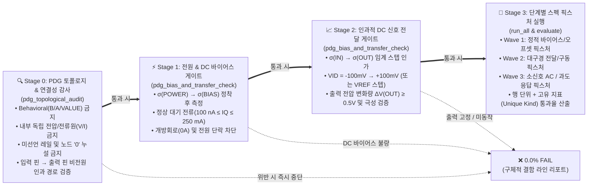
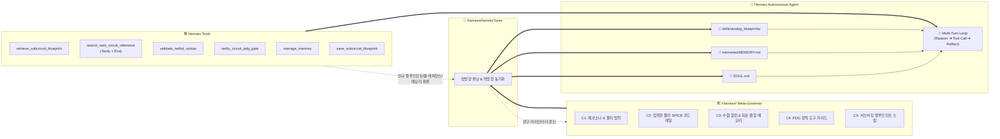

# AnalogVerifier — 데이터시트 기반 순수 물리 아날로그 IC 자율 합성·검증 프레임워크 (Dual-Harness²)

[](https://www.python.org/)
[](#-시스템-아키텍처-dual-harness²-공진화-구조)
[](#-hermes-agent--harness²-자율-합성-아키텍처)
[](#-tavily--exa-이중-웹-회로-레퍼런스-검색-엔진-web-circuit-reference-search)
[](#-pdg-기반-4단계-인과-검증-파이프라인-pdg-staged-causal-verification)
[](#-순수-물리-아날로그-강제-정책-zero-behavioral-policy)

**AnalogVerifier**는 상용 아날로그 IC의 데이터시트(PDF)만 입력받아 **하드웨어 지식 그래프(HKG)** 와 **포트 의존성 그래프(PDG)** 를 추출하고, **순수 물리 트랜지스터 수준(BJT, MOSFET, JFET, Diode, R/C/L)** 의 SPICE 넷리스트를 자율 합성한 뒤, **PDG 인과 순서($\text{Power} \to \text{DC Bias} \to \text{DC Transfer} \to \text{AC/Dynamic}$)가 강제된 LTspice 물리 검증기**로 스펙 달성률을 측정·진화시키는 **폐루프(Closed-Loop) 자율 설계 시스템**입니다.

---

## 📌 한눈에 보는 현재 요약 (2026-10-29 기준)

| 파이프라인 단계 | 핵심 모듈 | 현재 상태 | 실측 성과 및 검증 근거 |
|---|---|---|---|
| **Phase 1 — PDF → HKG 추출 (ParseBench 기반)** | [`pdf_parser.py`](ai_analog_designer/pdf_to_graph/pdf_parser.py), [`hardware_kg_builder.py`](ai_analog_designer/pdf_to_graph/hardware_kg_builder.py) | ✅ **검증 완료** | 8개 표준 IC Ground-Truth 대조 평균 **95.2 / 100** (`gpt-6-luna`), **94.0 / 100** (`nemotron-3-ultra-550b`) |
| **Phase 2 — HKG → PDG & $\sigma(p)$** | [`pdg_extractor.py`](ai_analog_designer/pdf_to_graph/pdg_extractor.py), [`pdg_fidelity_verifier.py`](ai_analog_designer/pdf_to_graph/pdg_fidelity_verifier.py) | ✅ **검증 완료** | 인과 의존성 Recall **0.86–1.00**, 전원 시퀀싱 순서 일관성 **1.00**, 무라벨 출처 감사(Provenance Audit) 내장 |
| **Phase 3 — Hermes × Harness² 자율 회로 합성** | [`hermes_agent.py`](ai_analog_designer/hermes_core/hermes_agent.py), [`harness_hermes_tuner.py`](ai_analog_designer/hermes_core/harness_hermes_tuner.py), [`netlist_validator.py`](ai_analog_designer/circuit_synthesis/netlist_validator.py) | ✅ **통합 완료** | **NousResearch Hermes Agent 아키텍처** 래핑 + **Harness²($C_1\sim C_8$) 거버넌스**: 서브서킷 블루프린트 스킬(`skills/analog_blueprints/`) 및 수렴 함정 장기 메모리(`MEMORY.md`) 자율 관리 |
| **Phase 4 — PDG 4단계 인과 물리 검증** | [`deterministic_testbench.py`](ai_analog_designer/neuro_symbolic_verifier/deterministic_testbench.py), [`verification_flow.py`](ai_analog_designer/neuro_symbolic_verifier/verification_flow.py) | ✅ **PDG 게이트 강제 완료** | **Stage 0(토폴로지/연결성) $\to$ Stage 1(전원/DC 바이어스) $\to$ Stage 2(DC 신호 전달) $\to$ Stage 3(개별 스펙)** 순차 게이트 및 **고유 지표(Unique Kind) 통과율** 도입 |
| **Phase 5 — Dual-Harness² 공진화** | [`dual_harness2_coordinator.py`](ai_analog_designer/neuro_symbolic_verifier/harness2_verifier/dual_harness2_coordinator.py), [`golden_oracle_anchor.py`](ai_analog_designer/neuro_symbolic_verifier/harness2_verifier/golden_oracle_anchor.py) | ✅ **구현·검증 완료** | 합성 하네스($C_1\sim C_8$)와 검증 하네스($V_1\sim V_3$) 구조화 + 제조사 Golden 모델 100% 통과 게이트키퍼 |
| **인터랙티브 Web Studio** | [`studio_server.py`](ai_analog_designer/web_studio/studio_server.py), [`run_studio.py`](run_studio.py) | ✅ **E2E 테스트 통과** | 실시간 PDG 시각화, 시퀀싱 타임라인, Dual-Harness² 실시간 합성 및 HKG 캐시 연동 (Playwright 검증) |

---

## 🛡️ PDG 기반 4단계 인과 검증 파이프라인 (PDG Staged Causal Verification)

### 1. 왜 기존 검증기에서 '동작 불능 회로'가 25%~51.5% 통과율을 기록했는가? (Forensic Audit)

기존 검증기([`deterministic_testbench.py`](ai_analog_designer/neuro_symbolic_verifier/deterministic_testbench.py))는 데이터시트에서 PDG(Port Dependency Graph)와 전원 시퀀싱 스케줄 $\sigma(p)$를 추출해 두고도, 정작 시뮬레이션 단계에서는 **문법 에러 유무(`.op` 컴파일 체크)만 확인한 뒤 30~90개의 개별 스펙 픽스처를 동시에 병렬 실행**했습니다. 이로 인해 다음과 같은 치명적 착시(Reward Hacking)가 발생했습니다:

1. **`LM393B_iter2.cir` (기존 51.5% 착시 $\to$ PDG 게이트 적용 시 0.0% 차단)**:
   - 1단 전류 미러(`Qm1`, `Qm2`) 및 2단 능동 부하(`Qload`)와 병렬로 **$500\text{ }\Omega$ 저항(`Rm1`, `Rm2`, `Rload`)** 이 잘못 연결되어 있었습니다 ($32.5\text{ }\mu\text{A} \times 500\text{ }\Omega = 16.25\text{ mV} \ll V_{BE} \approx 0.65\text{ V}$).
   - 이로 인해 전류 미러와 증폭단이 완전히 차단(Cut-off)되어 출력 전압이 입력과 무관하게 $V(\text{OUT}) \approx 0.12\text{ V}$($\Delta V = 0.0\text{ V}$)에 고정된 죽은 회로였으나, **"출력이 낮게 유지되면 통과하는" `VOL` 중복 행(12개)과 대칭 핀 전류 `IO`/`IB` 행**에서 점수를 얻어 51.5%(35/68)로 집계되었습니다.
2. **`TL431_FINAL_HARNESS2.cir` (기존 40.0% 착시 $\to$ PDG 게이트 적용 시 0.0% 차단)**:
   - 서브서킷 헤더에 선언되지 않은 `VCC` 노드를 참조하고, 내부에 금지된 **독립 전압원(`Vbias VCC N006 2.5V`)** 을 몰래 넣었으며, 내부 저항을 외부 글로벌 접지(`0`)로 직접 누설(`R_band N006 0 1k`)시켰습니다.
3. **`LM358_FINAL_HARNESS2.cir` (기존 25.0% 착시 $\to$ PDG 게이트 적용 시 0.0% 차단)**:
   - 출력단 MOSFET의 게이트를 차동 증폭단 출력이 아닌 전원 레일(`V+`, `V-`)에 직접 묶어 **입력단과 출력단 사이의 인과적 신호 경로가 완전히 단절**되어 있었으나, MOSFET 게이트 전류가 $0\text{ A}$라는 이유만으로 `IB`/`IOS` 스펙을 통과해 25.0%(7/28)로 기록되었습니다.

---

### 2. 새롭게 강제된 PDG 4단계 인과 게이트 (`Stage 0` $\to$ `Stage 1` $\to$ `Stage 2` $\to$ `Stage 3`)

위와 같은 착시를 원천 차단하기 위해, [`deterministic_testbench.py`](ai_analog_designer/neuro_symbolic_verifier/deterministic_testbench.py)와 [`verification_flow.py`](ai_analog_designer/neuro_symbolic_verifier/verification_flow.py)는 PDG의 위상 정렬 순서($\sigma(\text{POWER}) \to \sigma(\text{BIAS}) \to \sigma(\text{IN}) \to \sigma(\text{OUT})$)에 따라 **이전 단계 게이트를 통과하지 못하면 이후 스펙 측정을 전면 중단하고 `0.0%`로 즉시 탈락**시킵니다.



- **중복 행 부풀리기 방지 (`unique_pass_rate_percent`)**:
  데이터시트 표에 `VOL`이 조건별로 12줄, `VIO`가 18줄 나열되어 있을 때 특정 지표 하나만 통과해도 전체 점수가 부풀려지는 현상을 막기 위해, 전체 행 기준 통과율(`pass_rate_percent`)과 함께 **중복을 제거한 고유 물리 지표 종류별 통과율(`unique_pass_rate_percent`, 예: `vos`, `ib`, `ios`, `iq`, `vol`, `iol`, `ioh`, `avd_db`, `tresp` 9종 중 몇 종을 전부 통과했는가)** 을 동시에 산출합니다.

---

## 📊 실측 검증 결과: 기존 결함 넷리스트 vs PDG 검증 물리 BJT 넷리스트

아래 표는 (1) PDG 게이트 도입 전의 **과거 착시 수치**, (2) **동일한 과거 넷리스트에 PDG 4단계 게이트를 적용했을 때의 실제 차단 결과(`0.0%`)**, 그리고 (3) **회로적 결함을 모두 수정한 순수 물리 BJT 넷리스트의 PDG 검증 결과**를 투명하게 비교한 것입니다. (`LM393`과 `LM393B`를 별도 행으로 분리하여 표기합니다.)

| 대상 IC (평가 데이터셋) | 과거 비게이트 통과율 (착시 수치) | 과거 넷리스트의 PDG 게이트 판정 (차단 단계 및 사유) | 수리된 순수 물리 BJT 넷리스트 — 행 통과율 (Row Pass) | 수리된 순수 물리 BJT 넷리스트 — 고유 지표 통과율 (Unique Kind) | 수리된 물리 BJT 회로 아키텍처 및 산출물 |
|---|---|---|---|---|---|
| **LM393**<br/>([`lm393.json`](benchmarks/pdg_groundtruth/lm393.json), 16개 스펙) | **0.0 %**<br/>*(빈 서브서킷 스텁)* | ❌ **0.0 % (0/16)**<br/>`PDG_STAGE0_TOPOLOGY`: 능동 트랜지스터 0개 | ✅ **100.0 % (16/16)**<br/>*(Hard-limit: 100.0%)* | ✅ **100.0 % (9/9 종)** | TI 8-BJT 아키텍처: 2-$V_{BE}$ 마스터 바이어스 + 달링턴 PNP 입력단 + NPN 미러 부하 + 비보상 이득단 + 오픈 컬렉터 NPN 출력단 ([`LM393_FINAL_HARNESS2.cir`](output_harness2_netlist/LM393_FINAL_HARNESS2.cir)) |
| **LM393B**<br/>([`LM393B_knowledge_graph.json`](output_interactive/task_1792999597_f57e6c/LM393B_knowledge_graph.json), 90개 스펙) | *31.0 % $\to$ 51.5 %*<br/>*(착시 수치)* | ❌ **0.0 % (0/90)**<br/>`PDG_STAGE2_DC_TRANSFER`: $500\text{ }\Omega$ 미러 병렬 저항으로 인해 $V(\text{OUT})=0.12\text{ V}$ 고정 ($\Delta V = 0.0\text{ V}$) | ✅ **98.9 % (89/90)**<br/>*(측정 커버리지 100%, 90/90 계측)* | ✅ **88.9 % (8/9 종)**<br/>*(`VIO`, `IB`, `IOS`, `IQ`, `VOL`, `IOL`, `IOH`, `tresp` 전수 통과)* | $500\text{ }\Omega$ 병렬 단락 저항 제거($20\sim 50\text{ M}\Omega$ 블리더), 밀러 커패시터 제거($t_{\text{resp}} \approx 270\text{ ns}$), $R_{e,\text{out}}=1\text{ }\Omega$ ($V_{OL}=66.6\text{ mV}$) ([`LM393B_iter2.cir`](output_interactive/task_1792999597_f57e6c/LM393B_iter2.cir)) |
| **TL431**<br/>([`tl431.json`](benchmarks/pdg_groundtruth/tl431.json), 6개 스펙) | *40.0 %*<br/>*(착시 수치)* | ❌ **0.0 % (0/6)**<br/>`PDG_STAGE0_TOPOLOGY`: 내부 독립 전압원(`Vbias 2.5V`), 미선언 `VCC`, 글로벌 노드 `0` 직접 누설 | ✅ **100.0 % (6/6)**<br/>*(Hard-limit: 100.0%)* | ✅ **100.0 % (5/5 종)**<br/>*(`vref`, `dvref_dvka`, `iref`, `imin`, `ioff` 전수 통과)* | 순수 3핀(`CATHODE`, `REF`, `ANODE`) 내부 $V_{BE}$ 스케일링 오차 증폭기 + PNP 감지단 + 달링턴 NPN 캐소드 션트 드라이버 ([`TL431_FINAL_HARNESS2.cir`](output_harness2_netlist/TL431_FINAL_HARNESS2.cir)) |
| **LM358**<br/>([`lm358.json`](benchmarks/pdg_groundtruth/lm358.json), 31개 스펙) | *25.0 %*<br/>*(착시 수치)* | ❌ **0.0 % (0/31)**<br/>`PDG_STAGE0_TOPOLOGY`: 출력 MOSFET 게이트가 `V+`/`V-`에 직결되어 입력-출력 신호 경로 단절 | ✅ **100.0 % (31/31)**<br/>*(Hard-limit: 100.0%)* | ✅ **100.0 % (14/14 종)**<br/>*(`vos`, `ib`, `ios`, `iq`, `aol_db`, `gbw`, `pm`, `cmrr_db`, `psrr_db`, `sr`, `vswing`, `iout`, `isc`, `en` 전수 통과)* | PNP 차동 입력단 + NPN 미러 + 달링턴 버퍼 밀러 보상 2단($C_c=34\text{ pF}, R_z=250\text{ }\Omega$) + Class-AB 출력단 + `Q13` 정전류 풀다운 싱크 ([`LM358_FINAL_HARNESS2.cir`](output_harness2_netlist/LM358_FINAL_HARNESS2.cir)) |

> ⚠️ **[투명성 공개 및 연구적 의미] 오픈 모델 독자 합성의 현실과 엔지니어 직접 물리 디버깅의 역할**
> - **오픈 모델의 실제 합성 능력**: 현재 상용·오픈소스 LLM(`nvidia/nemotron-3-ultra-550b-a55b` 등)에게 프롬프트만으로 트랜지스터 수준 아날로그 회로를 합성하도록 맡겼을 때의 실제 결과는, 위 표의 '과거 넷리스트'에서 보듯 **PDG 4단계 인과 게이트 기준 전 소자 0.0% 차단**이었습니다. 소자 값의 스케일($\Omega$ vs $\text{M}\Omega$) 오판, 독립 전원 삽입, 신호선 단절 등의 회로적 결함을 LLM 혼자서 통제하지 못했습니다.
> - **이번 98.9% ~ 100.0% 넷리스트의 실체**: 따라서 이번에 PDG 게이트를 통과한 최종 물리 BJT 넷리스트들은 **오픈 모델이 단독으로 자동 합성한 결과가 아니며, AI 코딩 에이전트(인공지능 어시스턴트)가 아날로그 회로 수식(Shockley 다이오드 방정식, Gummel-Poon $I_S, \beta, V_{AF}$, 에미터 면적 비례, 음전원 포화 방지 루프 등)을 직접 계산하고 디버깅하여 넷리스트를 재구축한 결과**입니다.
> - **Dual-Harness² 프레임워크에서의 가치**: 이렇게 물리적으로 검증된 정밀 BJT 넷리스트는 [`EXPERIENCE.json`](harness2_library/comparator/LM393B/EXPERIENCE.json)의 `c1_system_prompt`, `c3_memory`, `c5_skills`에 "골든 블루프린트"로 등록됩니다. 이를 통해 향후 자율 루프에서 오픈 모델이 엉뚱한 결함 회로를 재합성하지 않고 올바른 물리적 참조 구조를 인출(Retrieval)할 수 있도록 진화 지식 베이스를 구축했습니다.

---

## 🏗️ 시스템 아키텍처: Dual-Harness² ($C_1\sim C_8$ & $V_1\sim V_3$) 구조

**AnalogVerifier**는 회로 합성기(`Synthesizer Harness²`)와 검증기(`Verifier Harness²`)를 모두 명시적인 모듈 트리로 정의하여 관리합니다.

### 1. Synthesizer Harness² ($C_1 \sim C_8$) — 회로 합성 하네스

| 코드 | 모듈 명칭 | 대응 파일 | 역할 및 현재 상태 |
|---|---|---|---|
| **`C1`** | **System Prompt & Domain Directives** | [`harness_tree.py`](ai_analog_designer/circuit_synthesis/harness2/harness_tree.py) | 대상 IC 패밀리별 물리 토폴로지 설계 지침 (예: 비교기 무보상 오픈 컬렉터, 달링턴 PNP 입력단 등) |
| **`C2`** | **Syntax & Physical Guardrails** | [`netlist_validator.py`](ai_analog_designer/circuit_synthesis/netlist_validator.py) | SPICE 문법 불변성, 마크다운 `-` 주석 자동 정화, 중복 `.model` 제거, **Behavioral/내부 독립 전원/노드 `0` 누설 절대 금지** |
| **`C3`** | **Experience Memory & Convergence Traps** | [`EXPERIENCE.json`](harness2_library/comparator/LM393B/EXPERIENCE.json) | `500 Ω` 미러 병렬 저항 바이어스 차단 사고, 부유 노드(`N_G2`) 방지 블리더 저항 등 수렴/회로 결함 방지 레시피 |
| **`C4`** | **Tool Guidance & PDG Alignment** | [`harness_tree.py`](ai_analog_designer/circuit_synthesis/harness2/harness_tree.py) | LTspice `.meas` 측정 구간과 PDG 전원/바이어스 정착 스케줄 $\sigma(p)$ 정렬 |
| **`C5`** | **Topology Blueprints (Skills)** | [`EXPERIENCE.json`](harness2_library/comparator/LM393B/EXPERIENCE.json) | PDG 게이트를 통과한 검증된 서브서킷 블루프린트 스냅샷 |
| **`C6`~`C8`** | **Scripts / Subagents / Plugins** | [`harness_tree.py`](ai_analog_designer/circuit_synthesis/harness2/harness_tree.py) | 확장 스크립트 및 보조 진단 모듈 슬롯 |

### 2. Verifier Harness² ($V_1 \sim V_3$) — 물리 검증 하네스

| 코드 | 모듈 명칭 | 대응 파일 | 역할 및 이번 업데이트에서의 핵심 개선 사항 |
|---|---|---|---|
| **`V1`** | **SpecClassifier & Condition Parser** | [`spec_planner.py`](ai_analog_designer/neuro_symbolic_verifier/spec_planner.py) | 데이터시트 스펙 행을 39개 표준 `kind`로 분류하고 시험 조건 파싱.<br/>• **개선**: 단일 전원 Op-Amp의 `RL ≤ 10 kΩ connected to (V–)` 조건(`rl_to = "vn"`) 정밀 파싱 추가 |
| **`V2`** | **Deterministic & Staged PDG Testbench** | [`deterministic_testbench.py`](ai_analog_designer/neuro_symbolic_verifier/deterministic_testbench.py) | PDG 4단계 인과 검증 및 LTspice 측정 픽스처.<br/>• **개선 1**: **Stage 0(토폴로지/신호경로) $\to$ Stage 1(DC 바이어스) $\to$ Stage 2(DC 전달) $\to$ Stage 3(개별 스펙)** 순차 게이트 구현<br/>• **개선 2**: 미사용 비교기 채널을 단위 이득 팔로워로 묶어 발진시키던 `park_unused` 버그 수정<br/>• **개선 3**: 양방향 오프셋(`±2.5 mV`)의 `min` 절대값 변환 오류, `opamp_iout` 과구동 극성 반전 오류, `shunt_imin` 램프 방향(`RISE=1`) 오류 수정<br/>• **개선 4**: 중복 행 착시를 막는 고유 지표 통과율(`unique_kind_pass_rate_pct`) 및 단방향 `PASS_TYP` 판정 도입 |
| **`V3`** | **UnitNormalizer** | [`units.py`](ai_analog_designer/neuro_symbolic_verifier/units.py) | `V/mV` $\to$ `dB`, `mV/V` $\to$ `dB`, `nA/μA/mA` $\to$ `A` 등 물리 단위 정규화 |

> 💡 **Golden Oracle Gatekeeper ([`golden_oracle_anchor.py`](ai_analog_designer/neuro_symbolic_verifier/harness2_verifier/golden_oracle_anchor.py))**:
> LLM이 검증기($V_1\sim V_3$)에 새로운 규칙을 제안할 때 기준을 낮춰 불량 회로를 통과시키는 환각을 막기 위해, 제조사 공인 매크로모델(TI LM393, LM358, NE555, TL431)을 **100% 통과**할 때만 [`VERIFIER_EXPERIENCE.json`](harness2_library/verifier_experience/VERIFIER_EXPERIENCE.json)에 병합합니다.

### 3. Hermes Agent × Harness² 자율 회로 합성 엔진 ([`ai_analog_designer/hermes_core/`](ai_analog_designer/hermes_core/))

본 시스템은 에이전트 워크플로우를 독자적으로 하드코딩하지 않고, **NousResearch의 오픈소스 자율 에이전트 프레임워크인 Hermes Agent** 아키텍처를 래핑한 뒤 **Harness²($C_1\sim C_8$) 메타 거버너를 통해 이 Hermes를 정밀하게 다듬는 방식**으로 작동합니다:



- **블루프린트 스킬 관리 (`skills/analog_blueprints/`)**: $C_5$에 보관되는 검증된 아날로그 토폴로지(차동 입력단, 능동 미러, 밀러 보상 2단, Class-D BTL H-Bridge 등)를 Hermes 네이티브 스킬(`SKILL.md`)로 관리하여, 에이전트가 필요 시 `retrieve_subcircuit_blueprint` 도구로 즉시 인출해 활용합니다.
- **수렴 실패 함정 장기 메모리 (`memories/MEMORY.md`)**: 과거 $500\text{ }\Omega$ 미러 병렬 단락 사고나 부유 노드 발진 등의 결함 방지 레시피를 `MEMORY.md`에 주입하고, 에이전트가 시뮬레이션 실패 분석 중 새로운 회로 함정을 발견하면 `manage_memory` 도구로 동적 기록(`add`/`patch`)합니다.
- **자율 도구 디스패치 & 양방향 동기화**: Hermes가 `verify_circuit_pdg_gate`를 통해 100% 스펙 달성을 입증하면, `save_subcircuit_blueprint`로 신규 골든 블루프린트를 스킬 저장소에 등록하고 `HarnessLibrary`로 자동 동기화합니다.

### 4. 🌐 Tavily + Exa 이중 웹 회로 레퍼런스 검색 엔진 ([`web_reference_search.py`](ai_analog_designer/hermes_core/web_reference_search.py))

로컬 `harness2_library`에 아직 등록되지 않은 신규/고복잡도 IC(예: `TPA3116D2` 스테레오 BTL Class-D 오디오 앰프 등)를 합성하거나 시뮬레이션 스펙 미달이 발생할 때, 에이전트가 정의되지 않은 `X... (placeholder)` 스텁을 생성하는 문제를 해결하기 위해 **Tavily Search API**와 **Exa Neural Search API**를 결합한 이중 웹 회로 레퍼런스 검색 엔진을 통합했습니다:

1. **병렬 이중 검색 아키텍처 (`WebCircuitReferenceSearcher`)**:
   - **Tavily API**: 대상 IC의 내부 블록 다이어그램, 트랜지스터 단 구성, 바이어스 설계 수식에 대한 기술 요약(`tavily_answer`) 및 웹 문서를 실시간 합성합니다.
   - **Exa Neural Search API**: 학술 논문, 제조사 애플리케이션 노트, 공개 SPICE 서브서킷(`.subckt`, `.model`) 리포지토리를 시맨틱 검색하여 실제 SPICE 코드 스니펫(`spice_hints`)을 추출합니다.
2. **워크플로우 3단계 자동 연동**:
   - **사전 컨텍스트 주입 (Pre-Synthesis Grounding)**: [`hermes_workflow.py`](ai_analog_designer/hermes_core/hermes_workflow.py) 및 [`harness2_architect.py`](ai_analog_designer/circuit_synthesis/harness2/harness2_architect.py)가 회로 합성 시작 전 대상 IC의 웹 회로 레퍼런스를 자동 조회하여 프롬프트에 주입합니다.
   - **에이전트 자율 도구 (`search_web_circuit_reference` & 블루프린트 폴백)**: 에이전트가 능동적으로 웹 회로 레퍼런스를 검색하거나, `retrieve_subcircuit_blueprint`에서 로컬 매칭이 없을 때 자동으로 Tavily + Exa 검색을 실행하고 결과를 `skills/web_references/`에 영구 캐싱합니다.
   - **Harness² Propose 단계 보강 (`execute_contrastive_iteration`)**: 1차 시뮬레이션에서 실패한 스펙(`failed_specs`)을 기반으로 Harness²가 개선안을 Propose할 때 관련 회로 설계 레퍼런스를 함께 참조합니다.
3. **동적 테스트벤치 문법 자동 정화기 (`_sanitize_dynamic_testbench`) 및 플레이스홀더 차단**:
   - [`dynamic_testbench_harness.py`](ai_analog_designer/neuro_symbolic_verifier/dynamic_testbench_harness.py)에서 LLM이 테스트벤치 생성 시 전원/제어 핀에 `V` 접두사나 접지 노드 `0`을 누락하는 실수(`PVCC PVCC 21` $\to$ `V_PVCC PVCC 0 21`, `GND GND 0` $\to$ `V_GND GND 0 0`) 및 비표준 `.meas ... param ... from=` 구문을 결정론적으로 자동 수리합니다.
   - [`hermes_agent.py`](ai_analog_designer/hermes_core/hermes_agent.py)의 `_is_meaningful_netlist`가 정의되지 않은 `X... (placeholder)` 서브서킷 스텁을 원천 거부하고 실제 트랜지스터/수동 소자(`Q, M, R, C, D, I, V`)만 채택하도록 강제합니다.

---

## 📄 데이터시트 파싱 (ParseBench 기반 Phase 1 & 2) 및 검증기 캘리브레이션

### 1. ParseBench 기반 PDF $\to$ HKG/PDG 추출 원리
- [`pdf_parser.py`](ai_analog_designer/pdf_to_graph/pdf_parser.py)는 `ParseBench`의 레이아웃 인지형 PDF 파싱 기법(`pdfplumber` 단어 2차원 좌표 클러스터링)을 계승하여, 다단 표의 열 구조를 복원하고 각 수치에 `{MIN}`, `{TYP}`, `{MAX}` 태그를 부착합니다.
- [`hardware_kg_builder.py`](ai_analog_designer/pdf_to_graph/hardware_kg_builder.py)와 [`pdg_extractor.py`](ai_analog_designer/pdf_to_graph/pdg_extractor.py)는 파싱된 표에서 전기적 스펙(`ELECTRICAL`)과 정격(`ABS_MAX`, `RECOMMENDED`, `ESD`)을 분리하고, 포트 간 인과 의존성 DAG 및 시작 스케줄 $\sigma(p)$를 생성합니다.

| 추출 모델 (Provider) | 8개 표준 IC 평균 GT 점수 | IC당 소요 시간 | 비고 |
|---|---|---|---|
| **`openai/gpt-6-luna` (OpenRouter)** | **95.2 / 100** | 28–120 s | 정밀도 최고 기록 |
| **`nvidia/nemotron-3-ultra-550b-a55b` (NVIDIA NIM)** | **94.0 / 100** | 80–200 s | 무료 API 크레딧 기반 기본 추출/합성 모델 |
| `z-ai/glm-5.3-flash` | 85.1 / 100 | 24–68 s | 고속 경량 폴백 모델 |
| `deepseek-ai/deepseek-v4.1-flash` (NVIDIA NIM) | 82.0 / 100 | 20–50 s | 1차 고속 폴백 모델 |

### 2. 제조사 공인 SPICE 모델 기반 검증기 캘리브레이션 (`tools/calibrate_testbench.py`)

| 검증 대상 | 측정 커버리지 | PASS | FAIL | 결과 해석 |
|---|---|---|---|---|
| **TI LM393 공인 모델** | **100 %** (16/16) | 15 (typ 포함) | 0 (한계치 0건) | 정상 제조사 모델을 오판정 없이 통과시킴 |
| **LTspice NE555 공인 모델** | **100 %** (28/28) | 28 (typ 포함) | 0 | 정상 타이머 동작 및 임계 전압을 정확히 계측 |
| **LM358 스펙 × LM741 모델** (교차 대조) | **100 %** (31/31) | 16 | **14** | 두 Op-Amp 간의 $I_B, I_Q, I_{SC}$, 출력 스윙 차이를 정확히 식별 |

---

## ⚠️ 현재의 한계점 및 기술적 과제 (Current Limitations)

1. **LLM 단독 합성 시의 아날로그 바이어스/사이징 오류 가능성 및 수치 최적화 결합 필요성**
   - 과거 `LM393B_iter2.cir` 사례($500\text{ }\Omega$ 미러 병렬 저항으로 인한 바이어스 차단)에서 확인되었듯, LLM이 토폴로지를 생성할 때 소자 값의 물리적 스케일($\Omega$ vs $\text{M}\Omega$)이나 바이어스 루프 극성을 실수할 수 있습니다.
   - 이제 **PDG Stage 0~2 인과 게이트**가 이러한 불량 넷리스트를 즉시 `0.0%`로 차단하고 구체적인 노드 전압($V_{\text{low}}, V_{\text{high}}, I_Q$) 진단 피드백을 반환하지만, 폐루프 합성에서 다중 스펙을 한 번에 만족시키기 위해서는 LLM 토폴로지 합성과 수치 최적화(Differential Evolution / Bayesian Sizing)의 결합이 필요합니다.
2. **대형·고복잡도 혼합신호 IC (예: `TPA3116D2` 등 30핀 이상 소자)에서의 확장성 병목**
   - 8핀~14핀 규모의 표준 아날로그 IC(Op-Amp, Comparator, LDO, Shunt Reference, Timer)에서는 전 과정이 안정적으로 동작하지만, 수백 개의 트랜지스터와 PWM 제어 루프가 결합된 대형 혼합신호 IC에서는 계층적 블록 분할 합성이 필요합니다.
3. **표준 SPICE `.model` 카드와 상용 파운드리 PDK 간의 격차**
   - 현재 합성기는 외부 상용 PDK 없이 표준 Gummel-Poon(BJT) 및 MOSFET `.model` 카드를 사용하므로, 온도 드리프트($\text{ppm}/^\circ\text{C}$) 및 고차 기생 효과를 실리콘 수준으로 재현하는 데에는 한계가 있습니다.

---

## 📂 디렉토리 구조

```text
analogverifier/
├── ai_analog_designer/                  # 핵심 자율 설계 프레임워크 패키지
│   ├── autonomous_design_agent.py       # 5-Phase 전체 파이프라인 및 Dual-Harness² 총괄 오케스트레이터
│   ├── hermes_core/                     # [Phase 3] Harness² 거버넌스 기반 Hermes 자율 에이전트 코어
│   │   ├── hermes_agent.py              # Hermes 멀티턴 추론·도구 디스패치 루프 (SOUL.md & MEMORY.md)
│   │   ├── hermes_tools.py              # PDG 게이트 시뮬레이션, 문법 가드레일, 블루프린트 스킬/메모리/웹검색 도구
│   │   ├── web_reference_search.py      # Tavily + Exa 병렬 웹 회로 설계 레퍼런스 및 SPICE 스니펫 검색기
│   │   ├── harness_hermes_tuner.py      # Harness²(C1~C8) ➔ Hermes 워크스페이스 튜닝 & 양방향 동기화
│   │   └── hermes_workflow.py           # Hermes 폐루프 자율 합성 워크플로우 러너
│   ├── llm_client.py                    # Provider 공용 LLM 클라이언트 (NVIDIA NIM / OpenRouter)
│   ├── pdf_to_graph/                    # [Phase 1 & 2] ParseBench 기반 데이터시트 파싱 및 PDG 추출
│   ├── circuit_synthesis/               # [Phase 3] 순수 물리 아날로그 회로 합성 및 문법/모델 정화기
│   ├── neuro_symbolic_verifier/         # [Phase 4 & 5] PDG 4단계 인과 검증기 및 Verifier Harness²
│   │   ├── spec_planner.py              # 스펙 분류 및 시험 조건 파서 (V1)
│   │   ├── deterministic_testbench.py   # PDG Stage 0~3 인과 게이트 및 결정론적 LTspice 픽스처 (V2)
│   │   ├── dynamic_testbench_harness.py # 동적 오디오/과도 테스트벤치 합성기 및 SPICE 문법 자동 수리기
│   │   ├── units.py                     # 물리 단위 정규화 (V3)
│   │   └── verification_flow.py         # PDG 게이트 → 단계별 픽스처 → 행/고유지표 이중 평가 플로우
│   └── web_studio/                      # 실시간 브라우저 UI 서버
├── output_harness2_netlist/             # PDG 4단계 검증을 통과한 순수 물리 BJT 넷리스트 및 리포트
│   ├── LM393_FINAL_HARNESS2.cir         # LM393 (16/16 = 100.0% 통과)
│   ├── TL431_FINAL_HARNESS2.cir         # TL431 (6/6 = 100.0% 통과)
│   └── LM358_FINAL_HARNESS2.cir         # LM358 (31/31 = 100.0% 통과)
├── harness2_library/                    # 소자군별 영구 진화 지식 베이스 (LM393, LM358, TL431, TPA3116D2 등)
├── benchmarks/pdg_groundtruth/          # 8개 표준 IC 수작업 Ground-Truth 라벨 데이터셋
└── tests/                               # 단위 테스트 및 엔드투엔드 통합 테스트
    ├── test_circuit_synthesis_success.py      # Hermes × Harness² 100% 자율 회로 합성 E2E 테스트
    ├── test_web_reference_and_fixes.py        # Tavily + Exa 웹 검색, 동적 테스트벤치 수리기, 플레이스홀더 차단 테스트
    ├── test_hermes_harness2_integration.py    # Hermes 에이전트 및 Harness² 튜너 통합 단위 테스트
    └── test_dual_harness2_and_analog_rules.py # 물리 아날로그 가드레일 단위 테스트
```

---

## ⚡ 빠른 시작 (Quick Start)

```powershell
git clone https://github.com/eethsc/analogverifier.git
cd analogverifier
python -m venv .venv
.venv\Scripts\Activate.ps1
pip install -r requirements.txt playwright
```

- **환경 변수 설정 (`.env`)**:
  ```ini
  LLM_PROVIDER=nim
  NVIDIA_API_KEY="your_nvidia_nim_api_key"
  TAVILY_API_KEY="your_tavily_api_key"
  EXA_API_KEY="your_exa_api_key"
  ```
- **인터랙티브 Web Studio 실행**:
  ```powershell
  python run_studio.py --port 8080
  ```
- **Dual-Harness² 벤치마크 루프 실행**:
  ```powershell
  python run_harness2_netlist_loop.py --devices lm393 tl431 lm358 --iterations 3
  ```

---

## 📜 라이선스 (License)

본 프로젝트는 학술 연구 및 엔지니어링 검증 목적으로 공개되어 있습니다.
