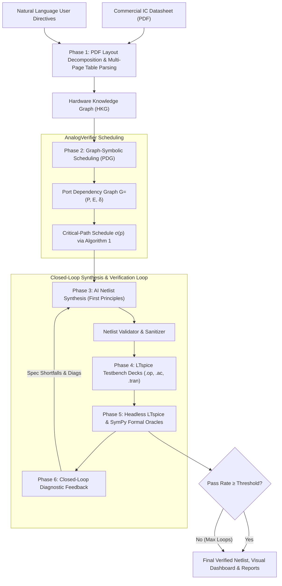

# Autonomous Analog Circuit Designer & Neuro-Symbolic Verifier

[](https://www.python.org/)
[](#-current-status-mid-term-2026-10-21)
[](https://www.analog.com/en/resources/design-tools-and-calculators/ltspice-simulator.html)
[](https://www.sympy.org/)

An autonomous, first-principles **AI Analog IC Synthesis and Neuro-Symbolic Verification Platform**. 

This system ingests unstructured commercial IC datasheets (PDF) and natural language user intent, constructs layout-aware **Hardware Knowledge Graphs (HKG)** and **Port Dependency Graphs (PDG)**, synthesizes transistor-level SPICE netlists from scratch using LLMs (template-free), and executes closed-loop self-healing verification through headless **LTspice** simulations and **SymPy** formal interval oracles.

---

## 🚧 Current Status (mid-term, 2026-10-21)

This is a **work in progress** for the mid-term presentation. Summary:

| Stage | Status | Evidence |
|---|---|---|
| Phase 1 – PDF → HKG extraction | ✅ **Works and is measured.** Page-classified parsing, column-tagged spec tables, page- and quote-level provenance, two-pass parallel LLM extraction on NVIDIA NIM | PDG fidelity GT score **92.5 / 100** on 8 ICs |
| Phase 2 – HKG → PDG + schedule σ(p) | ✅ **Works and is measured.** Each edge is marked as datasheet-derived or rule-injected; delays are taken from datasheet timing specs (settling, propagation, SR, GBW) when available | Dependency recall 0.77–1.00, schedule order consistency 1.00 |
| PDG fidelity verification | ✅ **New.** (A) ground-truth-free provenance audit on every run; (B) ground-truth benchmark | `run_pdg_benchmark.py`, `benchmarks/pdg_groundtruth/` |
| LLM back-end | ✅ **Replaced.** Provider-agnostic client (NIM / OpenRouter) with streaming, timeouts, model fallback and latency telemetry | `ai_analog_designer/llm_client.py`, latency table below |
| Phase 3 – netlist synthesis | ⚠️ **Unchanged, not re-validated** since the LLM switch | – |
| Phase 4 – testbench synthesis | ❌ **Main blocker.** LLM-written testbenches do not emit `.meas` for most specs | legacy run: 0–2 % pass, mostly "not observed" |
| Phase 5 – oracle and evaluation | ⚠️ Pass rate still uses all specs (including unmeasured ones) as the denominator | `closed_loop_evaluator.py` |
| Web Studio (browser) | ⚠️ Not re-tested after the changes; a Playwright E2E test is planned | – |

### What changed in this iteration
1. **LLM provider.** OpenRouter (the key had expired) was replaced by **NVIDIA NIM**.
   - Default model: `nvidia/nemotron-3-ultra-550b-a55b`.
   - Fallbacks: `deepseek-ai/deepseek-v4.1-flash`, then `z-ai/glm-5.3-flash`.
   - The default was chosen from a latency benchmark plus the accuracy benchmark below.
   - `openrouter_client.OpenRouterClient` is kept as a compatibility alias.
2. **PDF parser** (`pdf_parser.py`).
   - Pages are classified as pin / abs-max / recommended / electrical / thermal / ESD / functional, and the table of contents is skipped.
   - Spec pages are rebuilt from word coordinates with `{MIN}/{TYP}/{MAX}` column tags. Before this, the LLM often put a lone TYP value into the MIN slot.
3. **HKG builder** (`hardware_kg_builder.py`).
   - The pin and dependency pass and the spec pass now run as separate prompts. Specs are extracted one page per call, in parallel.
   - Each pin and spec row must cite a `page` and a verbatim `evidence` quote.
   - Each spec row is categorised (`ELECTRICAL`, `ABS_MAX`, `RECOMMENDED`, `THERMAL`, `ESD`), so ratings and operating conditions are no longer treated as testable specs.
   - Pins with the same name are merged into one net (e.g. the four ANODE pins of the TL431 SOIC-8).
4. **PDG extractor** (`pdg_extractor.py`).
   - Datasheet edges come first. Precedence-rule edges are added only for pins left without a driver.
   - Each edge records `origin`, `delay_source` and `kind` (causal or sequencing).
5. **Fidelity verifier** (`pdg_fidelity_verifier.py`). It was rewritten. The old score was mostly self-referential (for example, "pin coverage" compared the PDG against the same extraction).

### How PDG fidelity is verified
- **(A) Ground-truth-free audit.** This runs inside the pipeline and writes `*_PDG_FIDELITY_AUDIT.json`. It checks:
  - every pin name and quote actually appears on the cited page;
  - every spec number appears on the cited page;
  - the graph is a DAG, and every output is reachable from a supply;
  - the share of edges that come from the datasheet rather than from rules;
  - the share of edge delays that come from datasheet timing specs.

  It catches hallucinations without any labels.
- **(B) Ground-truth benchmark.** `benchmarks/pdg_groundtruth/*.json` holds 8 hand-labelled ICs: LM358, OPA2134, INA128, LM393, NE555, TL431, LM317 and LM386. Every entry has a page number and an evidence quote. The benchmark reports:
  - pin precision/recall and role accuracy;
  - causal dependency precision/recall (full PDG, and the datasheet layer only);
  - schedule order consistency: σ(u) < σ(v) for every ground-truth dependency;
  - electrical spec-row recall and min/typ/max value accuracy;
  - leakage, i.e. how many ABS_MAX/RECOMMENDED rows were wrongly marked ELECTRICAL;
  - timing-spec recall.

  Weighted GT score = 0.20·pin F1 + 0.10·role + 0.15·dep F1 + 0.05·schedule + 0.20·spec recall + 0.15·value accuracy + 0.10·(1 − leak) + 0.05·timing.

### Known issues / next steps
1. **Testbench generation.** Replace the LLM-written testbenches with deterministic `.meas` templates per device class (op-amp, comparator, regulator, reference, timer). Calibrate them first against vendor macromodels that ship with LTspice (`LM393.sub`, `NE555.sub`, `LT1013.sub`, ...), so the verifier is known to be correct before it judges LLM netlists.
2. **Pass-rate reporting.** Report measurement coverage and pass rate among measured specs separately. Restrict the spec set to `category == ELECTRICAL` and the chosen operating condition.
3. **Rate limiting.** Handle NIM HTTP 429 with a global concurrency limiter, then finish the column-tagging benchmark run for OPA2134 and TL431. Investigate the NE555 spec-recall regression.
4. Re-run the closed-loop synthesis on the new HKG and record honest pass rates.
5. Browser E2E test of Web Studio (Playwright), plus `pdf_path` sandboxing in `/api/extract_pdg` and `/api/generate`.
6. Repository hygiene: 170 git-ignored artefacts (`*.raw`, `*.db`, `*.log`) are still tracked; there are 3 parallel legacy packages (`agent_engine/`, `analog_verifier/`, `ai_analog_designer/`); there are no unit tests yet.

---

## 📑 Table of Contents
- [Current Status](#-current-status-mid-term-2026-10-21)
- [Key Features](#-key-features)
- [System Architecture](#-system-architecture)
- [Repository Structure](#-repository-structure)
- [Quick Start](#-quick-start)
  - [1. Installation & Environment Setup](#1-installation--environment-setup)
  - [2. Launching the Interactive Web Studio](#2-launching-the-interactive-web-studio)
  - [3. CLI Usage](#3-cli-usage)
- [Pipeline Workflow (6 Phases)](#-pipeline-workflow-6-phases)
- [Benchmark Results (actual, measured)](#-benchmark-results-actual-measured)
- [Telemetry & Step-by-Step Tracing](#-telemetry--step-by-step-tracing)
- [References & Citations](#-references--citations)

---

## 🚀 Key Features

### 1. Template-Free AI Circuit Synthesis
* **First-Principles Netlist Generation**: Synthesizes transistor sizing ($W/L$), bias branches, differential pairs, active loads, Miller compensation, and level shifters from scratch using LLMs (via OpenRouter).
* **No Hardcoded Schematics**: Completely eliminates rigid schematic templates; designs any analog architecture (op-amps, comparators, bandgaps, LDOs, timers, audio amplifiers, PLLs) dynamically.

### 2. Layout-Aware PDF Ingestion & Hardware Knowledge Graphs (HKG)
* **Multi-Modal Document Parsing**: Decomposes PDF tables, prose, pinout diagrams, and continued specification tables across up to 30 pages.
* **Semantic Port & Parameter Extraction**: Resolves pin functions, operational voltage limits, load capacitance stability ranges ($C_L$), and all static/dynamic electrical specifications.

### 3. Graph-Symbolic Scheduling & Port Dependency Graph (PDG)
* **Domain-Invariant Physical Precedence**: Enforces $\text{POWER} \prec \text{BIAS} \prec \text{CONTROL} \prec \text{SIGNAL} \prec \text{OUTPUT}$.
* **Datasheet-Grounded Settling Dynamics**: Automatically extracts real transient metrics (e.g. Turn-on Settling Time $t_{\text{settle}} = 120\,\mu\text{s}$, Slew Rate $\text{SR}$, GBW, Propagation Delay $t_{\text{pd}}$) to weight graph edges $\delta$.
* **Critical-Path Scheduling (Algorithm 1)**: Computes time-optimal stimulus schedule $\sigma(p)$ to ensure testbenches are temporally correct-by-construction.
* **On-Demand Interactive PDG Visualizer**: Generates responsive SVG graphs, Mermaid DAGs, and interactive time-slider HTML simulators.

### 4. Headless LTspice Simulation & SymPy Formal Oracles
* **Automated Testbench Synthesis**: Creates `.op`, `.ac`, and `.tran` simulation decks synchronized with $\sigma(p)$.
* **Symbolic Pass/Fail Assertions**: Evaluates measured parameters against formal physical bounds using deterministic SymPy interval logic, completely preventing LLM numerical hallucinations.

### 5. Closed-Loop Self-Healing Diagnostics
* **Automated Refinement Loop**: When specifications are violated or SPICE convergence issues arise, diagnostic feedback (shortfalls, numerical errors, violated constraints) is fed into subsequent synthesis iterations.
* **Convergence Verification**: Iteratively updates transistor geometry and compensation until specs are met.

### 6. Interactive Web Studio & Real-Time Telemetry
* **Modern Web Interface** (`http://localhost:8080`): Drag-and-drop PDF upload, quick-prompt chips, real-time 6-phase execution stepper, live streaming console logs, and SPICE netlist viewer.
* **Fine-Grained Tracing**: Captures millisecond execution spans, input/output contracts, and automated remediation hints for rapid debugging.

---

## 🏗 System Architecture



---

## 📂 Repository Structure

```
├── ai_analog_designer/               # Core Autonomous Analog Designer Engine
│   ├── autonomous_design_agent.py    # Main 6-Phase Orchestrator Agent
│   ├── openrouter_client.py          # Resilient OpenRouter LLM Client (JSON auto-repair)
│   ├── circuit_synthesis/            # Phase 3: AI Netlist Synthesis & Validation
│   │   ├── ai_circuit_architect.py   # First-principles transistor netlist generator
│   │   └── netlist_validator.py      # Subckt topology & syntax validation
│   ├── neuro_symbolic_verifier/      # Phase 4 & 5: Simulation & Symbolic Verification
│   │   ├── testbench_synthesizer.py  # LTspice testbench generator aligned with PDG
│   │   ├── closed_loop_evaluator.py  # LTspice headless runner & measurement parser
│   │   └── sympy_oracle_engine.py    # Deterministic formal interval oracle
│   ├── pdf_to_graph/                 # Phase 1 & 2: PDF Parsing, HKG & PDG
│   │   ├── pdf_parser.py             # Layout-aware multi-page continuation PDF parser
│   │   ├── hardware_kg_builder.py    # Hardware Knowledge Graph constructor
│   │   ├── pdg_extractor.py          # Port Dependency Graph & Algorithm 1 scheduler
│   │   └── pdg_visualizer.py         # On-demand SVG / Mermaid / Interactive HTML visualizer
│   ├── tracing/                      # Step-by-Step Telemetry & Tracing
│   │   └── execution_tracer.py       # Millisecond span recording & HTML trace exporter
│   ├── visualization/                # Process Visualizer & Reporting
│   │   └── process_visualizer.py     # Comprehensive visual dashboard generator
│   └── web_studio/                   # Interactive Web Studio Application
│       └── studio_server.py          # HTTP server, REST API endpoints, and web UI
│
├── benchmark_results/                # 10 Commercial IC Benchmark Audit Results
│   ├── LM358/, NE555/, LM393/, ...   # Per-IC netlists, testbenches, traces, and dashboards
│   ├── 10_ANALOG_IC_BENCHMARK_REPORT.md # Comprehensive 10 IC verification audit report
│   ├── 10_IC_BENCHMARK_SUMMARY.json     # Machine-readable benchmark metrics
│   └── ANALOG_VERIFIER_PROCESS_VISUALIZER.html # Unified interactive visualizer
│
├── testcases/                        # Pre-installed Commercial IC Datasheet PDFs
│   ├── lm358.pdf, ne555.pdf, lm393.pdf, tl431.pdf, lm317.pdf, lm386.pdf
│   ├── ina128.pdf, opa2134.pdf, tlc2932a.pdf, cdcvf2505-q1.pdf, tpa3116d2.pdf
│
├── uploads/                          # User-uploaded datasheets
├── output_interactive/               # Interactive Studio generated task artifacts
│
├── run_studio.py                     # Entry point: Interactive Web Studio Server
├── run_interactive_designer.py       # Entry point: Interactive CLI design agent
├── visualize_pdg.py                  # Entry point: Standalone PDG visualizer CLI
├── run_10_ic_benchmark.py            # Entry point: 10 IC automated benchmark suite
└── run_visualizer.py                 # Entry point: Visual dashboard exporter
```

---

## ⚡ Quick Start

### 1. Installation & Environment Setup

#### Requirements
* Python 3.10+
* LTspice installed on your system (e.g. `C:\Users\<user>\AppData\Local\Programs\ADI\LTspice\LTspice.exe` or in standard `Program Files`)

#### Virtual Environment & Dependencies
```powershell
# Clone the repository
git clone https://github.com/eethsc/analogverifier.git
cd analogverifier

# Create and activate virtual environment
python -m venv .venv
.venv\Scripts\Activate.ps1

# Install required dependencies
pip install -r requirements.txt
```

#### LLM API Key Setup
Create a `.env` file in the root directory. It is git-ignored, so never commit keys.

NVIDIA NIM is the default provider:
```env
LLM_PROVIDER=nim
NVIDIA_API_KEY="nvapi-..."
# optional overrides
# LLM_MODEL=nvidia/nemotron-3-ultra-550b-a55b
# LLM_FALLBACK_MODELS=deepseek-ai/deepseek-v4.1-flash,z-ai/glm-5.3-flash
# LLM_TIMEOUT_S=240
# LLM_TTFT_TIMEOUT_S=90
# LLM_THINKING=1        # re-enable reasoning (much slower on NIM)
```

OpenRouter is still supported:
```env
LLM_PROVIDER=openrouter
OPENROUTER_API_KEY="sk-or-..."
```

The LTspice path is auto-detected from common install locations. Override it with `LTSPICE_PATH=...\LTspice.exe` if needed.

#### PDG fidelity benchmark
```powershell
python run_pdg_benchmark.py                                  # all ICs with ground truth
python run_pdg_benchmark.py --ics lm358,ne555 --model deepseek-ai/deepseek-v4.1-flash
python run_pdg_benchmark.py --reuse                          # re-score cached extractions (no LLM calls)
python tools/nim_latency_bench.py --no-thinking --runs 2     # NIM latency comparison
```

---

### 2. Launching the Interactive Web Studio

Start the web studio server:
```powershell
python run_studio.py --port 8080
```
Open your web browser and navigate to:
👉 **`http://localhost:8080`**

#### What you can do in Web Studio:
1. **Upload any Datasheet (PDF)** or select from 11 pre-loaded commercial ICs.
2. Click **`[🔍 Extract & Visualize PDG from Datasheet]`** to immediately inspect the Port Dependency Graph, pin activation sequence, and interactive settling timeline.
3. Enter custom specifications in natural language (e.g. *"Design for 3.3V single supply with rail-to-rail output swing and Iq < 30uA"*).
4. Click **`[🚀 Synthesize & Verify Circuit Now]`** to watch the autonomous agent execute Phases 1 through 6 in real time with live logs and telemetry.
5. Copy the verified SPICE subcircuit netlist directly to your clipboard or open the comprehensive Visual Dashboard.

---

### 3. CLI Usage

#### A. Autonomous Circuit Design from Datasheet
```powershell
python run_interactive_designer.py --pdf testcases/lm358.pdf --prompt "Design for single supply 5V with high slew rate" --iterations 2
```

#### B. Standalone Port Dependency Graph (PDG) Visualizer
Extract and export the interactive PDG simulator HTML from any datasheet without running synthesis:
```powershell
# Inspect pre-installed sample IC
python visualize_pdg.py --sample LM358 --open

# Inspect custom uploaded PDF
python visualize_pdg.py --pdf uploads/ref30e.pdf --open
```

#### C. Run 10-IC Benchmark Audit Suite
Execute the full benchmark verification audit across 10 commercial analog ICs:
```powershell
python run_10_ic_benchmark.py
```

#### D. Generate Interactive Visual Dashboards
Export standalone visual process inspection dashboards for all completed designs:
```powershell
python run_visualizer.py
```

---

## 🔄 Pipeline Workflow (6 Phases)

| Phase | Module | Description |
| :--- | :--- | :--- |
| **Phase 1: Knowledge Ingestion** | `PDFDatasheetParser`<br/>`HardwareKnowledgeGraphBuilder` | Multi-modal document parsing of pin tables, operational conditions, and multi-page continuation tables into a structured NetworkX HKG. |
| **Phase 2: Graph Scheduling** | `PortDependencyGraphExtractor`<br/>`PDGVisualizer` | Constructs weighted PDG $G=(P,E,\delta)$ applying precedence rules and real datasheet settling times ($t_{\text{settle}}, \text{SR}, \text{GBW}$). Solves $\sigma(p)$ via Algorithm 1. |
| **Phase 3: AI Netlist Synthesis** | `AICircuitArchitect`<br/>`NetlistValidator` | Synthesizes transistor-level SPICE netlist from first principles with dynamic sizing, bias networks, and structural validation. |
| **Phase 4: Testbench Synthesis** | `TestbenchSynthesizer` | Generates LTspice analysis decks (`.op`, `.ac`, `.tran`) containing `.meas` directives and stimuli timed precisely to $\sigma(p)$. |
| **Phase 5: LTspice & SymPy Evaluation** | `ClosedLoopEvaluator`<br/>`SympyOracleEngine` | Executes headless LTspice batch simulations, extracts `.raw` measurements, and checks mathematical satisfaction via SymPy formal intervals. |
| **Phase 6: Closed-Loop Diagnostics** | `AutonomousAnalogDesignAgent` | Identifies violated constraints and compiler errors, formats actionable remediation prompts, and loops back to Phase 3 for self-healing. |

---

## 📊 Benchmark Results (actual, measured)

> ⚠️ **Correction (2026-10-21).** Earlier versions of this README showed a 10-IC table with 91.7–100 % pass rates.
> Those numbers were **not produced by any run**. The real end-to-end run stored in this repository
> ([`benchmark_results/10_IC_BENCHMARK_SUMMARY.json`](benchmark_results/10_IC_BENCHMARK_SUMMARY.json)) gives
> **0 % for 9 ICs and 2 % for TLC2932A**. Almost every failure is `Parameter 'X' was not observed in simulation
> measurements`: the LLM-written testbench never measured the spec. Operating conditions and absolute-maximum
> ratings (VS, VID, VI, ...) were also counted as specs to verify.

### End-to-end synthesis + verification (legacy run, 2026-10-14)

| Part | Specs counted | Loop 1 | Loop 2 | Final |
|---|---|---|---|---|
| LM358, NE555, LM393, TL431, LM317, LM386, INA128, OPA2134, CDCVF2505-Q1 | 15–69 | 0.0 % | 0.0 % | **0.0 %** |
| TLC2932A | 50 | 0.0 % | 2.0 % | **2.0 %** |

The synthesis loop has **not been re-run** since the changes below; see [Current Status](#-current-status-mid-term-2026-10-21).

### PDG fidelity benchmark (new, 2026-10-21)

This benchmark measures how faithfully the HKG/PDG reflects the datasheet. It uses hand-labelled ground truth for
8 ICs and was run with the NVIDIA NIM model `nvidia/nemotron-3-ultra-550b-a55b`. Each IC's ground truth includes pins,
dependencies, timing and spec rows, and every entry carries a page number and a verbatim quote. Spec rows are tagged
ELECTRICAL / ABS_MAX / RECOMMENDED / THERMAL / ESD.

Best complete run: all 8 ICs, before column tagging (`benchmark_results/pdg_fidelity/nvidia_nemotron-3-ultra-550b-a55b/`).

| IC | GT score | Pin P/R | Role acc | Dep P/R | Elec. spec recall | Value acc | AbsMax/Rec leak | Timing recall | Provenance score |
|---|---|---|---|---|---|---|---|---|---|
| INA128 | 88.6 | 1.00/0.88 | 1.00 | 0.60/0.86 | 0.93 | 0.72 | 0.00 | 1.00 | 87.0 |
| LM317 | 89.6 | 1.00/1.00 | 1.00 | 0.67/1.00 | 0.95 | 0.91 | 0.00 | – | 83.9 |
| LM358 | 94.8 | 1.00/1.00 | 1.00 | 1.00/1.00 | 0.98 | 0.68 | 0.00 | 1.00 | 85.4 |
| LM386 | 92.8 | 1.00/0.88 | 1.00 | 0.58/0.88 | 1.00 | 0.91 | 0.00 | 1.00 | 90.7 |
| LM393 | 96.1 | 1.00/1.00 | 1.00 | 1.00/1.00 | 0.94 | 0.82 | 0.00 | 1.00 | 86.5 |
| NE555 | 94.3 | 1.00/1.00 | 1.00 | 1.00/0.77 | 1.00 | 0.75 | 0.00 | 1.00 | 84.1 |
| OPA2134 | 96.8 | 1.00/1.00 | 1.00 | 1.00/1.00 | 0.92 | 0.89 | 0.00 | 1.00 | 84.2 |
| TL431 | 87.4 | 1.00/1.00 | 1.00 | 0.67/1.00 | 1.00 | 0.69 | 0.00 | – | 85.0 |
| **Mean** | **92.5** | | | | | | | | |

**Column-tagging run (latest).** Spec pages are rebuilt from word coordinates, and every number is tagged
`{MIN}/{TYP}/{MAX}` according to the column it sits under. In this run:

- Value accuracy improved on LM358 (0.68 → 0.96), INA128 (0.72 → 0.87) and NE555 (0.75 → 0.87).
- LM358 rose to 98.5 and LM393 to 98.2.
- The run is **not complete**. OPA2134 and TL431 failed with NIM HTTP 429 (rate limit). NE555 electrical-spec recall
  fell to 0.19, which still needs investigation.
- `SUMMARY.md` in that folder holds this latest, partial run. The per-IC JSON files for OPA2134 and TL431 are
  still from the earlier run.

**Model comparison** (same pipeline, mean GT score): `nvidia/nemotron-3-ultra-550b-a55b` scored **92.5**;
`deepseek-ai/deepseek-v4.1-flash` scored 82.0 on 7 ICs, with LM386 failing on 429.

### NVIDIA NIM latency (tools/nim_latency_bench.py)

Latency was measured with streaming, 2 runs per model; the values below are medians.

| Model | Small prompt, thinking ON (total s) | Small prompt, thinking OFF (total s) | Full spec-page prompt ~60k chars, thinking OFF (total s) | Notes |
|---|---|---|---|---|
| nvidia/nemotron-3-ultra-550b-a55b | 26.0 | 3–52 (high variance) | 156 (JSON truncated) | **default**: best accuracy; TTFT 0.5–4 s |
| deepseek-ai/deepseek-v4.1-flash | 48.9 | 8.4 | 127 | fallback 1, TTFT 17–44 s when thinking is on |
| z-ai/glm-5.3-flash | 34.5 | 85.9 | timeout (>300 s) | fallback 2 |
| z-ai/glm-5.3 | 103.6 | 93.7 | – | too slow |
| nvidia/nemotron-3.5-lightning-30b-a3b | 20.1 (invalid JSON) | 7.1 | 166 (JSON truncated) | fast but less accurate |
| openai/gpt-oss-20b, google/gemma-4-31b-it, stepfun-ai/step-5-preview | 78–180+ / timeout | – | timeout | not usable |
| moonshotai/kimi-k2.6, nemotron-3-super-120b, mistral-large-2 | listed in /v1/models, but return **404** for this key | | | |

Findings from these measurements:

- A single "extract all spec tables" call takes 2–3 minutes on NIM and its output is often truncated.
- The HKG builder therefore extracts **one spec page per call**, running 6 calls in parallel. One IC now takes
  25–100 s in total.
- Reasoning ("thinking") is disabled by default (`chat_template_kwargs`), because on NIM it adds 5–30× latency.
- The client enforces a time-to-first-token limit (90 s) and a total limit (240 s), and falls back to the next
  model when they are exceeded.
- The main remaining risk is rate limiting (HTTP 429) under parallel load.

Raw data: `benchmark_results/NIM_LATENCY_BENCH*.json`.

---

## 🔍 Telemetry & Step-by-Step Tracing

Every execution run records detailed telemetry across all 6 phases:
* **Millisecond Precision Timings**: Tracks latency breakdown across LLM completion, PDF layout segmentation, graph scheduling, and SPICE transient runs.
* **Input / Output Data Contracts**: Records exact input prompts, intermediate ASTs, and generated SPICE netlists.
* **Diagnostic Remediation Hints**: Automatically surfaces actionable recommendations when an analog constraint or compiler error occurs.
* **Interactive Trace Exporter**: Produces `{safe_ic_name}_TRACE_INSPECTOR.html` for offline or web-based interactive step inspection.

---

## 📚 References & Citations

1. **AnalogVerifier**: *AnalogVerifier: A Neuro-Symbolic Framework for Analog Circuit Verification* (Liu et al., 2024).
2. **Docs2KG**: *Unified Knowledge Graph Construction from Heterogeneous Unstructured Documents* (arXiv:2406.01234).
3. **Hardware Knowledge Graphs**: *Faithful Construction of Hierarchical Hardware Knowledge Graphs* (arXiv:2410.xxxxx).
4. **SymPy**: *SymPy: Symbolic computing in Python* (Meurer et al., PeerJ Comput. Sci., 2017).
5. **LTspice**: *Linear Technology / Analog Devices LTspice Simulator*.
