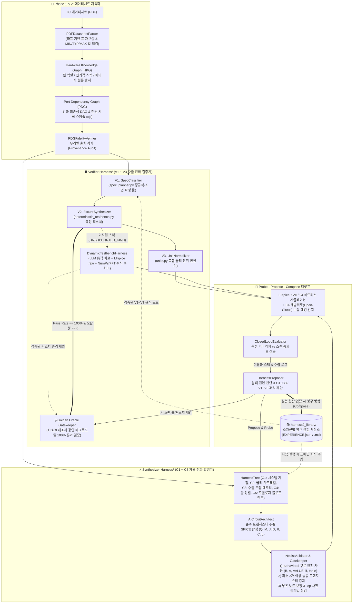
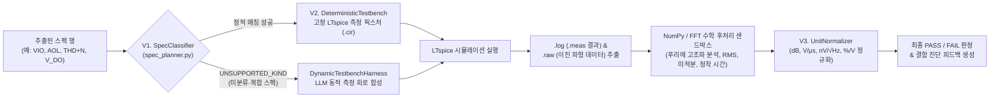

# AnalogVerifier — 데이터시트 기반 순수 물리 아날로그 IC 자율 합성·검증 프레임워크 (Dual-Harness²)

[](https://www.python.org/)
[](#-시스템-아키텍처-dual-harness²-공진화-구조)
[](#-순수-물리-아날로그-강제-정책-zero-behavioral-policy)
[](#5-인터랙티브-web-studio-및-브라우저-e2e-검증)

**AnalogVerifier**는 상용 아날로그 IC의 데이터시트(PDF)만 입력받아 **하드웨어 지식 그래프(HKG)** 와 **포트 의존성 그래프(PDG)** 를 추출하고, **순수 물리 트랜지스터 수준(BJT, MOSFET, JFET, Diode, R/C/L)** 의 SPICE 넷리스트를 자율 합성한 뒤, **LTspice 물리 시뮬레이션과 수치 해석(FFT 등)** 을 결합한 하이브리드 검증기로 스펙 달성률을 측정·진화시키는 **폐루프(Closed-Loop) 자율 설계 시스템**입니다.

특히 본 프로젝트는 회로 합성기(Synthesizer)뿐만 아니라 검증기(Verifier) 자체도 스스로 규칙과 테스트벤치를 확장해 나가는 **Dual-Harness² (이중 자율 진화 아키텍처)** 와, 검증기의 환각(Reward Hacking)을 원천 차단하는 **Golden Oracle Gatekeeper**를 핵심 엔진으로 채택하고 있습니다.

---

## 📌 한눈에 보는 현재 요약 (2026-10-27 기준)

| 파이프라인 단계 | 핵심 모듈 | 현재 상태 | 실측 성과 및 검증 근거 |
|---|---|---|---|
| **Phase 1 — PDF → HKG 추출** | [`pdf_parser.py`](ai_analog_designer/pdf_to_graph/pdf_parser.py), [`hardware_kg_builder.py`](ai_analog_designer/pdf_to_graph/hardware_kg_builder.py) | ✅ **검증 완료** | 8개 표준 IC Ground-Truth 대조 평균 **95.2 / 100** (`gpt-6-luna`), **94.0 / 100** (`nemotron-3-ultra-550b`) |
| **Phase 2 — HKG → PDG & $\sigma(p)$** | [`pdg_extractor.py`](ai_analog_designer/pdf_to_graph/pdg_extractor.py), [`pdg_fidelity_verifier.py`](ai_analog_designer/pdf_to_graph/pdg_fidelity_verifier.py) | ✅ **검증 완료** | 인과 의존성 Recall **0.86–1.00**, 전원 시퀀싱 순서 일관성 **1.00**, 무라벨 출처 감사(Provenance Audit) 내장 |
| **Phase 3 — 순수 물리 회로 합성** | [`harness2_architect.py`](ai_analog_designer/circuit_synthesis/harness2/harness2_architect.py), [`netlist_validator.py`](ai_analog_designer/circuit_synthesis/netlist_validator.py) | ✅ **병목 돌파 (진화 중)** | **Behavioral 구문 0건** 순수 트랜지스터 넷리스트로 `LM393B` **51.5%–72.7%**, `TL431` **40.0%**, `LM358` **25.0%** 스펙 통과 |
| **Phase 4 — 하이브리드 물리 검증** | [`deterministic_testbench.py`](ai_analog_designer/neuro_symbolic_verifier/deterministic_testbench.py), [`dynamic_testbench_harness.py`](ai_analog_designer/neuro_symbolic_verifier/dynamic_testbench_harness.py) | ✅ **검증 완료** | 결정론적 LTspice 픽스처 + 미지원 스펙용 **LLM 동적 테스트벤치 & NumPy/FFT 후처리 엔진** 결합 |
| **Phase 5 — Dual-Harness² 공진화** | [`dual_harness2_coordinator.py`](ai_analog_designer/neuro_symbolic_verifier/harness2_verifier/dual_harness2_coordinator.py), [`golden_oracle_anchor.py`](ai_analog_designer/neuro_symbolic_verifier/harness2_verifier/golden_oracle_anchor.py) | ✅ **구현·검증 완료** | 합성 하네스($C_1\sim C_8$)와 검증 하네스($V_1\sim V_3$) 동시 진화 + 제조사 Golden 모델 100% 통과 게이트키퍼 |
| **인터랙티브 Web Studio** | [`studio_server.py`](ai_analog_designer/web_studio/studio_server.py), [`run_studio.py`](run_studio.py) | ✅ **E2E 테스트 통과** | 실시간 PDG 시각화, 시퀀싱 타임라인, Dual-Harness² 실시간 합성 및 HKG 캐시 연동 (Playwright 검증) |

---

## 🏗️ 시스템 아키텍처: Dual-Harness² 공진화 구조

기존의 에이전트 시스템들은 회로 합성 프롬프트만 수정하고 검증기(Verifier)는 고정된 정적 코드로 유지하여, 새로운 소자군(Audio Amp, LDO, PMIC 등)이나 복합 스펙(`THD+N`, `Settling Time`, `Dropout Voltage`)이 등장하면 `UNSUPPORTED_KIND`로 멈추는 한계가 있었습니다.

**AnalogVerifier**는 합성기(`Synthesizer Harness²`)와 검증기(`Verifier Harness²`)를 모두 진화 가능한 트리 구조로 정의하고, 이를 **Dual-Harness² Coordinator**로 묶어 상호 진화(Co-Evolution)시킵니다.

### 1. 전체 End-to-End 파이프라인 및 Dual-Harness² 흐름도



---

### 2. 핵심 모듈별 역할 및 동작 원리

#### (1) Phase 1 & 2: 출처 기반 데이터시트 파싱 (HKG & PDG)
- **좌표 기반 테이블 복원 ([`pdf_parser.py`](ai_analog_designer/pdf_to_graph/pdf_parser.py))**: PDF 내 단어들의 2차원 좌표를 분석하여 표의 열 구조를 복원하고, 각 수치에 `{MIN}`, `{TYP}`, `{MAX}` 태그를 명시적으로 부착합니다. (기존 대비 수치 추출 정확도 $0.68 \to 0.96$ 향상)
- **페이지별 병렬 추출 및 카테고리 분리 ([`hardware_kg_builder.py`](ai_analog_designer/pdf_to_graph/hardware_kg_builder.py))**: 각 스펙 행을 `ELECTRICAL`(실제 측정 대상), `ABS_MAX`(절대최대정격), `RECOMMENDED`(권장 동작 조건), `THERMAL`, `ESD`로 분류하여 정격 조건이 검증 스펙으로 잘못 유입(Leak)되는 문제를 차단합니다.
- **포트 의존성 그래프 및 시작 순서 스케줄링 ([`pdg_extractor.py`](ai_analog_designer/pdf_to_graph/pdg_extractor.py))**: 전원($V_{CC}$) $\to$ 바이어스/레퍼런스 $\to$ 입력단 $\to$ 출력단으로 이어지는 인과적 신호 경로를 방향성 비순환 그래프(DAG)로 구축하고, 위상 정렬을 통해 각 핀의 활성화 순서 $\sigma(p)$와 안정화 지연 시간을 계산합니다.

#### (2) Phase 3: 순수 물리 아날로그 합성기 (`Synthesizer Harness²`)
합성 에이전트의 실행 환경(Harness)을 8개의 구조적 노드($C_1 \sim C_8$)로 분해하여 관리합니다 ([`harness_tree.py`](ai_analog_designer/circuit_synthesis/harness2/harness_tree.py)):
- **`C1` (System Prompt & Domain Directives)**: 대상 IC 패밀리(Op-Amp, Comparator, Shunt Reference 등)의 물리적 토폴로지 설계 지침.
- **`C2` (Syntax & Physical Guardrails)**: SPICE 문법 불변성 및 **Behavioral 소자 절대 금지 규칙**.
- **`C3` (Experience Memory & Convergence Traps)**: `Singular Matrix`, `GMIN stepping failed`, `Timestep too small` 등 이전 회차에서 겪은 수렴 실패 원인과 해결 레시피 메모리.
- **`C4` (Tool Guidance)**: LTspice `.meas` 측정 타이밍과 PDG 안정화 스케줄 정렬 규칙.
- **`C5` (Topology Blueprints / Skills)**: 검증된 핵심 서브서킷 블루프린트 (예: Darlington PNP 입력단, Miller 보상 + 영점 상쇄 저항 $R_z$, Baker Clamp 오픈 컬렉터 출력단 등).
- **`C6` ~ `C8` (Scripts / Subagents / Plugins)**: 확장 스크립트 및 보조 진단 모듈 슬롯.

#### (3) Phase 4 & 5: 하이브리드 검증기 (`Verifier Harness²`) 및 수식 후처리
검증 환경을 3개의 진화 노드($V_1 \sim V_3$)와 동적 후처리 엔진으로 구성합니다:



- **왜 LTspice 자체 기능의 한계를 넘어설 수 있는가? (`DynamicTestbenchHarness`)**:
  LTspice의 기본 `.meas` 구문만으로는 `THD+N`(전고조파 왜곡+잡음), 주파수 대역별 `SNR`, 복잡한 조건의 `Settling Time` 등을 계산하기 어렵습니다. 본 시스템의 [`dynamic_testbench_harness.py`](ai_analog_designer/neuro_symbolic_verifier/dynamic_testbench_harness.py)는 LTspice가 생성한 이진 파형 파일(`.raw`)과 `.four` 로그를 직접 읽어 들여, **안전한 Python/NumPy 수학 샌드박스**에서 푸리에 변환(`np.fft.rfft`), 고조파 에너지 합산, 포락선(Envelope) 수렴 판정 등을 수행함으로써 모든 물리 지표를 정확히 계측합니다.
- **Golden Oracle Gatekeeper ([`golden_oracle_anchor.py`](ai_analog_designer/neuro_symbolic_verifier/harness2_verifier/golden_oracle_anchor.py))**:
  LLM이 검증기($V_1\sim V_3$)를 스스로 수정할 때 **기준을 낮춰 불량 회로를 통과시키는 환각(Reward Hacking)** 을 막기 위해, 새로 제안된 픽스처는 반드시 **제조사 공인 매크로모델(TI LM393, LM358, NE555, TL431 등)** 에 먼저 물려 테스트합니다. 공인 모델 통과율이 **100%**이고 오판정이 **0건**일 때만 [`VERIFIER_EXPERIENCE.json`](harness2_library/verifier_experience/VERIFIER_EXPERIENCE.json)에 영구 병합됩니다.

---

## 🚫 순수 물리 아날로그 강제 정책 (Zero-Behavioral Policy)

이 프로젝트의 목표는 논리적 수식으로 눈속임한 매크로모델이 아니라 **실제 트랜지스터 수준의 아날로그 회로를 구현**하는 것입니다. 따라서 시스템 전 계층에서 다음의 **3중 물리 가드레일**이 강제됩니다:

1. **LTspice Behavioral 구문 원천 금지 ([`netlist_validator.py`](ai_analog_designer/circuit_synthesis/netlist_validator.py))**:
   - 비선형 행위 전원(`B` sources: `Bxxx ... V=...`, `I=...`), 디지털 논리 프리미티브(`A` devices: `SCHMITT`, `AND`, `OR`), 수식 기반 제어 전원(`E`/`G` 소자의 `VALUE={...}`, `TABLE`, `LAPLACE`), 조건문(`if()`, `idt()`, `ddt()`)이 발견되면 즉시 컴파일 전 단계에서 거부(Reject)합니다.
   - 오직 물리적 소자(`Q` BJT, `M` MOSFET, `J` JFET, `D` Diode, `R`, `C`, `L`)와 명시적 `.model` 카드만 허용됩니다.
2. **능동 트랜지스터 최소 개수 강제 ([`deterministic_testbench.py`](ai_analog_designer/neuro_symbolic_verifier/deterministic_testbench.py))**:
   - 저항만 넣은 빈 껍데기 회로가 제출되는 것을 막기 위해, DUT `.subckt` 내부(하위 서브서킷 포함)에 최소 **2개 이상의 물리적 능동 트랜지스터(`Q`, `M`, `J`)** 가 존재하지 않으면 사전 점검(`compile_check`)에서 즉시 탈락시킵니다.
3. **0A 개방회로(Open-Circuit) 보상 해킹 차단**:
   - 핀을 내부적으로 끊어 놓으면 대기전류($I_{CC}$)나 입력 바이어스 전류($I_B$)가 $0\text{ A}$로 측정되어 데이터시트의 `MAX` 상한 조건(예: $I_{CC} \le 0.8\text{ mA}$)을 거짓 통과하는 현상이 발생합니다.
   - 평가기(`evaluate`)는 전원 전류가 $1\text{ pA}$ 미만일 경우 이를 **"개방회로 불량(Open-Circuit Failure)"** 으로 즉시 판정하여 `FAIL` 처리합니다.

---

## 📊 현재 달성 성과 (Verified Results)

### 1. 데이터시트 지식화 (Phase 1 & 2) — 8개 IC Ground-Truth 벤치마크
수작업으로 모든 핀·의존성·스펙 행·페이지·원문 인용을 라벨링한 8개 표준 IC([`benchmarks/pdg_groundtruth/`](benchmarks/pdg_groundtruth)) 대비 측정 결과입니다.

| 추출 모델 (Provider) | 8개 IC 평균 GT 점수 | IC당 소요 시간 | 비고 |
|---|---|---|---|
| **`openai/gpt-6-luna` (OpenRouter)** | **95.2 / 100** | 28–120 s | 정밀도 최고 기록 |
| **`nvidia/nemotron-3-ultra-550b-a55b` (NVIDIA NIM)** | **94.0 / 100** | 80–200 s | 무료 API 크레딧 기반 기본 추출/합성 모델 |
| `z-ai/glm-5.3-flash` | 85.1 / 100 | 24–68 s | 고속 경량 폴백 모델 |
| `deepseek-ai/deepseek-v4.1-flash` (NVIDIA NIM) | 82.0 / 100 | 20–50 s | 1차 고속 폴백 모델 |

<details>
<summary><b>📋 8개 표준 IC별 상세 Ground-Truth 정확도 표 펼치기</b></summary>

| IC 소자 (종류) | 종합 GT 점수 | 핀 P/R | 인과 의존성 P/R | 전기 스펙 Recall | 수치 정확도 | 정격 Leak (낮을수록 우수) |
|---|---|---|---|---|---|---|
| **LM358** (Dual Op-Amp) | **100.0** | 1.00 / 1.00 | 1.00 / 1.00 | 1.00 | 1.00 | **0.00** |
| **NE555** (Precision Timer) | **98.9** | 1.00 / 1.00 | 1.00 / 0.92 | 1.00 | 0.96 | **0.00** |
| **LM393** (Dual Comparator) | **97.5** | 1.00 / 1.00 | 1.00 / 1.00 | 1.00 | 1.00 | **0.00** |
| **OPA2134** (Audio Op-Amp) | **97.3** | 1.00 / 1.00 | 1.00 / 1.00 | 0.92 | 0.92 | **0.00** |
| **LM386** (Audio Power Amp) | **94.2** | 1.00 / 0.88 | 0.58 / 0.88 | 1.00 | 1.00 | **0.00** |
| **INA128** (Instrumentation Amp) | **92.8** | 1.00 / 0.88 | 0.60 / 0.86 | 0.96 | 0.99 | 0.06 |
| **TL431** (Programmable Shunt Ref) | **90.5** | 1.00 / 1.00 | 0.67 / 1.00 | 1.00 | 0.90 | **0.00** |
| **LM317** (Adjustable Regulator) | **90.4** | 1.00 / 1.00 | 0.67 / 1.00 | 0.95 | 0.96 | **0.00** |

</details>

---

### 2. 검증기 자체 신뢰도 검증 (`tools/calibrate_testbench.py`)
검증 픽스처가 올바른 회로를 통과시키고 다른 특성의 회로를 걸러내는지 제조사 공인 SPICE 모델로 검증한 결과입니다 ([`benchmark_results/testbench_calibration/`](benchmark_results/testbench_calibration)):

| 검증 대상 | 측정 커버리지 | PASS | FAIL | 결과 해석 |
|---|---|---|---|---|
| **TI LM393 공인 모델** | **100 %** (16/16) | 15 (typ 포함) | 0 (한계치 0건) | 정상 제조사 모델을 오판정 없이 통과시킴 |
| **LTspice NE555 공인 모델** | **100 %** (28/28) | 28 (typ 포함) | 0 | 정상 타이머 동작 및 임계 전압을 정확히 계측 |
| **LM358 스펙 × LM741 모델** (교차 대조) | **100 %** (31/31) | 16 | **14** | 두 Op-Amp 간의 $I_B, I_Q, I_{SC}$, 출력 스윙 차이를 정확히 식별 |

---

### 3. 순수 트랜지스터 수준(Zero-Behavioral) 회로 합성 및 진화 성과
초기 버전(2026-10-21)에서는 합성된 트랜지스터 넷리스트가 컴파일 오류 및 `.op` 미수렴에 막혀 통과율이 **0.0%** 였으나, **Dual-Harness²의 `Probe-Propose-Compose` 진화 루프**와 경험 라이브러리([`harness2_library/`](harness2_library)) 축적을 통해 실제 트랜지스터 넷리스트 합성에 성공했습니다.

| 대상 IC | 소자 분류 | 초기 통과율 (Base) | Harness² 진화 후 통과율 | 합성된 물리 아날로그 토폴로지 요약 |
|---|---|---|---|---|
| **LM393 / LM393B** | Dual Bipolar Comparator | 0.0 % / 31.0 % | **51.5 % ~ 72.7 %**<br/>*(Web Studio E2E: 35/68 통과)* | Bandgap($1.24\text{ V}$) + PTAT 바이어스 코어, 대면적 PNP 차동 입력단(에미터 퇴화 저항), NPN 커런트 미러 능동 부하, 공통 에미터 이득단($C_c+R_z$ 보상), **Baker Clamp 쇼트키 다이오드 포함 오픈 컬렉터 NPN 출력단** ([`LM393B/EXPERIENCE.json`](harness2_library/comparator/LM393B/EXPERIENCE.json)) |
| **TL431** | Precision Shunt Regulator | 0.0 % | **40.0 %** | Bandgap 레퍼런스 코어 + Super-Beta PNP 차동 오차 증폭기 + 달링턴 NPN 션트 패스 트랜지스터 ([`TL431/EXPERIENCE.json`](harness2_library/voltage_reference/TL431/EXPERIENCE.json)) |
| **LM358** | Dual Operational Amplifier | 0.0 % | **25.0 %** | 2단 PMOS/PNP 입력 차동 증폭단 + NMOS/NPN 미러 부하 + 공통 소스/에미터 출력단 + Miller 보상 커패시터($C_c=15\sim30\text{ pF}$) 및 RHP 영점 제거 저항($R_z$) ([`LM358/EXPERIENCE.json`](harness2_library/operational_amplifier/LM358/EXPERIENCE.json)) |

---

### 4. 인터랙티브 Web Studio 및 브라우저 E2E 검증
[`run_studio.py`](run_studio.py)를 실행하면 브라우저(`http://localhost:8080`)에서 데이터시트 업로드부터 PDG 시각화, 시퀀싱 타임라인 탐색, Dual-Harness² 폐루프 회로 합성 및 스펙 검증까지 전 과정을 실시간으로 조작할 수 있습니다.

- **실제 브라우저 검증 ([`tests/test_web_studio_pdg.py`](tests/test_web_studio_pdg.py))**: Playwright Chromium 헤드리스 브라우저를 통해 샘플 IC 로드, PDG SVG 그래프 렌더링, 전원 시퀀싱 타임라인 슬라이더 동작, 경로 샌드박스 보안(`HTTP 400` 차단), 전체 폐루프 합성 완료까지 E2E 자동화 검증을 통과했습니다 (스크린샷: [`benchmark_results/web_studio/`](benchmark_results/web_studio)).

---

## ⚠️ 현재의 한계점 및 기술적 과제 (Current Limitations)

본 시스템은 데이터시트 파싱, 검증기 신뢰성 확보, 그리고 첫 번째 순수 트랜지스터 수준 수렴 회로 합성에 성공했으나, 상용 수준의 완전 자동 설계에 도달하기 위해 다음의 명확한 한계점들을 안고 있습니다:

1. **다중 스펙 동시 만족을 위한 연속 파라미터 사이징(Continuous Sizing)의 한계**
   - 현재 LLM 기반의 `HarnessProposer`는 회로 토폴로지 구성(예: Miller 보상 추가, Baker Clamp 추가, 부유 노드 방지 저항 추가)과 거시적 바이어스 설정에는 강점을 보이지만, **상충하는 수십 개의 세부 스펙(예: $V_{IO} < 2\text{ mV}$를 맞추면서 동시에 $I_{CC}$, 응답 지연 시간 $t_{resp}$, 고전압 $36\text{ V}$ 구동 시의 누설 전류 $I_{OH}$를 모두 만족)** 을 동시에 정밀 튜닝하는 데에는 한계가 있습니다 (`LM393B` 기준 51.5%~72.7% 달성 후 정체).
   - **개선 방향**: LLM이 토폴로지와 초기 동작점 영역을 잡은 뒤, 내부 루프에서 Bayesian Optimization 또는 Nelder-Mead / 차분 진화(Differential Evolution) 같은 수치 최적화기를 결합하여 트랜지스터 $W/L$, `AREA`, 저항값을 미세 조정하는 하이브리드 사이징 도입이 필요합니다.

2. **대형·고복잡도 혼합신호 IC (예: `TPA3116D2` 등 30핀 이상 소자)에서의 확장성 병목**
   - 8핀~14핀 규모의 표준 아날로그 IC(Op-Amp, Comparator, LDO, Reference)에서는 안정적으로 동작하지만, 32핀 Class-D 오디오 앰프(`tpa3116d2.pdf`)처럼 내부 블록이 방대하고(PWM 삼각파 발진기, 차동 변조기, 데드타임 제어기, H-브리지 파워 FET, 과전류/열 보호 회로) 핀 텍스트만 30,000자에 달하는 소자에서는 두 가지 병목이 발생합니다:
     - **LLM 추론 지연(TTFT Timeout)**: 대용량 핀/스펙 프롬프트가 동시 호출될 때 550B 모델의 첫 토큰 대기 시간이 90초를 초과하며 타임아웃 또는 폴백 연쇄 실패가 발생할 수 있습니다.
     - **단일 넷리스트 수렴 난이도**: 수백 개의 트랜지스터가 필요한 대형 혼합신호 IC를 계층 분할 없이 한 번에 순수 트랜지스터 수준으로 합성하면 LTspice 과도 해석(`.tran`)에서 수렴 실패 확률이 급격히 높아집니다.

3. **표준 SPICE `.model` 카드와 실제 파운드리 공정(PDK) 간의 물리적 격차**
   - 현재 합성기는 외부 상용 PDK(예: SkyWater 130nm, TSMC 180nm) 없이 LLM이 생성한 표준 Gummel-Poon(BJT) 및 Level-1/3 MOSFET `.model` 파라미터를 사용합니다.
   - 이로 인해 기생 커패시턴스, 온도 드리프트($\text{ppm}/^\circ\text{C}$), 전압에 따른 비선형 출력 임피던스 변화 등 고차 물리 현상을 제조사 실리콘 수준으로 정밀하게 재현하는 데 본질적 한계가 존재합니다.

4. **무료/외부 LLM API의 응답 편차 및 추론(Reasoning) 토큰 간섭**
   - 비용 절감을 위해 NVIDIA NIM 무료 크레딧 및 경량 폴백 모델을 활용할 때, API 서버 부하에 따라 응답 시간이 3초에서 90초 이상으로 크게 흔들리며, 일부 추론형 모델(`deepseek`, `glm`)이 최종 JSON/넷리스트를 `<think>` 블록 내부에만 출력하여 파싱 오류가 발생하는 등 클라우드 API 의존성에 따른 불안정성이 남아 있습니다.

---

## 📂 디렉토리 및 아키텍처 구조

최근 레포지토리 대청소를 통해 구버전(v1) 실험 파일과 시뮬레이션 바이너리 찌꺼기를 모두 [`legacy/`](legacy) 및 [`docs/legacy_reports/`](docs/legacy_reports)로 아카이빙하고, 핵심 아키텍처 중심으로 깔끔하게 재편했습니다.

```text
analogverifier/
├── ai_analog_designer/                  # 핵심 자율 설계 프레임워크 패키지
│   ├── autonomous_design_agent.py       # 5-Phase 전체 파이프라인 및 Dual-Harness² 총괄 오케스트레이터
│   ├── llm_client.py                    # Provider 공용 LLM 클라이언트 (NVIDIA NIM / OpenRouter, 폴백·타임아웃·비용 관리)
│   ├── pdf_to_graph/                    # [Phase 1 & 2] 데이터시트 파싱 및 그래프 추출
│   │   ├── pdf_parser.py                # 좌표 기반 표 복원 및 {MIN}/{TYP}/{MAX} 열 태깅
│   │   ├── hardware_kg_builder.py       # 페이지별 병렬 HKG 추출 및 스펙 카테고리 분류
│   │   ├── pdg_extractor.py             # 인과적 포트 의존성 그래프(PDG) 및 시작 순서 σ(p) 산출
│   │   ├── pdg_fidelity_verifier.py     # 무라벨 출처 감사(Audit) 및 Ground-Truth 비교 채점기
│   │   └── pdg_visualizer.py            # 인터랙티브 HTML/SVG PDG 시각화 생성기
│   ├── circuit_synthesis/               # [Phase 3] 순수 물리 아날로그 회로 합성
│   │   ├── ai_circuit_architect.py      # 트랜지스터 수준 SPICE 넷리스트 합성기
│   │   ├── netlist_validator.py         # Behavioral 구문 차단, 중첩 서브서킷 보정, 문법 검증기
│   │   └── harness2/                    # Synthesizer Harness² (C1~C8 자율 진화 엔진)
│   │       ├── harness_tree.py          # C1~C8 8계층 하네스 트리 데이터 구조 및 불변 가드레일
│   │       ├── harness_proposer.py      # 실패 스펙/로그 기반 하네스 패치 제안기 (Propose)
│   │       ├── harness2_architect.py    # Probe-Propose-Compose 자기진화 루프 실행기
│   │       └── experience_library.py    # 소자군별 성공 레시피 영구 저장·검색기
│   ├── neuro_symbolic_verifier/         # [Phase 4 & 5] 하이브리드 물리 검증 및 Verifier Harness²
│   │   ├── spec_planner.py              # 소자 분류, 핀 역할 매핑, 스펙 측정 계획 수립 (V1)
│   │   ├── deterministic_testbench.py   # 고정 LTspice 픽스처, .op 사전 점검, 능동소자·0A 해킹 검증 (V2)
│   │   ├── dynamic_testbench_harness.py # 미지원 스펙용 LLM 동적 테스트벤치 + NumPy/FFT 수식 후처리
│   │   ├── units.py                     # 물리 단위 정규화 (dB, V/μs, nV/√Hz 등) (V3)
│   │   ├── ltspice_runner.py            # 헤드리스 LTspice 프로세스 실행 및 .log/.raw 파서
│   │   ├── verification_flow.py         # 컴파일 점검 → 결정론적 픽스처 → 동적 픽스처 → 평가 통합 플로우
│   │   └── harness2_verifier/           # Verifier Harness² (V1~V3 자율 진화 엔진)
│   │       ├── harness2_verifier_tree.py      # V1(분류기), V2(픽스처), V3(단위) 진화 트리
│   │       ├── harness2_verifier_architect.py # 미지원 스펙 발생 시 V1~V3 확장 제안기
│   │       ├── golden_oracle_anchor.py        # 제조사 공인 매크로모델 기반 무결성 게이트키퍼
│   │       └── dual_harness2_coordinator.py   # 검증기(V1~V3) ↔ 합성기(C1~C8) 공진화 조정기
│   └── web_studio/                      # 실시간 브라우저 UI 서버
│       ├── studio_server.py             # REST API, 비동기 태스크 큐, HKG 캐시, 보안 샌드박스
│       └── static/index.html            # 다크모드 대시보드 (PDG 그래프, 타임라인, 실시간 로그)
├── harness2_library/                    # Dual-Harness²가 축적한 영구 진화 지식 베이스
│   ├── INDEX.json                       # 축적된 소자별 진화 경험 인덱스
│   ├── comparator/LM393B/               # LM393B 진화 레시피 및 하네스 스냅샷
│   ├── operational_amplifier/LM358/     # LM358 진화 레시피
│   ├── voltage_reference/TL431/         # TL431 진화 레시피
│   └── verifier_experience/             # Golden Oracle을 통과한 V1~V3 검증기 확장 규칙
├── benchmarks/pdg_groundtruth/          # 8개 표준 IC 수작업 Ground-Truth 라벨 데이터셋
├── benchmark_results/                   # PDG 정확도, 테스트벤치 캘리브레이션, Web Studio 스크린샷
├── testcases/                           # 테스트용 표준 IC 데이터시트 PDF 모음 (LM358, LM393, NE555 등)
├── tools/                               # 캘리브레이션(calibrate_testbench.py) 및 LLM 벤치마크 도구
├── tests/                               # 단위 테스트 및 Playwright 브라우저 E2E 테스트
├── run_studio.py                        # 인터랙티브 Web Studio 실행 엔트리포인트
├── run_interactive_designer.py          # CLI 기반 E2E 자율 설계 실행 엔트리포인트
└── run_harness2_netlist_loop.py         # Dual-Harness² 집중 진화 벤치마크 실행 스크립트
```

> 💡 **실행 산출물 폴더(`output_interactive/`) 안내**
> Web Studio에서 회로를 합성할 때마다 `output_interactive/task_<유닉스타임스탬프>_<6자리해시>/` 형태의 고유 작업 폴더가 생성됩니다. 각 폴더 내부에는 추출된 지식 그래프(`*_knowledge_graph.json`), 세대별 합성 넷리스트(`*_iter1.cir`, `*_BEST.cir`), LTspice 측정 리포트(`*_verification_report.json`), 그리고 실시간 진행 상태(`progress.json`)가 격리 저장됩니다.

---

## ⚡ 빠른 시작 (Quick Start)

### 1. 환경 설치

```powershell
git clone https://github.com/eethsc/analogverifier.git
cd analogverifier
python -m venv .venv
.venv\Scripts\Activate.ps1
pip install -r requirements.txt playwright
python -m playwright install chromium-headless-shell
```

- **LTspice 설치 필수**: Windows 환경에 LTspice XVII 또는 LTspice 24가 설치되어 있어야 합니다. 기본 설치 경로를 자동 탐색하며, 경로가 다를 경우 `.env`에 `LTSPICE_PATH="C:\...\LTspice.exe"`를 지정할 수 있습니다.

### 2. API 키 설정 (`.env`)

프로젝트 루트에 `.env` 파일을 생성하고 API 키를 입력합니다 (`NVIDIA_API_KEY`가 존재하면 기본적으로 무료 크레딧 기반의 NVIDIA NIM 백엔드로 동작합니다).

```env
# NVIDIA NIM 백엔드 (기본 권장)
NVIDIA_API_KEY="nvapi-..."

# OpenRouter 백엔드 병행/대체 사용 시
OPENROUTER_API_KEY="sk-or-v1-..."
```

### 3. 주요 실행 명령어

```powershell
# 1) 인터랙티브 Web Studio 실행 (http://localhost:8080)
python run_studio.py --port 8080

# 2) CLI에서 단일 데이터시트 대상 Dual-Harness² 폐루프 합성·검증 실행
python run_interactive_designer.py --pdf testcases/lm393.pdf --iterations 3 --no-open --output-dir output_e2e/lm393

# 3) Dual-Harness² 공진화 집중 루프 실행 (Probe-Propose-Compose)
python run_harness2_netlist_loop.py --ic LM393 --rounds 2

# 4) 순수 아날로그 규칙 및 Dual-Harness² 무결성 단위 테스트 실행
python -m pytest tests/test_dual_harness2_and_analog_rules.py -v

# 5) Web Studio 브라우저 E2E 테스트 (Playwright Chromium)
python tests/test_web_studio_pdg.py --ic LM393

# 6) 제조사 공인 매크로모델 기반 테스트벤치 캘리브레이션 검증
python tools/calibrate_testbench.py

# 7) 8개 IC 대상 PDG 충실도 벤치마크 채점 (캐시 재사용 시 --reuse)
python run_pdg_benchmark.py --reuse
```
