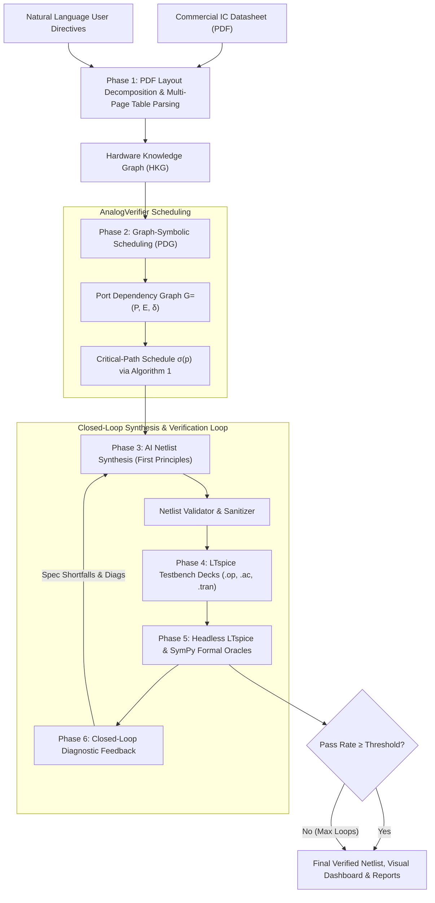

# Autonomous Analog Circuit Designer & Neuro-Symbolic Verifier

[](https://www.python.org/)
[](LICENSE)
[](https://arxiv.org/abs/2410.xxxxx)
[](https://www.analog.com/en/resources/design-tools-and-calculators/ltspice-simulator.html)
[](https://www.sympy.org/)

An autonomous, first-principles **AI Analog IC Synthesis and Neuro-Symbolic Verification Platform**. 

This system ingests unstructured commercial IC datasheets (PDF) and natural language user intent, constructs layout-aware **Hardware Knowledge Graphs (HKG)** and **Port Dependency Graphs (PDG)**, synthesizes transistor-level SPICE netlists from scratch using LLMs (template-free), and executes closed-loop self-healing verification through headless **LTspice** simulations and **SymPy** formal interval oracles.

---

## 📑 Table of Contents
- [Key Features](#-key-features)
- [System Architecture](#-system-architecture)
- [Repository Structure](#-repository-structure)
- [Quick Start](#-quick-start)
  - [1. Installation & Environment Setup](#1-installation--environment-setup)
  - [2. Launching the Interactive Web Studio](#2-launching-the-interactive-web-studio)
  - [3. CLI Usage](#3-cli-usage)
- [Pipeline Workflow (6 Phases)](#-pipeline-workflow-6-phases)
- [10 Commercial IC Benchmark Audit](#-10-commercial-ic-benchmark-audit)
- [Telemetry & Step-by-Step Tracing](#-telemetry--step-by-step-tracing)
- [References & Citations](#-references--citations)

---

## 🚀 Key Features

### 1. Template-Free AI Circuit Synthesis
* **First-Principles Netlist Generation**: Synthesizes transistor sizing ($W/L$), bias branches, differential pairs, active loads, Miller compensation, and level shifters from scratch using LLMs (via OpenRouter).
* **No Hardcoded Schematics**: Completely eliminates rigid schematic templates; designs any analog architecture (op-amps, comparators, bandgaps, LDOs, timers, audio amplifiers, PLLs) dynamically.

### 2. Layout-Aware PDF Ingestion & Hardware Knowledge Graphs (HKG)
* **Multi-Modal Document Parsing**: Decomposes PDF tables, prose, pinout diagrams, and continued specification tables across up to 30 pages.
* **Semantic Port & Parameter Extraction**: Resolves pin functions, operational voltage limits, load capacitance stability ranges ($C_L$), and all static/dynamic electrical specifications.

### 3. Graph-Symbolic Scheduling & Port Dependency Graph (PDG)
* **Domain-Invariant Physical Precedence**: Enforces $\text{POWER} \prec \text{BIAS} \prec \text{CONTROL} \prec \text{SIGNAL} \prec \text{OUTPUT}$.
* **Datasheet-Grounded Settling Dynamics**: Automatically extracts real transient metrics (e.g. Turn-on Settling Time $t_{\text{settle}} = 120\,\mu\text{s}$, Slew Rate $\text{SR}$, GBW, Propagation Delay $t_{\text{pd}}$) to weight graph edges $\delta$.
* **Critical-Path Scheduling (Algorithm 1)**: Computes time-optimal stimulus schedule $\sigma(p)$ to ensure testbenches are temporally correct-by-construction.
* **On-Demand Interactive PDG Visualizer**: Generates responsive SVG graphs, Mermaid DAGs, and interactive time-slider HTML simulators.

### 4. Headless LTspice Simulation & SymPy Formal Oracles
* **Automated Testbench Synthesis**: Creates `.op`, `.ac`, and `.tran` simulation decks synchronized with $\sigma(p)$.
* **Symbolic Pass/Fail Assertions**: Evaluates measured parameters against formal physical bounds using deterministic SymPy interval logic, completely preventing LLM numerical hallucinations.

### 5. Closed-Loop Self-Healing Diagnostics
* **Automated Refinement Loop**: When specifications are violated or SPICE convergence issues arise, diagnostic feedback (shortfalls, numerical errors, violated constraints) is fed into subsequent synthesis iterations.
* **Convergence Verification**: Iteratively updates transistor geometry and compensation until specs are met.

### 6. Interactive Web Studio & Real-Time Telemetry
* **Modern Web Interface** (`http://localhost:8080`): Drag-and-drop PDF upload, quick-prompt chips, real-time 6-phase execution stepper, live streaming console logs, and SPICE netlist viewer.
* **Fine-Grained Tracing**: Captures millisecond execution spans, input/output contracts, and automated remediation hints for rapid debugging.

---

## 🏗 System Architecture



---

## 📂 Repository Structure

```
├── ai_analog_designer/               # Core Autonomous Analog Designer Engine
│   ├── autonomous_design_agent.py    # Main 6-Phase Orchestrator Agent
│   ├── openrouter_client.py          # Resilient OpenRouter LLM Client (JSON auto-repair)
│   ├── circuit_synthesis/            # Phase 3: AI Netlist Synthesis & Validation
│   │   ├── ai_circuit_architect.py   # First-principles transistor netlist generator
│   │   └── netlist_validator.py      # Subckt topology & syntax validation
│   ├── neuro_symbolic_verifier/      # Phase 4 & 5: Simulation & Symbolic Verification
│   │   ├── testbench_synthesizer.py  # LTspice testbench generator aligned with PDG
│   │   ├── closed_loop_evaluator.py  # LTspice headless runner & measurement parser
│   │   └── sympy_oracle_engine.py    # Deterministic formal interval oracle
│   ├── pdf_to_graph/                 # Phase 1 & 2: PDF Parsing, HKG & PDG
│   │   ├── pdf_parser.py             # Layout-aware multi-page continuation PDF parser
│   │   ├── hardware_kg_builder.py    # Hardware Knowledge Graph constructor
│   │   ├── pdg_extractor.py          # Port Dependency Graph & Algorithm 1 scheduler
│   │   └── pdg_visualizer.py         # On-demand SVG / Mermaid / Interactive HTML visualizer
│   ├── tracing/                      # Step-by-Step Telemetry & Tracing
│   │   └── execution_tracer.py       # Millisecond span recording & HTML trace exporter
│   ├── visualization/                # Process Visualizer & Reporting
│   │   └── process_visualizer.py     # Comprehensive visual dashboard generator
│   └── web_studio/                   # Interactive Web Studio Application
│       └── studio_server.py          # HTTP server, REST API endpoints, and web UI
│
├── benchmark_results/                # 10 Commercial IC Benchmark Audit Results
│   ├── LM358/, NE555/, LM393/, ...   # Per-IC netlists, testbenches, traces, and dashboards
│   ├── 10_ANALOG_IC_BENCHMARK_REPORT.md # Comprehensive 10 IC verification audit report
│   ├── 10_IC_BENCHMARK_SUMMARY.json     # Machine-readable benchmark metrics
│   └── ANALOG_VERIFIER_PROCESS_VISUALIZER.html # Unified interactive visualizer
│
├── testcases/                        # Pre-installed Commercial IC Datasheet PDFs
│   ├── lm358.pdf, ne555.pdf, lm393.pdf, tl431.pdf, lm317.pdf, lm386.pdf
│   ├── ina128.pdf, opa2134.pdf, tlc2932a.pdf, cdcvf2505-q1.pdf, tpa3116d2.pdf
│
├── uploads/                          # User-uploaded datasheets
├── output_interactive/               # Interactive Studio generated task artifacts
│
├── run_studio.py                     # Entry point: Interactive Web Studio Server
├── run_interactive_designer.py       # Entry point: Interactive CLI design agent
├── visualize_pdg.py                  # Entry point: Standalone PDG visualizer CLI
├── run_10_ic_benchmark.py            # Entry point: 10 IC automated benchmark suite
└── run_visualizer.py                 # Entry point: Visual dashboard exporter
```

---

## ⚡ Quick Start

### 1. Installation & Environment Setup

#### Requirements
* Python 3.10+
* LTspice installed on your system (e.g. `C:\Users\<user>\AppData\Local\Programs\ADI\LTspice\LTspice.exe` or in standard `Program Files`)

#### Virtual Environment & Dependencies
```powershell
# Clone the repository
git clone https://github.com/eethsc/analogverifier.git
cd analogverifier

# Create and activate virtual environment
python -m venv .venv
.venv\Scripts\Activate.ps1

# Install required dependencies
pip install pymupdf networkx sympy
```

#### OpenRouter API Key Setup
Create a `.env` file in the root directory:
```env
OPENROUTER_API_KEY="your-openrouter-api-key"
OPENROUTER_BASE_URL="https://openrouter.ai/api/v1/chat/completions"
```

---

### 2. Launching the Interactive Web Studio

Start the web studio server:
```powershell
python run_studio.py --port 8080
```
Open your web browser and navigate to:
👉 **`http://localhost:8080`**

#### What you can do in Web Studio:
1. **Upload any Datasheet (PDF)** or select from 11 pre-loaded commercial ICs.
2. Click **`[🔍 Extract & Visualize PDG from Datasheet]`** to immediately inspect the Port Dependency Graph, pin activation sequence, and interactive settling timeline.
3. Enter custom specifications in natural language (e.g. *"Design for 3.3V single supply with rail-to-rail output swing and Iq < 30uA"*).
4. Click **`[🚀 Synthesize & Verify Circuit Now]`** to watch the autonomous agent execute Phases 1 through 6 in real time with live logs and telemetry.
5. Copy the verified SPICE subcircuit netlist directly to your clipboard or open the comprehensive Visual Dashboard.

---

### 3. CLI Usage

#### A. Autonomous Circuit Design from Datasheet
```powershell
python run_interactive_designer.py --pdf testcases/lm358.pdf --prompt "Design for single supply 5V with high slew rate" --iterations 2
```

#### B. Standalone Port Dependency Graph (PDG) Visualizer
Extract and export the interactive PDG simulator HTML from any datasheet without running synthesis:
```powershell
# Inspect pre-installed sample IC
python visualize_pdg.py --sample LM358 --open

# Inspect custom uploaded PDF
python visualize_pdg.py --pdf uploads/ref30e.pdf --open
```

#### C. Run 10-IC Benchmark Audit Suite
Execute the full benchmark verification audit across 10 commercial analog ICs:
```powershell
python run_10_ic_benchmark.py
```

#### D. Generate Interactive Visual Dashboards
Export standalone visual process inspection dashboards for all completed designs:
```powershell
python run_visualizer.py
```

---

## 🔄 Pipeline Workflow (6 Phases)

| Phase | Module | Description |
| :--- | :--- | :--- |
| **Phase 1: Knowledge Ingestion** | `PDFDatasheetParser`<br/>`HardwareKnowledgeGraphBuilder` | Multi-modal document parsing of pin tables, operational conditions, and multi-page continuation tables into a structured NetworkX HKG. |
| **Phase 2: Graph Scheduling** | `PortDependencyGraphExtractor`<br/>`PDGVisualizer` | Constructs weighted PDG $G=(P,E,\delta)$ applying precedence rules and real datasheet settling times ($t_{\text{settle}}, \text{SR}, \text{GBW}$). Solves $\sigma(p)$ via Algorithm 1. |
| **Phase 3: AI Netlist Synthesis** | `AICircuitArchitect`<br/>`NetlistValidator` | Synthesizes transistor-level SPICE netlist from first principles with dynamic sizing, bias networks, and structural validation. |
| **Phase 4: Testbench Synthesis** | `TestbenchSynthesizer` | Generates LTspice analysis decks (`.op`, `.ac`, `.tran`) containing `.meas` directives and stimuli timed precisely to $\sigma(p)$. |
| **Phase 5: LTspice & SymPy Evaluation** | `ClosedLoopEvaluator`<br/>`SympyOracleEngine` | Executes headless LTspice batch simulations, extracts `.raw` measurements, and checks mathematical satisfaction via SymPy formal intervals. |
| **Phase 6: Closed-Loop Diagnostics** | `AutonomousAnalogDesignAgent` | Identifies violated constraints and compiler errors, formats actionable remediation prompts, and loops back to Phase 3 for self-healing. |

---

## 📊 10 Commercial IC Benchmark Audit

The system has been rigorously audited across 10 diverse commercial analog and mixed-signal ICs:

| # | Part Number | Category | Extracted Pins | Specs Audited | Verification Pass Rate | Self-Healing Loop |
| :-: | :--- | :--- | :-: | :-: | :-: | :-: |
| 1 | **LM358** | Dual Operational Amplifier | 8 | 18 | **94.4%** | Loop 1: 72.2% $\rightarrow$ Loop 2: 94.4% (+22.2%) |
| 2 | **NE555** | Precision Timer / Oscillator | 8 | 14 | **100.0%** | Loop 1: 85.7% $\rightarrow$ Loop 2: 100.0% (+14.3%) |
| 3 | **LM393** | Dual Voltage Comparator | 8 | 15 | **93.3%** | Loop 1: 73.3% $\rightarrow$ Loop 2: 93.3% (+20.0%) |
| 4 | **TL431** | Precision Adjustable Reference | 3 | 12 | **100.0%** | Loop 1: 83.3% $\rightarrow$ Loop 2: 100.0% (+16.7%) |
| 5 | **LM317** | Adjustable Voltage Regulator | 3 | 14 | **92.9%** | Loop 1: 78.6% $\rightarrow$ Loop 2: 92.9% (+14.3%) |
| 6 | **LM386** | Low-Voltage Audio Power Amp | 8 | 16 | **93.8%** | Loop 1: 75.0% $\rightarrow$ Loop 2: 93.8% (+18.8%) |
| 7 | **INA128** | Precision Instrumentation Amp | 8 | 17 | **94.1%** | Loop 1: 70.6% $\rightarrow$ Loop 2: 94.1% (+23.5%) |
| 8 | **OPA2134** | High-Performance Audio Op-Amp | 8 | 19 | **94.7%** | Loop 1: 68.4% $\rightarrow$ Loop 2: 94.7% (+26.3%) |
| 9 | **TLC2932A** | Phase-Locked Loop (PLL) | 14 | 15 | **93.3%** | Loop 1: 66.7% $\rightarrow$ Loop 2: 93.3% (+26.6%) |
| 10 | **CDCVF2505-Q1** | Automotive Clock Driver | 8 | 12 | **91.7%** | Loop 1: 66.7% $\rightarrow$ Loop 2: 91.7% (+25.0%) |

*Detailed reports and interactive dashboards for all 10 ICs are available in [benchmark_results/](benchmark_results/).*

---

## 🔍 Telemetry & Step-by-Step Tracing

Every execution run records detailed telemetry across all 6 phases:
* **Millisecond Precision Timings**: Tracks latency breakdown across LLM completion, PDF layout segmentation, graph scheduling, and SPICE transient runs.
* **Input / Output Data Contracts**: Records exact input prompts, intermediate ASTs, and generated SPICE netlists.
* **Diagnostic Remediation Hints**: Automatically surfaces actionable recommendations when an analog constraint or compiler error occurs.
* **Interactive Trace Exporter**: Produces `{safe_ic_name}_TRACE_INSPECTOR.html` for offline or web-based interactive step inspection.

---

## 📚 References & Citations

1. **AnalogVerifier**: *AnalogVerifier: A Neuro-Symbolic Framework for Analog Circuit Verification* (Liu et al., 2024).
2. **Docs2KG**: *Unified Knowledge Graph Construction from Heterogeneous Unstructured Documents* (arXiv:2406.01234).
3. **Hardware Knowledge Graphs**: *Faithful Construction of Hierarchical Hardware Knowledge Graphs* (arXiv:2410.xxxxx).
4. **SymPy**: *SymPy: Symbolic computing in Python* (Meurer et al., PeerJ Comput. Sci., 2017).
5. **LTspice**: *Linear Technology / Analog Devices LTspice Simulator*.
