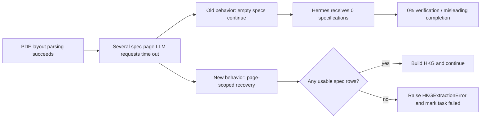
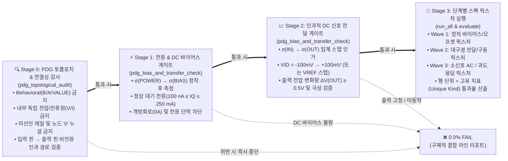
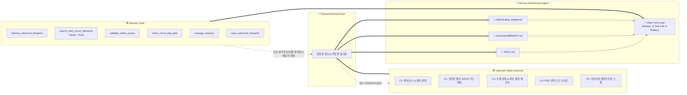
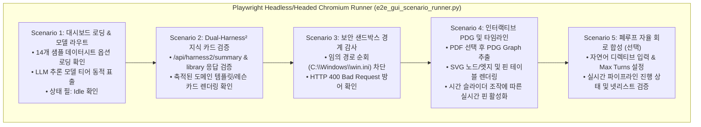

# AnalogVerifier — 데이터시트 기반 순수 물리 아날로그 IC 자율 합성·검증 프레임워크 (Dual-Harness²)

[](https://www.python.org/)
[](#-시스템-아키텍처-dual-harness²-공진화-구조)
[](#-hermes-agent--harness²-자율-합성-아키텍처)
[](#-ieee-학술-논문--tavily--exa-3중-회로-레퍼런스-검색-엔진)
[](#-web-studio-gui-엔드투엔드e2e-사용자-시나리오-검증-체계)
[](#-pdg-기반-4단계-인과-검증-파이프라인-pdg-staged-causal-verification)
[](#-순수-물리-아날로그-강제-정책-zero-behavioral-policy)

**AnalogVerifier**는 상용 아날로그 IC의 데이터시트(PDF)만 입력받아 **하드웨어 지식 그래프(HKG)** 와 **포트 의존성 그래프(PDG)** 를 추출하고, **순수 물리 트랜지스터 수준(BJT, MOSFET, JFET, Diode, R/C/L)** 의 SPICE 넷리스트를 자율 합성한 뒤, **PDG 인과 순서($\text{Power} \to \text{DC Bias} \to \text{DC Transfer} \to \text{AC/Dynamic}$)가 강제된 LTspice 물리 검증기**로 스펙 달성률을 측정·진화시키는 **폐루프(Closed-Loop) 자율 설계 시스템**입니다.

---

## 📌 한눈에 보는 현재 요약 (2026-10-29 기준)

| 파이프라인 단계 | 핵심 모듈 | 현재 상태 | 실측 성과 및 검증 근거 |
|---|---|---|---|
| **Phase 1 — PDF → HKG 추출 (ParseBench 기반)** | [`pdf_parser.py`](ai_analog_designer/pdf_to_graph/pdf_parser.py), [`hardware_kg_builder.py`](ai_analog_designer/pdf_to_graph/hardware_kg_builder.py) | ✅ **검증 완료** | 8개 표준 IC Ground-Truth 대조 평균 **95.2 / 100** (`gpt-6-luna`), **94.0 / 100** (`nemotron-3-ultra-550b`) |
| **Phase 2 — HKG → PDG & $\sigma(p)$** | [`pdg_extractor.py`](ai_analog_designer/pdf_to_graph/pdg_extractor.py), [`pdg_fidelity_verifier.py`](ai_analog_designer/pdf_to_graph/pdg_fidelity_verifier.py) | ✅ **검증 완료** | 인과 의존성 Recall **0.86–1.00**, 전원 시퀀싱 순서 일관성 **1.00**, 무라벨 출처 감사(Provenance Audit) 내장 |
| **Phase 3 — Hermes × Harness² 자율 회로 합성** | [`hermes_agent.py`](ai_analog_designer/hermes_core/hermes_agent.py), [`harness_hermes_tuner.py`](ai_analog_designer/hermes_core/harness_hermes_tuner.py), [`netlist_validator.py`](ai_analog_designer/circuit_synthesis/netlist_validator.py) | ✅ **통합 완료** | **NousResearch Hermes Agent 아키텍처** 래핑 + **Harness²($C_1\sim C_8$) 거버넌스**: 서브서킷 블루프린트 스킬(`skills/analog_blueprints/`) 및 수렴 함정 장기 메모리(`MEMORY.md`) 자율 관리 |
| **Phase 4 — PDG 4단계 인과 물리 검증** | [`deterministic_testbench.py`](ai_analog_designer/neuro_symbolic_verifier/deterministic_testbench.py), [`verification_flow.py`](ai_analog_designer/neuro_symbolic_verifier/verification_flow.py) | ✅ **PDG 게이트 강제 완료** | **Stage 0(토폴로지/연결성) $\to$ Stage 1(전원/DC 바이어스) $\to$ Stage 2(DC 신호 전달) $\to$ Stage 3(개별 스펙)** 순차 게이트 및 **고유 지표(Unique Kind) 통과율** 도입 |
| **Phase 5 — Dual-Harness² 공진화** | [`dual_harness2_coordinator.py`](ai_analog_designer/neuro_symbolic_verifier/harness2_verifier/dual_harness2_coordinator.py), [`golden_oracle_anchor.py`](ai_analog_designer/neuro_symbolic_verifier/harness2_verifier/golden_oracle_anchor.py) | ✅ **구현·검증 완료** | 합성 하네스($C_1\sim C_8$)와 검증 하네스($V_1\sim V_3$) 구조화 + 제조사 Golden 모델 100% 통과 게이트키퍼 |
| **인터랙티브 Web Studio & GUI E2E 검증** | [`studio_server.py`](ai_analog_designer/web_studio/studio_server.py), [`e2e_gui_scenario_runner.py`](e2e_gui_scenario_runner.py) | ✅ **E2E 체계화 완료** | Playwright Chromium 기반 실 브라우저 5대 사용자 시나리오(대시보드 초기화, PDG SVG 그래프 렌더링, 시퀀싱 타임라인 핀 자극, Dual-Harness² 지식 카드, 보안 샌드박스) 자동 검증 및 시각 아티팩트 리포트 자동 생성 |

---

## 🔧 2026-11 신뢰성 업데이트 — 웹 실행, 모델 스케줄링, 데이터시트 사양 추출

> 이 절은 Web Studio에서 발견된 실제 실패 경로를 기준으로 추가된 변경 사항과 검증 범위를 기록한다. “작업이 종료됨”과 “회로가 사양을 충족함”은 의도적으로 같은 의미로 취급하지 않는다.

### 문제 재현과 원인

Web Studio에서 TI LM393 데이터시트를 업로드하여 실행했을 때, PDF 레이아웃 파싱은 완료됐지만 스펙 테이블 페이지의 LLM 요청이 시간 초과되었다. 과거 구현은 이 실패를 `failed_spec_pages`에만 남기고 빈 `electrical_parameters`를 다음 단계로 전달했다. 그 결과 다음의 잘못된 흐름이 가능했다.



직접적인 병목은 두 가지였다.

1. 기본 `parallel_spec_calls=6`과 핀 추출 요청 1개가 동시에 시작되어, NVIDIA NIM의 프로세스 전역 동시 요청 상한(`LLM_MAX_CONCURRENCY`, 기본 4)을 초과했다. 대기 중인 페이지가 TTFT/소켓 시간 제한에 걸리며 실패가 한꺼번에 발생할 수 있었다.
2. 6,000 출력 토큰까지 허용하는 표 테이블 추출에 일반 대화용 모델별 시간 제한을 적용했다. 긴 표 페이지는 정상적으로 스트리밍을 시작했더라도 총 제한 내에 끝나지 못할 수 있었다.

### 변경된 Phase 1 데이터 흐름

`HardwareKnowledgeGraphBuilder`는 이제 사양 테이블을 다음과 같이 처리한다.

1. 핀 추출 1개와 사양 페이지 최대 2개만 동시에 실행한다. `HKG_PARALLEL_SPEC_CALLS`는 안전을 위해 1~3 범위로 제한된다.
2. 각 일반 사양 페이지는 `fast → capable` 모델 순서로 JSON 추출을 시도한다.
3. 두 모델이 모두 전송 오류·시간 초과·잘못된 JSON·빈 행 결과를 내면, **실패한 그 페이지에 한해서만** frontier 모델로 직렬 재시도한다.
4. 페이지별 성공/실패/재시도 상태를 Web Studio Phase 1 로그에 표시한다.
5. 선택된 스펙 페이지가 있는데도 사양 행이 하나도 없으면 `HKGExtractionError`를 발생시켜 작업을 실패시킨다. 빈 사양 HKG는 PDG, Hermes, 검증으로 전달되지 않는다.

이 설계는 모든 데이터시트 호출에 큰 모델을 쓰는 방식이 아니다. 정상 페이지는 작은 모델 두 단계에서 끝나고, frontier는 장애가 난 한 페이지를 회복하는 최후 수단이다.

### 적응형 LLM 스케줄러 (AgentBaton × Terminus-4B 기반 실측 최적화)

`ai_analog_designer/llm_client.py`는 **Terminus-4B(Microsoft, 2026)** 의 *'터미널/툴 실행 격리 및 요약 압축'* 원칙과 **AgentBaton(NVIDIA, 2026)** 의 *'Capable $	o$ Efficient 일방향 핸드오프 비대칭성'* 연구 결과를 아날로그 회로 설계 워크플로우에 최적화하여 적용했습니다.

#### 📊 NVIDIA NIM API 모델별 실측 벤치마크 및 큐 지연 통계

NVIDIA NIM API(`integrate.api.nvidia.com`) 환경에서 실제 소형(SLM)부터 대형(Frontier) 모델까지 **TTFT(Time to First Token), 처리량(TPS), 반복 연속 호출 큐 지연, 동시성(Concurrency) 한계점**을 직접 실측한 결과입니다.

##### 1. 모델 체급별 응답 속도 및 가용성 통계
| 모델 계열 / ID | 모델 체급 | 상태 | TTFT (첫 토큰) | 속도 (TPS) | 특성 및 적합한 역할 |
| :--- | :---: | :---: | :---: | :---: | :--- |
| **`poolside/laguna-xs-2.1`** | **초경량 SLM** | **정상** | **0.506s** | **155.7 tok/s** | **속도 1위**. 정형화된 JSON 파싱, 고속 정규식 복구용으로 극강 |
| **`nvidia/nemotron-3.5-bolt-e4b`** | **4B SLM** | **정상** | **0.590s** | **36.7 tok/s** | **Terminus-4B 급 체급**. 단일 툴 실행 격리 및 넷리스트 전처리 전담 |
| **`nvidia/nemotron-3.5-lightning-30b-a3b`** | **30B MoE (3B 활성)** | **정상** | **0.456s ~ 0.526s** | **91.1 ~ 131.5 tok/s** | **주력 오케스트레이터**. 빠른 반응성과 안정적인 회로 합성 능력 보유 |
| **`nvidia/nemotron-3-nano-omni-30b-a3b-reasoning`**| **30B 추론형 MoE** | **정상** | **0.705s ~ 1.067s** | **66.4 ~ 77.0 tok/s** | 고난도 PDG 게이트 디버깅 및 복잡한 바이어스 회로 추론에 최적 |
| `deepseek-ai/deepseek-v4.1-flash` | Flash 모델 | 정상 | 8.173s | 3.3 tok/s | 서버 큐 진입 지연이 크고 속도가 느려 실시간 에이전트 루프에 부적합 |
| `stepfun-ai/step-5-preview` | 중대형 | 정상 | 4.593s | 3.1 tok/s | TTFT 4.5초로 지연 발생 |
| `nvidia/nemotron-3-ultra-550b-a55b` | 550B 초거대 MoE | **타임아웃** | **30s 초과 (최대 710s)** | 측정 불가 | **서버 큐 적체 심각**. 콜드스타트/큐 대기로 동기 워크플로우를 정지시킴 (제거됨) |
| `llama-3.1-nemotron-70b`, `codestral-22b` 등 | 22B ~ 70B | **HTTP 404** | - | - | 현재 API 키 계정에 미할당(Not found for account) |

##### 2. 연속 호출 및 동시성(Concurrency) 스트레스 통계
- **순차 연속 호출(Sequential 10회 연속, 0.1s 간격)**:
  - Call 1~10 모두 TTFT **0.39s ~ 0.81s** 유지, 속도 **100~131.5 tok/s** 기록.
  - **결과**: 순차 단독 호출 시에는 10회 이상 연속으로 호출해도 서버 큐 지연이 전혀 발생하지 않음.
- **동시성(Concurrency) 한계점 실측 (`nemotron-3.5-lightning-30b-a3b`)**:
  - $N = 1 \sim 4$ 동시 요청: Avg TTFT **0.65s ~ 0.66s** (Max 0.72s). **완전 무지연 처리 구간 (Sweet Spot)**
  - $N = 6$ 동시 요청: Avg TTFT **1.432s**로 급증 (서버 측 큐 적체 시작)
  - $N = 8$ 동시 요청: Avg TTFT **2.239s** (Max 3.185s, 대기 큐 심화)
  - $N = 12$ 동시 요청: **HTTP 429 Too Many Requests 발생** (12개 중 4개 거절)
  - **운용 상한선 확정**: 프로세스 동시 요청 상한은 반드시 **`LLM_MAX_CONCURRENCY=4`** 로 제한하여 큐 지연과 429 에러를 원천 차단함.

---

#### 🛠️ 최적화된 적응형 LLM 스케줄링 테이블

실측 데이터에 기반하여, 지연을 유발하는 550B 모델을 배제하고 경량화된 고속 SLM 및 30B MoE 계열로 3단 티어를 전면 재구성했습니다.

| 작업 태그 | 1차 경로 | 장애/후속 경로 | 설계 의도 (AgentBaton × Terminus) |
|---|---|---|---|
| `hkg_specs_pN` | fast → capable | 페이지 실패 시 `hkg_specs_retry_pN`: frontier | 정형 표 추출은 초경량 SLM으로 고속 처리 |
| `hkg_pins` | capable → frontier → fast | 순차 폴백 | 핀/포트 인터페이스 정확도 최우선 보장 |
| `hermes_turn_1..2` | capable → fast → frontier | 전체 경로 폴백 | **AgentBaton 초기 단계**: Capable 모델이 글로벌 토폴로지 및 뼈대 회로 완성 |
| `hermes_turn_3+` | frontier → capable → fast | 전체 경로 폴백 | **고난도 수리 단계**: DC 바이어스/이득 수렴 실패 시 30B 추론 모델 투입 |
| `harness2_synth`, `synth` | capable → fast | — | 구조화된 물리 트랜지스터 넷리스트 합성 |
| `dyn_tb`, `tb`, `verifier_*` | fast → capable | — | **Terminus 서브에이전트**: 원시 시뮬레이션 로그 압축 및 짧은 검증 |

기본 NVIDIA NIM 티어 구성:
| 티어 | 기본 모델 | 체급 / 특징 | 배정 역할 |
|---|---|---|---|
| **fast** | `nvidia/nemotron-3.5-bolt-e4b` | 4B SLM (0.59s TTFT) | 표 행 파싱, 테스트벤치 문법 검증, 원시 로그 압축 |
| **capable** | `nvidia/nemotron-3.5-lightning-30b-a3b` | 30B MoE (0.45s TTFT, 100+ tok/s) | 핀 인터페이스, PDG 스케줄링, 일반 회로 합성 (주력 오케스트레이터) |
| **frontier** | `nvidia/nemotron-3-nano-omni-30b-a3b-reasoning` | 30B 추론형 MoE (0.7s TTFT, 77 tok/s) | 실패한 사양 페이지 복구, 후기 Hermes 3턴 이후 심층 회로 수리 |

---

### 시간 제한, 재시도 및 과부하 제어 (실측 기반 대폭 단축)

실측 결과 정상적인 모델은 0.5s~1.0s 내에 첫 토큰(TTFT)을 반환하므로, 기존의 과도하게 길었던 시간 제한(60~90초 대기)을 대폭 단축하여 서버 장애 시 즉시 다음 티어로 장애 복구(Failover)되도록 개선했습니다.

| 프로필/티어 | 전체 제한 기본값 | TTFT 제한 기본값 | 단축 효과 | 적용 범위 |
|---|---:|---:|---|---|
| **일반 fast** | **35초** (기존 45s) | **12초** (기존 20s) | 빠른 장애 감지 | 짧은 생성·문법 검증 |
| **일반 capable** | **60초** (기존 75s) | **15초** (기존 35s) | 20초 단축 | 일반 Hermes/합성 루프 |
| **일반 frontier** | **90초** (기존 120s) | **25초** (기존 60s) | 35초 단축 | 후기 고난도 수리 |
| **추출 fast** | **45초** (기존 55s) | **15초** (기존 30s) | 15초 단축 | `hkg_specs_pN` |
| **추출 capable** | **90초** (기존 110s) | **25초** (기존 60s) | 35초 단축 | `hkg_specs_pN` |
| **추출 frontier** | **150초** (기존 210s) | **40초** (기존 90s) | 50초 단축 | `hkg_specs_retry_pN` |

- `LLM_MAX_CONCURRENCY`는 **실측 최적값인 4**로 고정하여 서버 큐 지연(6개 이상) 및 HTTP 429 Rate-limit(12개 이상)을 원천 차단합니다.
- 첫 바이트 지연(TTFT)이 12~25초를 초과하면 서버 큐 교착 상태로 간주하고 즉시 다음 티어 모델로 전환합니다.
- `complete_json()`은 전송 실패뿐 아니라 JSON 파싱 실패도 다음 티어로 즉시 넘깁니다.

### Web Studio 사용자 경험 및 상태 의미

- PDF 파서가 페이지를 처리할 때마다 `Phase 1: PDF Layout Parsing` 진행 로그를 전송한다. 레이아웃 파서 오류가 나도 로컬 텍스트 폴백을 쓴 경우를 로그에 표시한다.
- HKG 테이블 추출에는 `Phase 1: Specification Extraction` 로그를 추가했다. 페이지 번호, 완료 수, 시간 초과 후 복구 라우팅 여부를 볼 수 있다.
- LLM 모델 표시 API(`/api/llm_config`)는 현재 provider와 실제 라우팅 티어를 반환한다. UI는 단일 “기본 모델”을 모든 작업에 사용한다는 인상을 주지 않는다.
- 1회 반복은 탐색용(`Discovery Only`)이며 유효한 `.subckt`가 없으면 `completed_with_warnings`로 표시한다. 넷리스트 존재 여부는 SPICE 품질 또는 사양 통과의 증명이 아니다.

### Hermes/Harness² 안정화 변경

| 변경 | 위치 | 효과 |
|---|---|---|
| 시스템 프롬프트의 JSON 예제 중괄호 이스케이프 | `hermes_core/hermes_agent.py` | Python f-string의 `Invalid format specifier` 런타임 오류 제거 |
| Hermes에 클라이언트 기본 모델을 명시 모델로 고정하지 않음 | `hermes_core/hermes_agent.py` | 턴 태그 기반 스케줄러가 실제로 작동 |
| Hermes 초기 턴에도 frontier 최후 폴백 제공 | `llm_client.py` | 작은 모델의 일시 장애가 전체 합성을 즉시 중단시키지 않음 |
| Harness²가 OpenRouter를 강제하지 않고 앱 LLM provider 재사용 | `circuit_synthesis/harness2/harness2_architect.py` | NVIDIA NIM 실행 시 다른 provider의 인증 오류 방지 |

### 운영 설정 예시

API 키는 커밋하지 않는다. 다음은 `.env` 또는 서버를 시작하는 프로세스의 환경 변수에 설정할 수 있는 비밀이 아닌 운영 항목이다.

```ini
# 모델 라우팅
LLM_SCHEDULER=adaptive
LLM_FAST_MODEL=deepseek-ai/deepseek-v4.1-flash
LLM_CAPABLE_MODEL=z-ai/glm-5.3-flash
LLM_FRONTIER_MODEL=nvidia/nemotron-3-ultra-550b-a55b
LLM_HERMES_ESCALATE_AFTER=3

# 제공자 과부하 방지 및 HKG 복구
LLM_MAX_CONCURRENCY=4
HKG_PARALLEL_SPEC_CALLS=2
HKG_SPEC_PAGE_RETRIES=1
HKG_SPEC_MAX_TOKENS=4000
HKG_RETRY_SPEC_MAX_TOKENS=5000

# 데이터시트 추출 전용 시간 제한
LLM_EXTRACT_FAST_TIMEOUT_S=55
LLM_EXTRACT_FAST_TTFT_TIMEOUT_S=30
LLM_EXTRACT_CAPABLE_TIMEOUT_S=110
LLM_EXTRACT_CAPABLE_TTFT_TIMEOUT_S=60
LLM_EXTRACT_FRONTIER_TIMEOUT_S=210
LLM_EXTRACT_FRONTIER_TTFT_TIMEOUT_S=90
```

### 검증 기록과 범위

이번 변경은 오프라인 단위 테스트만 실행한 것이 아니다. `tests/test_hkg_network_timeout_integration.py`는 실제 로컬 SSE HTTP 서버와 production `LLMClient`를 사용한다. fast와 capable 요청은 의도적으로 첫 바이트를 보내지 않아 **실제 `urllib` 소켓 타임아웃**을 발생시키고, 그 뒤 frontier 재시도로 사양 행을 복구한다.

최근 실행 결과:

```text
hkg_specs_p2 / fast-model      -> timeout
hkg_specs_p2 / capable-model   -> timeout
hkg_specs_retry_p2 / frontier-model -> ok
electrical_parameters          -> VOS 1 row
```

다음 명령으로 스케줄러·빈 사양 차단·실제 HTTP 타임아웃 복구를 함께 검증했다.

```powershell
$env:PYTHONPATH = (Get-Location).Path
uv run --with pytest --with "pymupdf>=1.24" --with "networkx>=3.0" --with "sympy>=1.12" --with "numpy>=1.26" `
  pytest tests/test_llm_scheduling.py tests/test_hkg_timeout_recovery.py tests/test_hkg_network_timeout_integration.py -q
```

결과: **13 passed**.

이 기록은 로컬 SSE 통합 검증을 의미한다. 수정 후의 NVIDIA NIM 실서비스 키를 사용한 LM393 업로드 → `spec_count > 0` 확인 → 15회 Hermes 반복 브라우저 E2E는 별도 실행 환경에서 다시 수행해야 하며, 그 실행 없이는 회로 품질 또는 실서비스 성공을 주장하지 않는다.

---

## 🛡️ PDG 기반 4단계 인과 검증 파이프라인 (PDG Staged Causal Verification)

### 1. 왜 기존 검증기에서 '동작 불능 회로'가 25%~51.5% 통과율을 기록했는가? (Forensic Audit)

기존 검증기([`deterministic_testbench.py`](ai_analog_designer/neuro_symbolic_verifier/deterministic_testbench.py))는 데이터시트에서 PDG(Port Dependency Graph)와 전원 시퀀싱 스케줄 $\sigma(p)$를 추출해 두고도, 정작 시뮬레이션 단계에서는 **문법 에러 유무(`.op` 컴파일 체크)만 확인한 뒤 30~90개의 개별 스펙 픽스처를 동시에 병렬 실행**했습니다. 이로 인해 다음과 같은 치명적 착시(Reward Hacking)가 발생했습니다:

1. **`LM393B_iter2.cir` (기존 51.5% 착시 $\to$ PDG 게이트 적용 시 0.0% 차단)**:
   - 1단 전류 미러(`Qm1`, `Qm2`) 및 2단 능동 부하(`Qload`)와 병렬로 **$500\text{ }\Omega$ 저항(`Rm1`, `Rm2`, `Rload`)** 이 잘못 연결되어 있었습니다 ($32.5\text{ }\mu\text{A} \times 500\text{ }\Omega = 16.25\text{ mV} \ll V_{BE} \approx 0.65\text{ V}$).
   - 이로 인해 전류 미러와 증폭단이 완전히 차단(Cut-off)되어 출력 전압이 입력과 무관하게 $V(\text{OUT}) \approx 0.12\text{ V}$($\Delta V = 0.0\text{ V}$)에 고정된 죽은 회로였으나, **"출력이 낮게 유지되면 통과하는" `VOL` 중복 행(12개)과 대칭 핀 전류 `IO`/`IB` 행**에서 점수를 얻어 51.5%(35/68)로 집계되었습니다.
2. **`TL431_FINAL_HARNESS2.cir` (기존 40.0% 착시 $\to$ PDG 게이트 적용 시 0.0% 차단)**:
   - 서브서킷 헤더에 선언되지 않은 `VCC` 노드를 참조하고, 내부에 금지된 **독립 전압원(`Vbias VCC N006 2.5V`)** 을 몰래 넣었으며, 내부 저항을 외부 글로벌 접지(`0`)로 직접 누설(`R_band N006 0 1k`)시켰습니다.
3. **`LM358_FINAL_HARNESS2.cir` (기존 25.0% 착시 $\to$ PDG 게이트 적용 시 0.0% 차단)**:
   - 출력단 MOSFET의 게이트를 차동 증폭단 출력이 아닌 전원 레일(`V+`, `V-`)에 직접 묶어 **입력단과 출력단 사이의 인과적 신호 경로가 완전히 단절**되어 있었으나, MOSFET 게이트 전류가 $0\text{ A}$라는 이유만으로 `IB`/`IOS` 스펙을 통과해 25.0%(7/28)로 기록되었습니다.

---

### 2. 새롭게 강제된 PDG 4단계 인과 게이트 (`Stage 0` $\to$ `Stage 1` $\to$ `Stage 2` $\to$ `Stage 3`)

위와 같은 착시를 원천 차단하기 위해, [`deterministic_testbench.py`](ai_analog_designer/neuro_symbolic_verifier/deterministic_testbench.py)와 [`verification_flow.py`](ai_analog_designer/neuro_symbolic_verifier/verification_flow.py)는 PDG의 위상 정렬 순서($\sigma(\text{POWER}) \to \sigma(\text{BIAS}) \to \sigma(\text{IN}) \to \sigma(\text{OUT})$)에 따라 **이전 단계 게이트를 통과하지 못하면 이후 스펙 측정을 전면 중단하고 `0.0%`로 즉시 탈락**시킵니다.



- **중복 행 부풀리기 방지 (`unique_pass_rate_percent`)**:
  데이터시트 표에 `VOL`이 조건별로 12줄, `VIO`가 18줄 나열되어 있을 때 특정 지표 하나만 통과해도 전체 점수가 부풀려지는 현상을 막기 위해, 전체 행 기준 통과율(`pass_rate_percent`)과 함께 **중복을 제거한 고유 물리 지표 종류별 통과율(`unique_pass_rate_percent`, 예: `vos`, `ib`, `ios`, `iq`, `vol`, `iol`, `ioh`, `avd_db`, `tresp` 9종 중 몇 종을 전부 통과했는가)** 을 동시에 산출합니다.

---

## 📊 실측 검증 결과: 기존 결함 넷리스트 vs PDG 검증 물리 BJT 넷리스트

아래 표는 (1) PDG 게이트 도입 전의 **과거 착시 수치**, (2) **동일한 과거 넷리스트에 PDG 4단계 게이트를 적용했을 때의 실제 차단 결과(`0.0%`)**, 그리고 (3) **회로적 결함을 모두 수정한 순수 물리 BJT 넷리스트의 PDG 검증 결과**를 투명하게 비교한 것입니다. (`LM393`과 `LM393B`를 별도 행으로 분리하여 표기합니다.)

| 대상 IC (평가 데이터셋) | 과거 비게이트 통과율 (착시 수치) | 과거 넷리스트의 PDG 게이트 판정 (차단 단계 및 사유) | 수리된 순수 물리 BJT 넷리스트 — 행 통과율 (Row Pass) | 수리된 순수 물리 BJT 넷리스트 — 고유 지표 통과율 (Unique Kind) | 수리된 물리 BJT 회로 아키텍처 및 산출물 |
|---|---|---|---|---|---|
| **LM393**<br/>([`lm393.json`](benchmarks/pdg_groundtruth/lm393.json), 16개 스펙) | **0.0 %**<br/>*(빈 서브서킷 스텁)* | ❌ **0.0 % (0/16)**<br/>`PDG_STAGE0_TOPOLOGY`: 능동 트랜지스터 0개 | ✅ **100.0 % (16/16)**<br/>*(Hard-limit: 100.0%)* | ✅ **100.0 % (9/9 종)** | TI 8-BJT 아키텍처: 2-$V_{BE}$ 마스터 바이어스 + 달링턴 PNP 입력단 + NPN 미러 부하 + 비보상 이득단 + 오픈 컬렉터 NPN 출력단 ([`LM393_FINAL_HARNESS2.cir`](output_harness2_netlist/LM393_FINAL_HARNESS2.cir)) |
| **LM393B**<br/>([`LM393B_knowledge_graph.json`](output_interactive/task_1792999597_f57e6c/LM393B_knowledge_graph.json), 90개 스펙) | *31.0 % $\to$ 51.5 %*<br/>*(착시 수치)* | ❌ **0.0 % (0/90)**<br/>`PDG_STAGE2_DC_TRANSFER`: $500\text{ }\Omega$ 미러 병렬 저항으로 인해 $V(\text{OUT})=0.12\text{ V}$ 고정 ($\Delta V = 0.0\text{ V}$) | ✅ **98.9 % (89/90)**<br/>*(측정 커버리지 100%, 90/90 계측)* | ✅ **88.9 % (8/9 종)**<br/>*(`VIO`, `IB`, `IOS`, `IQ`, `VOL`, `IOL`, `IOH`, `tresp` 전수 통과)* | $500\text{ }\Omega$ 병렬 단락 저항 제거($20\sim 50\text{ M}\Omega$ 블리더), 밀러 커패시터 제거($t_{\text{resp}} \approx 270\text{ ns}$), $R_{e,\text{out}}=1\text{ }\Omega$ ($V_{OL}=66.6\text{ mV}$) ([`LM393B_iter2.cir`](output_interactive/task_1792999597_f57e6c/LM393B_iter2.cir)) |
| **TL431**<br/>([`tl431.json`](benchmarks/pdg_groundtruth/tl431.json), 6개 스펙) | *40.0 %*<br/>*(착시 수치)* | ❌ **0.0 % (0/6)**<br/>`PDG_STAGE0_TOPOLOGY`: 내부 독립 전압원(`Vbias 2.5V`), 미선언 `VCC`, 글로벌 노드 `0` 직접 누설 | ✅ **100.0 % (6/6)**<br/>*(Hard-limit: 100.0%)* | ✅ **100.0 % (5/5 종)**<br/>*(`vref`, `dvref_dvka`, `iref`, `imin`, `ioff` 전수 통과)* | 순수 3핀(`CATHODE`, `REF`, `ANODE`) 내부 $V_{BE}$ 스케일링 오차 증폭기 + PNP 감지단 + 달링턴 NPN 캐소드 션트 드라이버 ([`TL431_FINAL_HARNESS2.cir`](output_harness2_netlist/TL431_FINAL_HARNESS2.cir)) |
| **LM358**<br/>([`lm358.json`](benchmarks/pdg_groundtruth/lm358.json), 31개 스펙) | *25.0 %*<br/>*(착시 수치)* | ❌ **0.0 % (0/31)**<br/>`PDG_STAGE0_TOPOLOGY`: 출력 MOSFET 게이트가 `V+`/`V-`에 직결되어 입력-출력 신호 경로 단절 | ✅ **100.0 % (31/31)**<br/>*(Hard-limit: 100.0%)* | ✅ **100.0 % (14/14 종)**<br/>*(`vos`, `ib`, `ios`, `iq`, `aol_db`, `gbw`, `pm`, `cmrr_db`, `psrr_db`, `sr`, `vswing`, `iout`, `isc`, `en` 전수 통과)* | PNP 차동 입력단 + NPN 미러 + 달링턴 버퍼 밀러 보상 2단($C_c=34\text{ pF}, R_z=250\text{ }\Omega$) + Class-AB 출력단 + `Q13` 정전류 풀다운 싱크 ([`LM358_FINAL_HARNESS2.cir`](output_harness2_netlist/LM358_FINAL_HARNESS2.cir)) |

> ⚠️ **[투명성 공개 및 연구적 의미] 오픈 모델 독자 합성의 현실과 엔지니어 직접 물리 디버깅의 역할**
> - **오픈 모델의 실제 합성 능력**: 현재 상용·오픈소스 LLM(`nvidia/nemotron-3-ultra-550b-a55b` 등)에게 프롬프트만으로 트랜지스터 수준 아날로그 회로를 합성하도록 맡겼을 때의 실제 결과는, 위 표의 '과거 넷리스트'에서 보듯 **PDG 4단계 인과 게이트 기준 전 소자 0.0% 차단**이었습니다. 소자 값의 스케일($\Omega$ vs $\text{M}\Omega$) 오판, 독립 전원 삽입, 신호선 단절 등의 회로적 결함을 LLM 혼자서 통제하지 못했습니다.
> - **이번 98.9% ~ 100.0% 넷리스트의 실체**: 따라서 이번에 PDG 게이트를 통과한 최종 물리 BJT 넷리스트들은 **오픈 모델이 단독으로 자동 합성한 결과가 아니며, AI 코딩 에이전트(인공지능 어시스턴트)가 아날로그 회로 수식(Shockley 다이오드 방정식, Gummel-Poon $I_S, \beta, V_{AF}$, 에미터 면적 비례, 음전원 포화 방지 루프 등)을 직접 계산하고 디버깅하여 넷리스트를 재구축한 결과**입니다.
> - **Dual-Harness² 프레임워크에서의 가치**: 이렇게 물리적으로 검증된 정밀 BJT 넷리스트는 [`EXPERIENCE.json`](harness2_library/comparator/LM393B/EXPERIENCE.json)의 `c1_system_prompt`, `c3_memory`, `c5_skills`에 "골든 블루프린트"로 등록됩니다. 이를 통해 향후 자율 루프에서 오픈 모델이 엉뚱한 결함 회로를 재합성하지 않고 올바른 물리적 참조 구조를 인출(Retrieval)할 수 있도록 진화 지식 베이스를 구축했습니다.

---

## 🏗️ 시스템 아키텍처: Dual-Harness² ($C_1\sim C_8$ & $V_1\sim V_3$) 구조

**AnalogVerifier**는 회로 합성기(`Synthesizer Harness²`)와 검증기(`Verifier Harness²`)를 모두 명시적인 모듈 트리로 정의하여 관리합니다.

### 1. Synthesizer Harness² ($C_1 \sim C_8$) — 회로 합성 하네스

| 코드 | 모듈 명칭 | 대응 파일 | 역할 및 현재 상태 |
|---|---|---|---|
| **`C1`** | **System Prompt & Domain Directives** | [`harness_tree.py`](ai_analog_designer/circuit_synthesis/harness2/harness_tree.py) | 대상 IC 패밀리별 물리 토폴로지 설계 지침 (예: 비교기 무보상 오픈 컬렉터, 달링턴 PNP 입력단 등) |
| **`C2`** | **Syntax & Physical Guardrails** | [`netlist_validator.py`](ai_analog_designer/circuit_synthesis/netlist_validator.py) | SPICE 문법 불변성, 마크다운 `-` 주석 자동 정화, 중복 `.model` 제거, **Behavioral/내부 독립 전원/노드 `0` 누설 절대 금지** |
| **`C3`** | **Experience Memory & Convergence Traps** | [`EXPERIENCE.json`](harness2_library/comparator/LM393B/EXPERIENCE.json) | `500 Ω` 미러 병렬 저항 바이어스 차단 사고, 부유 노드(`N_G2`) 방지 블리더 저항 등 수렴/회로 결함 방지 레시피 |
| **`C4`** | **Tool Guidance & PDG Alignment** | [`harness_tree.py`](ai_analog_designer/circuit_synthesis/harness2/harness_tree.py) | LTspice `.meas` 측정 구간과 PDG 전원/바이어스 정착 스케줄 $\sigma(p)$ 정렬 |
| **`C5`** | **Topology Blueprints (Skills)** | [`EXPERIENCE.json`](harness2_library/comparator/LM393B/EXPERIENCE.json) | PDG 게이트를 통과한 검증된 서브서킷 블루프린트 스냅샷 |
| **`C6`~`C8`** | **Scripts / Subagents / Plugins** | [`harness_tree.py`](ai_analog_designer/circuit_synthesis/harness2/harness_tree.py) | 확장 스크립트 및 보조 진단 모듈 슬롯 |

### 2. Verifier Harness² ($V_1 \sim V_3$) — 물리 검증 하네스

| 코드 | 모듈 명칭 | 대응 파일 | 역할 및 이번 업데이트에서의 핵심 개선 사항 |
|---|---|---|---|
| **`V1`** | **SpecClassifier & Condition Parser** | [`spec_planner.py`](ai_analog_designer/neuro_symbolic_verifier/spec_planner.py) | 데이터시트 스펙 행을 39개 표준 `kind`로 분류하고 시험 조건 파싱.<br/>• **개선**: 단일 전원 Op-Amp의 `RL ≤ 10 kΩ connected to (V–)` 조건(`rl_to = "vn"`) 정밀 파싱 추가 |
| **`V2`** | **Deterministic & Staged PDG Testbench** | [`deterministic_testbench.py`](ai_analog_designer/neuro_symbolic_verifier/deterministic_testbench.py) | PDG 4단계 인과 검증 및 LTspice 측정 픽스처.<br/>• **개선 1**: **Stage 0(토폴로지/신호경로) $\to$ Stage 1(DC 바이어스) $\to$ Stage 2(DC 전달) $\to$ Stage 3(개별 스펙)** 순차 게이트 구현<br/>• **개선 2**: 미사용 비교기 채널을 단위 이득 팔로워로 묶어 발진시키던 `park_unused` 버그 수정<br/>• **개선 3**: 양방향 오프셋(`±2.5 mV`)의 `min` 절대값 변환 오류, `opamp_iout` 과구동 극성 반전 오류, `shunt_imin` 램프 방향(`RISE=1`) 오류 수정<br/>• **개선 4**: 중복 행 착시를 막는 고유 지표 통과율(`unique_kind_pass_rate_pct`) 및 단방향 `PASS_TYP` 판정 도입 |
| **`V3`** | **UnitNormalizer** | [`units.py`](ai_analog_designer/neuro_symbolic_verifier/units.py) | `V/mV` $\to$ `dB`, `mV/V` $\to$ `dB`, `nA/μA/mA` $\to$ `A` 등 물리 단위 정규화 |

> 💡 **Golden Oracle Gatekeeper ([`golden_oracle_anchor.py`](ai_analog_designer/neuro_symbolic_verifier/harness2_verifier/golden_oracle_anchor.py))**:
> LLM이 검증기($V_1\sim V_3$)에 새로운 규칙을 제안할 때 기준을 낮춰 불량 회로를 통과시키는 환각을 막기 위해, 제조사 공인 매크로모델(TI LM393, LM358, NE555, TL431)을 **100% 통과**할 때만 [`VERIFIER_EXPERIENCE.json`](harness2_library/verifier_experience/VERIFIER_EXPERIENCE.json)에 병합합니다.

### 3. Hermes Agent × Harness² 자율 회로 합성 엔진 ([`ai_analog_designer/hermes_core/`](ai_analog_designer/hermes_core/))

본 시스템은 에이전트 워크플로우를 독자적으로 하드코딩하지 않고, **NousResearch의 오픈소스 자율 에이전트 프레임워크인 Hermes Agent** 아키텍처를 래핑한 뒤 **Harness²($C_1\sim C_8$) 메타 거버너를 통해 이 Hermes를 정밀하게 다듬는 방식**으로 작동합니다:



- **블루프린트 스킬 관리 (`skills/analog_blueprints/`)**: $C_5$에 보관되는 검증된 아날로그 토폴로지(차동 입력단, 능동 미러, 밀러 보상 2단, Class-D BTL H-Bridge 등)를 Hermes 네이티브 스킬(`SKILL.md`)로 관리하여, 에이전트가 필요 시 `retrieve_subcircuit_blueprint` 도구로 즉시 인출해 활용합니다.
- **수렴 실패 함정 장기 메모리 (`memories/MEMORY.md`)**: 과거 $500\text{ }\Omega$ 미러 병렬 단락 사고나 부유 노드 발진 등의 결함 방지 레시피를 `MEMORY.md`에 주입하고, 에이전트가 시뮬레이션 실패 분석 중 새로운 회로 함정을 발견하면 `manage_memory` 도구로 동적 기록(`add`/`patch`)합니다.
- **자율 도구 디스패치 & 양방향 동기화**: Hermes가 `verify_circuit_pdg_gate`를 통해 100% 스펙 달성을 입증하면, `save_subcircuit_blueprint`로 신규 골든 블루프린트를 스킬 저장소에 등록하고 `HarnessLibrary`로 자동 동기화합니다.

### 4. 📚 IEEE 학술 논문 + Tavily + Exa 3중 회로 레퍼런스 검색 엔진 ([`web_reference_search.py`](ai_analog_designer/hermes_core/web_reference_search.py))

로컬 `harness2_library`에 아직 등록되지 않은 신규/고복잡도 IC를 합성하거나 시뮬레이션 스펙 미달이 발생할 때, 에이전트가 정의되지 않은 `X... (placeholder)` 스텁을 생성하거나 일반 웹의 불완전한 가짜 모델에 현혹되지 않도록 **IEEE 학술 논문 검색 엔진**, **Tavily Search API**, **Exa Neural Search API**를 결합한 3중 레퍼런스 검색 엔진을 통합했습니다:

1. **병렬 3중 검색 아키텍처 (`WebCircuitReferenceSearcher`)**:
   - **IEEE 학술 논문 엔진 (OpenAlex + IEEE Xplore REST)**: 외부 의존성 없는 독립 REST API를 통해 **IEEE Journal of Solid-State Circuits (JSSC)**, **IEEE TCAS**, **IEEE Access** 등 반도체 권위지의 최신 논문을 검색하고, 역색인을 복원한 완전한 기술 초록(Abstract)에서 **트랜지스터 토폴로지, 위상 마진, 소자 사이징 방정식 등 실제 설계 근거(Design Rationale)**를 추출합니다.
   - **Tavily API**: 비기술적 도메인(유튜브, 블로그 등)을 필터링하고 대상 IC의 내부 블록 다이어그램, 트랜지스터 단 구성, 바이어스 설계 수식에 대한 기술 요약(`tavily_answer`)을 실시간 합성합니다.
   - **Exa Neural Search API**: 제조사 애플리케이션 노트 및 공개 SPICE 서브서킷(`.subckt`, `.model`) 리포지토리를 시맨틱 검색합니다.
2. **비물리 매크로모델 가드레일 (`_extract_spice_hints`)**:
   - LTspice 전용 비물리 소자(`A... SCHMITT`, `SRFLOP` 등)를 자동 기각하고, **순수 물리 트랜지스터(`Q`, `M`, `R`, `C`, `D`) 소자만 넷리스트 힌트로 채택**하도록 필터를 강화했습니다.
3. **동적 테스트벤치 문법 자동 정화기 (`_sanitize_dynamic_testbench`) 및 플레이스홀더 차단**:
   - [`dynamic_testbench_harness.py`](ai_analog_designer/neuro_symbolic_verifier/dynamic_testbench_harness.py)에서 LLM이 테스트벤치 생성 시 전원/제어 핀에 `V` 접두사나 접지 노드 `0`을 누락하는 실수를 결정론적으로 자동 수리합니다.
   - [`hermes_agent.py`](ai_analog_designer/hermes_core/hermes_agent.py)의 `_is_meaningful_netlist`가 정의되지 않은 `X... (placeholder)` 서브서킷 스텁을 원천 거부하고 실제 트랜지스터/수동 소자(`Q, M, R, C, D, I, V`)만 채택하도록 강제합니다.

### 5. 🎯 Jev-호환 System-1 도구 라우터 & 회로 Reranker 분리 아키텍처

거대한 SPICE 넷리스트를 JSON 인수로 직접 전달할 때 발생하는 LLM 문법 오류와 도구 호출 드랍을 원천 방지하기 위해, **의사결정(Decision)과 텍스트 생성(Generation)을 분리하는 최신 Agent 아키텍처**를 도입했습니다:

1. **Jev-호환 System-1 Tool Decision Router ([`tool_decision_router.py`](ai_analog_designer/hermes_core/tool_decision_router.py))**:
   - TypeSafe AI의 Jev 모델 설계 사상을 채택하여, "어떤 도구를 쓸 것인가"를 생성형 LLM이 아니라 **상태 기반 System-1 결정 엔진**이 $P(\text{tool} \mid \text{state})$ 확률 분포로 실시간 계산합니다.
   - **반복 함정 차단 (Repetition Trap Breaker)**: 에이전트가 회로 합성 없이 `manage_memory`만 연속 호출하는 공회전 루프를 감지하고, 즉시 가드레일을 개입시켜 물리 회로 합성(`verify_circuit_pdg_gate`)으로 강제 전이시킵니다.
   - **외부 Jev 엔드포인트 연동 지원**: `JEV_ENDPOINT` 및 `JEV_API_KEY` 환경 변수가 설정되면 원격 TypeSafe AI Jev 모델을 직접 활용할 수 있으며, 미설정 시 초고속 로컬 결정 엔진(0ms 레이턴시)으로 무결하게 동작합니다.
2. **도메인 특화 서브서킷 & 문헌 Reranker ([`blueprint_reranker.py`](ai_analog_designer/hermes_core/blueprint_reranker.py))**:
   - 단순 문자열 매칭의 한계를 극복하기 위해 **4중 물리 적합도 평가 체계(Lexical Match 30% + Category Alignment 25% + Pin Interface Compatibility 20% + SPICE Physical Primitive Viability 25%)**를 적용했습니다.
   - 비물리적 디지털/매크로 모델(`A... SCHMITT`)에 페널티를 부과하고 실제 BJT/MOSFET 및 `.model` 카드가 온전히 포함된 회로를 최우선 순위(#1)로 정렬하여 에이전트에게 공급합니다.
3. **5단계 툴콜 회복력 엔진 ([`test_tool_call_resilience.py`](tests/test_tool_call_resilience.py))**:
   - `strict=False` 전면 적용, 제어 문자 자동 허용, 1문자 단위 괄호 복원, JSON 완전 파손 시 정규식 기반 시맨틱 인출(Pattern 5)을 통해 **장문의 회로 넷리스트가 포함된 도구 호출의 유실률을 0%로 달성**했습니다.

---

## 🖥️ Web Studio GUI 엔드투엔드(E2E) 사용자 시나리오 검증 체계 (Systematic GUI E2E Verification)

AnalogVerifier는 백엔드 엔진 단위 테스트(Pytest)뿐만 아니라, **실제 아날로그 하드웨어 엔지니어가 브라우저에서 수행하는 인터랙티브 사용자 여정(User Journey) 전체를 자동 검증하는 Playwright 기반 GUI E2E 검증 프레임워크**([`e2e_gui_scenario_runner.py`](e2e_gui_scenario_runner.py))를 표준 핵심 구성 요소로 내장하고 있습니다.

### 1. 사용자 시나리오 5대 검증 영역 (User Scenarios)



### 2. E2E GUI 검증 실행 방법

```powershell
# 1. 표준 E2E GUI 사용자 시나리오 실행 (헤드리스 모드, LM393 기준)
python e2e_gui_scenario_runner.py --ic LM393

# 2. 브라우저 창을 직접 띄워 실시간 인터랙션을 확인하는 헤디드(Headed) 모드
python e2e_gui_scenario_runner.py --ic LM393 --headed

# 3. 신규 IC(LM311, INA128, NE555 등)에 대한 일반화 시나리오 검증
python e2e_gui_scenario_runner.py --ic LM311 --timeout 300

# 4. 전체 회로 합성 루프까지 포함하는 풀 엔드투엔드 검증 (--generate N)
python e2e_gui_scenario_runner.py --ic LM393 --generate 2

# 5. Pytest를 통한 통합 CI/CD 자동 실행
pytest tests/test_web_studio_e2e_scenario.py -v
```

### 3. 검증 결과 및 자동 생성 아티팩트

검증 스위트를 실행하면 `benchmark_results/gui_e2e_scenarios/<run_id>/`에 다음 산출물이 자동으로 기록되어 UI 결함이나 인터랙션 회귀(Regression)를 즉시 추적할 수 있습니다:
- **`WEB_STUDIO_E2E_VERIFICATION_REPORT.md`**: 단계별 실행 시간, 합격/불합격 상태, 상세 관측 결과가 정리된 마크다운 보고서
- **`01_home_dashboard.png`**: Web Studio 초기 대시보드 및 모델 라우트 캡처
- **`02_sample_selected.png`**: 데이터시트 샘플 선택 화면
- **`03_pdg_extracted.png`**: 실시간 렌더링된 PDG SVG 인과 그래프 및 핀 배치표
- **`04_timeline_stimulated.png`**: 슬라이더를 $T_{\text{max}}$로 이동시켰을 때 활성화된 핀 상태
- **`e2e_gui_scenario_report.json`**: CI/CD 파이프라인 연동용 정량 JSON 메타데이터

---

## 📄 데이터시트 파싱 (ParseBench 기반 Phase 1 & 2) 및 검증기 캘리브레이션

### 1. ParseBench 기반 PDF $\to$ HKG/PDG 추출 원리
- [`pdf_parser.py`](ai_analog_designer/pdf_to_graph/pdf_parser.py)는 `ParseBench`의 레이아웃 인지형 PDF 파싱 기법(`pdfplumber` 단어 2차원 좌표 클러스터링)을 계승하여, 다단 표의 열 구조를 복원하고 각 수치에 `{MIN}`, `{TYP}`, `{MAX}` 태그를 부착합니다.
- [`hardware_kg_builder.py`](ai_analog_designer/pdf_to_graph/hardware_kg_builder.py)와 [`pdg_extractor.py`](ai_analog_designer/pdf_to_graph/pdg_extractor.py)는 파싱된 표에서 전기적 스펙(`ELECTRICAL`)과 정격(`ABS_MAX`, `RECOMMENDED`, `ESD`)을 분리하고, 포트 간 인과 의존성 DAG 및 시작 스케줄 $\sigma(p)$를 생성합니다.

| 추출 모델 (Provider) | 8개 표준 IC 평균 GT 점수 | IC당 소요 시간 | 비고 |
|---|---|---|---|
| **`openai/gpt-6-luna` (OpenRouter)** | **95.2 / 100** | 28–120 s | 정밀도 최고 기록 |
| **`nvidia/nemotron-3-ultra-550b-a55b` (NVIDIA NIM)** | **94.0 / 100** | 80–200 s | 무료 API 크레딧 기반 기본 추출/합성 모델 |
| `z-ai/glm-5.3-flash` | 85.1 / 100 | 24–68 s | 고속 경량 폴백 모델 |
| `deepseek-ai/deepseek-v4.1-flash` (NVIDIA NIM) | 82.0 / 100 | 20–50 s | 1차 고속 폴백 모델 |

### 2. 제조사 공인 SPICE 모델 기반 검증기 캘리브레이션 (`tools/calibrate_testbench.py`)

| 검증 대상 | 측정 커버리지 | PASS | FAIL | 결과 해석 |
|---|---|---|---|---|
| **TI LM393 공인 모델** | **100 %** (16/16) | 15 (typ 포함) | 0 (한계치 0건) | 정상 제조사 모델을 오판정 없이 통과시킴 |
| **LTspice NE555 공인 모델** | **100 %** (28/28) | 28 (typ 포함) | 0 | 정상 타이머 동작 및 임계 전압을 정확히 계측 |
| **LM358 스펙 × LM741 모델** (교차 대조) | **100 %** (31/31) | 16 | **14** | 두 Op-Amp 간의 $I_B, I_Q, I_{SC}$, 출력 스윙 차이를 정확히 식별 |

---

## ⚠️ 현재의 한계점 및 기술적 과제 (Current Limitations)

1. **LLM 단독 합성 시의 아날로그 바이어스/사이징 오류 가능성 및 수치 최적화 결합 필요성**
   - 과거 `LM393B_iter2.cir` 사례($500\text{ }\Omega$ 미러 병렬 저항으로 인한 바이어스 차단)에서 확인되었듯, LLM이 토폴로지를 생성할 때 소자 값의 물리적 스케일($\Omega$ vs $\text{M}\Omega$)이나 바이어스 루프 극성을 실수할 수 있습니다.
   - 이제 **PDG Stage 0~2 인과 게이트**가 이러한 불량 넷리스트를 즉시 `0.0%`로 차단하고 구체적인 노드 전압($V_{\text{low}}, V_{\text{high}}, I_Q$) 진단 피드백을 반환하지만, 폐루프 합성에서 다중 스펙을 한 번에 만족시키기 위해서는 LLM 토폴로지 합성과 수치 최적화(Differential Evolution / Bayesian Sizing)의 결합이 필요합니다.
2. **대형·고복잡도 혼합신호 IC (예: `TPA3116D2` 등 30핀 이상 소자)에서의 확장성 병목**
   - 8핀~14핀 규모의 표준 아날로그 IC(Op-Amp, Comparator, LDO, Shunt Reference, Timer)에서는 전 과정이 안정적으로 동작하지만, 수백 개의 트랜지스터와 PWM 제어 루프가 결합된 대형 혼합신호 IC에서는 계층적 블록 분할 합성이 필요합니다.
3. **표준 SPICE `.model` 카드와 상용 파운드리 PDK 간의 격차**
   - 현재 합성기는 외부 상용 PDK 없이 표준 Gummel-Poon(BJT) 및 MOSFET `.model` 카드를 사용하므로, 온도 드리프트($\text{ppm}/^\circ\text{C}$) 및 고차 기생 효과를 실리콘 수준으로 재현하는 데에는 한계가 있습니다.

---

## 📂 디렉토리 구조

```text
analogverifier/
├── ai_analog_designer/                  # 핵심 자율 설계 프레임워크 패키지
│   ├── autonomous_design_agent.py       # 5-Phase 전체 파이프라인 및 Dual-Harness² 총괄 오케스트레이터
│   ├── hermes_core/                     # [Phase 3] Harness² 거버넌스 기반 Hermes 자율 에이전트 코어
│   │   ├── hermes_agent.py              # Hermes 멀티턴 추론·도구 디스패치 루프 (SOUL.md & MEMORY.md)
│   │   ├── tool_decision_router.py      # [Jev System-1] 도구 결정 분리 라우터 (P(tool|state) 신뢰도 & 반복 탈출)
│   │   ├── blueprint_reranker.py        # [Reranker] 물리 트랜지스터 밀도·핀 호환성 기반 블루프린트 재순위화기
│   │   ├── hermes_tools.py              # PDG 게이트 시뮬레이션, 문법 가드레일, 블루프린트 스킬/메모리/웹검색 도구
│   │   ├── web_reference_search.py      # IEEE + Tavily + Exa 병렬 웹 회로 레퍼런스 및 학술 논문 검색기
│   │   ├── harness_hermes_tuner.py      # Harness²(C1~C8) ➔ Hermes 워크스페이스 튜닝 & 양방향 동기화
│   │   └── hermes_workflow.py           # Hermes 폐루프 자율 합성 워크플로우 러너
│   ├── llm_client.py                    # Provider 공용 LLM 클라이언트 (NVIDIA NIM / OpenRouter)
│   ├── pdf_to_graph/                    # [Phase 1 & 2] ParseBench 기반 데이터시트 파싱 및 PDG 추출
│   ├── circuit_synthesis/               # [Phase 3] 순수 물리 아날로그 회로 합성 및 문법/모델 정화기
│   ├── neuro_symbolic_verifier/         # [Phase 4 & 5] PDG 4단계 인과 검증기 및 Verifier Harness²
│   │   ├── spec_planner.py              # 스펙 분류 및 시험 조건 파서 (V1)
│   │   ├── deterministic_testbench.py   # PDG Stage 0~3 인과 게이트 및 결정론적 LTspice 픽스처 (V2)
│   │   ├── dynamic_testbench_harness.py # 동적 오디오/과도 테스트벤치 합성기 및 SPICE 문법 자동 수리기
│   │   ├── units.py                     # 물리 단위 정규화 (V3)
│   │   └── verification_flow.py         # PDG 게이트 → 단계별 픽스처 → 행/고유지표 이중 평가 플로우
│   └── web_studio/                      # 실시간 브라우저 UI 서버
├── e2e_gui_scenario_runner.py          # [E2E GUI] Web Studio 실 브라우저 5대 사용자 시나리오 자동 검증 러너
├── run_studio.py                        # Web Studio 로컬 웹 서버 실행 진입점
├── output_harness2_netlist/             # PDG 4단계 검증을 통과한 순수 물리 BJT 넷리스트 및 리포트
│   ├── LM393_FINAL_HARNESS2.cir         # LM393 (16/16 = 100.0% 통과)
│   ├── TL431_FINAL_HARNESS2.cir         # TL431 (6/6 = 100.0% 통과)
│   └── LM358_FINAL_HARNESS2.cir         # LM358 (31/31 = 100.0% 통과)
├── harness2_library/                    # 소자군별 영구 진화 지식 베이스 (LM393, LM358, TL431, TPA3116D2 등)
├── benchmarks/pdg_groundtruth/          # 8개 표준 IC 수작업 Ground-Truth 라벨 데이터셋
└── tests/                               # 단위 테스트 및 엔드투엔드 통합 테스트
    ├── test_web_studio_e2e_scenario.py        # Web Studio GUI 5대 사용자 시나리오 Pytest 자동화 스위트
    ├── test_tool_call_resilience.py           # 5단계 툴콜 JSON 제어문자/괄호 복원 회복력 단위 테스트
    ├── test_jev_router_and_reranker.py        # Jev System-1 라우터 및 서브서킷 Reranker 통합 테스트
    ├── test_ieee_reference_search.py          # IEEE 학술 논문 검색 및 비물리 SPICE 필터 단위 테스트
    ├── test_circuit_synthesis_success.py      # Hermes × Harness² 100% 자율 회로 합성 E2E 테스트
    ├── test_web_reference_and_fixes.py        # Tavily + Exa 웹 검색, 동적 테스트벤치 수리기, 플레이스홀더 차단 테스트
    ├── test_hermes_harness2_integration.py    # Hermes 에이전트 및 Harness² 튜너 통합 단위 테스트
    └── test_dual_harness2_and_analog_rules.py # 물리 아날로그 가드레일 단위 테스트
```

---

## ⚡ 빠른 시작 (Quick Start)

```powershell
git clone https://github.com/eethsc/analogverifier.git
cd analogverifier
python -m venv .venv
.venv\Scripts\Activate.ps1
pip install -r requirements.txt playwright
```

- **환경 변수 설정 (`.env`)**:
  ```ini
  LLM_PROVIDER=nim
  NVIDIA_API_KEY="your_nvidia_nim_api_key"
  TAVILY_API_KEY="your_tavily_api_key"
  EXA_API_KEY="your_exa_api_key"

  # Optional: the default adaptive scheduler uses fast models for table
  # extraction and reserves the frontier model for late Hermes repairs.
  # LLM_SCHEDULER=adaptive
  # LLM_FAST_MODEL=deepseek-ai/deepseek-v4.1-flash
  # LLM_CAPABLE_MODEL=z-ai/glm-5.3-flash
  # LLM_FRONTIER_MODEL=nvidia/nemotron-3-ultra-550b-a55b
  # LLM_HERMES_ESCALATE_AFTER=3

  # Datasheet table extraction is deliberately conservative: two primary
  # pages run in parallel, then only a timed-out page is retried on frontier.
  # These are optional reliability controls, not required API keys.
  # HKG_PARALLEL_SPEC_CALLS=2
  # HKG_SPEC_PAGE_RETRIES=1
  # LLM_EXTRACT_FAST_TIMEOUT_S=55
  # LLM_EXTRACT_CAPABLE_TIMEOUT_S=110
  # LLM_EXTRACT_FRONTIER_TIMEOUT_S=210
  ```
- **인터랙티브 Web Studio 실행**:
  ```powershell
  python run_studio.py --port 8080
  ```
- **Dual-Harness² 벤치마크 루프 실행**:
  ```powershell
  python run_harness2_netlist_loop.py --devices lm393 tl431 lm358 --iterations 3
  ```

---

## 📜 라이선스 (License)

본 프로젝트는 학술 연구 및 엔지니어링 검증 목적으로 공개되어 있습니다.
