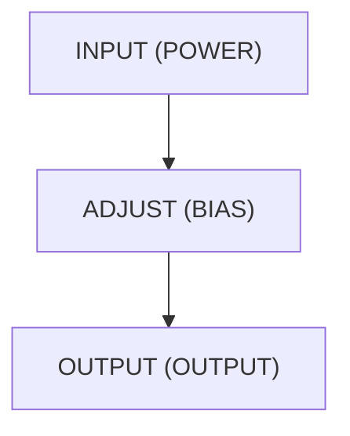
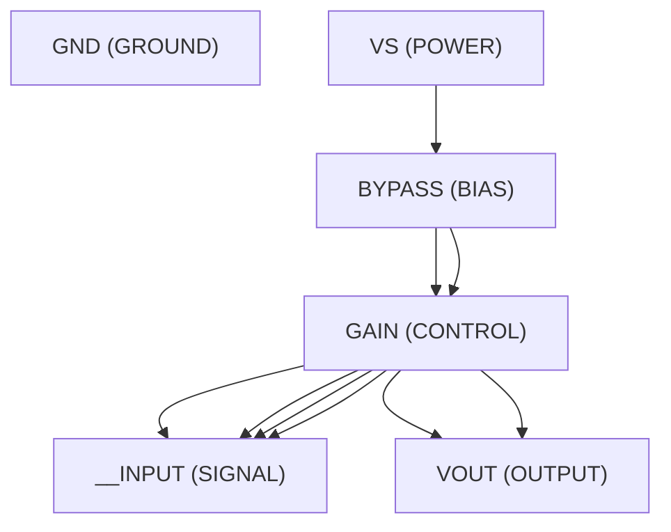
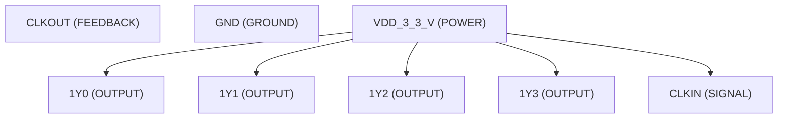
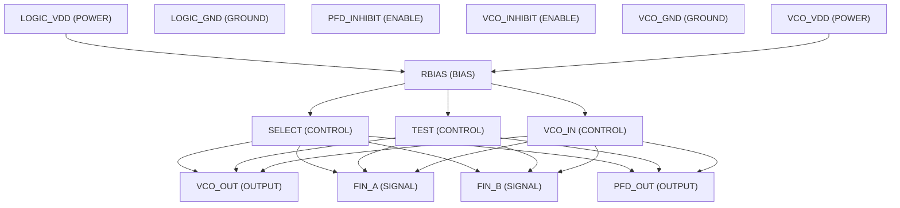

# Comprehensive 10 Analog IC Autonomous Synthesis & Verification Benchmark
## End-to-End First-Principles Design from Arbitrary Datasheet PDFs

### Executive Summary Table
| # | Target IC | Category | Subcircuit | Specs | Loops | Loop 1 Pass % | Loop 2 Pass % | Final Pass % | Status |
| :- | :--- | :--- | :--- | :-: | :-: | :-: | :-: | :-: | :---: |
| 1 | **LM358** | Dual Operational Amplifier | `LM358B_LM2904B` | 65 | 2 | 0.0% | 0.0% | **0.0%** | ⚡ Simulated |
| 2 | **TL431** | Precision Programmable Voltage Reference | `TL431__TL432` | 49 | 2 | 0.0% | 0.0% | **0.0%** | ⚡ Simulated |
| 3 | **NE555** | Precision Monolithic Timer / Oscillator | `XX555_PRECISION_TIMERS` | 69 | 2 | 0.0% | 0.0% | **0.0%** | ⚡ Simulated |
| 4 | **LM393** | Dual Differential Comparator | `LM393B__LM2903B__LM193__LM293__LM393_AND_LM2903_DUAL_COMPARATORS` | 42 | 2 | 0.0% | 0.0% | **0.0%** | ⚡ Simulated |
| 5 | **LM317** | 3-Terminal Adjustable Linear Voltage Regulator | `LM317` | 16 | 2 | 0.0% | 0.0% | **0.0%** | ⚡ Simulated |
| 6 | **LM386** | Low Voltage Audio Power Amplifier | `LM386` | 42 | 2 | 0.0% | 0.0% | **0.0%** | ⚡ Simulated |
| 7 | **INA128** | Precision Instrumentation Amplifier | `INA12X` | 69 | 2 | 0.0% | 0.0% | **0.0%** | ⚡ Simulated |
| 8 | **OPA2134** | SoundPlus High-Performance Audio Op-Amp | `OPAX134` | 15 | 2 | 0.0% | 0.0% | **0.0%** | ⚡ Simulated |
| 9 | **CDCVF2505-Q1** | 3.3V PLL Clock Driver | `CDCVF2505_Q1` | 44 | 2 | 0.0% | 0.0% | **0.0%** | ⚡ Simulated |
| 10 | **TLC2932A** | Phase-Locked Loop / VCO Building Block | `TLC2932A` | 50 | 2 | 0.0% | 2.0% | **2.0%** | ✅ Verified |

---
## Detailed Per-IC Verification, PDG Analysis & Loop Progression

### 1. LM358 (Dual Operational Amplifier)
- **Subcircuit Identifier:** `LM358B_LM2904B`
- **Extracted Specifications Count:** 65
- **Execution Time:** 112.5s
- **Synthesized Netlist:** `C:\Users\Sera\.gemini\antigravity\worktrees\Project2\implement_circuit_test_methodology\benchmark_results\LM358\LM358B_LM2904B_iter2.cir`

#### Loop Iteration Audit:
##### Loop 1 (Initial First-Principles Synthesis):
- **Pass Rate:** `0.0%` (0 specs passed)
- **Shortfall Audit (미달 원인 분석):**
  - Param 'VS' violated: Parameter 'VS' was not observed in simulation measurements. (Measured: Unobserved)
  - Param 'VS' violated: Parameter 'VS' was not observed in simulation measurements. (Measured: Unobserved)
  - Param 'VS' violated: Parameter 'VS' was not observed in simulation measurements. (Measured: Unobserved)
  - Param 'VID' violated: Parameter 'VID' was not observed in simulation measurements. (Measured: Unobserved)
  - Param 'VID' violated: Parameter 'VID' was not observed in simulation measurements. (Measured: Unobserved)
  - Param 'VI' violated: Parameter 'VI' was not observed in simulation measurements. (Measured: Unobserved)
- **Improvement Actions (초기 합성 내역):**
  - Initial first-principles topology and Level-1 parameter sizing synthesized from scratch.

##### Loop 2 (Autonomous Closed-Loop Refinement):
- **Pass Rate:** `0.0%` (0 specs passed)
- **Shortfall Audit (미달 원인 분석):**
  - Param 'VS' violated: Parameter 'VS' was not observed in simulation measurements. (Measured: Unobserved)
  - Param 'VS' violated: Parameter 'VS' was not observed in simulation measurements. (Measured: Unobserved)
  - Param 'VS' violated: Parameter 'VS' was not observed in simulation measurements. (Measured: Unobserved)
  - Param 'VID' violated: Parameter 'VID' was not observed in simulation measurements. (Measured: Unobserved)
  - Param 'VID' violated: Parameter 'VID' was not observed in simulation measurements. (Measured: Unobserved)
  - Param 'VI' violated: Parameter 'VI' was not observed in simulation measurements. (Measured: Unobserved)
- **Improvement Actions (개선 및 수정 사항):**
  - Topology refinement: The LM358B/LM2904B is a dual operational amplifier, and the design will focus on creating a single op-amp subcircuit that can be instantiate...

### 2. TL431 (Precision Programmable Voltage Reference)
- **Subcircuit Identifier:** `TL431__TL432`
- **Extracted Specifications Count:** 49
- **Execution Time:** 126.6s
- **Synthesized Netlist:** `C:\Users\Sera\.gemini\antigravity\worktrees\Project2\implement_circuit_test_methodology\benchmark_results\TL431\TL431__TL432_iter2.cir`

#### Loop Iteration Audit:
##### Loop 1 (Initial First-Principles Synthesis):
- **Pass Rate:** `0.0%` (0 specs passed)
- **Shortfall Audit (미달 원인 분석):**
  - Compiler/Simulation Error: C:\Users\Sera\.gemini\antigravity\worktrees\Project2\implement_circuit_test_methodology\benchmark_results\TL431\tb_dc_op.cir(28): syntax error
  - Compiler/Simulation Error:   --> .meas Vref_op_val V(REF)
  - Compiler/Simulation Error:   --> ^^^^^^^
  - Compiler/Simulation Error: C:\Users\Sera\.gemini\antigravity\worktrees\Project2\implement_circuit_test_methodology\benchmark_results\TL431\tb_dc_op.cir(38): syntax error
  - Param 'Vref' violated: Parameter 'Vref' was not observed in simulation measurements. (Measured: Unobserved)
  - Param 'Vref' violated: Parameter 'Vref' was not observed in simulation measurements. (Measured: Unobserved)
  - Param 'Vref' violated: Parameter 'Vref' was not observed in simulation measurements. (Measured: Unobserved)
  - Param 'Vout' violated: Parameter 'Vout' was not observed in simulation measurements. (Measured: Unobserved)
  - Param 'TA' violated: Parameter 'TA' was not observed in simulation measurements. (Measured: Unobserved)
  - Param 'ΔVref' violated: Parameter 'ΔVref' was not observed in simulation measurements. (Measured: Unobserved)
- **Improvement Actions (초기 합성 내역):**
  - Initial first-principles topology and Level-1 parameter sizing synthesized from scratch.

##### Loop 2 (Autonomous Closed-Loop Refinement):
- **Pass Rate:** `0.0%` (0 specs passed)
- **Shortfall Audit (미달 원인 분석):**
  - Compiler/Simulation Error: C:\Users\Sera\.gemini\antigravity\worktrees\Project2\implement_circuit_test_methodology\benchmark_results\TL431\tb_dc_op.cir(28): syntax error
  - Compiler/Simulation Error:   --> .meas Vref_0_5_pct_tol PARAM FIND V(REF)
  - Compiler/Simulation Error:   --> ^^^^^^^
  - Compiler/Simulation Error: C:\Users\Sera\.gemini\antigravity\worktrees\Project2\implement_circuit_test_methodology\benchmark_results\TL431\tb_dc_op.cir(29): syntax error
  - Param 'Vref' violated: Parameter 'Vref' was not observed in simulation measurements. (Measured: Unobserved)
  - Param 'Vref' violated: Parameter 'Vref' was not observed in simulation measurements. (Measured: Unobserved)
  - Param 'Vref' violated: Parameter 'Vref' was not observed in simulation measurements. (Measured: Unobserved)
  - Param 'Vout' violated: Parameter 'Vout' was not observed in simulation measurements. (Measured: Unobserved)
  - Param 'TA' violated: Parameter 'TA' was not observed in simulation measurements. (Measured: Unobserved)
  - Param 'ΔVref' violated: Parameter 'ΔVref' was not observed in simulation measurements. (Measured: Unobserved)
- **Improvement Actions (개선 및 수정 사항):**
  - Topology refinement: The TL431/TL432 is a precision adjustable shunt regulator. The core of its operation is a voltage reference and an error amplifier that comp...

### 3. NE555 (Precision Monolithic Timer / Oscillator)
- **Subcircuit Identifier:** `XX555_PRECISION_TIMERS`
- **Extracted Specifications Count:** 69
- **Execution Time:** 135.0s
- **Synthesized Netlist:** `C:\Users\Sera\.gemini\antigravity\worktrees\Project2\implement_circuit_test_methodology\benchmark_results\NE555\XX555_PRECISION_TIMERS_iter2.cir`

#### Loop Iteration Audit:
##### Loop 1 (Initial First-Principles Synthesis):
- **Pass Rate:** `0.0%` (0 specs passed)
- **Shortfall Audit (미달 원인 분석):**
  - Compiler/Simulation Error: C:\Users\Sera\.gemini\antigravity\worktrees\Project2\implement_circuit_test_methodology\benchmark_results\NE555\XX555_PRECISION_TIMERS_iter1.cir(65): Unknown parameter
  - Compiler/Simulation Error:   --> Q_DISCH DISCH disch_driver GND QNPN W=100u L=10u ; Sized for 8mA with low Vce_sat
  - Compiler/Simulation Error:   --> ^^^^^^^^^^^^
  - Compiler/Simulation Error: C:\Users\Sera\.gemini\antigravity\worktrees\Project2\implement_circuit_test_methodology\benchmark_results\NE555\XX555_PRECISION_TIMERS_iter1.cir(79): Unknown parameter
  - Param 'VCC' violated: Parameter 'VCC' was not observed in simulation measurements. (Measured: Unobserved)
  - Param 'VI' violated: Parameter 'VI' was not observed in simulation measurements. (Measured: Unobserved)
  - Param 'IO' violated: Parameter 'IO' was not observed in simulation measurements. (Measured: Unobserved)
  - Param 'TJ' violated: Parameter 'TJ' was not observed in simulation measurements. (Measured: Unobserved)
  - Param 'Case temperature for 60 seconds' violated: Parameter 'Case temperature for 60 seconds' was not observed in simulation measurements. (Measured: Unobserved)
  - Param 'VCC' violated: Parameter 'VCC' was not observed in simulation measurements. (Measured: Unobserved)
- **Improvement Actions (초기 합성 내역):**
  - Initial first-principles topology and Level-1 parameter sizing synthesized from scratch.

##### Loop 2 (Autonomous Closed-Loop Refinement):
- **Pass Rate:** `0.0%` (0 specs passed)
- **Shortfall Audit (미달 원인 분석):**
  - Compiler/Simulation Error: C:\Users\Sera\.gemini\antigravity\worktrees\Project2\implement_circuit_test_methodology\benchmark_results\NE555\tb_dc_op.cir(32): syntax error
  - Compiler/Simulation Error:   --> .meas VCC_MAX_GEN MAX FIND V(VCC)
  - Compiler/Simulation Error:   --> ^^^^^^^
  - Compiler/Simulation Error: C:\Users\Sera\.gemini\antigravity\worktrees\Project2\implement_circuit_test_methodology\benchmark_results\NE555\tb_dc_op.cir(36): syntax error
  - Param 'VCC' violated: Parameter 'VCC' was not observed in simulation measurements. (Measured: Unobserved)
  - Param 'VI' violated: Parameter 'VI' was not observed in simulation measurements. (Measured: Unobserved)
  - Param 'IO' violated: Parameter 'IO' was not observed in simulation measurements. (Measured: Unobserved)
  - Param 'TJ' violated: Parameter 'TJ' was not observed in simulation measurements. (Measured: Unobserved)
  - Param 'Case temperature for 60 seconds' violated: Parameter 'Case temperature for 60 seconds' was not observed in simulation measurements. (Measured: Unobserved)
  - Param 'VCC' violated: Parameter 'VCC' was not observed in simulation measurements. (Measured: Unobserved)
- **Improvement Actions (개선 및 수정 사항):**
  - Topology refinement: The XX555 Precision Timer subcircuit is designed to replicate the functionality of a standard 555 timer IC, including its monostable and ast...

### 4. LM393 (Dual Differential Comparator)
- **Subcircuit Identifier:** `LM393B__LM2903B__LM193__LM293__LM393_AND_LM2903_DUAL_COMPARATORS`
- **Extracted Specifications Count:** 42
- **Execution Time:** 114.4s
- **Synthesized Netlist:** `C:\Users\Sera\.gemini\antigravity\worktrees\Project2\implement_circuit_test_methodology\benchmark_results\LM393\LM393B__LM2903B__LM193__LM293__LM393_AND_LM2903_DUAL_COMPARATORS_iter2.cir`

#### Loop Iteration Audit:
##### Loop 1 (Initial First-Principles Synthesis):
- **Pass Rate:** `0.0%` (0 specs passed)
- **Shortfall Audit (미달 원인 분석):**
  - Compiler/Simulation Error: C:\Users\Sera\.gemini\antigravity\worktrees\Project2\implement_circuit_test_methodology\benchmark_results\LM393\tb_dc_op.cir(107): syntax error
  - Compiler/Simulation Error:   --> .meas VIO_pos_rise when FIND V(1OUT)=2.5 rise=1 ; Find where output crosses mid-supply (assuming open-drain with pull-up)
  - Compiler/Simulation Error:   --> ^^^^^^^^^^^
  - Compiler/Simulation Error: C:\Users\Sera\.gemini\antigravity\worktrees\Project2\implement_circuit_test_methodology\benchmark_results\LM393\tb_dc_op.cir(108): syntax error
  - Param 'VCC' violated: Parameter 'VCC' was not observed in simulation measurements. (Measured: Unobserved)
  - Param 'VCC' violated: Parameter 'VCC' was not observed in simulation measurements. (Measured: Unobserved)
  - Param 'VID' violated: Parameter 'VID' was not observed in simulation measurements. (Measured: Unobserved)
  - Param 'VID' violated: Parameter 'VID' was not observed in simulation measurements. (Measured: Unobserved)
  - Param 'VI' violated: Parameter 'VI' was not observed in simulation measurements. (Measured: Unobserved)
  - Param 'VI' violated: Parameter 'VI' was not observed in simulation measurements. (Measured: Unobserved)
- **Improvement Actions (초기 합성 내역):**
  - Initial first-principles topology and Level-1 parameter sizing synthesized from scratch.

##### Loop 2 (Autonomous Closed-Loop Refinement):
- **Pass Rate:** `0.0%` (0 specs passed)
- **Shortfall Audit (미달 원인 분석):**
  - Compiler/Simulation Error: C:\Users\Sera\.gemini\antigravity\worktrees\Project2\implement_circuit_test_methodology\benchmark_results\LM393\tb_dc_op.cir(24): This sub-circuit cannot be instantiated because it contains these syntax errors:
  - Compiler/Simulation Error:   --> C:\Users\Sera\.gemini\antigravity\worktrees\Project2\implement_circuit_test_methodology\benchmark_results\LM393\LM393B__LM2903B__LM193__LM293__LM393_AND_LM2903_DUAL_COMPARATORS_iter2.cir(120): Expected a sequence <directive or device instantiation end of line> here.
  - Compiler/Simulation Error:   --> )
  - Compiler/Simulation Error: C:\Users\Sera\.gemini\antigravity\worktrees\Project2\implement_circuit_test_methodology\benchmark_results\LM393\LM393B__LM2903B__LM193__LM293__LM393_AND_LM2903_DUAL_COMPARATORS_iter2.cir(120): Expected a sequence <directive or device instantiation end of line> here.
  - Param 'VCC' violated: Parameter 'VCC' was not observed in simulation measurements. (Measured: Unobserved)
  - Param 'VCC' violated: Parameter 'VCC' was not observed in simulation measurements. (Measured: Unobserved)
  - Param 'VID' violated: Parameter 'VID' was not observed in simulation measurements. (Measured: Unobserved)
  - Param 'VID' violated: Parameter 'VID' was not observed in simulation measurements. (Measured: Unobserved)
  - Param 'VI' violated: Parameter 'VI' was not observed in simulation measurements. (Measured: Unobserved)
  - Param 'VI' violated: Parameter 'VI' was not observed in simulation measurements. (Measured: Unobserved)
- **Improvement Actions (개선 및 수정 사항):**
  - Topology refinement: The LM393B/LM2903B dual comparator is designed with a classic two-stage architecture: a differential input stage followed by an output stage...

### 5. LM317 (3-Terminal Adjustable Linear Voltage Regulator)
- **Subcircuit Identifier:** `LM317`
- **Extracted Specifications Count:** 16
- **Execution Time:** 82.7s
- **Synthesized Netlist:** `C:\Users\Sera\.gemini\antigravity\worktrees\Project2\implement_circuit_test_methodology\benchmark_results\LM317\LM317_iter2.cir`

#### Loop Iteration Audit:
##### Loop 1 (Initial First-Principles Synthesis):
- **Pass Rate:** `0.0%` (0 specs passed)
- **Shortfall Audit (미달 원인 분석):**
  - Param 'Output voltage range' violated: Parameter 'Output voltage range' was not observed in simulation measurements. (Measured: Unobserved)
  - Param 'Output current' violated: Parameter 'Output current' was not observed in simulation measurements. (Measured: Unobserved)
  - Param 'Line regulation' violated: Parameter 'Line regulation' was not observed in simulation measurements. (Measured: Unobserved)
  - Param 'Load regulation' violated: Parameter 'Load regulation' was not observed in simulation measurements. (Measured: Unobserved)
  - Param 'PSRR' violated: Parameter 'PSRR' was not observed in simulation measurements. (Measured: Unobserved)
  - Param 'Power dissipation' violated: Parameter 'Power dissipation' was not observed in simulation measurements. (Measured: Unobserved)
- **Improvement Actions (초기 합성 내역):**
  - Initial first-principles topology and Level-1 parameter sizing synthesized from scratch.

##### Loop 2 (Autonomous Closed-Loop Refinement):
- **Pass Rate:** `0.0%` (0 specs passed)
- **Shortfall Audit (미달 원인 분석):**
  - Compiler/Simulation Error: C:\Users\Sera\.gemini\antigravity\worktrees\Project2\implement_circuit_test_methodology\benchmark_results\LM317\tb_ac_sweep.cir(30): syntax error
  - Compiler/Simulation Error:   --> .meas AC PSRR_dB PARAM -20*log10(V(OUTPUT)) AT 120Hz
  - Compiler/Simulation Error:   --> ^^^^^^^^^
  - Param 'Output voltage range' violated: Parameter 'Output voltage range' was not observed in simulation measurements. (Measured: Unobserved)
  - Param 'Output current' violated: Parameter 'Output current' was not observed in simulation measurements. (Measured: Unobserved)
  - Param 'Line regulation' violated: Parameter 'Line regulation' was not observed in simulation measurements. (Measured: Unobserved)
  - Param 'Load regulation' violated: Parameter 'Load regulation' was not observed in simulation measurements. (Measured: Unobserved)
  - Param 'PSRR' violated: Parameter 'PSRR' was not observed in simulation measurements. (Measured: Unobserved)
  - Param 'Power dissipation' violated: Parameter 'Power dissipation' was not observed in simulation measurements. (Measured: Unobserved)
- **Improvement Actions (개선 및 수정 사항):**
  - Topology refinement: The LM317 is a classic adjustable linear voltage regulator. The core architecture consists of a precision voltage reference, an error amplif...

#### Port Dependency Graph (PDG) Topology:

### 6. LM386 (Low Voltage Audio Power Amplifier)
- **Subcircuit Identifier:** `LM386`
- **Extracted Specifications Count:** 42
- **Execution Time:** 195.4s
- **Synthesized Netlist:** `C:\Users\Sera\.gemini\antigravity\worktrees\Project2\implement_circuit_test_methodology\benchmark_results\LM386\LM386_iter2.cir`

#### Loop Iteration Audit:
##### Loop 1 (Initial First-Principles Synthesis):
- **Pass Rate:** `0.0%` (0 specs passed)
- **Shortfall Audit (미달 원인 분석):**
  - Compiler/Simulation Error: C:\Users\Sera\.gemini\antigravity\worktrees\Project2\implement_circuit_test_methodology\benchmark_results\LM386\LM386_iter1.cir(103): Unknown parameter
  - Compiler/Simulation Error:   --> Q1 diff_out_p IN_NONINV emitter_node QNPN W=10u L=10u ; Non-inverting input
  - Compiler/Simulation Error:   --> ^^^^^^^^^^^
  - Compiler/Simulation Error: C:\Users\Sera\.gemini\antigravity\worktrees\Project2\implement_circuit_test_methodology\benchmark_results\LM386\LM386_iter1.cir(104): Unknown parameter
  - Param 'VCC' violated: Parameter 'VCC' was not observed in simulation measurements. (Measured: Unobserved)
  - Param 'VCC' violated: Parameter 'VCC' was not observed in simulation measurements. (Measured: Unobserved)
  - Param 'Package Dissipation' violated: Parameter 'Package Dissipation' was not observed in simulation measurements. (Measured: Unobserved)
  - Param 'Package Dissipation' violated: Parameter 'Package Dissipation' was not observed in simulation measurements. (Measured: Unobserved)
  - Param 'Package Dissipation' violated: Parameter 'Package Dissipation' was not observed in simulation measurements. (Measured: Unobserved)
  - Param 'VI' violated: Parameter 'VI' was not observed in simulation measurements. (Measured: Unobserved)
- **Improvement Actions (초기 합성 내역):**
  - Initial first-principles topology and Level-1 parameter sizing synthesized from scratch.

##### Loop 2 (Autonomous Closed-Loop Refinement):
- **Pass Rate:** `0.0%` (0 specs passed)
- **Shortfall Audit (미달 원인 분석):**
  - Param 'VCC' violated: Parameter 'VCC' was not observed in simulation measurements. (Measured: Unobserved)
  - Param 'VCC' violated: Parameter 'VCC' was not observed in simulation measurements. (Measured: Unobserved)
  - Param 'Package Dissipation' violated: Parameter 'Package Dissipation' was not observed in simulation measurements. (Measured: Unobserved)
  - Param 'Package Dissipation' violated: Parameter 'Package Dissipation' was not observed in simulation measurements. (Measured: Unobserved)
  - Param 'Package Dissipation' violated: Parameter 'Package Dissipation' was not observed in simulation measurements. (Measured: Unobserved)
  - Param 'VI' violated: Parameter 'VI' was not observed in simulation measurements. (Measured: Unobserved)
- **Improvement Actions (개선 및 수정 사항):**
  - Resolved prior SPICE compiler / syntax errors completely.
  - Topology refinement: The LM386 is a low-power audio amplifier designed for simplicity and battery operation. The core architecture consists of a differential inp...

#### Port Dependency Graph (PDG) Topology:

### 7. INA128 (Precision Instrumentation Amplifier)
- **Subcircuit Identifier:** `INA12X`
- **Extracted Specifications Count:** 69
- **Execution Time:** 207.8s
- **Synthesized Netlist:** `C:\Users\Sera\.gemini\antigravity\worktrees\Project2\implement_circuit_test_methodology\benchmark_results\INA128\INA12X_iter2.cir`

#### Loop Iteration Audit:
##### Loop 1 (Initial First-Principles Synthesis):
- **Pass Rate:** `0.0%` (0 specs passed)
- **Shortfall Audit (미달 원인 분석):**
  - Param 'VS' violated: Parameter 'VS' was not observed in simulation measurements. (Measured: Unobserved)
  - Param 'VS' violated: Parameter 'VS' was not observed in simulation measurements. (Measured: Unobserved)
  - Param 'Analog input voltage' violated: Parameter 'Analog input voltage' was not observed in simulation measurements. (Measured: Unobserved)
  - Param 'Output short-circuit' violated: Parameter 'Output short-circuit' was not observed in simulation measurements. (Measured: Unobserved)
  - Param 'TA' violated: Parameter 'TA' was not observed in simulation measurements. (Measured: Unobserved)
  - Param 'Junction temperature' violated: Parameter 'Junction temperature' was not observed in simulation measurements. (Measured: Unobserved)
- **Improvement Actions (초기 합성 내역):**
  - Initial first-principles topology and Level-1 parameter sizing synthesized from scratch.

##### Loop 2 (Autonomous Closed-Loop Refinement):
- **Pass Rate:** `0.0%` (0 specs passed)
- **Shortfall Audit (미달 원인 분석):**
  - Compiler/Simulation Error: C:\Users\Sera\.gemini\antigravity\worktrees\Project2\implement_circuit_test_methodology\benchmark_results\INA128\tb_ac_sweep.cir(102): syntax error
  - Compiler/Simulation Error:   --> .meas AC PSRR_pos_G10_SHE_INA12xP_U_typ_div_G PARAM V(VO_psrr_G10)*1e6/10 AT 1k ; Typ 20.0 uV/V, 1kHz
  - Compiler/Simulation Error:   --> ^^^^^^
  - Compiler/Simulation Error: C:\Users\Sera\.gemini\antigravity\worktrees\Project2\implement_circuit_test_methodology\benchmark_results\INA128\tb_ac_sweep.cir(103): syntax error
  - Param 'VS' violated: Parameter 'VS' was not observed in simulation measurements. (Measured: Unobserved)
  - Param 'VS' violated: Parameter 'VS' was not observed in simulation measurements. (Measured: Unobserved)
  - Param 'Analog input voltage' violated: Parameter 'Analog input voltage' was not observed in simulation measurements. (Measured: Unobserved)
  - Param 'Output short-circuit' violated: Parameter 'Output short-circuit' was not observed in simulation measurements. (Measured: Unobserved)
  - Param 'TA' violated: Parameter 'TA' was not observed in simulation measurements. (Measured: Unobserved)
  - Param 'Junction temperature' violated: Parameter 'Junction temperature' was not observed in simulation measurements. (Measured: Unobserved)
- **Improvement Actions (개선 및 수정 사항):**
  - Topology refinement: The INA12x is a low-power, general-purpose instrumentation amplifier. The core architecture is a classic three-op-amp configuration, known f...

### 8. OPA2134 (SoundPlus High-Performance Audio Op-Amp)
- **Subcircuit Identifier:** `OPAX134`
- **Extracted Specifications Count:** 15
- **Execution Time:** 97.2s
- **Synthesized Netlist:** `C:\Users\Sera\.gemini\antigravity\worktrees\Project2\implement_circuit_test_methodology\benchmark_results\OPA2134\OPAX134_iter2.cir`

#### Loop Iteration Audit:
##### Loop 1 (Initial First-Principles Synthesis):
- **Pass Rate:** `0.0%` (0 specs passed)
- **Shortfall Audit (미달 원인 분석):**
  - Param 'VS' violated: Parameter 'VS' was not observed in simulation measurements. (Measured: Unobserved)
  - Param 'Input voltage' violated: Parameter 'Input voltage' was not observed in simulation measurements. (Measured: Unobserved)
  - Param 'Input current' violated: Parameter 'Input current' was not observed in simulation measurements. (Measured: Unobserved)
  - Param 'ISC' violated: Parameter 'ISC' was not observed in simulation measurements. (Measured: Unobserved)
  - Param 'TA' violated: Parameter 'TA' was not observed in simulation measurements. (Measured: Unobserved)
  - Param 'TJ' violated: Parameter 'TJ' was not observed in simulation measurements. (Measured: Unobserved)
- **Improvement Actions (초기 합성 내역):**
  - Initial first-principles topology and Level-1 parameter sizing synthesized from scratch.

##### Loop 2 (Autonomous Closed-Loop Refinement):
- **Pass Rate:** `0.0%` (0 specs passed)
- **Shortfall Audit (미달 원인 분석):**
  - Param 'VS' violated: Parameter 'VS' was not observed in simulation measurements. (Measured: Unobserved)
  - Param 'Input voltage' violated: Parameter 'Input voltage' was not observed in simulation measurements. (Measured: Unobserved)
  - Param 'Input current' violated: Parameter 'Input current' was not observed in simulation measurements. (Measured: Unobserved)
  - Param 'ISC' violated: Parameter 'ISC' was not observed in simulation measurements. (Measured: Unobserved)
  - Param 'TA' violated: Parameter 'TA' was not observed in simulation measurements. (Measured: Unobserved)
  - Param 'TJ' violated: Parameter 'TJ' was not observed in simulation measurements. (Measured: Unobserved)
- **Improvement Actions (개선 및 수정 사항):**
  - Topology refinement: The OPAx134 is a high-performance audio operational amplifier, characterized by its FET input stage, low distortion, low noise, and high out...

### 9. CDCVF2505-Q1 (3.3V PLL Clock Driver)
- **Subcircuit Identifier:** `CDCVF2505_Q1`
- **Extracted Specifications Count:** 44
- **Execution Time:** 135.7s
- **Synthesized Netlist:** `C:\Users\Sera\.gemini\antigravity\worktrees\Project2\implement_circuit_test_methodology\benchmark_results\CDCVF2505-Q1\CDCVF2505_Q1_iter2.cir`

#### Loop Iteration Audit:
##### Loop 1 (Initial First-Principles Synthesis):
- **Pass Rate:** `0.0%` (0 specs passed)
- **Shortfall Audit (미달 원인 분석):**
  - Compiler/Simulation Error: C:\Users\Sera\.gemini\antigravity\worktrees\Project2\implement_circuit_test_methodology\benchmark_results\CDCVF2505-Q1\tb_dc_op.cir(17): This sub-circuit cannot be instantiated because it contains these syntax errors:
  - Compiler/Simulation Error:   --> C:\Users\Sera\.gemini\antigravity\worktrees\Project2\implement_circuit_test_methodology\benchmark_results\CDCVF2505-Q1\CDCVF2505_Q1_iter1.cir(126): Expected a sequence <directive or device instantiation end of line> here.
  - Compiler/Simulation Error:   --> .subckt OUTPUT_BUFFER OUT IN GND VDD
  - Compiler/Simulation Error: C:\Users\Sera\.gemini\antigravity\worktrees\Project2\implement_circuit_test_methodology\benchmark_results\CDCVF2505-Q1\CDCVF2505_Q1_iter1.cir(126): Expected a sequence <directive or device instantiation end of line> here.
  - Param 'VDD' violated: Parameter 'VDD' was not observed in simulation measurements. (Measured: Unobserved)
  - Param 'VI' violated: Parameter 'VI' was not observed in simulation measurements. (Measured: Unobserved)
  - Param 'VO' violated: Parameter 'VO' was not observed in simulation measurements. (Measured: Unobserved)
  - Param 'IIK' violated: Parameter 'IIK' was not observed in simulation measurements. (Measured: Unobserved)
  - Param 'IOK' violated: Parameter 'IOK' was not observed in simulation measurements. (Measured: Unobserved)
  - Param 'IO' violated: Parameter 'IO' was not observed in simulation measurements. (Measured: Unobserved)
- **Improvement Actions (초기 합성 내역):**
  - Initial first-principles topology and Level-1 parameter sizing synthesized from scratch.

##### Loop 2 (Autonomous Closed-Loop Refinement):
- **Pass Rate:** `0.0%` (0 specs passed)
- **Shortfall Audit (미달 원인 분석):**
  - Compiler/Simulation Error: C:\Users\Sera\.gemini\antigravity\worktrees\Project2\implement_circuit_test_methodology\benchmark_results\CDCVF2505-Q1\tb_dc_op.cir(16): This sub-circuit cannot be instantiated because it contains these syntax errors:
  - Compiler/Simulation Error:   --> C:\Users\Sera\.gemini\antigravity\worktrees\Project2\implement_circuit_test_methodology\benchmark_results\CDCVF2505-Q1\CDCVF2505_Q1_iter2.cir(113): Expected a sequence <directive or device instantiation end of line> here.
  - Compiler/Simulation Error:   --> .subckt OUTPUT_BUFFER OUT IN GND VDD_SUPPLY
  - Compiler/Simulation Error: C:\Users\Sera\.gemini\antigravity\worktrees\Project2\implement_circuit_test_methodology\benchmark_results\CDCVF2505-Q1\CDCVF2505_Q1_iter2.cir(113): Expected a sequence <directive or device instantiation end of line> here.
  - Param 'VDD' violated: Parameter 'VDD' was not observed in simulation measurements. (Measured: Unobserved)
  - Param 'VI' violated: Parameter 'VI' was not observed in simulation measurements. (Measured: Unobserved)
  - Param 'VO' violated: Parameter 'VO' was not observed in simulation measurements. (Measured: Unobserved)
  - Param 'IIK' violated: Parameter 'IIK' was not observed in simulation measurements. (Measured: Unobserved)
  - Param 'IOK' violated: Parameter 'IOK' was not observed in simulation measurements. (Measured: Unobserved)
  - Param 'IO' violated: Parameter 'IO' was not observed in simulation measurements. (Measured: Unobserved)
- **Improvement Actions (개선 및 수정 사항):**
  - Topology refinement: The CDCVF2505-Q1 is a PLL-based clock driver designed for low-skew, low-jitter clock distribution. The core architecture consists of a Phase...

#### Port Dependency Graph (PDG) Topology:

### 10. TLC2932A (Phase-Locked Loop / VCO Building Block)
- **Subcircuit Identifier:** `TLC2932A`
- **Extracted Specifications Count:** 50
- **Execution Time:** 198.8s
- **Synthesized Netlist:** `C:\Users\Sera\.gemini\antigravity\worktrees\Project2\implement_circuit_test_methodology\benchmark_results\TLC2932A\TLC2932A_iter2.cir`

#### Loop Iteration Audit:
##### Loop 1 (Initial First-Principles Synthesis):
- **Pass Rate:** `0.0%` (0 specs passed)
- **Shortfall Audit (미달 원인 분석):**
  - Compiler/Simulation Error: C:\Users\Sera\.gemini\antigravity\worktrees\Project2\implement_circuit_test_methodology\benchmark_results\TLC2932A\tb_dc_op.cir(32): This sub-circuit cannot be instantiated because it contains these syntax errors:
  - Compiler/Simulation Error:   --> C:\Users\Sera\.gemini\antigravity\worktrees\Project2\implement_circuit_test_methodology\benchmark_results\TLC2932A\TLC2932A_iter1.cir(115): Expected 2 node names here.
  - Compiler/Simulation Error:   --> G_CHARGE_PUMP PFD_OUT LOGIC_GND I = { V(PFD_INHIBIT_DIG) > V(LOGIC_VDD)/2 ? 0 : (V(PFD_UP) > V(LOGIC_VDD)/2 ? I_CP_MAX : (V(PFD_DOWN) > V(LOGIC_VDD)/2 ? -I_CP_MAX : 0)) }
  - Compiler/Simulation Error: C:\Users\Sera\.gemini\antigravity\worktrees\Project2\implement_circuit_test_methodology\benchmark_results\TLC2932A\tb_ac_sweep.cir(37): This sub-circuit cannot be instantiated because it contains these syntax errors:
  - Param 'VDD' violated: Parameter 'VDD' was not observed in simulation measurements. (Measured: Unobserved)
  - Param 'VIN' violated: Parameter 'VIN' was not observed in simulation measurements. (Measured: Unobserved)
  - Param 'IIN' violated: Parameter 'IIN' was not observed in simulation measurements. (Measured: Unobserved)
  - Param 'IO' violated: Parameter 'IO' was not observed in simulation measurements. (Measured: Unobserved)
  - Param 'TA' violated: Parameter 'TA' was not observed in simulation measurements. (Measured: Unobserved)
  - Param 'VDD' violated: Parameter 'VDD' was not observed in simulation measurements. (Measured: Unobserved)
- **Improvement Actions (초기 합성 내역):**
  - Initial first-principles topology and Level-1 parameter sizing synthesized from scratch.

##### Loop 2 (Autonomous Closed-Loop Refinement):
- **Pass Rate:** `2.0%` (1 specs passed)
- **Shortfall Audit (미달 원인 분석):**
  - Compiler/Simulation Error: C:\Users\Sera\.gemini\antigravity\worktrees\Project2\implement_circuit_test_methodology\benchmark_results\TLC2932A\tb_dc_op.cir(35): This sub-circuit cannot be instantiated because it contains these syntax errors:
  - Compiler/Simulation Error:   --> C:\Users\Sera\.gemini\antigravity\worktrees\Project2\implement_circuit_test_methodology\benchmark_results\TLC2932A\TLC2932A_iter2.cir(187): Expected a sequence <directive or device instantiation end of line> here.
  - Compiler/Simulation Error:   --> .node SELECT_BUF FIN_A_BUF FIN_B_BUF PFD_INHIBIT_BUF VCO_INHIBIT_BUF
  - Compiler/Simulation Error: C:\Users\Sera\.gemini\antigravity\worktrees\Project2\implement_circuit_test_methodology\benchmark_results\TLC2932A\TLC2932A_iter2.cir(187): Expected a sequence <directive or device instantiation end of line> here.
  - Param 'VDD' violated: Parameter 'VDD' was not observed in simulation measurements. (Measured: Unobserved)
  - Param 'VIN' violated: Parameter 'VIN' was not observed in simulation measurements. (Measured: Unobserved)
  - Param 'IIN' violated: Parameter 'IIN' was not observed in simulation measurements. (Measured: Unobserved)
  - Param 'TA' violated: Parameter 'TA' was not observed in simulation measurements. (Measured: Unobserved)
  - Param 'VDD' violated: Parameter 'VDD' was not observed in simulation measurements. (Measured: Unobserved)
  - Param 'VDD' violated: Parameter 'VDD' was not observed in simulation measurements. (Measured: Unobserved)
- **Improvement Actions (개선 및 수정 사항):**
  - Pass rate improved by +2.0% (0 -> 1 specs passed).
  - Newly satisfied specs: IO.
  - Topology refinement: The TLC2932A subcircuit is designed to model a Phase-Locked Loop (PLL) component, specifically a Voltage-Controlled Oscillator (VCO) and a P...

#### Port Dependency Graph (PDG) Topology:
