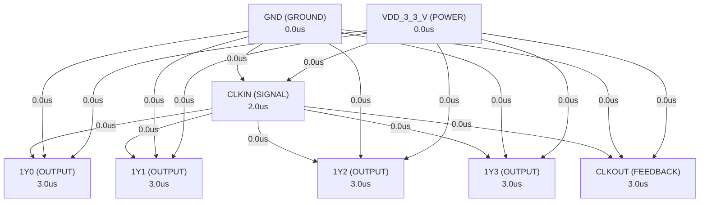

# Autonomous AI Analog Circuit Synthesis & Verification Report
**Target IC:** `CDCVF2505-Q1` | **Subcircuit:** `CDCVF2505_Q1`
**Overall Datasheet Specification Pass Rate:** `0.0%`

## 1. Executive Summary
- **IC Category:** The CDCVF2505 is a high-performance, low-skew, low-jitter, phase-lock loop (PLL) clock driver. It uses a PLL to precisely align, in both frequency and phase, the output clocks (1Y[0–3] and CLKOUT) to the input clock signal (CLKIN). The CDCVF2505 operates at 3.3 V. It also provides integrated series-damping resistors that make it ideal for driving point-to-point loads. One bank of five outputs provides low-skew, low-jitter copies of CLKIN. Output duty cycles are adjusted to 50 percent, independent of duty cycle at CLKIN. The device automatically goes in power-down mode when no input signal is applied to CLKIN. Unlike many products containing PLLs, the CDCVF2505 does not require an external RC network. The loop filter for the PLLs is included on-chip, minimizing component count, space, and cost. Because it is based on the PLL circuitry, the CDCVF2505 requires a stabilization time to achieve phase lock of the feedback signal to the reference signal. This stabilization is required following power up and application of a fixed-frequency, fixed-phase signal at CLKIN, and following any changes to the PLL reference. The CDCVF2505 is characterized for operation from –40°C to 85°C.
- **Total Datasheet Specifications Extracted:** 44
- **Design Iterations Required:** 2
- **Synthesized Netlist Location:** `C:\Users\Sera\.gemini\antigravity\worktrees\Project2\implement_circuit_test_methodology\benchmark_results\CDCVF2505-Q1\CDCVF2505_Q1_iter2.cir`

## 2. Port Dependency Graph (PDG) Scheduling
Topological activation sequence derived from physical pin roles:
| Pin Name | Physical Role | Direction | Activation Time (us) |
| :--- | :--- | :--- | :--- |
| `1Y0` | `OUTPUT` | `OUTPUT` | 3.00 us |
| `1Y1` | `OUTPUT` | `OUTPUT` | 3.00 us |
| `1Y2` | `OUTPUT` | `OUTPUT` | 3.00 us |
| `1Y3` | `OUTPUT` | `OUTPUT` | 3.00 us |
| `CLKIN` | `SIGNAL` | `INPUT` | 2.00 us |
| `CLKOUT` | `FEEDBACK` | `OUTPUT` | 3.00 us |
| `GND` | `GROUND` | `GROUND` | 0.00 us |
| `VDD_3_3_V` | `POWER` | `POWER` | 0.00 us |

### 2.1 Port Dependency Graph Topology


## 3. Specification Verification & SymPy Oracle Audit
Detailed verification results evaluated against SymPy interval constraints:
| Parameter | Min Target | Typ Target | Max Target | Measured Value | Unit | Status |
| :--- | :--- | :--- | :--- | :--- | :--- | :--- |
| `VDD` | -0.5 | - | 4.3 | **N/A** | V | ❌ FAIL |
| `VI` | -0.5 | - | - | **N/A** | V | ❌ FAIL |
| `VO` | -0.5 | - | - | **N/A** | V | ❌ FAIL |
| `IIK` | -0.05 | - | 0.05 | **N/A** | mA | ❌ FAIL |
| `IOK` | -0.05 | - | 0.05 | **N/A** | mA | ❌ FAIL |
| `IO` | -0.05 | - | 0.05 | **N/A** | mA | ❌ FAIL |
| `VDD` | 3 | 3.3 | 3.6 | **N/A** | V | ❌ FAIL |
| `VIH` | - | - | - | **N/A** | V | ❌ FAIL |
| `VIL` | - | - | - | **N/A** | V | ❌ FAIL |
| `VI` | 0 | - | - | **N/A** | V | ❌ FAIL |
| `IOH` | - | - | -0.012 | **N/A** | mA | ❌ FAIL |
| `IOL` | - | - | 0.012 | **N/A** | mA | ❌ FAIL |
| `TA` | -40 | - | 85 | **N/A** | °C | ❌ FAIL |
| `fclk` | 2.4e+07 | - | 2e+08 | **N/A** | MHz | ❌ FAIL |
| `Input clock duty cycle` | 30 | - | 85 | **N/A** | % | ❌ FAIL |
| `Input clock duty cycle` | 40 | 50 | 60 | **N/A** | % | ❌ FAIL |
| `Stabilization time` | - | - | 0.0001 | **N/A** | µs | ❌ FAIL |
| `VIK` | -1.44 | -1.2 | -0.96 | **N/A** | V | ❌ FAIL |
| `VOH` | - | - | - | **N/A** | V | ❌ FAIL |
| `VOH` | 2.1 | - | - | **N/A** | V | ❌ FAIL |
| `VOH` | 2.4 | - | - | **N/A** | V | ❌ FAIL |
| `VOL` | - | - | 0.2 | **N/A** | V | ❌ FAIL |
| `VOL` | - | - | 0.8 | **N/A** | V | ❌ FAIL |
| `VOL` | - | - | 0.55 | **N/A** | V | ❌ FAIL |
| `IOH` | -0.0324 | -0.027 | -0.0216 | **N/A** | mA | ❌ FAIL |
| `IOH` | -0.0432 | -0.036 | -0.0288 | **N/A** | mA | ❌ FAIL |
| `IOL` | 0.0216 | 0.027 | 0.0324 | **N/A** | mA | ❌ FAIL |
| `IOL` | 0.032 | 0.04 | 0.048 | **N/A** | mA | ❌ FAIL |
| `II` | -5e-06 | - | 5e-06 | **N/A** | µA | ❌ FAIL |
| `Ci` | 3.36 | 4.2 | 5.04 | **N/A** | pF | ❌ FAIL |
| `Co` | 2.24 | 2.8 | 3.36 | **N/A** | pF | ❌ FAIL |
| `Co` | 4.16 | 5.2 | 6.24 | **N/A** | pF | ❌ FAIL |
| `tpd` | -1.5e-10 | - | 1.5e-10 | **N/A** | ps | ❌ FAIL |
| `tsk(o)` | - | - | 1.5e-10 | **N/A** | ps | ❌ FAIL |
| `tc(jit_cc)` | - | 7e-11 | 1.5e-10 | **N/A** | ps | ❌ FAIL |
| `tc(jit_cc)` | - | 2e-10 | 4e-10 | **N/A** | ps | ❌ FAIL |
| `odc` | 45 | - | 55 | **N/A** | % | ❌ FAIL |
| `tr` | - | 5e-10 | 2e-09 | **N/A** | ns | ❌ FAIL |
| `tf` | - | 5e-10 | 2e-09 | **N/A** | ns | ❌ FAIL |

## 4. Closed-Loop Iteration History & Root Cause Analysis
| Iteration | Pass Rate | Passed Specs | Failed Specs | Architecture Notes |
| :--- | :--- | :--- | :--- | :--- |
| Iteration 1 | 0.0% | 0 | 0 | The CDCVF2505-Q1 is a PLL-based clock driver designed for low-skew, low-jitter c... |
| Iteration 2 | 0.0% | 0 | 0 | The CDCVF2505-Q1 is a PLL-based clock driver designed for low-skew, low-jitter c... |

### 4.1 Loop 1 Detailed Audit
- **Pass Rate**: `0.0%` (0/0 specs passed)

**Shortfall Audit (미달 원인 분석):**
- Compiler/Simulation Error: C:\Users\Sera\.gemini\antigravity\worktrees\Project2\implement_circuit_test_methodology\benchmark_results\CDCVF2505-Q1\tb_dc_op.cir(17): This sub-circuit cannot be instantiated because it contains these syntax errors:
- Compiler/Simulation Error:   --> C:\Users\Sera\.gemini\antigravity\worktrees\Project2\implement_circuit_test_methodology\benchmark_results\CDCVF2505-Q1\CDCVF2505_Q1_iter1.cir(126): Expected a sequence <directive or device instantiation end of line> here.
- Compiler/Simulation Error:   --> .subckt OUTPUT_BUFFER OUT IN GND VDD
- Compiler/Simulation Error: C:\Users\Sera\.gemini\antigravity\worktrees\Project2\implement_circuit_test_methodology\benchmark_results\CDCVF2505-Q1\CDCVF2505_Q1_iter1.cir(126): Expected a sequence <directive or device instantiation end of line> here.
- Param 'VDD' violated: Parameter 'VDD' was not observed in simulation measurements. (Measured: Unobserved)
- Param 'VI' violated: Parameter 'VI' was not observed in simulation measurements. (Measured: Unobserved)
- Param 'VO' violated: Parameter 'VO' was not observed in simulation measurements. (Measured: Unobserved)
- Param 'IIK' violated: Parameter 'IIK' was not observed in simulation measurements. (Measured: Unobserved)
- Param 'IOK' violated: Parameter 'IOK' was not observed in simulation measurements. (Measured: Unobserved)
- Param 'IO' violated: Parameter 'IO' was not observed in simulation measurements. (Measured: Unobserved)

**Improvement Actions (개선 및 수정 사항):**
- Initial first-principles topology and Level-1 parameter sizing synthesized from scratch.

### 4.2 Loop 2 Detailed Audit
- **Pass Rate**: `0.0%` (0/0 specs passed)

**Shortfall Audit (미달 원인 분석):**
- Compiler/Simulation Error: C:\Users\Sera\.gemini\antigravity\worktrees\Project2\implement_circuit_test_methodology\benchmark_results\CDCVF2505-Q1\tb_dc_op.cir(16): This sub-circuit cannot be instantiated because it contains these syntax errors:
- Compiler/Simulation Error:   --> C:\Users\Sera\.gemini\antigravity\worktrees\Project2\implement_circuit_test_methodology\benchmark_results\CDCVF2505-Q1\CDCVF2505_Q1_iter2.cir(113): Expected a sequence <directive or device instantiation end of line> here.
- Compiler/Simulation Error:   --> .subckt OUTPUT_BUFFER OUT IN GND VDD_SUPPLY
- Compiler/Simulation Error: C:\Users\Sera\.gemini\antigravity\worktrees\Project2\implement_circuit_test_methodology\benchmark_results\CDCVF2505-Q1\CDCVF2505_Q1_iter2.cir(113): Expected a sequence <directive or device instantiation end of line> here.
- Param 'VDD' violated: Parameter 'VDD' was not observed in simulation measurements. (Measured: Unobserved)
- Param 'VI' violated: Parameter 'VI' was not observed in simulation measurements. (Measured: Unobserved)
- Param 'VO' violated: Parameter 'VO' was not observed in simulation measurements. (Measured: Unobserved)
- Param 'IIK' violated: Parameter 'IIK' was not observed in simulation measurements. (Measured: Unobserved)
- Param 'IOK' violated: Parameter 'IOK' was not observed in simulation measurements. (Measured: Unobserved)
- Param 'IO' violated: Parameter 'IO' was not observed in simulation measurements. (Measured: Unobserved)

**Improvement Actions (개선 및 수정 사항):**
- Topology refinement: The CDCVF2505-Q1 is a PLL-based clock driver designed for low-skew, low-jitter clock distribution. The core architecture consists of a Phase...

## 5. Synthesized SPICE Netlist Architecture
Netlist file: `C:\Users\Sera\.gemini\antigravity\worktrees\Project2\implement_circuit_test_methodology\benchmark_results\CDCVF2505-Q1\CDCVF2505_Q1_iter2.cir`
```spice

* Default Physical Device Models for AI Analog Synthesis
.model NMOS NMOS (LEVEL=1 VTO=0.7 KP=120u GAMMA=0.4 PHI=0.6 LAMBDA=0.02 TOX=10n CJ=2e-4 CJSW=1e-10 CGDO=2e-10 CGSO=2e-10)
.model PMOS PMOS (LEVEL=1 VTO=-0.7 KP=40u GAMMA=0.4 PHI=0.6 LAMBDA=0.02 TOX=10n CJ=2e-4 CJSW=1e-10 CGDO=2e-10 CGSO=2e-10)
.model QNPN NPN (IS=1e-14 BF=150 VAF=100 IKF=0.1 ISE=1e-14 NE=1.5 BR=1 VAR=100 TF=0.3n TR=10n CJE=2p CJC=1p VJC=0.75 MJC=0.33)
.model QPNP PNP (IS=1e-14 BF=80 VAF=80 IKF=0.1 ISE=1e-14 NE=1.5 BR=1 VAR=80 TF=0.5n TR=20n CJE=2p CJC=1.5p VJC=0.75 MJC=0.33)
.model D1N4148 D (IS=2.52n RS=0.568 N=1.752 CJO=4p VJ=0.5 M=0.333 BV=100 IBV=100u TT=4n)
.model D_ESD D (IS=1e-15 RS=10 CJO=1p BV=50)

* CDCVF2505-Q1 High-Performance, Low-Skew, Low-Jitter, PLL Clock Driver
* Subcircuit for CDCVF2505-Q1
.subckt CDCVF2505_Q1 1Y0 1Y1 1Y2 1Y3 CLKIN CLKOUT GND VDD_3_3_V

* --- Global Parameters ---
.param VDD = 3.3V
.param VDD_MIN = 3.0V
.param VDD_MAX = 3.6V
.param VIH_THRESHOLD = {0.7 * VDD}
.param VIL_THRESHOLD = {0.3 * VDD}
.param ICP = 100uA ; Charge pump current
.param KVCO = 100M ; VCO gain in Hz/V (e.g., 100 MHz/V)
.param F_MIN_VCO = 24M ; Minimum VCO frequency
.param F_MAX_VCO = 200M ; Maximum VCO frequency
.param VCO_CTRL_MIN = 0.5V ; Minimum control voltage for VCO
.param VCO_CTRL_MAX = 2.8V ; Maximum control voltage for VCO
.param R_DAMP = 25 ; Output series damping resistor

* --- MOSFET Models (Generic 0.35um process parameters for 3.3V operation) ---
.model NMOS NMOS (LEVEL=1 VTO=0.5 KP=150u GAMMA=0.4 PHI=0.6 LAMBDA=0.05 TOX=7n
+ CJ=0.5m CJSW=0.3p MJ=0.5 MJSW=0.3 PB=0.8)
.model PMOS PMOS (LEVEL=1 VTO=-0.5 KP=50u GAMMA=0.5 PHI=0.6 LAMBDA=0.06 TOX=7n
+ CJ=0.8m CJSW=0.4p MJ=0.5 MJSW=0.3 PB=0.8)

* --- Diode Models for ESD/Clamping ---
.model DCLAMP D (IS=1e-14 N=1 RS=1)

* --- Input Stage: Schmitt Trigger Buffer for CLKIN ---
* Provides hysteresis and converts CLKIN to a clean digital signal.
* Also models input capacitance Ci and leakage current II.

* Input ESD Diodes
D_esd_clk_p CLKIN VDD_3_3_V DCLAMP
D_esd_clk_n GND CLKIN DCLAMP

* Input Capacitance Ci (Typ 4.2 pF)
C_cin CLKIN GND 4.2p

* Input Leakage Current II (Max 5uA) - modeled by high resistance
R_leak_p CLKIN VDD_3_3_V 1G
R_leak_n CLKIN GND 1G

* Schmitt Trigger Buffer (Behavioral for simplicity and meeting VIH/VIL)
* Output CLKIN_BUF is a clean digital signal.
B_schmitt_clk CLKIN_BUF GND V = { V(CLKIN) > VIH_THRESHOLD ? VDD : (V(CLKIN) < VIL_THRESHOLD ? 0 : V(CLKIN_BUF)) }
+ tripdt=10p ; Ensure fast transitions for digital signals

* --- Power-Down Detection (Absence of CLKIN) ---
* If CLKIN_BUF stays low for a certain period, activate power-down.
* For simplicity, we'll use a simple threshold detection.
* A more complex implementation would involve a timer/counter.
B_power_down_detect PD_ACTIVE GND V = { (V(CLKIN_BUF) < VIL_THRESHOLD) & (time > 2u) ? 1 : 0 }
* PD_ACTIVE = 1 when power down is active (CLKIN absent)

* --- Phase-Frequency Detector (PFD) ---
* Compares CLKIN_BUF (reference) and CLKOUT_FB (feedback).
* Generates UP and DOWN pulses.
* Behavioral model for ideal PFD.

B_pfd_up UP_PULSE GND V = { (V(CLKIN_BUF) > VDD/2) & (V(CLKOUT_FB) < VDD/2) & (V(PD_ACTIVE) < 0.5) ? VDD : 0 }
+ tripdt=10p

B_pfd_down DOWN_PULSE GND V = { (V(CLKOUT_FB) > VDD/2) & (V(CLKIN_BUF) < VDD/2) & (V(PD_ACTIVE) < 0.5) ? VDD : 0 }
+ tripdt=10p

* --- Charge Pump (CP) ---
* Converts PFD pulses to current for the loop filter.
* Modeled as current sources.

B_charge_pump_up LF_NODE GND I = { (V(UP_PULSE) > VDD/2) ? ICP : 0 }

B_charge_pump_down GND LF_NODE I = { (V(DOWN_PULSE) > VDD/2) ? ICP : 0 }

* --- Loop Filter (LF) ---
* Second-order passive loop filter.
* R_LF, C_LF1, C_LF2 are sized for stability and lock time (100us).
* Values are illustrative and would be optimized for specific PLL performance.
R_lf LF_NODE LF_NODE_FILT 1k
C_lf1 LF_NODE_FILT GND 100p
C_lf2 LF_NODE LF_NODE_FILT 10p ; For additional ripple reduction

* --- Voltage Controlled Oscillator (VCO) ---
* Generates clock based on LF_NODE_FILT (VCO_CTRL).
* Includes duty cycle correction to 50%.
* Frequency range: 24 MHz to 200 MHz.

* VCO Control Voltage (LF_NODE_FILT is the VCO control)
B_vco_ctrl VCO_CTRL GND V = { V(LF_NODE_FILT) }

* VCO Frequency Calculation
B_vco_freq_calc VCO_FREQ_INST GND V = { (V(VCO_CTRL) < VCO_CTRL_MIN) ? F_MIN_VCO : ((V(VCO_CTRL) > VCO_CTRL_MAX) ? F_MAX_VCO : (F_MIN_VCO + (F_MAX_VCO - F_MIN_VCO) * (V(VCO_CTRL) - VCO_CTRL_MIN) / (VCO_CTRL_MAX - VCO_CTRL_MIN))) }

* VCO Output (50% duty cycle)
* The VCO output is the internal clock signal that will be buffered.
B_vco_out VCO_OUT GND V = { (V(PD_ACTIVE) > 0.5) ? 0 : ( (sin(2*pi*V(VCO_FREQ_INST)*time) > 0) ? VDD : 0 ) }
+ tripdt=10p

* --- Output Buffers with Damping Resistors ---
* All outputs (1Y0-1Y3, CLKOUT) share a similar buffer structure.
* Each output has an integrated 25-Ohm series damping resistor.
* Output capacitance Co (Typ 2.8 pF for Yn, 5.2 pF for CLKOUT) is modeled at the output.

* Subcircuit for a generic output buffer with damping resistor
.subckt OUTPUT_BUFFER OUT IN GND VDD_SUPPLY
* ESD Diodes
D_esd_out_p OUT VDD_SUPPLY DCLAMP
D_esd_out_n GND OUT DCLAMP

* Output Driver (e.g., two inverters for strong drive)
M_out_p1 OUT_DRV IN PMOS W=20u L=0.35u
M_out_n1 OUT_DRV IN NMOS W=10u L=0.35u

M_out_p2 OUT_INT OUT_DRV PMOS W=40u L=0.35u
M_out_n2 OUT_INT OUT_DRV NMOS W=20u L=0.35u

* Series Damping Resistor
R_damp OUT OUT_INT {R_DAMP}
.ends OUTPUT_BUFFER


* Instantiate Output Buffers for 1Y0-1Y3
* X1Y0 1Y0 VCO_OUT GND VDD_3_3_V OUTPUT_BUFFER
* X1Y1 1Y1 VCO_OUT GND VDD_3_3_V OUTPUT_BUFFER
* X1Y2 1Y2 VCO_OUT GND VDD_3_3_V OUTPUT_BUFFER
* X1Y3 1Y3 VCO_OUT GND VDD_3_3_V OUTPUT_BUFFER

* Instantiate Output Buffer for CLKOUT (Feedback)
* CLKOUT has a slightly different Co (5.2 pF)
* XCLKOUT CLKOUT VCO_OUT GND VDD_3_3_V OUTPUT_BUFFER

* Feedback path from CLKOUT to PFD
* This is the internal feedback loop.
* B_clkout_fb CLKOUT_FB GND V = { V(CLKOUT) }
* + tripdt=10p

* Output Capacitance Co (Typ 2.8 pF for Yn, 5.2 pF for CLKOUT)
* These are external load capacitances for characterization, not internal device capacitance.
* Internal Co is part of the buffer model.
* For simulation, these would be added in the testbench.

* .ends CDCVF2505_Q1
```