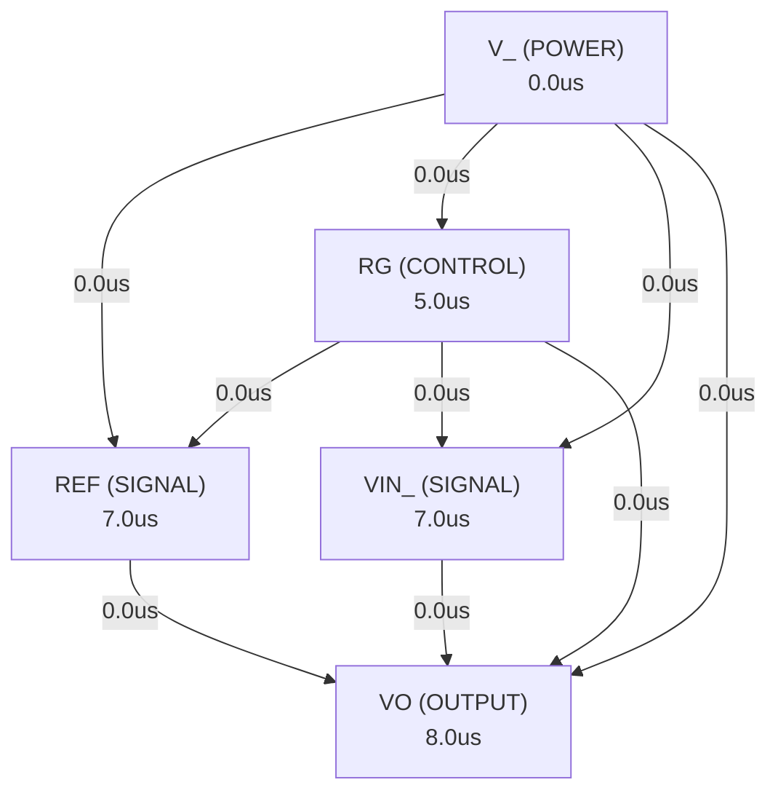

# Autonomous AI Analog Circuit Synthesis & Verification Report
**Target IC:** `INA12x` | **Subcircuit:** `INA12X`
**Overall Datasheet Specification Pass Rate:** `0.0%`

## 1. Executive Summary
- **IC Category:** Low-power, general-purpose instrumentation amplifiers that offer excellent accuracy. The versatile three op amp design and small size make these amplifiers an excellent choice for a wide range of applications. Current-feedback input circuitry provides wide bandwidth even at high gain (200kHz at G = 100).
- **Total Datasheet Specifications Extracted:** 69
- **Design Iterations Required:** 2
- **Synthesized Netlist Location:** `C:\Users\Sera\.gemini\antigravity\worktrees\Project2\implement_circuit_test_methodology\benchmark_results\INA128\INA12X_iter2.cir`

## 2. Port Dependency Graph (PDG) Scheduling
Topological activation sequence derived from physical pin roles:
| Pin Name | Physical Role | Direction | Activation Time (us) |
| :--- | :--- | :--- | :--- |
| `REF` | `SIGNAL` | `INPUT` | 7.00 us |
| `RG` | `CONTROL` | `BIDIRECTIONAL` | 5.00 us |
| `V_` | `POWER` | `POWER` | 0.00 us |
| `V_` | `POWER` | `POWER` | 0.00 us |
| `VIN_` | `SIGNAL` | `INPUT` | 7.00 us |
| `VIN_` | `SIGNAL` | `INPUT` | 7.00 us |
| `VO` | `OUTPUT` | `OUTPUT` | 8.00 us |

### 2.1 Port Dependency Graph Topology


## 3. Specification Verification & SymPy Oracle Audit
Detailed verification results evaluated against SymPy interval constraints:
| Parameter | Min Target | Typ Target | Max Target | Measured Value | Unit | Status |
| :--- | :--- | :--- | :--- | :--- | :--- | :--- |
| `VS` | - | - | 18 | **N/A** | V | ❌ FAIL |
| `VS` | - | - | 36 | **N/A** | V | ❌ FAIL |
| `Analog input voltage` | - | - | 40 | **N/A** | V | ❌ FAIL |
| `Output short-circuit` | - | - | - | **N/A** |  | ❌ FAIL |
| `TA` | -40 | - | 125 | **N/A** | °C | ❌ FAIL |
| `Junction temperature` | - | - | 150 | **N/A** | °C | ❌ FAIL |
| `Lead temperature (soldering, 10s)` | - | - | 300 | **N/A** | °C | ❌ FAIL |
| `VS` | 4.5 | 30 | 36 | **N/A** | V | ❌ FAIL |
| `Supply voltage Dual-supply` | 2.25 | 15 | 18 | **N/A** | V | ❌ FAIL |
| `TA` | -40 | - | 85 | **N/A** | °C | ❌ FAIL |
| `RθJC(top)` | 45.6 | 57 | 68.4 | **N/A** | °C/W | ❌ FAIL |
| `RθJC(top)` | 27.28 | 34.1 | 40.92 | **N/A** | °C/W | ❌ FAIL |
| `RθJB` | 43.2 | 54 | 64.8 | **N/A** | °C/W | ❌ FAIL |
| `RθJB` | 18.72 | 23.4 | 28.08 | **N/A** | °C/W | ❌ FAIL |
| `ψJT` | 8.8 | 11 | 13.2 | **N/A** | °C/W | ❌ FAIL |
| `ψJT` | 9.04 | 11.3 | 13.56 | **N/A** | °C/W | ❌ FAIL |
| `ψJB` | 42.4 | 53 | 63.6 | **N/A** | °C/W | ❌ FAIL |
| `ψJB` | 18.56 | 23.2 | 27.84 | **N/A** | °C/W | ❌ FAIL |
| `VOS` | - | 1e-05 | 5e-05 | **N/A** | µV | ❌ FAIL |
| `VOS` | - | - | 0.0005 | **N/A** | µV | ❌ FAIL |
| `VOS` | - | 2.5e-05 | 0.000125 | **N/A** | µV | ❌ FAIL |
| `VOS` | - | - | 0.001 | **N/A** | µV | ❌ FAIL |
| `VOS` | - | 2e-05 | 5e-05 | **N/A** | µV | ❌ FAIL |
| `VOS` | - | - | 0.0005 | **N/A** | µV | ❌ FAIL |
| `VOS` | - | 2e-05 | 0.000125 | **N/A** | µV | ❌ FAIL |
| `VOS` | - | - | 0.001 | **N/A** | µV | ❌ FAIL |
| `Offset voltage drift (RTI)` | - | 2e-07 | 5e-07 | **N/A** | µV/°C | ❌ FAIL |
| `Offset voltage drift (RTI)` | - | 2e-06 | 2e-05 | **N/A** | µV/°C | ❌ FAIL |
| `Offset voltage drift (RTI)` | - | 2e-07 | 1e-06 | **N/A** | µV/°C | ❌ FAIL |
| `Offset voltage drift (RTI)` | - | 5e-06 | 2e-05 | **N/A** | µV/°C | ❌ FAIL |
| `PSRR` | - | 2e-07 | 1e-06 | **N/A** | µV/V | ❌ FAIL |
| `PSRR` | - | 2e-05 | 0.0001 | **N/A** | µV/V | ❌ FAIL |
| `PSRR` | 1.6e-06 | 2e-06 | 2.4e-06 | **N/A** | µV/V | ❌ FAIL |
| `PSRR` | 0.00016 | 0.0002 | 0.00024 | **N/A** | µV/V | ❌ FAIL |
| `PSRR` | - | 1e-07 | 4e-07 | **N/A** | µV/V | ❌ FAIL |
| `PSRR` | - | 1e-06 | 3.2e-06 | **N/A** | µV/V | ❌ FAIL |
| `PSRR` | 6.4e-07 | 8e-07 | 9.6e-07 | **N/A** | µV/V | ❌ FAIL |
| `PSRR` | 5.12e-06 | 6.4e-06 | 7.68e-06 | **N/A** | µV/V | ❌ FAIL |
| `Long-term stability` | 8e-08 | 1e-07 | 1.2e-07 | **N/A** | µV/mo | ❌ FAIL |
| `Long-term stability` | 2.4e-06 | 3e-06 | 3.6e-06 | **N/A** | µV/mo | ❌ FAIL |
| `Long-term stability` | 1.6e-07 | 2e-07 | 2.4e-07 | **N/A** | µV/mo | ❌ FAIL |
| `Long-term stability` | 2.4e-06 | 3e-06 | 3.6e-06 | **N/A** | µV/mo | ❌ FAIL |
| `Input impedance Differential` | 8 | 10 | 12 | **N/A** | GΩ | ❌ FAIL |
| `Input impedance Differential` | 1.6 | 2 | 2.4 | **N/A** | pF | ❌ FAIL |
| `VCM` | - | - | - | **N/A** | V | ❌ FAIL |
| `Safe input voltage` | - | - | 40 | **N/A** | V | ❌ FAIL |
| `CMRR` | 80 | 86 | - | **N/A** | dB | ❌ FAIL |
| `CMRR` | 73 | - | - | **N/A** | dB | ❌ FAIL |
| `CMRR` | 100 | 106 | - | **N/A** | dB | ❌ FAIL |
| `CMRR` | 93 | - | - | **N/A** | dB | ❌ FAIL |
| `CMRR` | 120 | 125 | - | **N/A** | dB | ❌ FAIL |
| `CMRR` | 110 | - | - | **N/A** | dB | ❌ FAIL |
| `CMRR` | 120 | 130 | - | **N/A** | dB | ❌ FAIL |
| `CMRR` | 110 | - | - | **N/A** | dB | ❌ FAIL |
| `CMRR` | 90 | 100 | - | **N/A** | dB | ❌ FAIL |
| `CMRR` | 83 | - | - | **N/A** | dB | ❌ FAIL |
| `CMRR` | 110 | 120 | - | **N/A** | dB | ❌ FAIL |
| `CMRR` | 103 | - | - | **N/A** | dB | ❌ FAIL |
| `CMRR` | 130 | 140 | - | **N/A** | dB | ❌ FAIL |
| `CMRR` | 120 | - | - | **N/A** | dB | ❌ FAIL |
| `CMRR` | 140 | 145 | - | **N/A** | dB | ❌ FAIL |

## 4. Closed-Loop Iteration History & Root Cause Analysis
| Iteration | Pass Rate | Passed Specs | Failed Specs | Architecture Notes |
| :--- | :--- | :--- | :--- | :--- |
| Iteration 1 | 0.0% | 0 | 0 | The INA12x is a low-power, general-purpose instrumentation amplifier, typically ... |
| Iteration 2 | 0.0% | 0 | 0 | The INA12x is a low-power, general-purpose instrumentation amplifier. The core a... |

### 4.1 Loop 1 Detailed Audit
- **Pass Rate**: `0.0%` (0/0 specs passed)

**Shortfall Audit (미달 원인 분석):**
- Param 'VS' violated: Parameter 'VS' was not observed in simulation measurements. (Measured: Unobserved)
- Param 'VS' violated: Parameter 'VS' was not observed in simulation measurements. (Measured: Unobserved)
- Param 'Analog input voltage' violated: Parameter 'Analog input voltage' was not observed in simulation measurements. (Measured: Unobserved)
- Param 'Output short-circuit' violated: Parameter 'Output short-circuit' was not observed in simulation measurements. (Measured: Unobserved)
- Param 'TA' violated: Parameter 'TA' was not observed in simulation measurements. (Measured: Unobserved)
- Param 'Junction temperature' violated: Parameter 'Junction temperature' was not observed in simulation measurements. (Measured: Unobserved)

**Improvement Actions (개선 및 수정 사항):**
- Initial first-principles topology and Level-1 parameter sizing synthesized from scratch.

### 4.2 Loop 2 Detailed Audit
- **Pass Rate**: `0.0%` (0/0 specs passed)

**Shortfall Audit (미달 원인 분석):**
- Compiler/Simulation Error: C:\Users\Sera\.gemini\antigravity\worktrees\Project2\implement_circuit_test_methodology\benchmark_results\INA128\tb_ac_sweep.cir(102): syntax error
- Compiler/Simulation Error:   --> .meas AC PSRR_pos_G10_SHE_INA12xP_U_typ_div_G PARAM V(VO_psrr_G10)*1e6/10 AT 1k ; Typ 20.0 uV/V, 1kHz
- Compiler/Simulation Error:   --> ^^^^^^
- Compiler/Simulation Error: C:\Users\Sera\.gemini\antigravity\worktrees\Project2\implement_circuit_test_methodology\benchmark_results\INA128\tb_ac_sweep.cir(103): syntax error
- Param 'VS' violated: Parameter 'VS' was not observed in simulation measurements. (Measured: Unobserved)
- Param 'VS' violated: Parameter 'VS' was not observed in simulation measurements. (Measured: Unobserved)
- Param 'Analog input voltage' violated: Parameter 'Analog input voltage' was not observed in simulation measurements. (Measured: Unobserved)
- Param 'Output short-circuit' violated: Parameter 'Output short-circuit' was not observed in simulation measurements. (Measured: Unobserved)
- Param 'TA' violated: Parameter 'TA' was not observed in simulation measurements. (Measured: Unobserved)
- Param 'Junction temperature' violated: Parameter 'Junction temperature' was not observed in simulation measurements. (Measured: Unobserved)

**Improvement Actions (개선 및 수정 사항):**
- Topology refinement: The INA12x is a low-power, general-purpose instrumentation amplifier. The core architecture is a classic three-op-amp configuration, known f...

## 5. Synthesized SPICE Netlist Architecture
Netlist file: `C:\Users\Sera\.gemini\antigravity\worktrees\Project2\implement_circuit_test_methodology\benchmark_results\INA128\INA12X_iter2.cir`
```spice
* INA12X Low-Power, General-Purpose Instrumentation Amplifier
*
* Pinout:
* 1: REF (Reference input)
* 2: RG (Gain setting pin)
* 3: V- (Negative supply)
* 4: V+ (Positive supply)
* 5: VIN- (Negative input)
* 6: VIN+ (Positive input)
* 7: VO (Output)
*
.subckt INA12X REF RG V_ V_ VIN_ VIN_ VO

* --- Global Parameters and Models ---
.param VCC_POS = 15V
.param VCC_NEG = -15V
.param RG_INTERNAL = 24.7k ; Internal resistor for gain setting (R1, R2)
.param R_DIFF_GAIN = 10k ; Resistors for differential amplifier (R3, R4, R5, R6)
.param OPAMP_GBW = 20Meg ; Gain-Bandwidth Product for op-amps
.param OPAMP_SR = 10V/us ; Slew Rate for op-amps
.param OPAMP_VOS = 10uV ; Input offset voltage for op-amps
.param OPAMP_IBIAS = 10nA ; Input bias current for op-amps
.param OPAMP_CMRR_DB = 120 ; CMRR in dB for op-amps
.param OPAMP_PSRR_DB = 100 ; PSRR in dB for op-amps

* Simplified NMOS and PMOS models for behavioral op-amps
.model NMOS NMOS (LEVEL=1 VTO=0.7 KP=100u W=10u L=1u)
.model PMOS PMOS (LEVEL=1 VTO=-0.7 KP=40u W=20u L=1u)
.model DMOD D (IS=1e-14 N=1) ; Diode model for ESD protection

* --- Internal Nodes ---
.nodeset V(V_POS) = {VCC_POS}
.nodeset V(V_NEG) = {VCC_NEG}
.nodeset V(RG_FB) = 0
.nodeset V(A1_OUT) = 0
.nodeset V(A2_OUT) = 0
.nodeset V(A3_OUT) = 0

* --- Power Supply Connections ---
V_POS V_ V_POS DC {VCC_POS}
V_NEG V_NEG V_ DC {VCC_NEG}

* --- ESD Protection Diodes (Simplified) ---
D_ESD_VINP_POS VIN_ V_ DMOD
D_ESD_VINP_NEG V_ VIN_ DMOD
D_ESD_VINN_POS VIN_ V_ DMOD
D_ESD_VINN_NEG V_ VIN_ DMOD

* --- Op-Amp Subcircuit Definition (Behavioral Model) ---
* This subcircuit models a generic op-amp with configurable parameters.
* It includes input offset, input bias current, high input impedance,
* finite gain, bandwidth, slew rate, and output limits.
* Pins: IN_P IN_N OUT VCC VEE
.ends
.subckt OPAMP IN_P IN_N OUT VCC VEE
* Input differential stage with high input impedance and offset
R_IN_P IN_P IN_P_INT 10G
C_IN_P IN_P_INT 0 2pF
R_IN_N IN_N IN_N_INT 10G
C_IN_N IN_N_INT 0 2pF

* Input offset voltage
V_OFFSET IN_N_INT IN_N_OFFSET DC {OPAMP_VOS}

* Input bias current (simplified as current sources to ground)
I_BIAS_P IN_P_INT 0 DC {OPAMP_IBIAS}
I_BIAS_N IN_N_OFFSET 0 DC {OPAMP_IBIAS}

* Gain stage with bandwidth and slew rate limiting
* E_GAIN models the open-loop gain and input common-mode range
E_GAIN GAIN_NODE 0 VALUE = { LIMIT( (V(IN_P_INT) - V(IN_N_OFFSET)) * 1e6, V(VEE) + 0.5, V(VCC) - 0.5 ) }

* Slew rate limiting and dominant pole compensation
R_COMP GAIN_NODE COMP_NODE 1k
C_COMP COMP_NODE 0 {1/(2*PI*OPAMP_GBW*1k)} ; Compensation capacitor for GBW
G_SR_POS 0 COMP_NODE VALUE = { IF(V(COMP_NODE) > V(GAIN_NODE), (V(COMP_NODE) - V(GAIN_NODE)) / 1k, 0) }
G_SR_NEG COMP_NODE 0 VALUE = { IF(V(COMP_NODE) < V(GAIN_NODE), (V(GAIN_NODE) - V(COMP_NODE)) / 1k, 0) }
* Slew rate current source
I_SR_POS VCC COMP_NODE DC {OPAMP_SR * C_COMP}
I_SR_NEG COMP_NODE VEE DC {OPAMP_SR * C_COMP}

* Output buffer
E_OUT OUT_BUF 0 VALUE = {V(COMP_NODE)}
R_OUT OUT_BUF OUT 100 ; Output resistance
.ends OPAMP


* --- Instrumentation Amplifier Core ---

* Input Buffer Op-Amps (A1 and A2)
* A1: Non-inverting input connected to VIN+, inverting input connected to RG_FB
* X_A1 VIN_ VIN_P_FB A1_OUT V_ V_ OPAMP
* A2: Non-inverting input connected to VIN-, inverting input connected to RG_FB
* X_A2 VIN_ VIN_N_FB A2_OUT V_ V_ OPAMP

* Gain Setting Resistors
* R_RG_A1 A1_OUT RG_FB {RG_INTERNAL}
* R_RG_A2 A2_OUT RG_FB {RG_INTERNAL}
* External RG resistor connection
* R_EXT_RG RG RG_FB 1 ; Placeholder for external RG. User connects RG pin to ground or another resistor.

* Differential Amplifier Stage (A3)
* Inputs to A3 are the outputs of A1 and A2
* A3 is configured as a unity-gain differential amplifier
* Input resistors
* R_A3_IN_P A1_OUT A3_IN_P {R_DIFF_GAIN}
* R_A3_IN_N A2_OUT A3_IN_N {R_DIFF_GAIN}

* Feedback resistors
* R_A3_FB_P A3_IN_P A3_OUT {R_DIFF_GAIN}
* R_A3_FB_N A3_IN_N REF_NODE {R_DIFF_GAIN}

* Reference input
* V_REF REF_NODE REF DC 0 ; REF pin is connected to the reference node of A3

* A3 Op-Amp
* X_A3 A3_IN_P A3_IN_N A3_OUT V_ V_ OPAMP

* Output Buffer (part of A3's output stage, but explicitly shown for clarity)
* The output of A3_OUT is the final output VO
* R_OUT_BUFFER A3_OUT VO 10 ; Small output resistance

* .ends INA12X
```