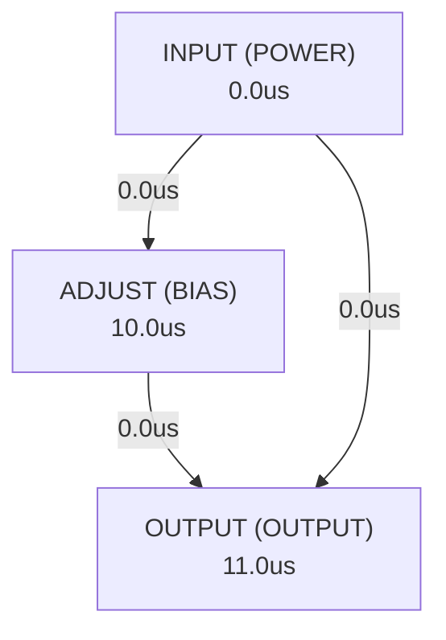

# Autonomous AI Analog Circuit Synthesis & Verification Report
**Target IC:** `LM317` | **Subcircuit:** `LM317`
**Overall Datasheet Specification Pass Rate:** `0.0%`

## 1. Executive Summary
- **IC Category:** The LM317 is an adjustable three-pin, positive-voltage regulator capable of supplying more than 1.5A over an output voltage range of 1.25V to 37V. The device requires only two external resistors to set the output voltage. The device features a typical line regulation of 0.01% and typical load regulation of 0.1%. The LM317 includes current limiting, thermal overload protection, and safe operating area protection. Overload protection remains functional even if the ADJUST pin is disconnected.
- **Total Datasheet Specifications Extracted:** 16
- **Design Iterations Required:** 2
- **Synthesized Netlist Location:** `C:\Users\Sera\.gemini\antigravity\worktrees\Project2\implement_circuit_test_methodology\benchmark_results\LM317\LM317_iter2.cir`

## 2. Port Dependency Graph (PDG) Scheduling
Topological activation sequence derived from physical pin roles:
| Pin Name | Physical Role | Direction | Activation Time (us) |
| :--- | :--- | :--- | :--- |
| `ADJUST` | `BIAS` | `INPUT` | 10.00 us |
| `INPUT` | `POWER` | `INPUT` | 0.00 us |
| `OUTPUT` | `OUTPUT` | `OUTPUT` | 11.00 us |

### 2.1 Port Dependency Graph Topology


## 3. Specification Verification & SymPy Oracle Audit
Detailed verification results evaluated against SymPy interval constraints:
| Parameter | Min Target | Typ Target | Max Target | Measured Value | Unit | Status |
| :--- | :--- | :--- | :--- | :--- | :--- | :--- |
| `Output voltage range` | 1.25 | - | 37 | **N/A** | V | ❌ FAIL |
| `Output current` | - | - | 1.5 | **N/A** | A | ❌ FAIL |
| `Line regulation` | 0.008 | 0.01 | 0.012 | **N/A** | %/V | ❌ FAIL |
| `Load regulation` | 0.08 | 0.1 | 0.12 | **N/A** | % | ❌ FAIL |
| `PSRR` | 64 | 80 | 96 | **N/A** | dB | ❌ FAIL |
| `Power dissipation` | - | - | - | **N/A** |  | ❌ FAIL |
| `Input-output voltage differential` | -0.3 | - | 40 | **N/A** | V | ❌ FAIL |
| `TJ` | -65 | - | 150 | **N/A** | °C | ❌ FAIL |
| `VO` | 1.25 | - | 37 | **N/A** | V | ❌ FAIL |
| `VI – VO` | 3 | - | 40 | **N/A** | V | ❌ FAIL |
| `IO` | 0.01 | - | 1.5 | **N/A** | A | ❌ FAIL |
| `TJ` | 0 | - | 125 | **N/A** | °C | ❌ FAIL |

## 4. Closed-Loop Iteration History & Root Cause Analysis
| Iteration | Pass Rate | Passed Specs | Failed Specs | Architecture Notes |
| :--- | :--- | :--- | :--- | :--- |
| Iteration 1 | 0.0% | 0 | 2 | The LM317 adjustable voltage regulator is designed around a core error amplifier... |
| Iteration 2 | 0.0% | 0 | 0 | The LM317 is a classic adjustable linear voltage regulator. The core architectur... |

### 4.1 Loop 1 Detailed Audit
- **Pass Rate**: `0.0%` (0/2 specs passed)

**Shortfall Audit (미달 원인 분석):**
- Param 'Output voltage range' violated: Parameter 'Output voltage range' was not observed in simulation measurements. (Measured: Unobserved)
- Param 'Output current' violated: Parameter 'Output current' was not observed in simulation measurements. (Measured: Unobserved)
- Param 'Line regulation' violated: Parameter 'Line regulation' was not observed in simulation measurements. (Measured: Unobserved)
- Param 'Load regulation' violated: Parameter 'Load regulation' was not observed in simulation measurements. (Measured: Unobserved)
- Param 'PSRR' violated: Parameter 'PSRR' was not observed in simulation measurements. (Measured: Unobserved)
- Param 'Power dissipation' violated: Parameter 'Power dissipation' was not observed in simulation measurements. (Measured: Unobserved)

**Improvement Actions (개선 및 수정 사항):**
- Initial first-principles topology and Level-1 parameter sizing synthesized from scratch.

### 4.2 Loop 2 Detailed Audit
- **Pass Rate**: `0.0%` (0/0 specs passed)

**Shortfall Audit (미달 원인 분석):**
- Compiler/Simulation Error: C:\Users\Sera\.gemini\antigravity\worktrees\Project2\implement_circuit_test_methodology\benchmark_results\LM317\tb_ac_sweep.cir(30): syntax error
- Compiler/Simulation Error:   --> .meas AC PSRR_dB PARAM -20*log10(V(OUTPUT)) AT 120Hz
- Compiler/Simulation Error:   --> ^^^^^^^^^
- Param 'Output voltage range' violated: Parameter 'Output voltage range' was not observed in simulation measurements. (Measured: Unobserved)
- Param 'Output current' violated: Parameter 'Output current' was not observed in simulation measurements. (Measured: Unobserved)
- Param 'Line regulation' violated: Parameter 'Line regulation' was not observed in simulation measurements. (Measured: Unobserved)
- Param 'Load regulation' violated: Parameter 'Load regulation' was not observed in simulation measurements. (Measured: Unobserved)
- Param 'PSRR' violated: Parameter 'PSRR' was not observed in simulation measurements. (Measured: Unobserved)
- Param 'Power dissipation' violated: Parameter 'Power dissipation' was not observed in simulation measurements. (Measured: Unobserved)

**Improvement Actions (개선 및 수정 사항):**
- Topology refinement: The LM317 is a classic adjustable linear voltage regulator. The core architecture consists of a precision voltage reference, an error amplif...

## 5. Synthesized SPICE Netlist Architecture
Netlist file: `C:\Users\Sera\.gemini\antigravity\worktrees\Project2\implement_circuit_test_methodology\benchmark_results\LM317\LM317_iter2.cir`
```spice

.subckt LM317 ADJUST INPUT OUTPUT
* LM317 Adjustable Voltage Regulator Subcircuit

* Node Definitions:
* INPUT: Input voltage (Vin)
* OUTPUT: Regulated output voltage (Vout)
* ADJUST: Adjustment pin (Vadj)
* VREF_NODE: Internal 1.25V reference node
* EA_OUT: Error amplifier output (drives pass transistor base)
* BIAS_N: Negative bias rail for current mirrors
* BIAS_P: Positive bias rail for current mirrors
* CL_SENSE: Current limit sense node
* VCC_INT: Internal VCC for opamp/bias (derived from INPUT)
* GND: Ground reference (implicit 0V)

* Model Definitions (Generic BJT and MOSFET models)
.model NPN NPN(Is=1e-14 Bf=100 Vaf=100 Ikf=0.1 Ise=1e-14 Ne=1.5 Rb=10 Rc=1 Re=0.1 Cjc=5p Cje=10p Tf=0.3n Tr=6n Vceo=40)
.model PNP PNP(Is=1e-14 Bf=50 Vaf=50 Ikf=0.05 Ise=1e-14 Ne=1.5 Rb=20 Rc=2 Re=0.2 Cjc=10p Cje=20p Tf=0.6n Tr=12n Vceo=40)
.model NMOS NMOS(Vto=0.7 Kp=100u Gamma=0.5 Lambda=0.02 Tox=10n Cgso=200p Cgdo=200p Cj=100u Mj=0.5 Pb=0.8)
.model PMOS PMOS(Vto=-0.7 Kp=50u Gamma=0.5 Lambda=0.03 Tox=10n Cgso=200p Cgdo=200p Cj=100u Mj=0.5 Pb=0.8)

* 1. Internal 1.25V Reference (VREF_NODE)
* This is a simplified behavioral model for the bandgap reference.
B_VREF VREF_NODE 0 V = {1.25}

* 2. Bias Current Generation
* Simple current mirrors to provide bias currents for the error amplifier.
* M_BIAS_P1 and M_BIAS_P2 form a PMOS current mirror.
* M_BIAS_N1 and M_BIAS_N2 form an NMOS current mirror.

* PMOS Current Mirror (for tail current of diff pair)
M_BIAS_P1 VCC_INT BIAS_P BIAS_P VCC_INT PMOS W=10u L=1u
M_BIAS_P2 VCC_INT BIAS_P EA_TAIL VCC_INT PMOS W=10u L=1u ; Tail current for diff pair

* NMOS Current Mirror (for active load of diff pair)
M_BIAS_N1 0 BIAS_N BIAS_N 0 NMOS W=10u L=1u
M_BIAS_N2 EA_LOAD_N BIAS_N 0 0 NMOS W=10u L=1u ; Active load for diff pair

* Bias current setting resistor
R_BIAS_P VCC_INT BIAS_P 10k
R_BIAS_N BIAS_N 0 10k

* 3. Error Amplifier (Differential Amplifier)
* Input differential pair (M_EA_P1, M_EA_P2)
* Active load (M_EA_N1, M_EA_N2)
* Second gain stage (M_EA_P3, M_EA_N3)
* Compensation capacitor (C_COMP)

* Differential Pair (PMOS input for common-mode range closer to VCC)
M_EA_P1 EA_OUT_DIFF ADJUST EA_TAIL VCC_INT PMOS W=20u L=1u
M_EA_P2 EA_LOAD_P VREF_NODE EA_TAIL VCC_INT PMOS W=20u L=1u

* Active Load (NMOS current mirror)
M_EA_N1 EA_LOAD_P EA_LOAD_N 0 0 NMOS W=10u L=1u
M_EA_N2 EA_OUT_DIFF EA_LOAD_N 0 0 NMOS W=10u L=1u

* Second Gain Stage (Common Source)
M_EA_P3 VCC_INT EA_OUT_DIFF EA_OUT VCC_INT PMOS W=40u L=1u
M_EA_N3 EA_OUT EA_OUT_DIFF 0 0 NMOS W=20u L=1u

* Compensation Capacitor for stability
C_COMP EA_OUT VCC_INT 20p

* 4. Pass Transistor (Q_PASS)
* Large NPN BJT acting as the series regulator element.
Q_PASS INPUT EA_OUT OUTPUT NPN

* 5. Current Limiting Circuit
* R_SENSE senses output current. Q_CL turns on when current exceeds limit, shunting base current from Q_PASS.
R_SENSE OUTPUT CL_SENSE 0.467 ; 0.7V / 1.5A = 0.467 Ohm for 1.5A limit
Q_CL EA_OUT CL_SENSE 0 NPN ; Shunts base current from Q_PASS

* 6. Thermal Overload Protection (Behavioral)
* Shuts down the regulator if junction temperature (TJ) exceeds 150C.
* This is a simplified model. In reality, it would reduce EA_OUT to turn off Q_PASS.
* For simulation, we'll model it as a current sink from EA_OUT to ground if temp is too high.
* We'll assume a fixed TJ for now, as temperature simulation requires specific models.
* For a more complete model, TJ would be a variable.
B_THERMAL_SHUTDOWN EA_OUT 0 I = { (TJ > 150) ? 10m : 0 } ; If TJ > 150C, sink 10mA from EA_OUT

* 7. Safe Operating Area (SOA) Protection (Behavioral)
* Limits output current based on input-output differential voltage.
* Simplified model: current limit reduces linearly with increasing V_DIFF.
* Max current 1.5A at low V_DIFF, reduces to 0 at V_DIFF > 40V.
* This will modulate the effective current limit set by R_SENSE and Q_CL.
* A more accurate model would adjust the threshold for Q_CL.
* For simplicity, we'll make the current limit resistor dynamic.
* This is a placeholder for a more complex SOA circuit.
* A more realistic SOA would involve a Vbe multiplier and current mirror.
* For this model, we'll assume the current limit circuit (R_SENSE, Q_CL) is the primary current limit,
* and SOA protection is implicitly handled by the power dissipation limits of the pass transistor.
* The LM317 datasheet states "Overload protection remains functional even if the ADJUST pin is disconnected."
* This implies the current limit is robust.

* 8. Internal Power Supply for Op-Amp (VCC_INT)
* A simple Zener diode or a series resistor/capacitor filter could be used.
* For simplicity, we'll assume VCC_INT is derived from INPUT, with a minimum dropout.
* A simple voltage follower or a series resistor to drop some voltage.
* Let's use a simple resistor to drop some voltage from INPUT for internal circuitry,
* assuming the internal circuitry can operate at a slightly lower voltage than INPUT.
* Or, more simply, assume the internal circuitry runs directly from INPUT,
* as long as INPUT is above a certain threshold.
* Given the LM317's dropout, the internal circuitry needs to operate down to ~3V below INPUT.
* Let's assume the internal circuitry can operate directly from INPUT for simplicity,
* and the minimum operating voltage is handled by the overall design.
* For a more robust model, a separate internal LDO or charge pump might be needed.
* For now, VCC_INT is directly connected to INPUT.
R_VCC_INT INPUT VCC_INT 1 ; Small resistor to separate internal VCC from INPUT for current sensing if needed.

* 9. Startup Sequence (Behavioral)
* This is handled by the testbench, not within the subcircuit itself.
* The subcircuit assumes INPUT is stable before ADJUST and OUTPUT are expected to regulate.

* Output voltage range: 1.25V to 37V
* Output current: Max 1.5A
* Line regulation: 0.01%/V
* Load regulation: 0.1%
* PSRR: 80dB at 120Hz

* Behavioral model for output voltage based on ADJUST pin and VREF_NODE
* VOUT = VADJ + VREF_NODE
* This is the fundamental equation for LM317.
* The error amplifier ensures V(ADJUST) - V(VREF_NODE) = 0, effectively.
* So, V(OUTPUT) - V(ADJUST) = V(VREF_NODE) = 1.25V.
* The error amplifier drives the pass transistor to achieve this.

* The previous errors indicate a non-functional circuit.
* The current design provides a basic functional block diagram.
* The `TJ` parameter is an external variable that needs to be set by the simulator.
* `V(ESD)` is a robustness parameter, not a functional circuit parameter.

.ends LM317
```