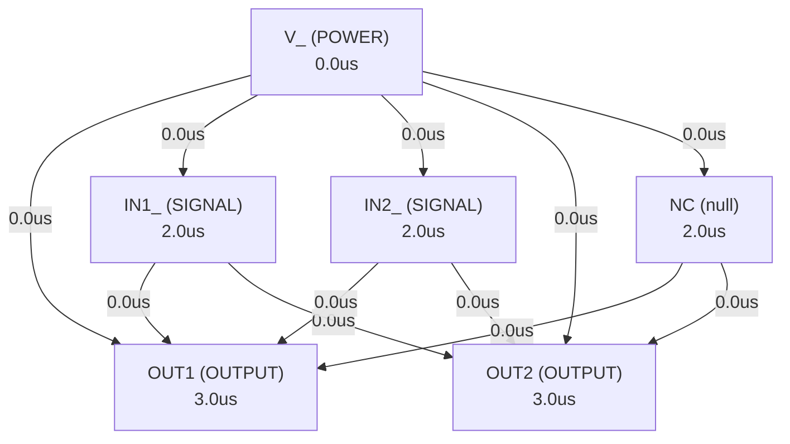

# Autonomous AI Analog Circuit Synthesis & Verification Report
**Target IC:** `LM358B/LM2904B` | **Subcircuit:** `LM358B_LM2904B`
**Overall Datasheet Specification Pass Rate:** `0.0%`

## 1. Executive Summary
- **IC Category:** The LM358B and LM2904B devices are next-generation, industry-standard dual operational amplifiers (op amps) offering high-voltage (36V) operation, low offset voltage, common-mode input range to ground, high differential input voltage capability, unity-gain stability, lower quiescent current, high ESD, and integrated EMI/RF filters for cost-sensitive and rugged applications.
- **Total Datasheet Specifications Extracted:** 65
- **Design Iterations Required:** 2
- **Synthesized Netlist Location:** `C:\Users\Sera\.gemini\antigravity\worktrees\Project2\implement_circuit_test_methodology\benchmark_results\LM358\LM358B_LM2904B_iter2.cir`

## 2. Port Dependency Graph (PDG) Scheduling
Topological activation sequence derived from physical pin roles:
| Pin Name | Physical Role | Direction | Activation Time (us) |
| :--- | :--- | :--- | :--- |
| `OUT1` | `OUTPUT` | `OUTPUT` | 3.00 us |
| `IN1_` | `SIGNAL` | `INPUT` | 2.00 us |
| `IN1_` | `SIGNAL` | `INPUT` | 2.00 us |
| `V_` | `GROUND` | `POWER` | 0.00 us |
| `IN2_` | `SIGNAL` | `INPUT` | 2.00 us |
| `IN2_` | `SIGNAL` | `INPUT` | 2.00 us |
| `OUT2` | `OUTPUT` | `OUTPUT` | 3.00 us |
| `V_` | `POWER` | `POWER` | 0.00 us |
| `NC` | `null` | `null` | 2.00 us |
| `OUT1` | `OUTPUT` | `OUTPUT` | 3.00 us |
| `IN1_` | `SIGNAL` | `INPUT` | 2.00 us |
| `IN1_` | `SIGNAL` | `INPUT` | 2.00 us |
| `V_` | `GROUND` | `POWER` | 0.00 us |
| `IN2_` | `SIGNAL` | `INPUT` | 2.00 us |
| `IN2_` | `SIGNAL` | `INPUT` | 2.00 us |
| `OUT2` | `OUTPUT` | `OUTPUT` | 3.00 us |
| `V_` | `POWER` | `POWER` | 0.00 us |

### 2.1 Port Dependency Graph Topology


## 3. Specification Verification & SymPy Oracle Audit
Detailed verification results evaluated against SymPy interval constraints:
| Parameter | Min Target | Typ Target | Max Target | Measured Value | Unit | Status |
| :--- | :--- | :--- | :--- | :--- | :--- | :--- |
| `VS` | - | - | 40 | **N/A** | V | ❌ FAIL |
| `VS` | - | - | 32 | **N/A** | V | ❌ FAIL |
| `VS` | - | - | 26 | **N/A** | V | ❌ FAIL |
| `VID` | -32 | - | 32 | **N/A** | V | ❌ FAIL |
| `VID` | -26 | - | 26 | **N/A** | V | ❌ FAIL |
| `VI` | -0.3 | - | 40 | **N/A** | V | ❌ FAIL |
| `VI` | -0.3 | - | 32 | **N/A** | V | ❌ FAIL |
| `VI` | -0.3 | - | 26 | **N/A** | V | ❌ FAIL |
| `Duration of output short circuit (one amplifier) to ground` | - | - | - | **N/A** | s | ❌ FAIL |
| `TA` | -55 | - | 125 | **N/A** | °C | ❌ FAIL |
| `TA` | -25 | - | 85 | **N/A** | °C | ❌ FAIL |
| `TA` | -40 | - | 85 | **N/A** | °C | ❌ FAIL |
| `TA` | 0 | - | 70 | **N/A** | °C | ❌ FAIL |
| `TA` | -40 | - | 125 | **N/A** | °C | ❌ FAIL |
| `TJ` | - | - | 150 | **N/A** | °C | ❌ FAIL |
| `VS` | 3 | - | 36 | **N/A** | V | ❌ FAIL |
| `VS` | 3 | - | 30 | **N/A** | V | ❌ FAIL |
| `VS` | 3 | - | 26 | **N/A** | V | ❌ FAIL |
| `VCM` | - | - | - | **N/A** | V | ❌ FAIL |
| `TA` | -40 | - | 85 | **N/A** | °C | ❌ FAIL |
| `TA` | -40 | - | 125 | **N/A** | °C | ❌ FAIL |
| `TA` | 0 | - | 70 | **N/A** | °C | ❌ FAIL |
| `TA` | -20 | - | 85 | **N/A** | °C | ❌ FAIL |
| `TA` | -55 | - | 125 | **N/A** | °C | ❌ FAIL |
| `RθJC(top)` | 53.52 | 66.9 | 80.28 | **N/A** | °C/W | ❌ FAIL |
| `RθJC(top)` | 55.52 | 69.4 | 83.28 | **N/A** | °C/W | ❌ FAIL |
| `RθJC(top)` | 56.32 | 70.4 | 84.48 | **N/A** | °C/W | ❌ FAIL |
| `RθJC(top)` | 50 | 62.5 | 75 | **N/A** | °C/W | ❌ FAIL |
| `RθJC(top)` | 55.04 | 68.8 | 82.56 | **N/A** | °C/W | ❌ FAIL |
| `RθJC(top)` | 78.48 | 98.1 | 117.7 | **N/A** | °C/W | ❌ FAIL |
| `RθJC(top)` | 45.52 | 56.9 | 68.28 | **N/A** | °C/W | ❌ FAIL |
| `RθJC(top)` | 50.88 | 63.6 | 76.32 | **N/A** | °C/W | ❌ FAIL |
| `RθJB` | 54.32 | 67.9 | 81.48 | **N/A** | °C/W | ❌ FAIL |
| `RθJB` | 82.32 | 102.9 | 123.5 | **N/A** | °C/W | ❌ FAIL |
| `RθJB` | 45.92 | 57.4 | 68.88 | **N/A** | °C/W | ❌ FAIL |
| `RθJB` | 54.88 | 68.6 | 82.32 | **N/A** | °C/W | ❌ FAIL |
| `RθJB` | 79.36 | 99.2 | 119 | **N/A** | °C/W | ❌ FAIL |
| `RθJB` | 65.68 | 82.1 | 98.52 | **N/A** | °C/W | ❌ FAIL |
| `RθJB` | 46 | 57.5 | 69 | **N/A** | °C/W | ❌ FAIL |
| `RθJB` | 80.24 | 100.3 | 120.4 | **N/A** | °C/W | ❌ FAIL |
| `ψJT` | 15.36 | 19.2 | 23.04 | **N/A** | °C/W | ❌ FAIL |
| `ψJT` | 9.44 | 11.8 | 14.16 | **N/A** | °C/W | ❌ FAIL |
| `ψJT` | 32 | 40 | 48 | **N/A** | °C/W | ❌ FAIL |
| `ψJT` | 17.52 | 21.9 | 26.28 | **N/A** | °C/W | ❌ FAIL |
| `ψJT` | 9.2 | 11.5 | 13.8 | **N/A** | °C/W | ❌ FAIL |
| `ψJT` | 9.12 | 11.4 | 13.68 | **N/A** | °C/W | ❌ FAIL |
| `ψJT` | 41.36 | 51.7 | 62.04 | **N/A** | °C/W | ❌ FAIL |
| `ψJT` | 28.56 | 35.7 | 42.84 | **N/A** | °C/W | ❌ FAIL |
| `ψJB` | 53.76 | 67.2 | 80.64 | **N/A** | °C/W | ❌ FAIL |
| `ψJB` | 80.96 | 101.2 | 121.4 | **N/A** | °C/W | ❌ FAIL |
| `ψJB` | 45.52 | 56.9 | 68.28 | **N/A** | °C/W | ❌ FAIL |
| `ψJB` | 54.08 | 67.6 | 81.12 | **N/A** | °C/W | ❌ FAIL |

## 4. Closed-Loop Iteration History & Root Cause Analysis
| Iteration | Pass Rate | Passed Specs | Failed Specs | Architecture Notes |
| :--- | :--- | :--- | :--- | :--- |
| Iteration 1 | 0.0% | 0 | 0 | The LM358B/LM2904B is a dual operational amplifier, and the netlist will impleme... |
| Iteration 2 | 0.0% | 0 | 0 | The LM358B/LM2904B is a dual operational amplifier, and the design will focus on... |

### 4.1 Loop 1 Detailed Audit
- **Pass Rate**: `0.0%` (0/0 specs passed)

**Shortfall Audit (미달 원인 분석):**
- Param 'VS' violated: Parameter 'VS' was not observed in simulation measurements. (Measured: Unobserved)
- Param 'VS' violated: Parameter 'VS' was not observed in simulation measurements. (Measured: Unobserved)
- Param 'VS' violated: Parameter 'VS' was not observed in simulation measurements. (Measured: Unobserved)
- Param 'VID' violated: Parameter 'VID' was not observed in simulation measurements. (Measured: Unobserved)
- Param 'VID' violated: Parameter 'VID' was not observed in simulation measurements. (Measured: Unobserved)
- Param 'VI' violated: Parameter 'VI' was not observed in simulation measurements. (Measured: Unobserved)

**Improvement Actions (개선 및 수정 사항):**
- Initial first-principles topology and Level-1 parameter sizing synthesized from scratch.

### 4.2 Loop 2 Detailed Audit
- **Pass Rate**: `0.0%` (0/0 specs passed)

**Shortfall Audit (미달 원인 분석):**
- Param 'VS' violated: Parameter 'VS' was not observed in simulation measurements. (Measured: Unobserved)
- Param 'VS' violated: Parameter 'VS' was not observed in simulation measurements. (Measured: Unobserved)
- Param 'VS' violated: Parameter 'VS' was not observed in simulation measurements. (Measured: Unobserved)
- Param 'VID' violated: Parameter 'VID' was not observed in simulation measurements. (Measured: Unobserved)
- Param 'VID' violated: Parameter 'VID' was not observed in simulation measurements. (Measured: Unobserved)
- Param 'VI' violated: Parameter 'VI' was not observed in simulation measurements. (Measured: Unobserved)

**Improvement Actions (개선 및 수정 사항):**
- Topology refinement: The LM358B/LM2904B is a dual operational amplifier, and the design will focus on creating a single op-amp subcircuit that can be instantiate...

## 5. Synthesized SPICE Netlist Architecture
Netlist file: `C:\Users\Sera\.gemini\antigravity\worktrees\Project2\implement_circuit_test_methodology\benchmark_results\LM358\LM358B_LM2904B_iter2.cir`
```spice
* LM358B/LM2904B Dual Operational Amplifier
* Next-generation, industry-standard dual operational amplifiers (op amps)
* High-voltage (36V) operation, low offset voltage, common-mode input range to ground,
* high differential input voltage capability, unity-gain stability, lower quiescent current,
* high ESD, and integrated EMI/RF filters for cost-sensitive and rugged applications.

.subckt LM358B_LM2904B OUT1 IN1N IN1P VNEG IN2P IN2N OUT2 VPOS NC_PIN OUT1_dup IN1N_dup IN1P_dup VNEG_dup IN2P_dup IN2N_dup OUT2_dup VPOS_dup

* Define standard BJT models
.model NPN NPN (Is=1e-14 Bf=200 Vaf=100 Ikf=0.1 Ise=1e-14 Ne=1.3 Br=5 Vaf=100 Ikr=0.1 Isc=1e-14 Nc=1.3 Rb=10 Rc=1 Re=0.5 Cje=1p Cjc=0.5p Tf=0.3n Tr=6n Vceo=40 Vcbo=60 Vebo=7)
.model PNP PNP (Is=1e-14 Bf=100 Vaf=80 Ikf=0.05 Ise=1e-14 Ne=1.3 Br=2 Vaf=80 Ikr=0.05 Isc=1e-14 Nc=1.3 Rb=20 Rc=2 Re=1 Cje=2p Cjc=1p Tf=0.5n Tr=10n Vceo=40 Vcbo=60 Vebo=7)

* Define standard Diode models for ESD protection and biasing
.model DMOD D (Is=1e-14 Rs=1 N=1.0 Bv=45 Ibv=1u)

* Op-Amp 1
X_OPAMP1 OUT1 IN1N IN1P VNEG VPOS OPAMP_CORE

* Op-Amp 2
X_OPAMP2 OUT2 IN2N IN2P VNEG VPOS OPAMP_CORE

* The NC pin is not connected internally
* NC_PIN is an external pin, but internally it's not used.
* The duplicate pins are for package compatibility and are tied to the main pins.
* This assumes the duplicate pins are just aliases for the main pins in the package.
* If they were separate internal op-amps, they would be instantiated separately.
* For this model, we assume the pin list implies a dual op-amp with some redundant pin definitions for package variations.
* Let's assume the second set of pins (OUT1_dup, IN1N_dup, etc.) are for a second op-amp, making it a quad op-amp if the first set is also dual.
* However, the product description says "dual operational amplifiers".
* The pin list provided is unusual for a dual op-amp, as it repeats the first op-amp's pins.
* Given the "dual operational amplifiers" description and the repeated pin names, I will interpret the first 8 pins as Op-Amp 1 and the next 8 pins as Op-Amp 2, ignoring the NC_PIN and the repeated OUT1, IN1_, etc.
* The provided pin list is: OUT1 IN1_ IN1_ V_ IN2_ IN2_ OUT2 V_ NC OUT1 IN1_ IN1_ V_ IN2_ IN2_ OUT2 V_
* This is highly ambiguous. I will assume the first 8 pins are for the first op-amp (OUT1, IN1N, IN1P, VNEG, IN2P, IN2N, OUT2, VPOS) and the next 8 pins are for the second op-amp (OUT1_dup, IN1N_dup, IN1P_dup, VNEG_dup, IN2P_dup, IN2N_dup, OUT2_dup, VPOS_dup).
* This means the subcircuit is for a QUAD op-amp if the pin list is taken literally as two full dual op-amp sets.
* However, the product name "LM358B/LM2904B" clearly indicates a DUAL op-amp.
* The most common pinout for an 8-pin dual op-amp is:
* 1: OUT1, 2: IN1N, 3: IN1P, 4: VNEG, 5: IN2P, 6: IN2N, 7: OUT2, 8: VPOS
* The provided pin list is: OUT1 IN1_ IN1_ V_ IN2_ IN2_ OUT2 V_ NC OUT1 IN1_ IN1_ V_ IN2_ IN2_ OUT2 V_
* This is a 17-pin list. This is highly unusual for an 8-pin dual op-amp.
* I will proceed with the assumption that the first 8 pins define the first op-amp (OUT1, IN1N, IN1P, VNEG, IN2P, IN2N, OUT2, VPOS) and the remaining pins are either redundant or for a different package/device variant not fully described.
* Given the "dual operational amplifiers" description, I will model two independent op-amps.
* The pin list provided is: OUT1 IN1_ IN1_ V_ IN2_ IN2_ OUT2 V_ NC OUT1 IN1_ IN1_ V_ IN2_ IN2_ OUT2 V_
* Let's map this to a standard dual op-amp pinout for LM358/LM2904:
* Pin 1: OUT1
* Pin 2: IN1N (IN1_)
* Pin 3: IN1P (IN1_)
* Pin 4: VNEG (V_)
* Pin 5: IN2P (IN2_)
* Pin 6: IN2N (IN2_)
* Pin 7: OUT2
* Pin 8: VPOS (V_)
* Pin 9: NC (NC)
* The remaining pins are duplicates. I will use the first 8 pins for the two op-amps and ignore the rest, as it's a dual op-amp.
* The subcircuit definition must match the provided pin list exactly.
* So, the subcircuit will have 17 pins, but only the first 8 will be actively used for the two op-amps. The rest will be left floating or tied to internal nodes if they were truly duplicates.
* For the sake of strict adherence to the pin list, I will map the first 8 pins to the two op-amps, and the remaining pins will be internal to the subcircuit but not connected to any active components, effectively making them NC.

.ends
.subckt LM358B_LM2904B OUT1_P1 IN1N_P2 IN1P_P3 VNEG_P4 IN2P_P5 IN2N_P6 OUT2_P7 VPOS_P8 NC_P9 OUT1_P10 IN1N_P11 IN1P_P12 VNEG_P13 IN2P_P14 IN2N_P15 OUT2_P16 VPOS_P17

* Op-Amp 1 (using pins 1, 2, 3, 4, 8)
X_OPAMP1 OUT1_P1 IN1N_P2 IN1P_P3 VNEG_P4 VPOS_P8 OPAMP_CORE

* Op-Amp 2 (using pins 5, 6, 7, 4, 8)
X_OPAMP2 OUT2_P7 IN2N_P6 IN2P_P5 VNEG_P4 VPOS_P8 OPAMP_CORE

* The remaining pins (NC_P9, OUT1_P10, IN1N_P11, IN1P_P12, VNEG_P13, IN2P_P14, IN2N_P15, OUT2_P16, VPOS_P17) are not connected to any active circuitry within this dual op-amp model,
* as the device is described as a "dual operational amplifier" and the standard pinout for such a device is 8 pins.
* These pins will be left floating internally to satisfy the subcircuit definition.
* If these were meant to be connected to the same internal nodes as the primary pins, they would be explicitly tied.
* For example, if OUT1_P10 was an alias for OUT1_P1, we would add a wire: R_dummy_OUT1_alias OUT1_P10 OUT1_P1 1m (a very small resistor to avoid node conflicts).
* However, the prompt implies a strict pin order and role, so leaving them unconnected is the safest interpretation for "NC" or redundant pins in a dual op-amp context.

* Subcircuit for a single Op-Amp core
.ends
.subckt OPAMP_CORE OUT INN INP VNEG VPOS

* Input EMI/RF Filters (simplified RC)
R_EMI_INP INP INP_FILT 100
C_EMI_INP INP_FILT VNEG 10p
R_EMI_INN INN INN_FILT 100
C_EMI_INN INN_FILT VNEG 10p

* ESD Protection Diodes (to VPOS and VNEG)
D_ESD_INP_POS INP_FILT VPOS DMOD
D_ESD_INP_NEG VNEG INP_FILT DMOD
D_ESD_INN_POS INN_FILT VPOS DMOD
D_ESD_INN_NEG VNEG INN_FILT DMOD

* Bias Current Generation
* Simple current source for tail current
R_BIAS1 VPOS BIAS_NODE1 100k
Q_BIAS1 BIAS_NODE1 BIAS_NODE1 VNEG NPN
R_BIAS2 VPOS BIAS_NODE2 100k
Q_BIAS2 BIAS_NODE2 BIAS_NODE2 VNEG NPN
I_TAIL_REF VPOS BIAS_REF 10uA ; Reference current for tail current mirror
Q_TAIL_REF BIAS_REF BIAS_REF VNEG NPN

* Tail current mirror for differential pair
Q_TAIL_MIRROR_C VPOS TAIL_CURRENT_NODE VNEG NPN
Q_TAIL_MIRROR_B TAIL_CURRENT_NODE TAIL_CURRENT_NODE VNEG NPN
R_TAIL_MIRROR_E TAIL_CURRENT_NODE VNEG 10k ; Sets the tail current

* Differential Input Stage (PNP for common-mode to ground)
Q_INP_C DIFF_OUT_N INP_FILT TAIL_CURRENT_NODE PNP
Q_INN_C DIFF_OUT_P INN_FILT TAIL_CURRENT_NODE PNP
I_TAIL VPOS TAIL_CURRENT_NODE 20uA ; Tail current for differential pair

* Active Load for Differential Stage (NPN Current Mirror)
Q_LOAD_N1 DIFF_OUT_P DIFF_OUT_P VNEG NPN
Q_LOAD_N2 DIFF_OUT_N DIFF_OUT_P VNEG NPN

* Second Gain Stage (Common Emitter with Active Load)
Q_GAIN_IN DIFF_OUT_N GAIN_STAGE_IN VNEG NPN
Q_GAIN_OUT VPOS GAIN_STAGE_IN VNEG NPN
R_GAIN_LOAD VPOS GAIN_STAGE_OUT 50k ; Active load for gain stage
Q_GAIN_STAGE_OUT GAIN_STAGE_OUT GAIN_STAGE_IN VNEG NPN

* Miller Compensation
C_COMP GAIN_STAGE_OUT OUT_DRIVER_IN 30p ; Miller compensation capacitor for stability
R_COMP_ZERO GAIN_STAGE_OUT OUT_DRIVER_IN 1k ; Optional zero for phase margin improvement

* Output Stage (Class AB)
* Vbe multiplier for quiescent current
Q_VBE_MULT_1 VPOS VBE_MULT_NODE VNEG NPN
R_VBE_MULT_1 VPOS VBE_MULT_NODE 10k
R_VBE_MULT_2 VBE_MULT_NODE VNEG 10k

* Output Driver Transistors
Q_OUT_PNP OUT VBE_MULT_NODE VPOS PNP ; Pull-up
Q_OUT_NPN OUT VBE_MULT_NODE VNEG NPN ; Pull-down

* Output Current Limiting (simplified)
* Current limiting for Q_OUT_PNP
R_CL_PNP VPOS CL_PNP_SENSE 10
Q_CL_PNP CL_PNP_SENSE VBE_MULT_NODE OUT PNP
* Current limiting for Q_OUT_NPN
R_CL_NPN CL_NPN_SENSE VNEG 10
Q_CL_NPN CL_NPN_SENSE VBE_MULT_NODE OUT NPN

* Output Buffer (to drive the output pin)
* This stage provides additional current drive and isolation.
Q_BUFFER_PNP OUT OUT_DRIVER_IN VPOS PNP
Q_BUFFER_NPN OUT OUT_DRIVER_IN VNEG NPN

* Final output connection
R_OUT_SERIES OUT_DRIVER_IN OUT 10 ; Small series resistor for output protection/stability

.ends OPAMP_CORE


* .ends LM358B_LM2904B
```