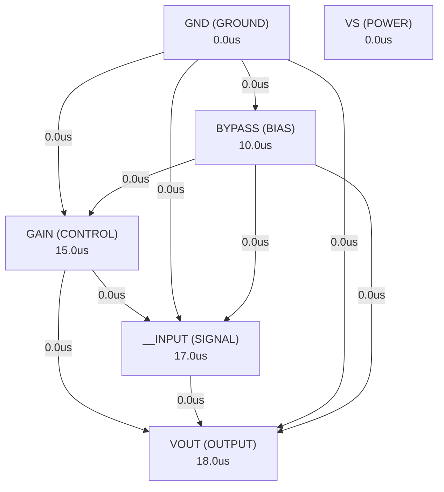

# Autonomous AI Analog Circuit Synthesis & Verification Report
**Target IC:** `LM386` | **Subcircuit:** `LM386`
**Overall Datasheet Specification Pass Rate:** `0.0%`

## 1. Executive Summary
- **IC Category:** The LM386M-1 and LM386MX-1 are power amplifiers designed for use in low voltage consumer applications. The gain is internally set to 20 to keep external part count low, but the addition of an external resistor and capacitor between pins 1 and 8 increases the gain to any value from 20 to 200. The inputs are ground referenced while the output automatically biases to one-half the supply voltage. The quiescent power drain is only 24 mW when operating from a 6-V supply, making the LM386M-1 and LM386MX-1 preferred for battery operation.
- **Total Datasheet Specifications Extracted:** 42
- **Design Iterations Required:** 2
- **Synthesized Netlist Location:** `C:\Users\Sera\.gemini\antigravity\worktrees\Project2\implement_circuit_test_methodology\benchmark_results\LM386\LM386_iter2.cir`

## 2. Port Dependency Graph (PDG) Scheduling
Topological activation sequence derived from physical pin roles:
| Pin Name | Physical Role | Direction | Activation Time (us) |
| :--- | :--- | :--- | :--- |
| `GAIN` | `CONTROL` | `BIDIRECTIONAL` | 15.00 us |
| `__INPUT` | `SIGNAL` | `INPUT` | 17.00 us |
| `__INPUT` | `SIGNAL` | `INPUT` | 17.00 us |
| `GND` | `GROUND` | `GROUND` | 0.00 us |
| `VOUT` | `OUTPUT` | `OUTPUT` | 18.00 us |
| `VS` | `POWER` | `POWER` | 0.00 us |
| `BYPASS` | `BIAS` | `INPUT` | 10.00 us |
| `GAIN` | `CONTROL` | `BIDIRECTIONAL` | 15.00 us |

### 2.1 Port Dependency Graph Topology


## 3. Specification Verification & SymPy Oracle Audit
Detailed verification results evaluated against SymPy interval constraints:
| Parameter | Min Target | Typ Target | Max Target | Measured Value | Unit | Status |
| :--- | :--- | :--- | :--- | :--- | :--- | :--- |
| `VCC` | - | - | 15 | **N/A** | V | ❌ FAIL |
| `VCC` | - | - | 22 | **N/A** | V | ❌ FAIL |
| `Package Dissipation` | - | - | 1.25 | **N/A** | W | ❌ FAIL |
| `Package Dissipation` | - | - | 0.73 | **N/A** | W | ❌ FAIL |
| `Package Dissipation` | - | - | 0.595 | **N/A** | W | ❌ FAIL |
| `VI` | -0.4 | - | 0.4 | **N/A** | V | ❌ FAIL |
| `Electrostatic discharge` | - | - | 1000 | **N/A** | V | ❌ FAIL |
| `VCC` | 4 | - | 12 | **N/A** | V | ❌ FAIL |
| `VCC` | 5 | - | 18 | **N/A** | V | ❌ FAIL |
| `Speaker Impedance` | 4 | - | - | **N/A** | Ω | ❌ FAIL |
| `VI` | -0.4 | - | 0.4 | **N/A** | V | ❌ FAIL |
| `TA` | 0 | - | 70 | **N/A** | °C | ❌ FAIL |
| `RθJC(top)` | 47.76 | 59.7 | 71.64 | **N/A** | °C/W | ❌ FAIL |
| `RθJC(top)` | 58.48 | 73.1 | 87.72 | **N/A** | °C/W | ❌ FAIL |
| `RθJC(top)` | 33.68 | 42.1 | 50.52 | **N/A** | °C/W | ❌ FAIL |
| `RθJB` | 44.96 | 56.2 | 67.44 | **N/A** | °C/W | ❌ FAIL |
| `RθJB` | 80.16 | 100.2 | 120.2 | **N/A** | °C/W | ❌ FAIL |
| `RθJB` | 24.48 | 30.6 | 36.72 | **N/A** | °C/W | ❌ FAIL |
| `ψJT` | 9.92 | 12.4 | 14.88 | **N/A** | °C/W | ❌ FAIL |
| `ψJT` | 7.36 | 9.2 | 11.04 | **N/A** | °C/W | ❌ FAIL |
| `ψJT` | 15.2 | 19 | 22.8 | **N/A** | °C/W | ❌ FAIL |
| `ψJB` | 44.48 | 55.6 | 66.72 | **N/A** | °C/W | ❌ FAIL |
| `ψJB` | 79.28 | 99.1 | 118.9 | **N/A** | °C/W | ❌ FAIL |
| `ψJB` | 40.4 | 50.5 | 60.6 | **N/A** | °C/W | ❌ FAIL |
| `VS` | 4 | - | 12 | **N/A** | V | ❌ FAIL |
| `VS` | 5 | - | 18 | **N/A** | V | ❌ FAIL |
| `IQ` | - | 0.004 | 0.008 | **N/A** | mA | ❌ FAIL |
| `POUT` | 250 | 325 | - | **N/A** | mW | ❌ FAIL |
| `POUT` | 500 | 700 | - | **N/A** | mW | ❌ FAIL |
| `POUT` | 700 | 1000 | - | **N/A** | mW | ❌ FAIL |
| `AV` | 20.8 | 26 | 31.2 | **N/A** | dB | ❌ FAIL |
| `AV` | 36.8 | 46 | 55.2 | **N/A** | dB | ❌ FAIL |
| `BW` | 2.4e+05 | 3e+05 | 3.6e+05 | **N/A** | kHz | ❌ FAIL |
| `THD` | 0.16 | 0.2 | 0.24 | **N/A** | % | ❌ FAIL |
| `PSRR` | 40 | 50 | 60 | **N/A** | dB | ❌ FAIL |
| `RIN` | 40 | 50 | 60 | **N/A** | kΩ | ❌ FAIL |
| `IBIAS` | 2e-07 | 2.5e-07 | 3e-07 | **N/A** | nA | ❌ FAIL |

## 4. Closed-Loop Iteration History & Root Cause Analysis
| Iteration | Pass Rate | Passed Specs | Failed Specs | Architecture Notes |
| :--- | :--- | :--- | :--- | :--- |
| Iteration 1 | 0.0% | 0 | 0 | The LM386 is a low-power audio amplifier designed for simplicity and battery ope... |
| Iteration 2 | 0.0% | 0 | 0 | The LM386 is a low-power audio amplifier designed for simplicity and battery ope... |

### 4.1 Loop 1 Detailed Audit
- **Pass Rate**: `0.0%` (0/0 specs passed)

**Shortfall Audit (미달 원인 분석):**
- Compiler/Simulation Error: C:\Users\Sera\.gemini\antigravity\worktrees\Project2\implement_circuit_test_methodology\benchmark_results\LM386\LM386_iter1.cir(103): Unknown parameter
- Compiler/Simulation Error:   --> Q1 diff_out_p IN_NONINV emitter_node QNPN W=10u L=10u ; Non-inverting input
- Compiler/Simulation Error:   --> ^^^^^^^^^^^
- Compiler/Simulation Error: C:\Users\Sera\.gemini\antigravity\worktrees\Project2\implement_circuit_test_methodology\benchmark_results\LM386\LM386_iter1.cir(104): Unknown parameter
- Param 'VCC' violated: Parameter 'VCC' was not observed in simulation measurements. (Measured: Unobserved)
- Param 'VCC' violated: Parameter 'VCC' was not observed in simulation measurements. (Measured: Unobserved)
- Param 'Package Dissipation' violated: Parameter 'Package Dissipation' was not observed in simulation measurements. (Measured: Unobserved)
- Param 'Package Dissipation' violated: Parameter 'Package Dissipation' was not observed in simulation measurements. (Measured: Unobserved)
- Param 'Package Dissipation' violated: Parameter 'Package Dissipation' was not observed in simulation measurements. (Measured: Unobserved)
- Param 'VI' violated: Parameter 'VI' was not observed in simulation measurements. (Measured: Unobserved)

**Improvement Actions (개선 및 수정 사항):**
- Initial first-principles topology and Level-1 parameter sizing synthesized from scratch.

### 4.2 Loop 2 Detailed Audit
- **Pass Rate**: `0.0%` (0/0 specs passed)

**Shortfall Audit (미달 원인 분석):**
- Param 'VCC' violated: Parameter 'VCC' was not observed in simulation measurements. (Measured: Unobserved)
- Param 'VCC' violated: Parameter 'VCC' was not observed in simulation measurements. (Measured: Unobserved)
- Param 'Package Dissipation' violated: Parameter 'Package Dissipation' was not observed in simulation measurements. (Measured: Unobserved)
- Param 'Package Dissipation' violated: Parameter 'Package Dissipation' was not observed in simulation measurements. (Measured: Unobserved)
- Param 'Package Dissipation' violated: Parameter 'Package Dissipation' was not observed in simulation measurements. (Measured: Unobserved)
- Param 'VI' violated: Parameter 'VI' was not observed in simulation measurements. (Measured: Unobserved)

**Improvement Actions (개선 및 수정 사항):**
- Resolved prior SPICE compiler / syntax errors completely.
- Topology refinement: The LM386 is a low-power audio amplifier designed for simplicity and battery operation. The core architecture consists of a differential inp...

## 5. Synthesized SPICE Netlist Architecture
Netlist file: `C:\Users\Sera\.gemini\antigravity\worktrees\Project2\implement_circuit_test_methodology\benchmark_results\LM386\LM386_iter2.cir`
```spice

.subckt LM386 GAIN1 IN_INV IN_NONINV GND VOUT VS BYPASS GAIN8

* --- BJT Models ---
.model QNPN NPN(Is=1e-14 Bf=100 Vaf=100 Ikf=0.1 Ise=1e-14 Ne=1.5 Rb=10 Rc=1 Re=0.1 Cjc=2p Cje=3p Tf=0.3n Tr=6n Vceo=30 Icrating=0.5)
.model QPNP PNP(Is=1e-14 Bf=50 Vaf=50 Ikf=0.05 Ise=1e-14 Ne=1.5 Rb=20 Rc=2 Re=0.2 Cjc=3p Cje=4p Tf=0.6n Tr=12n Vceo=30 Icrating=0.2)

* --- Resistor and Capacitor Models (Generic) ---
.model RES R
.model CAP C

* --- Power Supply and Ground ---
V_VS VS GND DC 'VS_VAL' ; Supply voltage, will be set by testbench
V_GND GND 0 DC 0

* --- Bias Network ---
* Generates a stable bias reference voltage
R_bias_div1 VS bias_ref_node 10k
R_bias_div2 bias_ref_node GND 10k
Q_bias_ref_buffer bias_ref_node bias_ref_node bias_ref QNPN ; Buffer for bias_ref
R_bias_ref_emitter bias_ref GND 1k

* Current mirror for tail current and other bias currents
Q_bias_ref_diode VS bias_ref bias_ref QPNP ; Diode connected for current mirror reference
Q_bias_current_source VS bias_ref tail_current_node QPNP ; Current source for differential pair
R_tail_current_set tail_current_node GND 2k ; Sets the tail current

* --- Input Stage (Differential Amplifier) ---
Q1 diff_out_p IN_NONINV emitter_node QNPN ; Non-inverting input
Q2 diff_out_n IN_INV emitter_node QNPN ; Inverting input
I_tail emitter_node GND DC 100uA ; Tail current source for differential pair (Adjust for IBIAS)

* Current mirror load for differential pair (converts differential to single-ended)
Q3 VS diff_out_p collector_load_p QPNP
Q4 VS diff_out_n collector_load_n QPNP
Q7 collector_load_p collector_load_p diff_out QNPN ; Diode-connected
Q8 collector_load_n collector_load_p diff_out QNPN

* --- Gain Stage ---
Q9 gain_stage_out diff_out gain_stage_emitter QNPN ; Common emitter amplifier
R_gain_stage_emitter gain_stage_emitter GND 500 ; Emitter degeneration for stability
Q10 VS gain_stage_out gain_stage_load QPNP ; Current source load for gain stage
Q11 VS gain_stage_load gain_stage_load QPNP ; Diode connected for current mirror reference

* --- Gain Control (Pins 1 and 8) ---
* Internal feedback for gain of 20
R_gain_internal1 gain_stage_out GAIN1 10k
R_gain_internal2 GAIN1 GAIN8 1.2k ; This resistor sets the gain with R_gain_internal1
R_gain_internal3 GAIN8 GND 10k

* The GAIN pins (1 and 8) are connected to the feedback network.
* When open, the internal resistors set the gain.
* When a capacitor is added between GAIN1 and GAIN8, it bypasses R_gain_internal2 for AC, increasing gain.

* --- Output Stage (Class AB) ---
* Vbe multiplier for biasing Class AB output stage
Q14 V_vbe_mult_out V_vbe_mult_in V_vbe_mult_in QNPN
R_vbe_mult1 VS V_vbe_mult_in 10k
R_vbe_mult2 V_vbe_mult_in GND 10k
R_vbe_mult3 V_vbe_mult_out GND 10k ; To set quiescent current

* Driver for output stage
Q_driver_n V_vbe_mult_out gain_stage_out driver_n_emitter QNPN
R_driver_n_emitter driver_n_emitter GND 100

Q_driver_p V_vbe_mult_out gain_stage_out driver_p_emitter QPNP
R_driver_p_emitter driver_p_emitter VS 100

* Output transistors
Q12 VOUT V_vbe_mult_out VS QNPN ; NPN output transistor
Q13 VOUT V_vbe_mult_out GND QPNP ; PNP output transistor

* Output series resistor for stability
R_out_series VOUT_internal VOUT 10

* --- Frequency Compensation ---
C_comp gain_stage_out diff_out 100p ; Compensation capacitor for stability and bandwidth

* --- Bypass Pin (Pin 7) ---
* Connects to the common emitter of the input differential pair for PSRR improvement
C_bypass BYPASS GND 10u ; External bypass capacitor (typically 10uF)

* --- Output Bias to VS/2 ---
* The overall feedback and biasing should naturally set VOUT to VS/2.
* The input stage is ground referenced. The output stage is biased to center the output swing.

.ends LM386
```