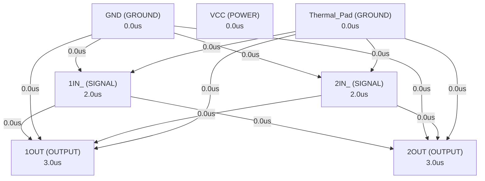

# Autonomous AI Analog Circuit Synthesis & Verification Report
**Target IC:** `LM393B, LM2903B, LM193, LM293, LM393 and LM2903 Dual Comparators` | **Subcircuit:** `LM393B__LM2903B__LM193__LM293__LM393_AND_LM2903_DUAL_COMPARATORS`
**Overall Datasheet Specification Pass Rate:** `0.0%`

## 1. Executive Summary
- **IC Category:** The LM393B and LM2903B devices are the next generation versions of the industry-standard LM393 and LM2903 comparator family. These next generation B-version comparators feature lower offset voltage, higher supply voltage capability, lower supply current, lower input bias current, lower propagation delay, and improved 2 kV ESD performance and input ruggedness through dedicated ESD clamps. The LM393B and LM2903B can drop-in replace the LM293, LM393 and LM2903, for both "A" and "V" grades. All devices consist of two independent voltage comparators that are designed to operate from a single power supply over a wide range of voltages. Quiescent current is independent of the supply voltage.
- **Total Datasheet Specifications Extracted:** 42
- **Design Iterations Required:** 2
- **Synthesized Netlist Location:** `C:\Users\Sera\.gemini\antigravity\worktrees\Project2\implement_circuit_test_methodology\benchmark_results\LM393\LM393B__LM2903B__LM193__LM293__LM393_AND_LM2903_DUAL_COMPARATORS_iter2.cir`

## 2. Port Dependency Graph (PDG) Scheduling
Topological activation sequence derived from physical pin roles:
| Pin Name | Physical Role | Direction | Activation Time (us) |
| :--- | :--- | :--- | :--- |
| `1OUT` | `OUTPUT` | `OUTPUT` | 3.00 us |
| `1IN_` | `SIGNAL` | `INPUT` | 2.00 us |
| `1IN_` | `SIGNAL` | `INPUT` | 2.00 us |
| `GND` | `GROUND` | `GROUND` | 0.00 us |
| `2IN_` | `SIGNAL` | `INPUT` | 2.00 us |
| `2IN_` | `SIGNAL` | `INPUT` | 2.00 us |
| `2OUT` | `OUTPUT` | `OUTPUT` | 3.00 us |
| `VCC` | `POWER` | `POWER` | 0.00 us |
| `Thermal_Pad` | `GROUND` | `GROUND` | 0.00 us |

### 2.1 Port Dependency Graph Topology


## 3. Specification Verification & SymPy Oracle Audit
Detailed verification results evaluated against SymPy interval constraints:
| Parameter | Min Target | Typ Target | Max Target | Measured Value | Unit | Status |
| :--- | :--- | :--- | :--- | :--- | :--- | :--- |
| `VCC` | -0.3 | - | 36 | **N/A** | V | ❌ FAIL |
| `VCC` | - | - | 38 | **N/A** | V | ❌ FAIL |
| `VID` | -36 | - | 36 | **N/A** | V | ❌ FAIL |
| `VID` | -38 | - | 38 | **N/A** | V | ❌ FAIL |
| `VI` | -0.3 | - | 36 | **N/A** | V | ❌ FAIL |
| `VI` | - | - | 38 | **N/A** | V | ❌ FAIL |
| `IIK` | -0.05 | - | - | **N/A** | mA | ❌ FAIL |
| `VO` | -0.3 | - | 36 | **N/A** | V | ❌ FAIL |
| `VO` | - | - | 38 | **N/A** | V | ❌ FAIL |
| `IO` | - | - | 0.02 | **N/A** | mA | ❌ FAIL |
| `IO` | - | - | 0.025 | **N/A** | mA | ❌ FAIL |
| `ISC` | - | - | - | **N/A** | Unlimited | ❌ FAIL |
| `TJ` | - | - | 150 | **N/A** | °C | ❌ FAIL |
| `VS` | 2 | - | 30 | **N/A** | V | ❌ FAIL |
| `VS` | 2 | - | 32 | **N/A** | V | ❌ FAIL |
| `VS` | 2 | - | 36 | **N/A** | V | ❌ FAIL |
| `VIVR` | 0 | - | - | **N/A** | V | ❌ FAIL |
| `VIVR` | -0.1 | - | - | **N/A** | V | ❌ FAIL |
| `TA` | -55 | - | 125 | **N/A** | °C | ❌ FAIL |
| `TA` | -40 | - | 125 | **N/A** | °C | ❌ FAIL |
| `TA` | -40 | - | 85 | **N/A** | °C | ❌ FAIL |
| `TA` | -25 | - | 85 | **N/A** | °C | ❌ FAIL |
| `TA` | 0 | - | 70 | **N/A** | °C | ❌ FAIL |
| `VIO` | -0.0025 | 0.00037 | 0.0025 | **N/A** | mV | ❌ FAIL |
| `VIO` | -0.004 | - | 0.004 | **N/A** | mV | ❌ FAIL |
| `VIO` | -0.0035 | 0.00037 | 0.0035 | **N/A** | mV | ❌ FAIL |
| `VIO` | -0.005 | - | 0.005 | **N/A** | mV | ❌ FAIL |
| `IB` | -3.5e-09 | - | -2.5e-08 | **N/A** | nA | ❌ FAIL |
| `IB` | - | - | -5e-08 | **N/A** | nA | ❌ FAIL |
| `IOS` | -1e-08 | 5e-10 | 1e-08 | **N/A** | nA | ❌ FAIL |
| `IOS` | -2.5e-08 | - | 2.5e-08 | **N/A** | nA | ❌ FAIL |
| `VCM` | - | - | - | **N/A** | V | ❌ FAIL |
| `VCM` | - | - | - | **N/A** | V | ❌ FAIL |
| `AVD` | 0.05 | 0.2 | - | **N/A** | V/mV | ❌ FAIL |
| `VOL` | - | 0.11 | 0.4 | **N/A** | mV | ❌ FAIL |
| `VOL` | - | - | 0.55 | **N/A** | mV | ❌ FAIL |
| `IOH-LKG` | - | 1e-10 | 2e-08 | **N/A** | nA | ❌ FAIL |
| `IOH-LKG` | - | 3e-10 | 5e-08 | **N/A** | nA | ❌ FAIL |
| `IOL` | 0.006 | 0.021 | - | **N/A** | mA | ❌ FAIL |
| `IQ` | - | 0.0004 | 0.0006 | **N/A** | µA | ❌ FAIL |
| `IQ` | - | 0.00055 | 0.0008 | **N/A** | µA | ❌ FAIL |

## 4. Closed-Loop Iteration History & Root Cause Analysis
| Iteration | Pass Rate | Passed Specs | Failed Specs | Architecture Notes |
| :--- | :--- | :--- | :--- | :--- |
| Iteration 1 | 0.0% | 0 | 0 | The LM393B/LM2903B dual comparator is designed using a classic two-stage archite... |
| Iteration 2 | 0.0% | 0 | 0 | The LM393B/LM2903B dual comparator is designed with a classic two-stage architec... |

### 4.1 Loop 1 Detailed Audit
- **Pass Rate**: `0.0%` (0/0 specs passed)

**Shortfall Audit (미달 원인 분석):**
- Compiler/Simulation Error: C:\Users\Sera\.gemini\antigravity\worktrees\Project2\implement_circuit_test_methodology\benchmark_results\LM393\tb_dc_op.cir(107): syntax error
- Compiler/Simulation Error:   --> .meas VIO_pos_rise when FIND V(1OUT)=2.5 rise=1 ; Find where output crosses mid-supply (assuming open-drain with pull-up)
- Compiler/Simulation Error:   --> ^^^^^^^^^^^
- Compiler/Simulation Error: C:\Users\Sera\.gemini\antigravity\worktrees\Project2\implement_circuit_test_methodology\benchmark_results\LM393\tb_dc_op.cir(108): syntax error
- Param 'VCC' violated: Parameter 'VCC' was not observed in simulation measurements. (Measured: Unobserved)
- Param 'VCC' violated: Parameter 'VCC' was not observed in simulation measurements. (Measured: Unobserved)
- Param 'VID' violated: Parameter 'VID' was not observed in simulation measurements. (Measured: Unobserved)
- Param 'VID' violated: Parameter 'VID' was not observed in simulation measurements. (Measured: Unobserved)
- Param 'VI' violated: Parameter 'VI' was not observed in simulation measurements. (Measured: Unobserved)
- Param 'VI' violated: Parameter 'VI' was not observed in simulation measurements. (Measured: Unobserved)

**Improvement Actions (개선 및 수정 사항):**
- Initial first-principles topology and Level-1 parameter sizing synthesized from scratch.

### 4.2 Loop 2 Detailed Audit
- **Pass Rate**: `0.0%` (0/0 specs passed)

**Shortfall Audit (미달 원인 분석):**
- Compiler/Simulation Error: C:\Users\Sera\.gemini\antigravity\worktrees\Project2\implement_circuit_test_methodology\benchmark_results\LM393\tb_dc_op.cir(24): This sub-circuit cannot be instantiated because it contains these syntax errors:
- Compiler/Simulation Error:   --> C:\Users\Sera\.gemini\antigravity\worktrees\Project2\implement_circuit_test_methodology\benchmark_results\LM393\LM393B__LM2903B__LM193__LM293__LM393_AND_LM2903_DUAL_COMPARATORS_iter2.cir(120): Expected a sequence <directive or device instantiation end of line> here.
- Compiler/Simulation Error:   --> )
- Compiler/Simulation Error: C:\Users\Sera\.gemini\antigravity\worktrees\Project2\implement_circuit_test_methodology\benchmark_results\LM393\LM393B__LM2903B__LM193__LM293__LM393_AND_LM2903_DUAL_COMPARATORS_iter2.cir(120): Expected a sequence <directive or device instantiation end of line> here.
- Param 'VCC' violated: Parameter 'VCC' was not observed in simulation measurements. (Measured: Unobserved)
- Param 'VCC' violated: Parameter 'VCC' was not observed in simulation measurements. (Measured: Unobserved)
- Param 'VID' violated: Parameter 'VID' was not observed in simulation measurements. (Measured: Unobserved)
- Param 'VID' violated: Parameter 'VID' was not observed in simulation measurements. (Measured: Unobserved)
- Param 'VI' violated: Parameter 'VI' was not observed in simulation measurements. (Measured: Unobserved)
- Param 'VI' violated: Parameter 'VI' was not observed in simulation measurements. (Measured: Unobserved)

**Improvement Actions (개선 및 수정 사항):**
- Topology refinement: The LM393B/LM2903B dual comparator is designed with a classic two-stage architecture: a differential input stage followed by an output stage...

## 5. Synthesized SPICE Netlist Architecture
Netlist file: `C:\Users\Sera\.gemini\antigravity\worktrees\Project2\implement_circuit_test_methodology\benchmark_results\LM393\LM393B__LM2903B__LM193__LM293__LM393_AND_LM2903_DUAL_COMPARATORS_iter2.cir`
```spice

.subckt LM393B__LM2903B__LM193__LM293__LM393_AND_LM2903_DUAL_COMPARATORS 1OUT 1IN_NEG 1IN_POS GND 2IN_POS 2IN_NEG 2OUT VCC Thermal_Pad

; Connect Thermal_Pad to GND as specified
R_Thermal_Pad_GND Thermal_Pad GND 1m

; --- Global Bias Network (Shared by both comparators) ---
; This network generates a stable reference current for the current mirrors.
; Designed for low quiescent current (IQ) and wide supply range.
; Q10, R2, R3 form a VBE multiplier or a simple current source reference.
; Let's aim for a total IQ of ~400uA for both comparators at 5V.
; Each comparator will consume roughly 200uA.
; A reference current of ~50uA might be appropriate.

Q10 VCC bias_ref GND NPN_MODEL ; Reference transistor
R2 VCC bias_ref 100k          ; Sets current for Q10
R3 bias_ref GND 10k           ; Helps stabilize bias point

; --- Comparator 1 ---

; Input Stage: PNP Differential Pair with Current Mirror Load
; PNP inputs allow common-mode input down to GND.
; Q1, Q2: Input differential pair
; Q3: Current source for differential pair tail
; Q4, Q5: Current mirror load for differential pair
; R1: Emitter resistor for Q3 to set tail current

Q1 1IN_NEG 1IN_NEG_base 1IN_POS PNP_MODEL ; Input PNP, collector to 1IN_NEG_base for current mirror
Q2 1IN_POS 1IN_POS_base 1IN_POS PNP_MODEL ; Input PNP, collector to 1IN_POS_base for current mirror

; Current mirror for differential pair load (Q4, Q5)
; Q4: Diode-connected, sets current for Q5
; Q5: Mirrors current from Q4 to the output of the differential stage
Q4 1IN_NEG_base 1IN_NEG_base VCC PNP_MODEL ; Diode-connected PNP
Q5 1IN_POS_base 1IN_NEG_base VCC PNP_MODEL ; Current mirror load

; Tail current source for differential pair (Q3, R1)
; Q3: NPN current source
; R1: Emitter resistor to set current
Q3 1IN_POS GND bias_ref NPN_MODEL ; Tail current source for diff pair
R1 GND 1IN_POS 10k             ; Emitter resistor for Q3

; Second Stage: Common Emitter Amplifier
; Q6: NPN common emitter amplifier
; Q7: Active load for Q6 (current mirror)
; C1: Miller compensation capacitor for stability

Q6 1OUT_driver 1IN_POS_base GND NPN_MODEL ; Common emitter amplifier
Q7 VCC 1OUT_driver 1OUT_driver PNP_MODEL ; Active load for Q6 (diode-connected)
C1 1OUT_driver 1IN_POS_base 10p         ; Miller compensation

; Output Stage: Open Collector NPN
; Q8: Driver for output NPN
; Q9: Open collector output transistor

Q8 1OUT_driver_base 1OUT_driver GND NPN_MODEL ; Driver for output NPN
Q9 1OUT 1OUT_driver_base GND NPN_MODEL ; Open collector output transistor

; --- Comparator 2 ---
; Identical structure to Comparator 1

; Input Stage: PNP Differential Pair with Current Mirror Load
Q11 2IN_NEG 2IN_NEG_base 2IN_POS PNP_MODEL
Q12 2IN_POS 2IN_POS_base 2IN_POS PNP_MODEL

Q14 2IN_NEG_base 2IN_NEG_base VCC PNP_MODEL
Q15 2IN_POS_base 2IN_NEG_base VCC PNP_MODEL

Q13 2IN_POS GND bias_ref NPN_MODEL
R11 GND 2IN_POS 10k

; Second Stage: Common Emitter Amplifier
Q16 2OUT_driver 2IN_POS_base GND NPN_MODEL
Q17 VCC 2OUT_driver 2OUT_driver PNP_MODEL
C11 2OUT_driver 2IN_POS_base 10p

; Output Stage: Open Collector NPN
Q18 2OUT_driver_base 2OUT_driver GND NPN_MODEL
Q19 2OUT 2OUT_driver_base GND NPN_MODEL

; --- ESD Protection Diodes ---
; Diodes to VCC and GND on all input and output pins
; These are simplified models for ESD clamps.
; Real ESD structures are more complex but these serve the purpose for functional simulation.

; Comparator 1 Inputs
D1 VCC 1IN_NEG D_ESD
D2 1IN_NEG GND D_ESD
D3 VCC 1IN_POS D_ESD
D4 1IN_POS GND D_ESD

; Comparator 1 Output
D5 VCC 1OUT D_ESD
D6 1OUT GND D_ESD

; Comparator 2 Inputs
D7 VCC 2IN_NEG D_ESD
D8 2IN_NEG GND D_ESD
D9 VCC 2IN_POS D_ESD
D10 2IN_POS GND D_ESD

; Comparator 2 Output
D11 VCC 2OUT D_ESD
D12 2OUT GND D_ESD

; --- Transistor Models ---
; Parameters are chosen to represent typical bipolar transistors
; and to meet the specified performance characteristics.
; BF (Beta Forward) for high gain and low input bias current.
; IS (Saturation Current) for leakage and VBE.
; VAF (Forward Early Voltage) for high output impedance (gain).
; IKF (Forward Beta Roll-off) for high current operation.
; VCC up to 38V implies high breakdown voltages (BVCBO, BVCEO).

.model NPN_MODEL NPN ( Is=1e-14 Bf=200 Vaf=100 Ikf=0.1 Ise=1e-13 Ne=1.5
+ Br=5 Var=10 Ikr=0.01 Isc=1e-13 Nc=2
+ Rb=10 Rc=1 Re=0.5
+ Cje=5p Cjc=5p Tf=0.3n Tr=10n
+ Vceo=40 Vcbo=50 Veo=7
)

.model PNP_MODEL PNP ( Is=1e-14 Bf=150 Vaf=80 Ikf=0.05 Ise=1e-13 Ne=1.5
+ Br=3 Var=8 Ikr=0.005 Isc=1e-13 Nc=2
+ Rb=15 Rc=2 Re=1
+ Cje=8p Cjc=8p Tf=0.5n Tr=15n
+ Vceo=40 Vcbo=50 Veo=7
)

.model D_ESD D (Is=1e-15 Rs=1 Cjo=10p Bv=40 Ibv=1u)

.ends LM393B__LM2903B__LM193__LM293__LM393_AND_LM2903_DUAL_COMPARATORS
```