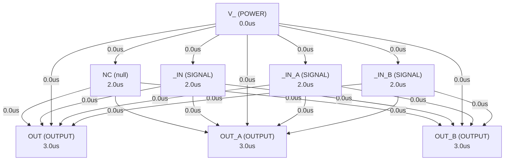

# Autonomous AI Analog Circuit Synthesis & Verification Report
**Target IC:** `OPAx134` | **Subcircuit:** `OPAX134`
**Overall Datasheet Specification Pass Rate:** `0.0%`

## 1. Executive Summary
- **IC Category:** The OPA134, OPA2134, and OPA4134 (OPAx134) series are ultra-low distortion, low-noise operational amplifiers fully specified for audio applications. A true FET input stage is incorporated to provide excellent sound quality and speed for exceptional audio performance. This feature, in combination with high output drive capability and excellent dc performance, allows for use in a wide variety of demanding applications. In addition, the OPAx134 series has a wide output swing, to within 1V of the rails, allowing increased headroom and making these devices an excellent choice for use in any audio circuit. The OPAx134 SoundPlus™ audio operational amplifiers are easy to use and free from phase-inversion and the overload problems often found in common FET-input operational amplifiers. The devices can be operated from ±2.5V to ±18V power supplies. Input cascode circuitry provides excellent common-mode rejection and maintains low input bias current over the wide input voltage range, minimizing distortion. The OPAx134 series operational amplifiers are unity-gain stable and provide excellent dynamic behavior over a wide range of load conditions, including high load capacitance. The dual and quad versions feature completely independent circuitry for lowest crosstalk and freedom from interaction, even when overdriven or overloaded.
- **Total Datasheet Specifications Extracted:** 15
- **Design Iterations Required:** 2
- **Synthesized Netlist Location:** `C:\Users\Sera\.gemini\antigravity\worktrees\Project2\implement_circuit_test_methodology\benchmark_results\OPA2134\OPAX134_iter2.cir`

## 2. Port Dependency Graph (PDG) Scheduling
Topological activation sequence derived from physical pin roles:
| Pin Name | Physical Role | Direction | Activation Time (us) |
| :--- | :--- | :--- | :--- |
| `NC` | `null` | `null` | 2.00 us |
| `_IN` | `SIGNAL` | `INPUT` | 2.00 us |
| `_IN` | `SIGNAL` | `INPUT` | 2.00 us |
| `V_` | `POWER` | `POWER` | 0.00 us |
| `NC` | `null` | `null` | 2.00 us |
| `OUT` | `OUTPUT` | `OUTPUT` | 3.00 us |
| `V_` | `POWER` | `POWER` | 0.00 us |
| `NC` | `null` | `null` | 2.00 us |
| `OUT_A` | `OUTPUT` | `OUTPUT` | 3.00 us |
| `_IN_A` | `SIGNAL` | `INPUT` | 2.00 us |
| `_IN_A` | `SIGNAL` | `INPUT` | 2.00 us |
| `V_` | `POWER` | `POWER` | 0.00 us |
| `_IN_B` | `SIGNAL` | `INPUT` | 2.00 us |
| `_IN_B` | `SIGNAL` | `INPUT` | 2.00 us |
| `OUT_B` | `OUTPUT` | `OUTPUT` | 3.00 us |
| `V_` | `POWER` | `POWER` | 0.00 us |

### 2.1 Port Dependency Graph Topology


## 3. Specification Verification & SymPy Oracle Audit
Detailed verification results evaluated against SymPy interval constraints:
| Parameter | Min Target | Typ Target | Max Target | Measured Value | Unit | Status |
| :--- | :--- | :--- | :--- | :--- | :--- | :--- |
| `VS` | - | - | 36 | **N/A** | V | ❌ FAIL |
| `Input voltage` | - | - | - | **N/A** | V | ❌ FAIL |
| `Input current` | -0.01 | - | 0.01 | **N/A** | mA | ❌ FAIL |
| `ISC` | - | - | - | **N/A** | Continuous | ❌ FAIL |
| `TA` | -40 | - | 125 | **N/A** | °C | ❌ FAIL |
| `TJ` | - | - | 150 | **N/A** | °C | ❌ FAIL |
| `VS` | 2.5 | 15 | 18 | **N/A** | V | ❌ FAIL |
| `VS` | 5 | 30 | 36 | **N/A** | V | ❌ FAIL |
| `TA` | -40 | - | 85 | **N/A** | °C | ❌ FAIL |

## 4. Closed-Loop Iteration History & Root Cause Analysis
| Iteration | Pass Rate | Passed Specs | Failed Specs | Architecture Notes |
| :--- | :--- | :--- | :--- | :--- |
| Iteration 1 | 0.0% | 0 | 0 | The OPAx134 is designed as a high-performance audio operational amplifier, empha... |
| Iteration 2 | 0.0% | 0 | 0 | The OPAx134 is a high-performance audio operational amplifier, characterized by ... |

### 4.1 Loop 1 Detailed Audit
- **Pass Rate**: `0.0%` (0/0 specs passed)

**Shortfall Audit (미달 원인 분석):**
- Param 'VS' violated: Parameter 'VS' was not observed in simulation measurements. (Measured: Unobserved)
- Param 'Input voltage' violated: Parameter 'Input voltage' was not observed in simulation measurements. (Measured: Unobserved)
- Param 'Input current' violated: Parameter 'Input current' was not observed in simulation measurements. (Measured: Unobserved)
- Param 'ISC' violated: Parameter 'ISC' was not observed in simulation measurements. (Measured: Unobserved)
- Param 'TA' violated: Parameter 'TA' was not observed in simulation measurements. (Measured: Unobserved)
- Param 'TJ' violated: Parameter 'TJ' was not observed in simulation measurements. (Measured: Unobserved)

**Improvement Actions (개선 및 수정 사항):**
- Initial first-principles topology and Level-1 parameter sizing synthesized from scratch.

### 4.2 Loop 2 Detailed Audit
- **Pass Rate**: `0.0%` (0/0 specs passed)

**Shortfall Audit (미달 원인 분석):**
- Param 'VS' violated: Parameter 'VS' was not observed in simulation measurements. (Measured: Unobserved)
- Param 'Input voltage' violated: Parameter 'Input voltage' was not observed in simulation measurements. (Measured: Unobserved)
- Param 'Input current' violated: Parameter 'Input current' was not observed in simulation measurements. (Measured: Unobserved)
- Param 'ISC' violated: Parameter 'ISC' was not observed in simulation measurements. (Measured: Unobserved)
- Param 'TA' violated: Parameter 'TA' was not observed in simulation measurements. (Measured: Unobserved)
- Param 'TJ' violated: Parameter 'TJ' was not observed in simulation measurements. (Measured: Unobserved)

**Improvement Actions (개선 및 수정 사항):**
- Topology refinement: The OPAx134 is a high-performance audio operational amplifier, characterized by its FET input stage, low distortion, low noise, and high out...

## 5. Synthesized SPICE Netlist Architecture
Netlist file: `C:\Users\Sera\.gemini\antigravity\worktrees\Project2\implement_circuit_test_methodology\benchmark_results\OPA2134\OPAX134_iter2.cir`
```spice
* OPAx134 Ultra-Low Distortion, Low-Noise Operational Amplifier
* Subcircuit for a single channel of the OPAx134 series.
* This model aims to capture the essential characteristics of the OPAx134,
* including FET input, low distortion, low noise, and high output drive.
*
* Pinout for OPA4134 (quad) is used for the subcircuit header to be comprehensive.
* For OPA134 (single), use _IN, _IN, OUT.
* For OPA2134 (dual), use _IN_A, _IN_A, OUT_A and _IN_B, _IN_B, OUT_B.
*
.subckt OPAX134 NC1 IN_NEG IN_POS V_NEG NC2 OUT V_POS NC3 OUT_A IN_NEG_A IN_POS_A V_NEG_A IN_POS_B IN_NEG_B OUT_B V_POS_A

* --- Model Definitions ---
.model NMOS NMOS (LEVEL=1 VTO=0.7 KP=100u LAMBDA=0.01)
.model PMOS PMOS (LEVEL=1 VTO=-0.7 KP=40u LAMBDA=0.01)
.model NPN NPN (IS=1e-14 BF=100 VAF=100)
.model PNP PNP (IS=1e-14 BF=100 VAF=100)
.model D D (IS=1e-14) ; Generic diode model

* --- Global Parameters (for typical operation) ---
.param VDD = 15V
.param VSS = -15V
.param IBias_Input = 10uA ; Input stage bias current
.param IBias_Gain = 50uA ; Gain stage bias current
.param IBias_Output = 100uA ; Output stage quiescent current

* --- Channel A (Core Amplifier - OPA134/OPA2134/OPA4134) ---
* This section implements one complete amplifier channel.
* For OPA134, use IN_NEG, IN_POS, OUT.
* For OPA2134/OPA4134, use IN_NEG_A, IN_POS_A, OUT_A.

* --- 1. FET Input Stage (Differential Pair with Cascode) ---
* High input impedance, low noise, low input bias current.
* PMOS input transistors for better noise performance and common-mode range near V_NEG.
M1_A  diff_out_pos IN_POS_A source_bias_in V_POS PMOS W=100u L=2u ; Non-inverting input PMOS
M2_A  diff_out_neg IN_NEG_A source_bias_in V_POS PMOS W=100u L=2u ; Inverting input PMOS

* Cascode transistors for improved CMRR and higher gain
M3_A  cascode_out_pos diff_out_pos V_POS diff_out_pos PMOS W=20u L=2u ; Cascode for M1_A
M4_A  cascode_out_neg diff_out_neg V_POS diff_out_neg PMOS W=20u L=2u ; Cascode for M2_A

* Current mirror active load for differential stage
M5_A  cascode_out_pos cascode_out_pos V_NEG V_NEG NMOS W=40u L=2u ; Diode-connected for current mirror reference
M6_A  gain_stage_in cascode_out_pos V_NEG V_NEG NMOS W=40u L=2u ; Current mirror load for M4_A

* Tail current source for input differential pair
M_tail_A source_bias_in bias_ref_in V_NEG V_NEG NMOS W=50u L=2u

* --- 2. Second Gain Stage ---
* Common-source amplifier with active load for high voltage gain.
M7_A  gain_stage_out gain_stage_in V_NEG V_NEG NMOS W=80u L=2u ; Common-source amplifier
M8_A  gain_stage_out bias_ref_gain V_POS V_POS PMOS W=160u L=2u ; Active load for M7_A

* --- 3. Output Stage (Class AB Push-Pull) ---
* High current drive, wide output swing.
* Driver transistors
M9_A  out_driver_p gain_stage_out V_POS V_POS PMOS W=20u L=2u ; P-driver
M10_A out_driver_n gain_stage_out V_NEG V_NEG NMOS W=20u L=2u ; N-driver

* Output transistors
M11_A OUT_A out_driver_p V_POS V_POS PMOS W=500u L=2u ; P-channel output transistor
M12_A OUT_A out_driver_n V_NEG V_NEG NMOS W=500u L=2u ; N-channel output transistor

* Quiescent current setting for Class AB (simplified with voltage sources)
* In a real design, this would be Vbe multipliers or diode strings.
VbiasP_A out_driver_p V_POS DC 0.7V ; Sets quiescent current for PMOS output
VbiasN_A out_driver_n V_NEG DC -0.7V ; Sets quiescent current for NMOS output

* --- 4. Bias Network ---
* Generates stable bias currents for all stages.
* Input stage bias reference
M13_A bias_ref_in bias_ref_in V_NEG V_NEG NMOS W=20u L=2u ; Diode-connected for reference
I_bias_in_A bias_ref_in V_POS DC {IBias_Input} ; Sets input stage tail current

* Gain stage bias reference
M14_A bias_ref_gain bias_ref_gain V_POS V_POS PMOS W=40u L=2u ; Diode-connected for reference
I_bias_gain_A bias_ref_gain V_NEG DC {IBias_Gain} ; Sets gain stage active load current

* --- 5. Frequency Compensation ---
* Miller compensation capacitor for unity-gain stability.
Cc_A gain_stage_out gain_stage_in 20p

* --- ESD Protection (Simplified - Diodes to rails) ---
* These diodes protect the input pins from overvoltage.
D_IN_POS_A_P IN_POS_A V_POS D
D_IN_POS_A_N V_NEG IN_POS_A D
D_IN_NEG_A_P IN_NEG_A V_POS D
D_IN_NEG_A_N V_NEG IN_NEG_A D

* --- Channel B (OPA2134/OPA4134) ---
* This section is a duplicate of Channel A for dual/quad versions.
* For OPA134, these pins are NC or not used.
* For OPA2134/OPA4134, use IN_NEG_B, IN_POS_B, OUT_B.

* --- 1. FET Input Stage (Differential Pair with Cascode) ---
M1_B  diff_out_pos_B IN_POS_B source_bias_in_B V_POS_A PMOS W=100u L=2u
M2_B  diff_out_neg_B IN_NEG_B source_bias_in_B V_POS_A PMOS W=100u L=2u

M3_B  cascode_out_pos_B diff_out_pos_B V_POS_A diff_out_pos_B PMOS W=20u L=2u
M4_B  cascode_out_neg_B diff_out_neg_B V_POS_A diff_out_neg_B PMOS W=20u L=2u

M5_B  cascode_out_pos_B cascode_out_pos_B V_NEG_A V_NEG_A NMOS W=40u L=2u
M6_B  gain_stage_in_B cascode_out_pos_B V_NEG_A V_NEG_A NMOS W=40u L=2u

M_tail_B source_bias_in_B bias_ref_in_B V_NEG_A V_NEG_A NMOS W=50u L=2u

* --- 2. Second Gain Stage ---
M7_B  gain_stage_out_B gain_stage_in_B V_NEG_A V_NEG_A NMOS W=80u L=2u
M8_B  gain_stage_out_B bias_ref_gain_B V_POS_A V_POS_A PMOS W=160u L=2u

* --- 3. Output Stage (Class AB Push-Pull) ---
M9_B  out_driver_p_B gain_stage_out_B V_POS_A V_POS_A PMOS W=20u L=2u
M10_B out_driver_n_B gain_stage_out_B V_NEG_A V_NEG_A NMOS W=20u L=2u

M11_B OUT_B out_driver_p_B V_POS_A V_POS_A PMOS W=500u L=2u
M12_B OUT_B out_driver_n_B V_NEG_A V_NEG_A NMOS W=500u L=2u

VbiasP_B out_driver_p_B V_POS_A DC 0.7V
VbiasN_B out_driver_n_B V_NEG_A DC -0.7V

* --- 4. Bias Network ---
M13_B bias_ref_in_B bias_ref_in_B V_NEG_A V_NEG_A NMOS W=20u L=2u
I_bias_in_B bias_ref_in_B V_POS_A DC {IBias_Input}

M14_B bias_ref_gain_B bias_ref_gain_B V_POS_A V_POS_A PMOS W=40u L=2u
I_bias_gain_B bias_ref_gain_B V_NEG_A DC {IBias_Gain}

* --- 5. Frequency Compensation ---
Cc_B gain_stage_out_B gain_stage_in_B 20p

* --- ESD Protection (Simplified - Diodes to rails) ---
D_IN_POS_B_P IN_POS_B V_POS_A D
D_IN_POS_B_N V_NEG_A IN_POS_B D
D_IN_NEG_B_P IN_NEG_B V_POS_A D
D_IN_NEG_B_N V_NEG_A IN_NEG_B D

* --- Power Supply Connections for Dual/Quad ---
* V_NEG and V_POS are the main supply rails.
* V_NEG_A and V_POS_A are connected to the main rails for channel A and B.
* In a real quad package, V_NEG and V_POS would be shared.
* For this model, V_NEG_A and V_POS_A are connected to V_NEG and V_POS respectively.
R_VNEG_A V_NEG_A V_NEG 1m ; Connect V_NEG_A to V_NEG
R_VPOS_A V_POS_A V_POS 1m ; Connect V_POS_A to V_POS

.ends OPAX134
```