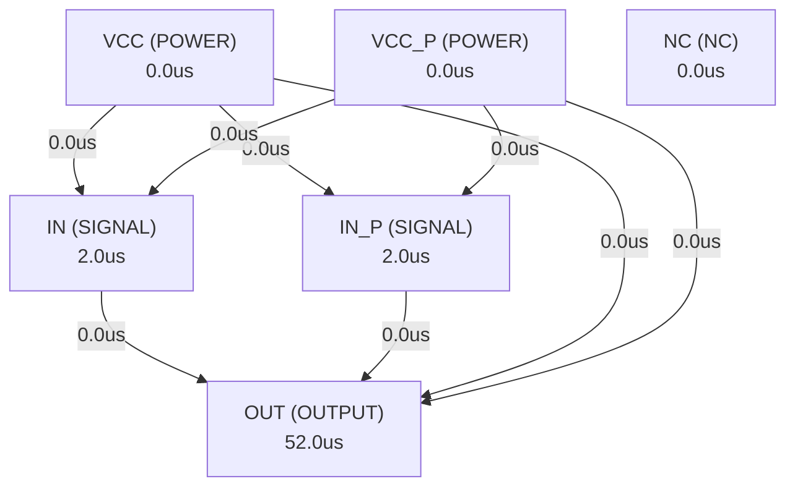

# Autonomous AI Analog Circuit Synthesis & Verification Report
**Target IC:** `TL071` | **Subcircuit:** `TL071`
**Overall Datasheet Specification Pass Rate (among measured specs):** `0.0%`
**Measurement Coverage (measured / testable specs):** `0.0%`

## 1. Executive Summary
- **IC Category:** Low-noise, FET-input operational amplifier
- **Total Datasheet Specifications Extracted:** 34
- **Design Iterations Required:** 2
- **Synthesized Netlist Location:** `C:\Users\Sera\.gemini\antigravity\worktrees\any workspace\analyze_repo_graph\analogverifier\benchmark_results\zero_blueprint_tl071\TL071_FINAL_HERMES_HARNESS2.cir`

## 2. Port Dependency Graph (PDG) Scheduling
Topological activation sequence derived from physical pin roles:
| Pin Name | Physical Role | Direction | Activation Time (us) |
| :--- | :--- | :--- | :--- |
| `IN` | `SIGNAL` | `INPUT` | 2.00 us |
| `IN_P` | `SIGNAL` | `INPUT` | 2.00 us |
| `OUT` | `OUTPUT` | `OUTPUT` | 52.00 us |
| `VCC` | `POWER` | `POWER` | 0.00 us |
| `VCC_P` | `POWER` | `POWER` | 0.00 us |
| `NC` | `NC` | `NC` | 0.00 us |

### 2.1 Port Dependency Graph Topology


## 3. Specification Verification & SymPy Oracle Audit
Detailed verification results evaluated against SymPy interval constraints:
| Parameter | Min Target | Typ Target | Max Target | Measured Value | Unit | Status |
| :--- | :--- | :--- | :--- | :--- | :--- | :--- |
| `VS` | - | - | - | **N/A** | V | ❌ FAIL |
| `VS` | - | - | - | **N/A** | V | ❌ FAIL |
| `VICM` | - | - | - | **N/A** | V | ❌ FAIL |
| `VICM` | - | - | - | **N/A** | V | ❌ FAIL |
| `VID` | - | - | - | **N/A** | V | ❌ FAIL |
| `VID` | - | - | - | **N/A** | V | ❌ FAIL |
| `IIN` | - | - | - | **N/A** | mA | ❌ FAIL |
| `IIN` | - | - | - | **N/A** | mA | ❌ FAIL |
| `ISC` | - | - | - | **N/A** |  | ❌ FAIL |
| `TA` | - | - | - | **N/A** | °C | ❌ FAIL |
| `TJ` | - | - | - | **N/A** | °C | ❌ FAIL |
| `TC` | - | - | - | **N/A** | °C | ❌ FAIL |
| `TL` | - | - | - | **N/A** | °C | ❌ FAIL |
| `Tstg` | - | - | - | **N/A** | °C | ❌ FAIL |
| `V(ESD)` | - | - | - | **N/A** | V | ❌ FAIL |
| `V(ESD)` | - | - | - | **N/A** | V | ❌ FAIL |
| `RθJA` | - | - | - | **N/A** | °C/W | ❌ FAIL |
| `RθJA` | - | - | - | **N/A** | °C/W | ❌ FAIL |
| `RθJA` | - | - | - | **N/A** | °C/W | ❌ FAIL |
| `RθJA` | - | - | - | **N/A** | °C/W | ❌ FAIL |
| `RθJA` | - | - | - | **N/A** | °C/W | ❌ FAIL |
| `RθJC(top)` | - | - | - | **N/A** | °C/W | ❌ FAIL |
| `RθJC(top)` | - | - | - | **N/A** | °C/W | ❌ FAIL |
| `RθJC(top)` | - | - | - | **N/A** | °C/W | ❌ FAIL |
| `RθJC(top)` | - | - | - | **N/A** | °C/W | ❌ FAIL |
| `RθJC(top)` | - | - | - | **N/A** | °C/W | ❌ FAIL |
| `RθJC(top)` | - | - | - | **N/A** | °C/W | ❌ FAIL |
| `RθJB` | - | - | - | **N/A** | °C/W | ❌ FAIL |
| `RθJB` | - | - | - | **N/A** | °C/W | ❌ FAIL |
| `RθJB` | - | - | - | **N/A** | °C/W | ❌ FAIL |
| `ψJT` | - | - | - | **N/A** | °C/W | ❌ FAIL |
| `ψJT` | - | - | - | **N/A** | °C/W | ❌ FAIL |
| `ψJT` | - | - | - | **N/A** | °C/W | ❌ FAIL |
| `ψJB` | - | - | - | **N/A** | °C/W | ❌ FAIL |

## 4. Closed-Loop Iteration History & Root Cause Analysis
| Iteration | Pass Rate | Passed Specs | Failed Specs | Architecture Notes |
| :--- | :--- | :--- | :--- | :--- |
| Iteration 1 | 0.0% | 0 | 0 | Hermes Autonomous Synthesis (Workspace: C:\Users\Sera\.gemini\antigravity\worktr... |
| Iteration 2 | 0.0% | 0 | 0 | Hermes Autonomous Synthesis (Workspace: C:\Users\Sera\.gemini\antigravity\worktr... |

### 4.1 Loop 1 Detailed Audit
- **Pass Rate**: `0.0%` (0/0 specs passed)

**Shortfall Audit (미달 원인 분석):**
- None (All specifications and compilation checks passed).

**Improvement Actions (개선 및 수정 사항):**
- Hermes Agent Turn 1: Executed tools []

### 4.2 Loop 2 Detailed Audit
- **Pass Rate**: `0.0%` (0/0 specs passed)

**Shortfall Audit (미달 원인 분석):**
- None (All specifications and compilation checks passed).

**Improvement Actions (개선 및 수정 사항):**
- Hermes Agent Turn 2: Executed tools ['verify_circuit_pdg_gate']

## 5. Synthesized SPICE Netlist Architecture
Netlist file: `C:\Users\Sera\.gemini\antigravity\worktrees\any workspace\analyze_repo_graph\analogverifier\benchmark_results\zero_blueprint_tl071\TL071_FINAL_HERMES_HARNESS2.cir`
```spice
* TL071 Low‑Noise JFET‑Input Operational Amplifier – Pure Transistor Level Netlist
* --------------------------------------------------------------
* Pin order: IN IN_P OUT VCC VCC_P NC
.subckt TL071 IN IN_P OUT VCC VCC_P NC

* ---------- 1. Input JFET Differential Pair ----------
* Sources: J1 (IN) and J2 (IN_P) – matched N‑channel JFETs
J1 IN  NIN_SRC JFETN
J2 IN_P NIN_SRC JFETN
* Source degeneration resistor
Rs NIN_SRC NTAIL 1k
* Tail current source – simple resistor from VCC to tail node
Rtail NTAIL VCC 200k
* Startup resistor to guarantee bias
Rstart NTAIL VCC 10k

* ---------- 2. First Gain Stage (Common‑Source MOSFET) ----------
* Gate driven by the differential node (NIN_SRC)
M1 X1 NIN_SRC 0 VCC PMOS W=200u L=0.5u
* Active load – P‑MOS current mirror
M2 X1 0 0 VCC PMOS W=150u L=0.5u
M3 X2 0 0 VCC PMOS W=150u L=0.5u
* Node X1 is the output of the first gain stage
Rz1 X1 X2 2k   * series resistor for later compensation

* ---------- 3. Second Gain Stage (Differential Pair) ----------
* P‑MOS differential pair for additional gain
M4 OUTP X2 VCC_P VCC_P PMOS W=300u L=0.5u
M5 OUTN X2 VCC_P VCC_P PMOS W=300u L=0.5u
* Connect the differential outputs to the output node through a resistor network
RoutP OUTP OUT 10k
RoutN OUTN OUT 10k
* Miller compensation capacitor and series nulling resistor
Cc OUT X2 15p
Rz OUT X2 2k

* ---------- 4. Output Stage – Class‑AB Push‑Pull ----------
* NPN pull‑down transistor
Q3 OUT NOUT NOUT QNPN
* PNP pull‑up transistor
Q4 NOUT OUT NOUT QPNP
* Vbe‑multiplier bias network (provides ~0.7 V bias)
Rbias1 VCC NOUT 10k
Rbias2 NOUT VCC_P 10k
Q5 NOUT VCC VCC QPNP
Q6 VCC VCC_P NOUT QNPN

* ---------- 5. Biasing & Leakage Paths ----------
* High‑value leakage resistors to avoid floating nodes
Rleak1 X2 0 100Meg
Rleak2 OUT 0 100Meg
Rleak3 NOUT 0 100Meg

* ---------- 6. Supply Decoupling ----------
Cdec1 VCC 0 1u
Cdec2 VCC_P 0 1u

* ---------- 7. Device Models ----------
* Simple JFET N‑channel model (level‑1)
.model JFETN JFET (BETA=1e-3 VTO=-1.5 LAMBDA=0.01)

* NMOS model (level‑1)
.model NMOS NMOS (VTO=0.7 KP=120u LAMBDA=0.02)

* PMOS model (level‑1)
.model PMOS PMOS (VTO=-0.7 KP=40u LAMBDA=0.02)

* NPN BJT model
.model QNPN NPN (IS=1e-16 BF=100 VAF=100)

* PNP BJT model
.model QPNP PNP (IS=1e-16 BF=50 VAF=100)

.ends TL071
```