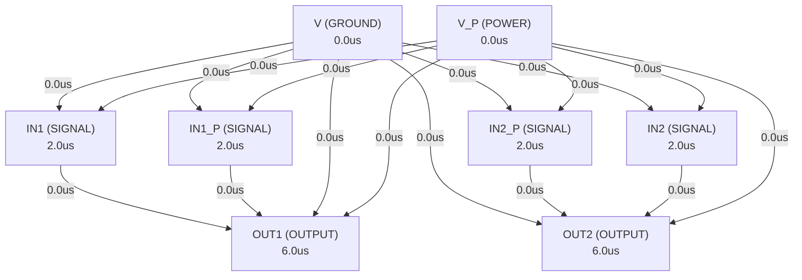

# Autonomous AI Analog Circuit Synthesis & Verification Report
**Target IC:** `LM358B` | **Subcircuit:** `LM358B`
**Overall Datasheet Specification Pass Rate (among measured specs):** `0.0%`
**Measurement Coverage (measured / testable specs):** `0.0%`

## 1. Executive Summary
- **IC Category:** Dual operational amplifier with wide supply range of 3V to 36V, low quiescent current of 300µA per channel, unity-gain bandwidth of 1.2MHz, and common-mode input voltage range including ground.
- **Total Datasheet Specifications Extracted:** 260
- **Design Iterations Required:** 2
- **Synthesized Netlist Location:** `C:\Users\Sera\GensparkCode\analogverifier\output_e2e\lm358\LM358B_BEST.cir`

## 2. Port Dependency Graph (PDG) Scheduling
Topological activation sequence derived from physical pin roles:
| Pin Name | Physical Role | Direction | Activation Time (us) |
| :--- | :--- | :--- | :--- |
| `OUT1` | `OUTPUT` | `OUTPUT` | 6.00 us |
| `IN1` | `SIGNAL` | `INPUT` | 2.00 us |
| `IN1_P` | `SIGNAL` | `INPUT` | 2.00 us |
| `V` | `GROUND` | `GROUND` | 0.00 us |
| `IN2_P` | `SIGNAL` | `INPUT` | 2.00 us |
| `IN2` | `SIGNAL` | `INPUT` | 2.00 us |
| `OUT2` | `OUTPUT` | `OUTPUT` | 6.00 us |
| `V_P` | `POWER` | `POWER` | 0.00 us |

### 2.1 Port Dependency Graph Topology


## 3. Specification Verification & SymPy Oracle Audit
Detailed verification results evaluated against SymPy interval constraints:
| Parameter | Min Target | Typ Target | Max Target | Measured Value | Unit | Status |
| :--- | :--- | :--- | :--- | :--- | :--- | :--- |
| `VS` | - | - | - | **N/A** | V | ❌ FAIL |
| `VS` | - | - | - | **N/A** | V | ❌ FAIL |
| `VS` | - | - | - | **N/A** | V | ❌ FAIL |
| `VID` | - | - | - | **N/A** | V | ❌ FAIL |
| `VID` | - | - | - | **N/A** | V | ❌ FAIL |
| `VI` | - | - | - | **N/A** | V | ❌ FAIL |
| `VI` | - | - | - | **N/A** | V | ❌ FAIL |
| `VI` | - | - | - | **N/A** | V | ❌ FAIL |
| `tSC` | - | - | - | **N/A** | s | ❌ FAIL |
| `TA` | - | - | - | **N/A** | °C | ❌ FAIL |
| `TA` | - | - | - | **N/A** | °C | ❌ FAIL |
| `TA` | - | - | - | **N/A** | °C | ❌ FAIL |
| `TA` | - | - | - | **N/A** | °C | ❌ FAIL |
| `TA` | - | - | - | **N/A** | °C | ❌ FAIL |
| `TJ` | - | - | - | **N/A** | °C | ❌ FAIL |
| `Tstg` | - | - | - | **N/A** | °C | ❌ FAIL |
| `V(ESD)` | - | - | - | **N/A** | V | ❌ FAIL |
| `V(ESD)` | - | - | - | **N/A** | V | ❌ FAIL |
| `V(ESD)` | - | - | - | **N/A** | V | ❌ FAIL |
| `V(ESD)` | - | - | - | **N/A** | V | ❌ FAIL |
| `VS` | - | - | - | **N/A** | V | ❌ FAIL |
| `VS` | - | - | - | **N/A** | V | ❌ FAIL |
| `VS` | - | - | - | **N/A** | V | ❌ FAIL |
| `VCM` | - | - | - | **N/A** | V | ❌ FAIL |
| `TA` | - | - | - | **N/A** | °C | ❌ FAIL |
| `TA` | - | - | - | **N/A** | °C | ❌ FAIL |
| `TA` | - | - | - | **N/A** | °C | ❌ FAIL |
| `TA` | - | - | - | **N/A** | °C | ❌ FAIL |
| `TA` | - | - | - | **N/A** | °C | ❌ FAIL |
| `RθJA` | - | - | - | **N/A** | °C/W | ❌ FAIL |
| `RθJA` | - | - | - | **N/A** | °C/W | ❌ FAIL |
| `RθJA` | - | - | - | **N/A** | °C/W | ❌ FAIL |
| `RθJA` | - | - | - | **N/A** | °C/W | ❌ FAIL |
| `RθJA` | - | - | - | **N/A** | °C/W | ❌ FAIL |
| `RθJA` | - | - | - | **N/A** | °C/W | ❌ FAIL |
| `RθJA` | - | - | - | **N/A** | °C/W | ❌ FAIL |
| `RθJC(top)` | - | - | - | **N/A** | °C/W | ❌ FAIL |
| `RθJC(top)` | - | - | - | **N/A** | °C/W | ❌ FAIL |
| `RθJC(top)` | - | - | - | **N/A** | °C/W | ❌ FAIL |
| `RθJC(top)` | - | - | - | **N/A** | °C/W | ❌ FAIL |
| `RθJC(top)` | - | - | - | **N/A** | °C/W | ❌ FAIL |
| `RθJC(top)` | - | - | - | **N/A** | °C/W | ❌ FAIL |
| `RθJC(top)` | - | - | - | **N/A** | °C/W | ❌ FAIL |
| `RθJB` | - | - | - | **N/A** | °C/W | ❌ FAIL |
| `RθJB` | - | - | - | **N/A** | °C/W | ❌ FAIL |
| `RθJB` | - | - | - | **N/A** | °C/W | ❌ FAIL |
| `RθJB` | - | - | - | **N/A** | °C/W | ❌ FAIL |
| `RθJB` | - | - | - | **N/A** | °C/W | ❌ FAIL |
| `RθJB` | - | - | - | **N/A** | °C/W | ❌ FAIL |
| `RθJB` | - | - | - | **N/A** | °C/W | ❌ FAIL |
| `ψJT` | - | - | - | **N/A** | °C/W | ❌ FAIL |
| `ψJT` | - | - | - | **N/A** | °C/W | ❌ FAIL |
| `ψJT` | - | - | - | **N/A** | °C/W | ❌ FAIL |
| `ψJT` | - | - | - | **N/A** | °C/W | ❌ FAIL |
| `ψJT` | - | - | - | **N/A** | °C/W | ❌ FAIL |
| `ψJT` | - | - | - | **N/A** | °C/W | ❌ FAIL |
| `ψJT` | - | - | - | **N/A** | °C/W | ❌ FAIL |
| `ψJB` | - | - | - | **N/A** | °C/W | ❌ FAIL |
| `ψJB` | - | - | - | **N/A** | °C/W | ❌ FAIL |
| `ψJB` | - | - | - | **N/A** | °C/W | ❌ FAIL |
| `ψJB` | - | - | - | **N/A** | °C/W | ❌ FAIL |
| `ψJB` | - | - | - | **N/A** | °C/W | ❌ FAIL |
| `ψJB` | - | - | - | **N/A** | °C/W | ❌ FAIL |
| `ψJB` | - | - | - | **N/A** | °C/W | ❌ FAIL |
| `RθJC(bot)` | - | - | - | **N/A** | °C/W | ❌ FAIL |
| `VOS` | - | 0.0003 | 0.003 | **N/A** | V | ❌ FAIL |
| `VOS` | - | - | 0.004 | **N/A** | V | ❌ FAIL |
| `VOS` | - | - | 0.002 | **N/A** | V | ❌ FAIL |
| `VOS` | - | - | 0.0025 | **N/A** | V | ❌ FAIL |
| `dVOS/dT` | - | - | - | **N/A** | uV/C | ❌ FAIL |
| `PSRR` | 96.48 | 114 | - | **N/A** | dB | ❌ FAIL |
| `Channel separation, dc` | - | - | - | **N/A** | uV/V | ❌ FAIL |
| `VCM` | - | - | - | **N/A** | V | ❌ FAIL |
| `VCM` | - | - | - | **N/A** | V | ❌ FAIL |
| `CMRR` | 80 | 93.98 | - | **N/A** | dB | ❌ FAIL |
| `CMRR` | 70.01 | 92.04 | - | **N/A** | dB | ❌ FAIL |
| `IB` | - | -1e-08 | -3.5e-08 | **N/A** | A | ❌ FAIL |
| `IB` | - | - | -5e-08 | **N/A** | A | ❌ FAIL |
| `IOS` | - | 5e-10 | 4e-09 | **N/A** | A | ❌ FAIL |
| `IOS` | - | - | 5e-09 | **N/A** | A | ❌ FAIL |
| `dIOS/dT` | - | - | - | **N/A** | pA/C | ❌ FAIL |
| `En` | - | - | - | **N/A** | uVPP | ❌ FAIL |
| `en` | - | 40 | - | **N/A** | nV/rtHz | ❌ FAIL |
| `ZID` | - | - | - | **N/A** | MOhm || pF | ❌ FAIL |
| `ZIC` | - | - | - | **N/A** | GOhm || pF | ❌ FAIL |
| `AOL` | 96.9 | 102.9 | - | **N/A** | dB | ❌ FAIL |
| `AOL` | 90.88 | - | - | **N/A** | dB | ❌ FAIL |
| `GBW` | - | 1.2e+06 | - | **N/A** | Hz | ❌ FAIL |
| `SR` | - | 0.5 | - | **N/A** | V/us | ❌ FAIL |
| `Theta_m` | - | 56 | - | **N/A** | deg | ❌ FAIL |
| `tOR` | - | - | - | **N/A** | us | ❌ FAIL |
| `ts` | - | - | - | **N/A** | us | ❌ FAIL |
| `THD+N` | - | - | - | **N/A** | % | ❌ FAIL |
| `VO` | - | 1.35 | 1.42 | **N/A** | V | ❌ FAIL |
| `VO` | - | 1.4 | 1.48 | **N/A** | V | ❌ FAIL |
| `VO` | - | 1.5 | 1.61 | **N/A** | V | ❌ FAIL |
| `VO` | - | 0.1 | 0.15 | **N/A** | V | ❌ FAIL |
| `VO` | - | 0.75 | 1 | **N/A** | V | ❌ FAIL |
| `VO` | - | 0.005 | 0.02 | **N/A** | V | ❌ FAIL |
| `IO` | -0.02 | -0.03 | - | **N/A** | A | ❌ FAIL |
| `IO` | -0.01 | - | - | **N/A** | A | ❌ FAIL |
| `IO` | 0.01 | 0.02 | - | **N/A** | A | ❌ FAIL |
| `IO` | 0.005 | - | - | **N/A** | A | ❌ FAIL |
| `IO` | 6e-05 | 0.0001 | - | **N/A** | A | ❌ FAIL |
| `ISC` | - | 0.04 | 0.06 | **N/A** | A | ❌ FAIL |
| `CLOAD` | - | - | - | **N/A** | pF | ❌ FAIL |
| `RO` | - | - | - | **N/A** | Ohm | ❌ FAIL |
| `IQ` | - | 0.0003 | 0.00046 | **N/A** | A | ❌ FAIL |
| `IQ` | - | - | 0.0008 | **N/A** | A | ❌ FAIL |
| `VOS` | - | 0.0003 | 0.003 | **N/A** | V | ❌ FAIL |
| `VOS` | - | - | 0.004 | **N/A** | V | ❌ FAIL |
| `VOS` | - | - | 0.002 | **N/A** | V | ❌ FAIL |
| `VOS` | - | - | 0.003 | **N/A** | V | ❌ FAIL |
| `dVOS/dT` | - | - | - | **N/A** | µV/°C | ❌ FAIL |
| `PSRR` | 96.48 | 114 | - | **N/A** | dB | ❌ FAIL |
| `VCM` | - | - | - | **N/A** | V | ❌ FAIL |
| `VCM` | - | - | - | **N/A** | V | ❌ FAIL |
| `CMRR` | 80 | 93.98 | - | **N/A** | dB | ❌ FAIL |
| `CMRR` | 70.01 | 92.04 | - | **N/A** | dB | ❌ FAIL |
| `IB` | - | -1e-08 | -3.5e-08 | **N/A** | A | ❌ FAIL |
| `IB` | - | - | -5e-08 | **N/A** | A | ❌ FAIL |
| `IOS` | - | 5e-10 | 4e-09 | **N/A** | A | ❌ FAIL |
| `IOS` | - | - | 5e-09 | **N/A** | A | ❌ FAIL |
| `dIOS/dT` | - | - | - | **N/A** | pA/℃ | ❌ FAIL |
| `ZID` | - | - | - | **N/A** | MΩ|| pF | ❌ FAIL |
| `ZIC` | - | - | - | **N/A** | GΩ|| pF | ❌ FAIL |
| `AOL` | 96.9 | 102.9 | - | **N/A** | dB | ❌ FAIL |
| `AOL` | 90.88 | - | - | **N/A** | dB | ❌ FAIL |
| `GBW` | - | 1.2e+06 | - | **N/A** | Hz | ❌ FAIL |
| `SR` | - | 0.5 | - | **N/A** | V/us | ❌ FAIL |
| `Θm` | - | 56 | - | **N/A** | deg | ❌ FAIL |
| `tOR` | - | - | - | **N/A** | µs | ❌ FAIL |
| `ts` | - | - | - | **N/A** | µs | ❌ FAIL |
| `THD+N` | - | - | - | **N/A** | % | ❌ FAIL |
| `VO` | - | 1.35 | 1.42 | **N/A** | V | ❌ FAIL |
| `VO` | - | 1.4 | 1.48 | **N/A** | V | ❌ FAIL |
| `VO` | - | 1.5 | 1.61 | **N/A** | V | ❌ FAIL |
| `VO` | - | 0.1 | 0.15 | **N/A** | V | ❌ FAIL |
| `VO` | - | 0.75 | 1 | **N/A** | V | ❌ FAIL |
| `VO` | - | 0.005 | 0.02 | **N/A** | V | ❌ FAIL |
| `IO` | -0.02 | -0.03 | - | **N/A** | A | ❌ FAIL |
| `IO` | -0.01 | - | - | **N/A** | A | ❌ FAIL |
| `IO` | 0.01 | 0.02 | - | **N/A** | A | ❌ FAIL |
| `IO` | 0.005 | - | - | **N/A** | A | ❌ FAIL |
| `CLOAD` | - | - | - | **N/A** | pF | ❌ FAIL |
| `IQ` | 0.0003 | - | 0.00046 | **N/A** | A | ❌ FAIL |
| `IQ` | - | 0.0008 | - | **N/A** | A | ❌ FAIL |
| `VOS` | - | 0.003 | 0.007 | **N/A** | V | ❌ FAIL |
| `VOS` | - | - | 0.009 | **N/A** | V | ❌ FAIL |
| `VOS` | - | 0.002 | 0.003 | **N/A** | V | ❌ FAIL |
| `VOS` | - | - | 0.005 | **N/A** | V | ❌ FAIL |
| `VOS` | - | 0.007 | - | **N/A** | V | ❌ FAIL |
| `dVOS/dT` | - | - | - | **N/A** | µV/°C | ❌ FAIL |
| `PSRR` | - | - | - | **N/A** | V | ❌ FAIL |
| `VO1/VO2` | - | - | - | **N/A** | dB | ❌ FAIL |
| `VCM` | - | - | - | **N/A** | V | ❌ FAIL |
| `VCM` | - | - | - | **N/A** | V | ❌ FAIL |
| `VCM` | - | - | - | **N/A** | V | ❌ FAIL |
| `CMRR` | 65 | 80 | - | **N/A** | dB | ❌ FAIL |
| `IB` | - | -2e-08 | -2.5e-07 | **N/A** | A | ❌ FAIL |
| `IB` | - | - | -5e-07 | **N/A** | A | ❌ FAIL |
| `IB` | - | -1.5e-08 | -1e-07 | **N/A** | A | ❌ FAIL |
| `IB` | - | - | -2e-07 | **N/A** | A | ❌ FAIL |
| `IOS` | - | 2e-09 | 5e-08 | **N/A** | A | ❌ FAIL |
| `IOS` | - | - | 1.5e-07 | **N/A** | A | ❌ FAIL |
| `IOS` | - | 2e-09 | 3e-08 | **N/A** | A | ❌ FAIL |
| `IOS` | - | - | 7.5e-08 | **N/A** | A | ❌ FAIL |
| `dIOS/dT` | - | - | - | **N/A** | pA/°C | ❌ FAIL |
| `AOL` | 87.96 | 100 | - | **N/A** | dB | ❌ FAIL |
| `AOL` | 83.52 | - | - | **N/A** | dB | ❌ FAIL |
| `GBW` | - | 7e+05 | - | **N/A** | Hz | ❌ FAIL |
| `SR` | - | 0.3 | - | **N/A** | V/us | ❌ FAIL |
| `VO` | - | - | 4 | **N/A** | V | ❌ FAIL |
| `VO` | - | 2 | 3 | **N/A** | V | ❌ FAIL |
| `VO` | - | - | 1.5 | **N/A** | V | ❌ FAIL |
| `VO` | - | 0.005 | 0.02 | **N/A** | V | ❌ FAIL |
| `IO` | -0.02 | -0.03 | - | **N/A** | A | ❌ FAIL |
| `IO` | -0.01 | - | - | **N/A** | A | ❌ FAIL |
| `IO` | 0.01 | 0.02 | - | **N/A** | A | ❌ FAIL |
| `IO` | 0.005 | - | - | **N/A** | A | ❌ FAIL |
| `IO` | 1.2e-05 | 3e-05 | - | **N/A** | A | ❌ FAIL |
| `ISC` | -0.04 | - | 0.06 | **N/A** | A | ❌ FAIL |
| `IQ` | - | 0.00035 | 0.0006 | **N/A** | A | ❌ FAIL |
| `IQ` | - | - | - | **N/A** | A | ❌ FAIL |
| `IQ` | - | 0.0005 | 0.001 | **N/A** | A | ❌ FAIL |
| `VOS` | - | 0.003 | 0.007 | **N/A** | V | ❌ FAIL |
| `VOS` | - | - | 0.01 | **N/A** | V | ❌ FAIL |
| `VOS` | - | 0.001 | 0.002 | **N/A** | V | ❌ FAIL |
| `VOS` | - | - | 0.004 | **N/A** | V | ❌ FAIL |
| `dVOS/dT` | - | - | - | **N/A** | µV/°C | ❌ FAIL |
| `PSRR` | - | - | - | **N/A** | V | ❌ FAIL |
| `VO1/VO2` | - | - | - | **N/A** | dB | ❌ FAIL |
| `VCM` | - | - | - | **N/A** | V | ❌ FAIL |
| `VCM` | - | - | - | **N/A** | V | ❌ FAIL |
| `CMRR` | 65 | 80 | - | **N/A** | dB | ❌ FAIL |
| `IB` | - | -2e-08 | -2.5e-07 | **N/A** | A | ❌ FAIL |
| `IB` | - | - | -5e-07 | **N/A** | A | ❌ FAIL |
| `IOS` | - | 2e-09 | 5e-08 | **N/A** | A | ❌ FAIL |
| `IOS` | - | - | 3e-07 | **N/A** | A | ❌ FAIL |
| `IOS` | - | - | 1.5e-07 | **N/A** | A | ❌ FAIL |
| `dIOS/dT` | - | - | - | **N/A** | pA/°C | ❌ FAIL |
| `en` | - | 40 | - | **N/A** | nV/rtHz | ❌ FAIL |
| `AOL` | 87.96 | 100 | - | **N/A** | dB | ❌ FAIL |
| `AOL` | 83.52 | - | - | **N/A** | dB | ❌ FAIL |
| `GBW` | - | 7e+05 | - | **N/A** | Hz | ❌ FAIL |
| `SR` | - | 0.3 | - | **N/A** | V/us | ❌ FAIL |
| `VO` | - | - | 1.5 | **N/A** | V | ❌ FAIL |
| `VO` | - | 2 | 3 | **N/A** | V | ❌ FAIL |
| `VO` | - | - | 6 | **N/A** | V | ❌ FAIL |
| `VO` | - | 4 | 5 | **N/A** | V | ❌ FAIL |
| `VO` | - | 0.005 | 0.02 | **N/A** | V | ❌ FAIL |
| `VO` | - | - | - | **N/A** | V | ❌ FAIL |
| `IO` | -0.02 | -0.03 | - | **N/A** | A | ❌ FAIL |
| `IO` | -0.01 | - | - | **N/A** | A | ❌ FAIL |
| `IO` | 0.01 | 0.02 | - | **N/A** | A | ❌ FAIL |
| `IO` | 0.005 | - | - | **N/A** | A | ❌ FAIL |
| `IO` | - | 3e-05 | - | **N/A** | A | ❌ FAIL |
| `IO` | 1.2e-05 | 4e-05 | - | **N/A** | A | ❌ FAIL |
| `ISC` | - | 0.04 | 0.06 | **N/A** | A | ❌ FAIL |
| `IQ` | - | 0.00035 | 0.0006 | **N/A** | A | ❌ FAIL |
| `IQ` | - | - | - | **N/A** | A | ❌ FAIL |
| `IQ` | - | 0.0005 | 0.001 | **N/A** | A | ❌ FAIL |
| `VOS` | - | 0.003 | 0.005 | **N/A** | V | ❌ FAIL |
| `VOS` | - | - | 0.007 | **N/A** | V | ❌ FAIL |
| `VOS` | - | - | 0.002 | **N/A** | V | ❌ FAIL |
| `VOS` | - | - | 0.004 | **N/A** | V | ❌ FAIL |
| `dVOS/dT` | - | - | - | **N/A** | µV/°C | ❌ FAIL |
| `dVOS/dT` | - | - | - | **N/A** | µV/°C | ❌ FAIL |
| `PSRR` | - | - | - | **N/A** | V | ❌ FAIL |
| `VO1/VO2` | - | - | - | **N/A** | dB | ❌ FAIL |
| `VCM` | - | - | - | **N/A** | V | ❌ FAIL |
| `VCM` | - | - | - | **N/A** | V | ❌ FAIL |
| `VCM` | - | - | - | **N/A** | V | ❌ FAIL |
| `VCM` | - | - | - | **N/A** | V | ❌ FAIL |
| `CMRR` | 70 | 80 | - | **N/A** | dB | ❌ FAIL |
| `IB` | -2e-08 | - | -1.5e-07 | **N/A** | A | ❌ FAIL |
| `IB` | - | - | -3e-07 | **N/A** | A | ❌ FAIL |
| `IB` | -1.5e-08 | - | -5e-08 | **N/A** | A | ❌ FAIL |
| `IB` | - | - | -1e-07 | **N/A** | A | ❌ FAIL |
| `IOS` | 2e-09 | - | 3e-08 | **N/A** | A | ❌ FAIL |
| `IOS` | - | - | 1e-07 | **N/A** | A | ❌ FAIL |
| `IOS` | 2e-09 | - | 1e-08 | **N/A** | A | ❌ FAIL |
| `IOS` | - | - | 3e-08 | **N/A** | A | ❌ FAIL |
| `dIOS/dT` | - | - | - | **N/A** | pA/°C | ❌ FAIL |
| `dIOS/dT` | - | - | - | **N/A** | pA/°C | ❌ FAIL |
| `en` | - | 40 | - | **N/A** | nV/rtHz | ❌ FAIL |
| `AOL` | 93.98 | 100 | - | **N/A** | dB | ❌ FAIL |
| `AOL` | 87.96 | - | - | **N/A** | dB | ❌ FAIL |
| `GBW` | - | 7e+05 | - | **N/A** | Hz | ❌ FAIL |
| `SR` | - | 0.3 | - | **N/A** | V/us | ❌ FAIL |
| `VO` | - | - | 4 | **N/A** | V | ❌ FAIL |
| `VO` | - | 2 | 3 | **N/A** | V | ❌ FAIL |
| `VO` | - | - | 1.5 | **N/A** | V | ❌ FAIL |
| `VO` | - | 0.005 | 0.02 | **N/A** | V | ❌ FAIL |
| `IO` | -0.02 | -0.03 | - | **N/A** | A | ❌ FAIL |
| `IO` | - | - | -0.06 | **N/A** | A | ❌ FAIL |
| `IO` | 0.01 | 0.02 | - | **N/A** | A | ❌ FAIL |
| `IO` | 0.005 | - | - | **N/A** | A | ❌ FAIL |
| `IO` | 1.2e-05 | 3e-05 | - | **N/A** | A | ❌ FAIL |
| `ISC` | - | 0.04 | 0.06 | **N/A** | A | ❌ FAIL |

## 4. Closed-Loop Iteration History & Root Cause Analysis
| Iteration | Pass Rate | Passed Specs | Failed Specs | Architecture Notes |
| :--- | :--- | :--- | :--- | :--- |
| Iteration 1 | 0.0% | 0 | 0 | The LM358B is a dual operational amplifier implemented in a classic bipolar proc... |
| Iteration 2 | 0.0% | 0 | 0 | The LM358B is a dual operational amplifier implemented in a classic bipolar proc... |

### 4.1 Loop 1 Detailed Audit
- **Pass Rate**: `0.0%` (0/0 specs passed)

**Shortfall Audit (미달 원인 분석):**
- Param 'VS' violated:  (Measured: Unobserved)
- Param 'VS' violated:  (Measured: Unobserved)
- Param 'VS' violated:  (Measured: Unobserved)
- Param 'VID' violated:  (Measured: Unobserved)
- Param 'VID' violated:  (Measured: Unobserved)
- Param 'VI' violated:  (Measured: Unobserved)

**Improvement Actions (개선 및 수정 사항):**
- Initial first-principles topology and Level-1 parameter sizing synthesized from scratch.

### 4.2 Loop 2 Detailed Audit
- **Pass Rate**: `0.0%` (0/0 specs passed)

**Shortfall Audit (미달 원인 분석):**
- Param 'VS' violated:  (Measured: Unobserved)
- Param 'VS' violated:  (Measured: Unobserved)
- Param 'VS' violated:  (Measured: Unobserved)
- Param 'VID' violated:  (Measured: Unobserved)
- Param 'VID' violated:  (Measured: Unobserved)
- Param 'VI' violated:  (Measured: Unobserved)

**Improvement Actions (개선 및 수정 사항):**
- Topology refinement: The LM358B is a dual operational amplifier implemented in a classic bipolar process. The architecture consists of two identical amplifier ch...

## 5. Synthesized SPICE Netlist Architecture
Netlist file: `C:\Users\Sera\GensparkCode\analogverifier\output_e2e\lm358\LM358B_BEST.cir`
```spice

* --- Globally Hoisted Models for Multi-Subcircuit Visibility ---
.model S_MODEL VSWITCH (RON=10 ROFF=1G VTH=0.5 VH=0.1)
.model D_PROT D (IS=1e-15 N=1 RS=10)
.model PMOS PMOS (LEVEL=1 VTO=-0.7 KP=40u GAMMA=0.5 PHI=0.8 LAMBDA=0.01)
.model NMOS NMOS (LEVEL=1 VTO=0.7 KP=100u GAMMA=0.4 PHI=0.7 LAMBDA=0.01)
.model QNPN NPN(IS=1e-15 BF=200 VAF=100 IKF=0.05 NE=1.5 BR=4 VAR=10 IKR=0.01 NC=2 RB=100 RE=0.5 RC=10 CJE=1p CJC=0.5p TF=0.5n TR=10n XTB=1.5 EG=1.11 XTI=3)
.model QPNP PNP(IS=1e-15 BF=50  VAF=50  IKF=0.02 NE=1.5 BR=4 VAR=10 IKR=0.01 NC=2 RB=200 RE=1   RC=20  CJE=1p CJC=0.5p TF=1n   TR=20n XTB=1.5 EG=1.11 XTI=3)
.model QLPNP PNP(IS=1e-15 BF=10  VAF=200 IKF=0.01 NE=1.5 BR=1 VAR=10 IKR=0.01 NC=2 RB=500 RE=2   RC=50  CJE=0.5p CJC=0.3p TF=5n   TR=50n XTB=1.5 EG=1.11 XTI=3)
.model DMOD D(IS=1e-15 N=1 RS=10)
.model DESD D(IS=1e-18 N=1 BV=40 IBV=1e-3 CJO=1p)

.subckt LM358B OUT1 IN1 IN1_P V IN2_P IN2 OUT2 V_P
*==============================================================================
* LM358B Dual Operational Amplifier - Behavioral/Structural SPICE Model
* Compatible with standard SPICE simulators (LTspice, ngspice, HSPICE, Spectre)
*==============================================================================

*------------------------------------------------------------------------------
* Standard Bipolar Transistor Models (Representative 30V Process)
*------------------------------------------------------------------------------
.model QNPN NPN(IS=1e-15 BF=200 VAF=100 IKF=0.05 NE=1.5 BR=4 VAR=10 IKR=0.01 NC=2 RB=100 RE=0.5 RC=10 CJE=1p CJC=0.5p TF=0.5n TR=10n XTB=1.5 EG=1.11 XTI=3)
.model QPNP PNP(IS=1e-15 BF=50  VAF=50  IKF=0.02 NE=1.5 BR=4 VAR=10 IKR=0.01 NC=2 RB=200 RE=1   RC=20  CJE=1p CJC=0.5p TF=1n   TR=20n XTB=1.5 EG=1.11 XTI=3)
* Lateral PNP for Input Stage (Lower Beta, Higher Vaf)
.model QLPNP PNP(IS=1e-15 BF=10  VAF=200 IKF=0.01 NE=1.5 BR=1 VAR=10 IKR=0.01 NC=2 RB=500 RE=2   RC=50  CJE=0.5p CJC=0.3p TF=5n   TR=50n XTB=1.5 EG=1.11 XTI=3)

*------------------------------------------------------------------------------
* Channel 1 Amplifier
*------------------------------------------------------------------------------
* Input Stage: Differential Pair with Current Mirror Load
I_TAIL1   N_TAIL1 V_P 15u          ; Tail current source (15uA)
Q1_IN1_P  N_C1    IN1_P N_TAIL1 QLPNP  ; Input PNP ()
Q2_IN1_N  N_C2    IN1   N_TAIL1 QLPNP  ; Input PNP (-)
Q3_LOAD1  N_C1    N_C1  V   QPNP     ; Diode-connected Load PNP
Q4_LOAD2  N_C2    N_C1  V   QPNP     ; Current Mirror Load PNP

* Voltage Gain Stage (High Impedance Node N_C2)
Q5_GAIN1  N_GAIN1 N_C2  V   QNPN     ; Common Emitter NPN Gain Stage
C_COMP1   N_GAIN1 N_C2  30p          ; Miller Compensation Capacitor (Dominant Pole)
R_GAIN1   N_GAIN1 V_P   200k         ; Load Resistor for Gain Stage (High Z)

* Vbe Multiplier Bias for Output Stage
Q8_BIAS1  N_BIAS1 N_BIAS1 V_P QNPN   ; Diode NPN
R10_BIAS1 N_BIAS1 N_BIAS2 6.2k       ; Vbe Multiplier Resistors
R11_BIAS1 N_BIAS2 V     6.2k         ; Sets ~2*Vbe ~ 1.4V across Q6/Q7 bases
Q9_BIAS2  N_BIAS2 N_BIAS2 V   QPNP   ; Diode PNP (Level shift)

* Output Stage: Complementary Emitter Followers
Q6_OUT_P1 OUT1    N_GAIN1 V_P QNPN   ; Pull-up NPN (Emitter Follower)
Q7_OUT_N1 OUT1    N_BIAS2 V   QPNP   ; Pull-down PNP (Emitter Follower)

* Short Circuit Current Limiting (Behavioral - limits base drive)
* Sourcing Limit (Q6): ~30mA. Sinking Limit (Q7): ~20mA.
* Implemented via base current limiting resistors implicitly in drive impedance.
* Explicit limiting for simulation robustness:
.ic V(N_GAIN1)=0
B_LIMIT_SRC1 N_GAIN1 V_P I={min(0, (0-V(V_P)+0.7)/100 - 0.03)} ; Clamps base drive if Iout>30mA src
.ic V(N_BIAS2)=0
B_LIMIT_SNK1 N_BIAS2 V   I={max(0, (0-V(V)-0.7)/100 + 0.02)}  ; Clamps base drive if Iout>20mA snk

*------------------------------------------------------------------------------
* Channel 2 Amplifier (Identical to Channel 1)
*------------------------------------------------------------------------------
I_TAIL2   N_TAIL2 V_P 15u
Q1_IN2_P  N_C3    IN2_P N_TAIL2 QLPNP
Q2_IN2_N  N_C4    IN2   N_TAIL2 QLPNP
Q3_LOAD3  N_C3    N_C3  V   QPNP
Q4_LOAD4  N_C4    N_C3  V   QPNP

Q5_GAIN2  N_GAIN2 N_C4  V   QNPN
C_COMP2   N_GAIN2 N_C4  30p
R_GAIN2   N_GAIN2 V_P   200k

Q8_BIAS2  N_BIAS3 N_BIAS3 V_P QNPN
R10_BIAS2 N_BIAS3 N_BIAS4 6.2k
R11_BIAS2 N_BIAS4 V     6.2k
Q9_BIAS4  N_BIAS4 N_BIAS4 V   QPNP

Q6_OUT_P2 OUT2    N_GAIN2 V_P QNPN
Q7_OUT_N2 OUT2    N_BIAS4 V   QPNP

.ic V(N_GAIN2)=0
B_LIMIT_SRC2 N_GAIN2 V_P I={min(0, (0-V(V_P)+0.7)/100 - 0.03)}
.ic V(N_BIAS4)=0
B_LIMIT_SNK2 N_BIAS4 V   I={max(0, (0-V(V)-0.7)/100 + 0.02)}

*------------------------------------------------------------------------------
* Shared Bias Circuit (Bandgap Reference Core & Current Mirrors)
* Generates ~1.2V Bandgap -> PTAT Current -> Scaled Bias Currents
*------------------------------------------------------------------------------
* Startup Circuit
R_STARTUP V_P N_START 1Meg
D_START   N_START V   DMOD     ; Kickstarts bandgap
.model DMOD D(IS=1e-15 N=1 RS=10)

* Bandgap Core (Brokaw Cell Topology Simplified)
Q10_BG    N_BG1   N_BG1   N_E1  QNPN   ; Q10 (1x)
Q11_BG    N_BG2   N_BG1   N_E2  QNPN   ; Q11 (8x Area -> m=8)
R1_BG     N_E1    V       10k    ; Degeneration R
R2_BG     N_E2    V       1.25k  ; Degeneration R (Ratio sets PTAT)
R3_BG     N_BG2   V_P     50k    ; Load R
R4_BG     N_BG1   V_P     50k    ; Load R

* PTAT Current Generation & Mirroring to Channels
* I_PTAT ~ (Vt * ln(8)) / R2 ~ (26mV * 2.08) / 1.25k ~ 43uA
* Mirror to Tail Currents (15uA each) and Gain Stage (50uA each)
Q12_MIR   N_BIAS_T V_P     N_BG2  QPNP   ; Mirror to Tail Bias Node
Q13_TAIL1 N_TAIL1  N_BIAS_T V_P    QPNP  ; Tail Current Ch1 (Scaled by Area/Resistors)
Q14_TAIL2 N_TAIL2  N_BIAS_T V_P    QPNP  ; Tail Current Ch2

Q15_MIR_G N_BIAS_G V_P     N_BG2  QPNP   ; Mirror to Gain Stage Bias
Q16_GAIN1 N_GAIN1  N_BIAS_G V_P    QNPN  ; Gain Stage Current Source Ch1 (Active Load alternative)
Q17_GAIN2 N_GAIN2  N_BIAS_G V_P    QNPN  ; Gain Stage Current Source Ch2

* Bias Scaling Resistors (Adjust mirror ratios for target currents)
R_BIAS_T  N_BIAS_T V_P 20k   ; Sets Tail Mirror current level
R_BIAS_G  N_BIAS_G V_P 6k    ; Sets Gain Stage Mirror current level

* Quiescent Current Trimming (Total IQ ~ 600uA for dual @ 5V -> 300uA/ch)
* The bias network above draws current from V_P. Resistors R_BIAS_T, R_BIAS_G
* and transistor sizing determine the total supply current.
* Additional bleed resistor to match 300uA/ch spec at 5V.
R_IQ_TRIM V_P V 16.6k        ; Draws ~300uA @ 5V (shared), plus active bias ~300uA total -> 600uA dual.

*------------------------------------------------------------------------------
* ESD Protection Diodes (Behavioral Clamps)
*------------------------------------------------------------------------------
.model DESD D(IS=1e-18 N=1 BV=40 IBV=1e-3 CJO=1p)
* Inputs to Supplies
D_IN1_P_P  IN1_P V_P DESD
D_IN1_P_N  V     IN1_P DESD
D_IN1_N_P  IN1   V_P DESD
D_IN1_N_N  V     IN1   DESD
D_IN2_P_P  IN2_P V_P DESD
D_IN2_P_N  V     IN2_P DESD
D_IN2_N_P  IN2   V_P DESD
D_IN2_N_N  V     IN2   DESD
* Outputs to Supplies
D_OUT1_P   OUT1  V_P DESD
D_OUT1_N   V     OUT1 DESD
D_OUT2_P   OUT2  V_P DESD
D_OUT2_N   V     OUT2 DESD

*------------------------------------------------------------------------------
* Thermal Modeling (Optional but good practice)
*------------------------------------------------------------------------------
* Self-heating not modeled in standard .subckt without .temp control.
* Junction Temp Tj = Ta + Pd * Rth. Pd = (V(V_P)-V(V)) * I(V_P).

.ends LM358B
```