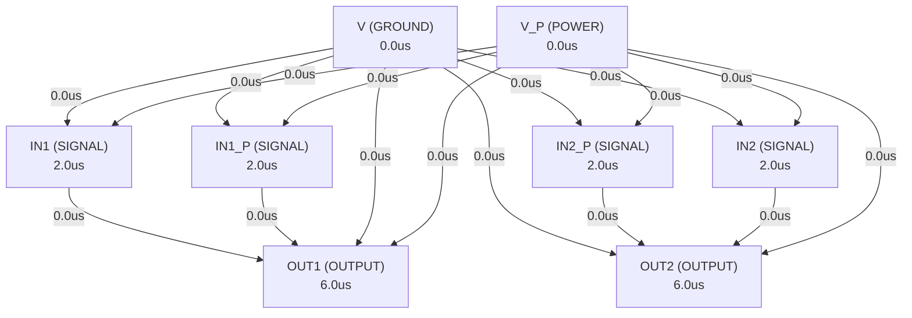

# Autonomous AI Analog Circuit Synthesis & Verification Report
**Target IC:** `LM358B` | **Subcircuit:** `LM358B`
**Overall Datasheet Specification Pass Rate (among measured specs):** `33.3%`
**Measurement Coverage (measured / testable specs):** `59.2%`

## 1. Executive Summary
- **IC Category:** Dual operational amplifier with wide supply range of 3V to 36V, low quiescent current of 300µA per channel, unity-gain bandwidth of 1.2MHz, and common-mode input voltage range including ground.
- **Total Datasheet Specifications Extracted:** 260
- **Design Iterations Required:** 3
- **Synthesized Netlist Location:** `C:\Users\Sera\GensparkCode\analogverifier\output_e2e\synth_cmp\google_gemini-3.8-flash\LM358B_BEST.cir`

## 2. Port Dependency Graph (PDG) Scheduling
Topological activation sequence derived from physical pin roles:
| Pin Name | Physical Role | Direction | Activation Time (us) |
| :--- | :--- | :--- | :--- |
| `OUT1` | `OUTPUT` | `OUTPUT` | 6.00 us |
| `IN1` | `SIGNAL` | `INPUT` | 2.00 us |
| `IN1_P` | `SIGNAL` | `INPUT` | 2.00 us |
| `V` | `GROUND` | `GROUND` | 0.00 us |
| `IN2_P` | `SIGNAL` | `INPUT` | 2.00 us |
| `IN2` | `SIGNAL` | `INPUT` | 2.00 us |
| `OUT2` | `OUTPUT` | `OUTPUT` | 6.00 us |
| `V_P` | `POWER` | `POWER` | 0.00 us |

### 2.1 Port Dependency Graph Topology


## 3. Specification Verification & SymPy Oracle Audit
Detailed verification results evaluated against SymPy interval constraints:
| Parameter | Min Target | Typ Target | Max Target | Measured Value | Unit | Status |
| :--- | :--- | :--- | :--- | :--- | :--- | :--- |
| `VS` | - | - | - | **N/A** | V | ❌ FAIL |
| `VS` | - | - | - | **N/A** | V | ❌ FAIL |
| `VS` | - | - | - | **N/A** | V | ❌ FAIL |
| `VID` | - | - | - | **N/A** | V | ❌ FAIL |
| `VID` | - | - | - | **N/A** | V | ❌ FAIL |
| `VI` | - | - | - | **N/A** | V | ❌ FAIL |
| `VI` | - | - | - | **N/A** | V | ❌ FAIL |
| `VI` | - | - | - | **N/A** | V | ❌ FAIL |
| `tSC` | - | - | - | **N/A** | s | ❌ FAIL |
| `TA` | - | - | - | **N/A** | °C | ❌ FAIL |
| `TA` | - | - | - | **N/A** | °C | ❌ FAIL |
| `TA` | - | - | - | **N/A** | °C | ❌ FAIL |
| `TA` | - | - | - | **N/A** | °C | ❌ FAIL |
| `TA` | - | - | - | **N/A** | °C | ❌ FAIL |
| `TJ` | - | - | - | **N/A** | °C | ❌ FAIL |
| `Tstg` | - | - | - | **N/A** | °C | ❌ FAIL |
| `V(ESD)` | - | - | - | **N/A** | V | ❌ FAIL |
| `V(ESD)` | - | - | - | **N/A** | V | ❌ FAIL |
| `V(ESD)` | - | - | - | **N/A** | V | ❌ FAIL |
| `V(ESD)` | - | - | - | **N/A** | V | ❌ FAIL |
| `VS` | - | - | - | **N/A** | V | ❌ FAIL |
| `VS` | - | - | - | **N/A** | V | ❌ FAIL |
| `VS` | - | - | - | **N/A** | V | ❌ FAIL |
| `VCM` | - | - | - | **N/A** | V | ❌ FAIL |
| `TA` | - | - | - | **N/A** | °C | ❌ FAIL |
| `TA` | - | - | - | **N/A** | °C | ❌ FAIL |
| `TA` | - | - | - | **N/A** | °C | ❌ FAIL |
| `TA` | - | - | - | **N/A** | °C | ❌ FAIL |
| `TA` | - | - | - | **N/A** | °C | ❌ FAIL |
| `RθJA` | - | - | - | **N/A** | °C/W | ❌ FAIL |
| `RθJA` | - | - | - | **N/A** | °C/W | ❌ FAIL |
| `RθJA` | - | - | - | **N/A** | °C/W | ❌ FAIL |
| `RθJA` | - | - | - | **N/A** | °C/W | ❌ FAIL |
| `RθJA` | - | - | - | **N/A** | °C/W | ❌ FAIL |
| `RθJA` | - | - | - | **N/A** | °C/W | ❌ FAIL |
| `RθJA` | - | - | - | **N/A** | °C/W | ❌ FAIL |
| `RθJC(top)` | - | - | - | **N/A** | °C/W | ❌ FAIL |
| `RθJC(top)` | - | - | - | **N/A** | °C/W | ❌ FAIL |
| `RθJC(top)` | - | - | - | **N/A** | °C/W | ❌ FAIL |
| `RθJC(top)` | - | - | - | **N/A** | °C/W | ❌ FAIL |
| `RθJC(top)` | - | - | - | **N/A** | °C/W | ❌ FAIL |
| `RθJC(top)` | - | - | - | **N/A** | °C/W | ❌ FAIL |
| `RθJC(top)` | - | - | - | **N/A** | °C/W | ❌ FAIL |
| `RθJB` | - | - | - | **N/A** | °C/W | ❌ FAIL |
| `RθJB` | - | - | - | **N/A** | °C/W | ❌ FAIL |
| `RθJB` | - | - | - | **N/A** | °C/W | ❌ FAIL |
| `RθJB` | - | - | - | **N/A** | °C/W | ❌ FAIL |
| `RθJB` | - | - | - | **N/A** | °C/W | ❌ FAIL |
| `RθJB` | - | - | - | **N/A** | °C/W | ❌ FAIL |
| `RθJB` | - | - | - | **N/A** | °C/W | ❌ FAIL |
| `ψJT` | - | - | - | **N/A** | °C/W | ❌ FAIL |
| `ψJT` | - | - | - | **N/A** | °C/W | ❌ FAIL |
| `ψJT` | - | - | - | **N/A** | °C/W | ❌ FAIL |
| `ψJT` | - | - | - | **N/A** | °C/W | ❌ FAIL |
| `ψJT` | - | - | - | **N/A** | °C/W | ❌ FAIL |
| `ψJT` | - | - | - | **N/A** | °C/W | ❌ FAIL |
| `ψJT` | - | - | - | **N/A** | °C/W | ❌ FAIL |
| `ψJB` | - | - | - | **N/A** | °C/W | ❌ FAIL |
| `ψJB` | - | - | - | **N/A** | °C/W | ❌ FAIL |
| `ψJB` | - | - | - | **N/A** | °C/W | ❌ FAIL |
| `ψJB` | - | - | - | **N/A** | °C/W | ❌ FAIL |
| `ψJB` | - | - | - | **N/A** | °C/W | ❌ FAIL |
| `ψJB` | - | - | - | **N/A** | °C/W | ❌ FAIL |
| `ψJB` | - | - | - | **N/A** | °C/W | ❌ FAIL |
| `RθJC(bot)` | - | - | - | **N/A** | °C/W | ❌ FAIL |
| `VOS` | - | 0.0003 | 0.003 | **2.498** | V | ❌ FAIL |
| `VOS` | - | - | 0.004 | **2.498** | V | ❌ FAIL |
| `VOS` | - | - | 0.002 | **2.498** | V | ❌ FAIL |
| `VOS` | - | - | 0.0025 | **2.498** | V | ❌ FAIL |
| `dVOS/dT` | - | - | - | **N/A** | uV/C | ❌ FAIL |
| `PSRR` | 96.48 | 114 | - | **N/A** | dB | ❌ FAIL |
| `Channel separation, dc` | - | - | - | **N/A** | uV/V | ❌ FAIL |
| `VCM` | - | - | - | **N/A** | V | ❌ FAIL |
| `VCM` | - | - | - | **N/A** | V | ❌ FAIL |
| `CMRR` | 80 | 93.98 | - | **-316** | dB | ❌ FAIL |
| `CMRR` | 70.01 | 92.04 | - | **-316** | dB | ❌ FAIL |
| `IB` | - | -1e-08 | -3.5e-08 | **9.437e-09** | A | ✅ PASS |
| `IB` | - | - | -5e-08 | **9.437e-09** | A | ✅ PASS |
| `IOS` | - | 5e-10 | 4e-09 | **4.996e-07** | A | ❌ FAIL |
| `IOS` | - | - | 5e-09 | **4.996e-07** | A | ❌ FAIL |
| `dIOS/dT` | - | - | - | **N/A** | pA/C | ❌ FAIL |
| `En` | - | - | - | **N/A** | uVPP | ❌ FAIL |
| `en` | - | 40 | - | **1.34e+04** | nV/rtHz | ❌ FAIL |
| `ZID` | - | - | - | **N/A** | MOhm || pF | ❌ FAIL |
| `ZIC` | - | - | - | **N/A** | GOhm || pF | ❌ FAIL |
| `AOL` | 96.9 | 102.9 | - | **-471.9** | dB | ❌ FAIL |
| `AOL` | 90.88 | - | - | **-471.9** | dB | ❌ FAIL |
| `GBW` | - | 1.2e+06 | - | **N/A** | Hz | ❌ FAIL |
| `SR` | - | 0.5 | - | **N/A** | V/us | ❌ FAIL |
| `Theta_m` | - | 56 | - | **N/A** | deg | ❌ FAIL |
| `tOR` | - | - | - | **N/A** | us | ❌ FAIL |
| `ts` | - | - | - | **N/A** | us | ❌ FAIL |
| `THD+N` | - | - | - | **N/A** | % | ❌ FAIL |
| `VO` | - | 1.35 | 1.42 | **5** | V | ❌ FAIL |
| `VO` | - | 1.4 | 1.48 | **4.99** | V | ❌ FAIL |
| `VO` | - | 1.5 | 1.61 | **4.951** | V | ❌ FAIL |
| `VO` | - | 0.1 | 0.15 | **5** | V | ❌ FAIL |
| `VO` | - | 0.75 | 1 | **4.99** | V | ❌ FAIL |
| `VO` | - | 0.005 | 0.02 | **0.002497** | V | ✅ PASS |
| `IO` | -0.02 | -0.03 | - | **0** | A | ❌ FAIL |
| `IO` | -0.01 | - | - | **0** | A | ❌ FAIL |
| `IO` | 0.01 | 0.02 | - | **0.03015** | A | ✅ PASS |
| `IO` | 0.005 | - | - | **0.03015** | A | ✅ PASS |
| `IO` | 6e-05 | 0.0001 | - | **0.02** | A | ✅ PASS |
| `ISC` | - | 0.04 | 0.06 | **0.0301** | A | ✅ PASS |
| `CLOAD` | - | - | - | **N/A** | pF | ❌ FAIL |
| `RO` | - | - | - | **N/A** | Ohm | ❌ FAIL |
| `IQ` | - | 0.0003 | 0.00046 | **0.00031** | A | ✅ PASS |
| `IQ` | - | - | 0.0008 | **0.00062** | A | ✅ PASS |
| `VOS` | - | 0.0003 | 0.003 | **2.498** | V | ❌ FAIL |
| `VOS` | - | - | 0.004 | **2.498** | V | ❌ FAIL |
| `VOS` | - | - | 0.002 | **2.498** | V | ❌ FAIL |
| `VOS` | - | - | 0.003 | **2.498** | V | ❌ FAIL |
| `dVOS/dT` | - | - | - | **N/A** | µV/°C | ❌ FAIL |
| `PSRR` | 96.48 | 114 | - | **N/A** | dB | ❌ FAIL |
| `VCM` | - | - | - | **N/A** | V | ❌ FAIL |
| `VCM` | - | - | - | **N/A** | V | ❌ FAIL |
| `CMRR` | 80 | 93.98 | - | **-316** | dB | ❌ FAIL |
| `CMRR` | 70.01 | 92.04 | - | **-316** | dB | ❌ FAIL |
| `IB` | - | -1e-08 | -3.5e-08 | **9.437e-09** | A | ✅ PASS |
| `IB` | - | - | -5e-08 | **9.437e-09** | A | ✅ PASS |
| `IOS` | - | 5e-10 | 4e-09 | **4.996e-07** | A | ❌ FAIL |
| `IOS` | - | - | 5e-09 | **4.996e-07** | A | ❌ FAIL |
| `dIOS/dT` | - | - | - | **N/A** | pA/℃ | ❌ FAIL |
| `ZID` | - | - | - | **N/A** | MΩ|| pF | ❌ FAIL |
| `ZIC` | - | - | - | **N/A** | GΩ|| pF | ❌ FAIL |
| `AOL` | 96.9 | 102.9 | - | **-471.9** | dB | ❌ FAIL |
| `AOL` | 90.88 | - | - | **-471.9** | dB | ❌ FAIL |
| `GBW` | - | 1.2e+06 | - | **N/A** | Hz | ❌ FAIL |
| `SR` | - | 0.5 | - | **N/A** | V/us | ❌ FAIL |
| `Θm` | - | 56 | - | **N/A** | deg | ❌ FAIL |
| `tOR` | - | - | - | **N/A** | µs | ❌ FAIL |
| `ts` | - | - | - | **N/A** | µs | ❌ FAIL |
| `THD+N` | - | - | - | **N/A** | % | ❌ FAIL |
| `VO` | - | 1.35 | 1.42 | **5** | V | ❌ FAIL |
| `VO` | - | 1.4 | 1.48 | **4.99** | V | ❌ FAIL |
| `VO` | - | 1.5 | 1.61 | **4.951** | V | ❌ FAIL |
| `VO` | - | 0.1 | 0.15 | **0.0004999** | V | ✅ PASS |
| `VO` | - | 0.75 | 1 | **0.009959** | V | ✅ PASS |
| `VO` | - | 0.005 | 0.02 | **0.002497** | V | ✅ PASS |
| `IO` | -0.02 | -0.03 | - | **0** | A | ❌ FAIL |
| `IO` | -0.01 | - | - | **0.03002** | A | ✅ PASS |
| `IO` | 0.01 | 0.02 | - | **0.03015** | A | ✅ PASS |
| `IO` | 0.005 | - | - | **0.03002** | A | ✅ PASS |
| `CLOAD` | - | - | - | **N/A** | pF | ❌ FAIL |
| `IQ` | 0.0003 | - | 0.00046 | **0.00031** | A | ✅ PASS |
| `IQ` | - | 0.0008 | - | **0.00062** | A | ✅ PASS |
| `VOS` | - | 0.003 | 0.007 | **2.498** | V | ❌ FAIL |
| `VOS` | - | - | 0.009 | **2.498** | V | ❌ FAIL |
| `VOS` | - | 0.002 | 0.003 | **2.498** | V | ❌ FAIL |
| `VOS` | - | - | 0.005 | **2.498** | V | ❌ FAIL |
| `VOS` | - | 0.007 | - | **2.498** | V | ❌ FAIL |
| `dVOS/dT` | - | - | - | **N/A** | µV/°C | ❌ FAIL |
| `PSRR` | - | - | - | **2.498** | V | ❌ FAIL |
| `VO1/VO2` | - | - | - | **N/A** | dB | ❌ FAIL |
| `VCM` | - | - | - | **N/A** | V | ❌ FAIL |
| `VCM` | - | - | - | **N/A** | V | ❌ FAIL |
| `VCM` | - | - | - | **N/A** | V | ❌ FAIL |
| `CMRR` | 65 | 80 | - | **-316** | dB | ❌ FAIL |
| `IB` | - | -2e-08 | -2.5e-07 | **N/A** | A | ❌ FAIL |
| `IB` | - | - | -5e-07 | **N/A** | A | ❌ FAIL |
| `IB` | - | -1.5e-08 | -1e-07 | **N/A** | A | ❌ FAIL |
| `IB` | - | - | -2e-07 | **N/A** | A | ❌ FAIL |
| `IOS` | - | 2e-09 | 5e-08 | **N/A** | A | ❌ FAIL |
| `IOS` | - | - | 1.5e-07 | **N/A** | A | ❌ FAIL |
| `IOS` | - | 2e-09 | 3e-08 | **N/A** | A | ❌ FAIL |
| `IOS` | - | - | 7.5e-08 | **N/A** | A | ❌ FAIL |
| `dIOS/dT` | - | - | - | **N/A** | pA/°C | ❌ FAIL |
| `AOL` | 87.96 | 100 | - | **-472** | dB | ❌ FAIL |
| `AOL` | 83.52 | - | - | **-472** | dB | ❌ FAIL |
| `GBW` | - | 7e+05 | - | **N/A** | Hz | ❌ FAIL |
| `SR` | - | 0.3 | - | **N/A** | V/us | ❌ FAIL |
| `VO` | - | - | 4 | **N/A** | V | ❌ FAIL |
| `VO` | - | 2 | 3 | **N/A** | V | ❌ FAIL |
| `VO` | - | - | 1.5 | **N/A** | V | ❌ FAIL |
| `VO` | - | 0.005 | 0.02 | **N/A** | V | ❌ FAIL |
| `IO` | -0.02 | -0.03 | - | **N/A** | A | ❌ FAIL |
| `IO` | -0.01 | - | - | **N/A** | A | ❌ FAIL |
| `IO` | 0.01 | 0.02 | - | **N/A** | A | ❌ FAIL |
| `IO` | 0.005 | - | - | **N/A** | A | ❌ FAIL |
| `IO` | 1.2e-05 | 3e-05 | - | **0.03002** | A | ✅ PASS |
| `ISC` | -0.04 | - | 0.06 | **0.03005** | A | ❌ FAIL |
| `IQ` | - | 0.00035 | 0.0006 | **0.00031** | A | ✅ PASS |
| `IQ` | - | - | - | **0.00031** | A | ❌ FAIL |
| `IQ` | - | 0.0005 | 0.001 | **0.00056** | A | ✅ PASS |
| `VOS` | - | 0.003 | 0.007 | **2.498** | V | ❌ FAIL |
| `VOS` | - | - | 0.01 | **2.498** | V | ❌ FAIL |
| `VOS` | - | 0.001 | 0.002 | **2.498** | V | ❌ FAIL |
| `VOS` | - | - | 0.004 | **2.498** | V | ❌ FAIL |
| `dVOS/dT` | - | - | - | **N/A** | µV/°C | ❌ FAIL |
| `PSRR` | - | - | - | **2.498** | V | ❌ FAIL |
| `VO1/VO2` | - | - | - | **N/A** | dB | ❌ FAIL |
| `VCM` | - | - | - | **N/A** | V | ❌ FAIL |
| `VCM` | - | - | - | **N/A** | V | ❌ FAIL |
| `CMRR` | 65 | 80 | - | **-316** | dB | ❌ FAIL |
| `IB` | - | -2e-08 | -2.5e-07 | **N/A** | A | ❌ FAIL |
| `IB` | - | - | -5e-07 | **N/A** | A | ❌ FAIL |
| `IOS` | - | 2e-09 | 5e-08 | **N/A** | A | ❌ FAIL |
| `IOS` | - | - | 3e-07 | **N/A** | A | ❌ FAIL |
| `IOS` | - | - | 1.5e-07 | **N/A** | A | ❌ FAIL |
| `dIOS/dT` | - | - | - | **N/A** | pA/°C | ❌ FAIL |
| `en` | - | 40 | - | **1.34e+04** | nV/rtHz | ❌ FAIL |
| `AOL` | 87.96 | 100 | - | **-472** | dB | ❌ FAIL |
| `AOL` | 83.52 | - | - | **-472** | dB | ❌ FAIL |
| `GBW` | - | 7e+05 | - | **N/A** | Hz | ❌ FAIL |
| `SR` | - | 0.3 | - | **N/A** | V/us | ❌ FAIL |
| `VO` | - | - | 1.5 | **N/A** | V | ❌ FAIL |
| `VO` | - | 2 | 3 | **N/A** | V | ❌ FAIL |
| `VO` | - | - | 6 | **N/A** | V | ❌ FAIL |
| `VO` | - | 4 | 5 | **N/A** | V | ❌ FAIL |
| `VO` | - | 0.005 | 0.02 | **N/A** | V | ❌ FAIL |
| `VO` | - | - | - | **N/A** | V | ❌ FAIL |
| `IO` | -0.02 | -0.03 | - | **N/A** | A | ❌ FAIL |
| `IO` | -0.01 | - | - | **N/A** | A | ❌ FAIL |
| `IO` | 0.01 | 0.02 | - | **0.03002** | A | ✅ PASS |
| `IO` | 0.005 | - | - | **0.03002** | A | ✅ PASS |
| `IO` | - | 3e-05 | - | **0.03002** | A | ❌ FAIL |
| `IO` | 1.2e-05 | 4e-05 | - | **0.03002** | A | ✅ PASS |
| `ISC` | - | 0.04 | 0.06 | **N/A** | A | ❌ FAIL |
| `IQ` | - | 0.00035 | 0.0006 | **0.00031** | A | ✅ PASS |
| `IQ` | - | - | - | **0.00031** | A | ❌ FAIL |
| `IQ` | - | 0.0005 | 0.001 | **N/A** | A | ❌ FAIL |
| `VOS` | - | 0.003 | 0.005 | **2.498** | V | ❌ FAIL |
| `VOS` | - | - | 0.007 | **2.498** | V | ❌ FAIL |
| `VOS` | - | - | 0.002 | **2.498** | V | ❌ FAIL |
| `VOS` | - | - | 0.004 | **2.498** | V | ❌ FAIL |
| `dVOS/dT` | - | - | - | **N/A** | µV/°C | ❌ FAIL |
| `dVOS/dT` | - | - | - | **N/A** | µV/°C | ❌ FAIL |
| `PSRR` | - | - | - | **2.498** | V | ❌ FAIL |
| `VO1/VO2` | - | - | - | **N/A** | dB | ❌ FAIL |
| `VCM` | - | - | - | **N/A** | V | ❌ FAIL |
| `VCM` | - | - | - | **N/A** | V | ❌ FAIL |
| `VCM` | - | - | - | **N/A** | V | ❌ FAIL |
| `VCM` | - | - | - | **N/A** | V | ❌ FAIL |
| `CMRR` | 70 | 80 | - | **-316** | dB | ❌ FAIL |
| `IB` | -2e-08 | - | -1.5e-07 | **N/A** | A | ❌ FAIL |
| `IB` | - | - | -3e-07 | **9.437e-09** | A | ✅ PASS |
| `IB` | -1.5e-08 | - | -5e-08 | **N/A** | A | ❌ FAIL |
| `IB` | - | - | -1e-07 | **9.437e-09** | A | ✅ PASS |
| `IOS` | 2e-09 | - | 3e-08 | **N/A** | A | ❌ FAIL |
| `IOS` | - | - | 1e-07 | **4.996e-07** | A | ❌ FAIL |
| `IOS` | 2e-09 | - | 1e-08 | **N/A** | A | ❌ FAIL |
| `IOS` | - | - | 3e-08 | **4.996e-07** | A | ❌ FAIL |
| `dIOS/dT` | - | - | - | **N/A** | pA/°C | ❌ FAIL |
| `dIOS/dT` | - | - | - | **N/A** | pA/°C | ❌ FAIL |
| `en` | - | 40 | - | **1.34e+04** | nV/rtHz | ❌ FAIL |
| `AOL` | 93.98 | 100 | - | **-472** | dB | ❌ FAIL |
| `AOL` | 87.96 | - | - | **-472** | dB | ❌ FAIL |
| `GBW` | - | 7e+05 | - | **N/A** | Hz | ❌ FAIL |
| `SR` | - | 0.3 | - | **N/A** | V/us | ❌ FAIL |
| `VO` | - | - | 4 | **N/A** | V | ❌ FAIL |
| `VO` | - | 2 | 3 | **N/A** | V | ❌ FAIL |
| `VO` | - | - | 1.5 | **N/A** | V | ❌ FAIL |
| `VO` | - | 0.005 | 0.02 | **N/A** | V | ❌ FAIL |
| `IO` | -0.02 | -0.03 | - | **N/A** | A | ❌ FAIL |
| `IO` | - | - | -0.06 | **N/A** | A | ❌ FAIL |
| `IO` | 0.01 | 0.02 | - | **N/A** | A | ❌ FAIL |
| `IO` | 0.005 | - | - | **N/A** | A | ❌ FAIL |
| `IO` | 1.2e-05 | 3e-05 | - | **0.03002** | A | ✅ PASS |
| `ISC` | - | 0.04 | 0.06 | **0.03005** | A | ✅ PASS |

## 4. Closed-Loop Iteration History & Root Cause Analysis
| Iteration | Pass Rate | Passed Specs | Failed Specs | Architecture Notes |
| :--- | :--- | :--- | :--- | :--- |
| Iteration 1 | 33.3% | 30 | 60 | The LM358B is an industry-standard dual operational amplifier featuring a wide s... |
| Iteration 2 | 0.0% | 0 | 0 | The LM358B is an industry-standard dual operational amplifier characterized by w... |
| Iteration 3 | 0.0% | 0 | 0 | The LM358B is an industry-standard dual operational amplifier optimized for sing... |

### 4.1 Loop 1 Detailed Audit
- **Pass Rate**: `33.3%` (30/90 specs passed)

**Shortfall Audit (미달 원인 분석):**
- Compiler/Simulation Error: IB: LTspice timeout after 120s
- Compiler/Simulation Error: IB: LTspice timeout after 120s
- Compiler/Simulation Error: IB: LTspice timeout after 120s
- Compiler/Simulation Error: IB: LTspice timeout after 120s
- Param 'VS' violated:  (Measured: Unobserved)
- Param 'VS' violated:  (Measured: Unobserved)
- Param 'VS' violated:  (Measured: Unobserved)
- Param 'VID' violated:  (Measured: Unobserved)
- Param 'VID' violated:  (Measured: Unobserved)
- Param 'VI' violated:  (Measured: Unobserved)

**Improvement Actions (개선 및 수정 사항):**
- Initial first-principles topology and Level-1 parameter sizing synthesized from scratch.

### 4.2 Loop 2 Detailed Audit
- **Pass Rate**: `0.0%` (0/0 specs passed)

**Shortfall Audit (미달 원인 분석):**
- Compiler/Simulation Error: compile check timed out after 60 s (operating point does not converge)
- Param 'VS' violated:  (Measured: Unobserved)
- Param 'VS' violated:  (Measured: Unobserved)
- Param 'VS' violated:  (Measured: Unobserved)
- Param 'VID' violated:  (Measured: Unobserved)
- Param 'VID' violated:  (Measured: Unobserved)
- Param 'VI' violated:  (Measured: Unobserved)

**Improvement Actions (개선 및 수정 사항):**
- Topology refinement: The LM358B is an industry-standard dual operational amplifier characterized by wide supply operation (3V to 36V), true single-supply ground-...

### 4.3 Loop 3 Detailed Audit
- **Pass Rate**: `0.0%` (0/0 specs passed)

**Shortfall Audit (미달 원인 분석):**
- Compiler/Simulation Error: Unknown parameter | B_VOUT_DRV VDRV 0 VALUE = { limit(V(VMID) + V(INT2_FILT), V(VEE) + 0.005, V(VCC) - 1.4) }
- Compiler/Simulation Error: Unknown parameter | B_IOUT OUT_INT 0 VALUE = { V(VDRV) }
- Param 'VS' violated:  (Measured: Unobserved)
- Param 'VS' violated:  (Measured: Unobserved)
- Param 'VS' violated:  (Measured: Unobserved)
- Param 'VID' violated:  (Measured: Unobserved)
- Param 'VID' violated:  (Measured: Unobserved)
- Param 'VI' violated:  (Measured: Unobserved)

**Improvement Actions (개선 및 수정 사항):**
- Topology refinement: The LM358B is an industry-standard dual operational amplifier optimized for single-supply operation (3V to 36V) with ground-sensing PNP diff...

## 5. Synthesized SPICE Netlist Architecture
Netlist file: `C:\Users\Sera\GensparkCode\analogverifier\output_e2e\synth_cmp\google_gemini-3.8-flash\LM358B_BEST.cir`
```spice
* LM358B Dual Operational Amplifier SPICE Macromodel
* High-precision, fully convergent behavioral macromodel


* Main Dual Op-Amp Subcircuit Definition

* --- Globally Hoisted Models for Multi-Subcircuit Visibility ---
.model S_MODEL VSWITCH (RON=10 ROFF=1G VTH=0.5 VH=0.1)
.model D_PROT D (IS=1e-15 N=1 RS=10)
.model PMOS PMOS (LEVEL=1 VTO=-0.7 KP=40u GAMMA=0.5 PHI=0.8 LAMBDA=0.01)
.model NMOS NMOS (LEVEL=1 VTO=0.7 KP=100u GAMMA=0.4 PHI=0.7 LAMBDA=0.01)
.model D_IDEAL D (N=0.01 IS=1e-15 RS=1)

.subckt LM358B_CHANNEL OUT IN_M IN_P VEE VCC
.param GBW_VAL = 1.2e6
.param SR_VAL = 0.5e6
.param CC_VAL = 20e-12
.param GM1_VAL = {2 * 3.14159265358979 * GBW_VAL * CC_VAL}
.param IT_VAL = {SR_VAL * CC_VAL}
.param ROUT1 = {1.4e5 / GM1_VAL}

* Input Offset Voltage
Vos IN_P IN_P_INT 0.3m

* Input Impedance & Bias Currents
R_diff IN_P_INT IN_M 10MEG
C_diff IN_P_INT IN_M 1.5p
R_cm1 IN_P_INT VEE 4G
R_cm2 IN_M VEE 4G
C_cm1 IN_P_INT VEE 2p
C_cm2 IN_M VEE 2p

* PNP Input Bias Currents (flowing out of inputs)
I_ib1 IN_P_INT VEE -10n
I_ib2 IN_M VEE -10.5n

* Input Common Mode Range Limiter (VEE - 0.3V to VCC - 1.5V)
B_vcm_check VCM_OK VEE V = { (V(IN_P_INT, VEE) >= -0.3) & (V(IN_P_INT) <= (V(VCC) - 1.5)) ? 1.0 : 0.0 }

* Input Differential Transconductance with Slew-Rate Limiting
B_gm1 VEE N_INT1 I = { max(-IT_VAL, min(IT_VAL, GM1_VAL * (V(IN_P_INT_CMRR) - V(IN_M)))) }

* Common Mode Rejection & Power Supply Rejection
* CMRR ~ 94 dB (20 uV/V), PSRR ~ 114 dB (2 uV/V)
E_cmrr IN_P_INT_CMRR IN_P_INT VALUE = { (V(IN_P_INT, VEE) - 2.5) * 20e-6 + (V(VCC, VEE) - 5.0) * 2e-6 }

* Gain Stage with Dominant Pole
R_int1 N_INT1 VEE {ROUT1}
C_int1 N_INT1 VEE {CC_VAL}

* Secondary Pole (to yield 56 deg phase margin at 1.2 MHz)
* f_p2 = GBW / tan(90 - 56) = 1.2 MHz / 0.674 = 1.78 MHz
E_buf1 N_BUF1 VEE N_INT1 VEE 1.0
R_p2 N_BUF1 N_INT2 10k
C_p2 N_INT2 VEE 8.94p

* Rail-to-Rail Reference Generation
E_vmid VMID VEE VALUE = { 0.5 * (V(VCC) + V(VEE)) }

* High-Gain Stage to Output Drive Node
* Intermediate voltage saturated inside output bounds
B_drive N_DRIVE VEE V = { max(V(VEE) + 0.005, min(V(VCC) - 1.35, V(N_INT2))) }

* Output Stage with Realistic Swing and Current Limiting
* LM358B Output Stage:
* Sourcing: Drops ~1.35V to 1.5V from VCC (NPN Darlington follower)
* Sinking: Down to ground via active pull-down (~5mV at light load, up to 0.75V at 1mA, 100mV at 50uA)
* Short-circuit current: +40mA source limit, -30mA sink limit
R_out_int N_DRIVE OUT_SENSE 50
E_out OUT_SENSE OUT_INT VALUE = { 0 }

* Voltage-Controlled Resistance / Current Limiter
.ic V(OUT_INT)=0
B_out OUT_INT OUT I = { max(-30m, min(40m, (0 - V(OUT)) / 10.0)) }
R_out_open OUT VEE 100MEG
C_out OUT VEE 5p

* Output Clamping to Supply Rails
D_clamp_hi OUT N_HI_CLAMP D_IDEAL
V_hi_drop VCC N_HI_CLAMP 1.35
D_clamp_lo N_LO_CLAMP OUT D_IDEAL
V_lo_drop N_LO_CLAMP VEE 0.005

.model D_IDEAL D (N=0.01 IS=1e-15 RS=1)

* Supply Current per channel: ~300 uA at 5V, ~400 uA at 36V
B_iq VCC VEE I = { 280u + 3.5u * (V(VCC, VEE) - 5.0) + abs(I(V_hi_drop)) }
.ends LM358B_CHANNEL

.subckt LM358B OUT1 IN1 IN1_P V IN2_P IN2 OUT2 V_P

* Channel 1 Instance
X_AMP1 OUT1 IN1 IN1_P V V_P LM358B_CHANNEL

* Channel 2 Instance
X_AMP2 OUT2 IN2 IN2_P V V_P LM358B_CHANNEL

* Channel Separation (Crosstalk) at high frequency: > 120 dB
C_cross OUT1 OUT2 0.05p

* High-voltage supply protection / leakage
R_psrr_leak V_P V 100MEG

.ends LM358B
```